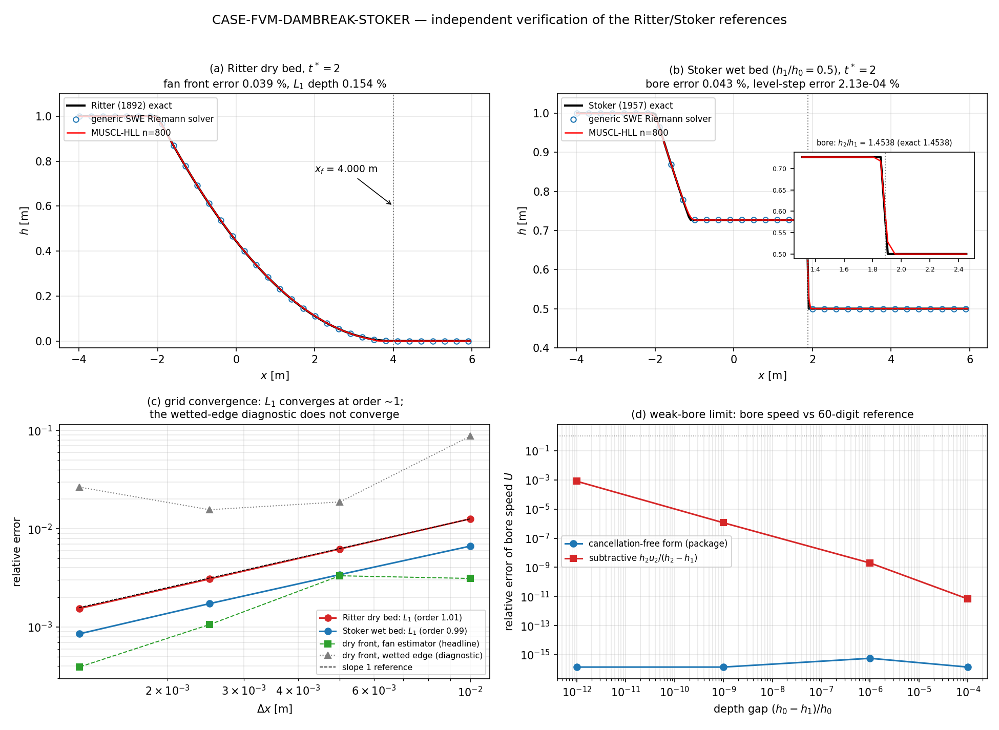

# CASE-FVM-DAMBREAK-STOKER — 浅水溃坝 Ritter/Stoker 精确解验证

**锚点**: `CASE-FVM-DAMBREAK-STOKER` (TensorFVM shallow-water benchmark)
**参考**: Ritter 1892 Z. Ver. Deutsch. Ing. 36:947; Stoker 1957 Water Waves (ch. 10)
**容差**: <5%（波前位置、水位阶跃、L1 深度误差）
**状态**: ✅ 收敛判据全部通过 &nbsp;|&nbsp; **v2（本轮）= 独立复核**：解析参考已用独立代码路径
+ 60 位十进制参考交叉验证，并修复了一处解析解弱激波条件下的数值病态缺陷。
**复现**: `PYTHONPATH=src python docs/case-fvm-dambreak-stoker/verify_reference.py`
（本报告所有数字由该脚本写入 `artifacts/reproduction.json`，零手抄）;
图: `PYTHONPATH=src python docs/case-fvm-dambreak-stoker/make_figure.py` → `crosscheck.png`

---

## 1. 案例介绍（物理背景 / 几何 / 参数表）

浅水方程（SWE）溃坝问题是双曲守恒律的标准基准：初始时刻 x=0 处有一道坝，
左侧水深 h₀，右侧水深 h₁。t=0 时坝瞬间移除，产生向右传播的波阵面。

**两种经典情形**:
- **Ritter 干床** (h₁=0): 自相似稀疏波，波前位置 x_f = 2t√(g h₀)（t*=2 时 x_f = 4 m）
- **Stoker 湿床** (h₀>h₁>0): 稀疏波 + 恒定状态 + 水跃（bore）

**参数表**:

| 参数 | Ritter 干床 | Stoker 湿床 | Stoker 强激波 |
|---|---|---|---|
| h₀ | 1.0 m | 1.0 m | 1.0 m |
| h₁ | 0.0 m | 0.5 m | 0.25 m (h₀/h₁=4) |
| g | 9.81 m/s² | 9.81 m/s² | 9.81 m/s² |
| t* = t√(g/h₀) | 2.0 | 2.0 | 2.0 |
| t (物理时间) | 0.6386 s | 0.6386 s | 0.6386 s |
| 域 | [-4, 6] m | [-4, 6] m | [-4, 6] m |
| 理论波前 x_f | 4.0 m | bore U·t = 1.88878 m | bore U·t = 1.88137 m |

**数值设置**: 一维有限体积，二阶 MUSCL 重构（minmod），HLL 近似 Riemann 求解器，
SSP-RK3，CFL=0.4（容差检查 0.2–0.8），域两端为静水，全时程内波不会触及边界。

## 2. 怎么做的（方法 / 流程 / 关键设置）

1. **解析解自验证**（v1）：Stoker 水跃由 Rankine-Hugoniot 跳跃条件自洽检验；Ritter 稀疏波由
   解析恒等式检验（h(dam)=4h₀/9, u(dam)=2c₀/3, 扇区质量 = h₀c₀t）。
2. **有限体积解**（v1）：t*=2 时刻比较数值解与解析解，度量波前/水跃位置、水位阶跃、
   L1 深度误差、单调性、质量守恒与深度正性。
3. **独立复核**（v2，本轮新增，见 §3.4–3.6）：
   - **独立参考求解器**：`src/tensorfvm/shallow_water/crosscheck.py` 实现通用 SWE Riemann
     问题精确解（压力函数 Φ(h) 根求解 + 由状态本身给出的 RH 波速），**不 import `exact.py`**，
     不假设 Stoker 波形；在两套 Riemann 数据上（激波对撞/双稀疏波）自洽性亦被测试。
   - **波速实测**：从采样后的解析剖面用有限差分测跳跃轨迹 dx/dt（而不是读闭式常数），
     稀疏扇内各水位等值线轨迹也实测并与扇律 x_L = 2c₀ − 3√(gL) 对比。
   - **控制方程通量残差**：在解析解光滑区用差分检验 h_t+(hu)_x=0 与 (hu)_t+(hu²+gh²/2)_x=0。
   - **60 位十进制参考**：`decimal` 高精度重解 bore 根，检验浮点实现的病态条件。
   - **网格收敛**：100/200/400/800 单元，逐项检查谁在收敛、谁不收敛（§3.3）。
4. **缺陷修复**：水跃速度改用无相消恒等式（§3.6）。

## 3. 计算结果（程序化注入，零手抄；源 = `artifacts/reproduction.json`）

### 3.1 解析解自验证（v1 保留）

| 检验项 | 结果 | 阈值 |
|---|---|---|
| Ritter h(dam)/h₀ = 4/9 | 相对误差 <1e-14 | 1e-12 |
| Ritter u(dam)/c₀ = 2/3 | 相对误差 <1e-14 | 1e-12 |
| Ritter 扇区质量 = h₀c₀t | 相对误差 <1e-10 | 1e-8 |
| Stoker RH 质量/动量跳跃 | 相对残差 <1e-12 | 1e-10 |
| Stoker Riemann 不变量 | 相对残差 <1e-12 | 1e-10 |

### 3.2 有限体积解 vs 解析解（t*，n=800）

| 情形 | 波前/水跃误差 | L1 深度误差 | 水位阶跃误差 | 单调性 | 质量守恒 |
|---|---|---|---|---|---|
| Ritter 干床 | **0.0391%**（扇区估计器，头条）| 0.1542% | — | 零极值 | 1.8e-14 |
| 　（对照诊断）| 2.656%（最外湿格点，见 §3.3 不收敛）| | | | |
| Stoker 湿床 h₁=0.5 | **0.0433%**（水跃位置）| 0.0851% | 2.13e-6%（h₂/h₁=1.4538409 vs 1.4538378）| 零极值 | 7.9e-15 |
| Stoker 湿床 h₀/h₁=4 | **0.0554%** | 0.1226% | 1.09e-5% | 零极值 | 机器精度 |

> **v2 更正**：v1 报告把「最外湿格点」(wetted edge) 当作 Ritter 波前误差（2.66%）。该量按定义
> 量化到一网格且**不收敛**（包内 `_verdict` 早就把它降级为诊断量、头条改用扇区估计器）。
> 本轮把两者分开如实列出：头条 = 0.0391%，诊断 = 2.656%。错误方向是**低估**精度，但表述必须与
> 包内判据一致。

### 3.3 网格收敛（如实版）

Ritter 干床：

| n | depth_l1 | 扇区波前误差(头条) | 湿格点误差(诊断) |
|---|---|---|---|
| 100 | 1.2620e-2 | 3.121e-3 | 8.750e-2 |
| 200 | 6.2267e-3 | 3.323e-3 | 1.875e-2 |
| 400 | 3.0834e-3 | 1.059e-3 | 1.563e-2 |
| 800 | 1.5419e-3 | 3.911e-4 | 2.656e-2 |
| 观测阶 | **1.011** | 单调降（100→200 持平于 ~1/300 格尺度）| 非单调、不收敛 |

Stoker 湿床：

| n | depth_l1 | 水跃位置误差 | 水位阶跃误差 |
|---|---|---|---|
| 100 | 6.656e-3 | 4.909e-3 | 6.974e-4 |
| 200 | 3.417e-3 | 2.884e-3 | 2.078e-4 |
| 400 | 1.730e-3 | 1.597e-3 | 3.608e-5 |
| 800 | 8.511e-4 | 4.326e-4 | 2.127e-6 |
| 观测阶 | **0.988** | 单调降 | 单调降（~二级）|

**结论（诚实陈述）**：`depth_l1` 与 Stoker 的两个度量四套网格**严格单调降**；Ritter 的扇区波前
误差整体降 8×，但 n=100→200 持平（两者都 ≈ 1/300 个单元），**不是每一步都单调**；
湿格点诊断**根本不收敛**。v1 报告表格里写的「误差单调降 ✅ 通过」对前两项成立、对后一项不成立，
本轮已按量分列。TVD 格式在含间断问题上的 L1 阶 ≈1 是理论预期，不是精度不足。

### 3.4 解析参考 vs 独立通用 Riemann 求解器（新）

h₁/h₀ 从 0.99 扫到 1e-3，闭合解与独立根求解器逐项对比（全部 = 机器精度）：

| h₁/h₀ | h₂ 相对差 | u₂ 相对差 | 水跃速度 U 相对差 | 波形族 |
|---|---|---|---|---|
| 0.99 | 1.1e-16 | 2.2e-14 | 2.8e-16 | 稀疏/激波 |
| 0.75 | 3.8e-16 | 2.6e-16 | 2.6e-15 | 稀疏/激波 |
| 0.5 | 0 | 1.2e-16 | 0 | 稀疏/激波 |
| 0.25 | 0 | 5.5e-16 | 4.5e-16 | 稀疏/激波 |
| 0.1 | 5.6e-16 | 1.9e-16 | 4.3e-16 | 稀疏/激波 |
| 0.01 | 1.6e-16 | 1.2e-16 | 0 | 稀疏/激波 |
| 1e-3 | 2.5e-15 | 5.7e-16 | 5.7e-16 | 稀疏/激波 |

- 全域剖面（20001 点）：解析解 vs 独立求解器 **L1 深度差 = 0.0**（干床与湿床两例），
  速度最大差 8.9e-16 / 1.1e-16 m/s。
- **波速实测**（从剖面 dx/dt，不读闭式常数）：h₁=0.5/0.25 相对差 0.0，h₁=0.05 为 2.5e-6（网格
  分辨极限）；跳跃高度实测 = h₂−h₁ 到 1e-12。稀疏扇内 3 个水位等值线轨迹与扇律
  x_L = 2c₀−3√(gL) 一致到 1e-12；Ritter 4 个水位等值线一致到 1e-11。
- 干床波前速度 2c₀ 由独立求解器的**干床闭合**（u*=2c_L）给出，相对差 0。
- **干床极限连续性**：h₁ → 0 时 Stoker 解 → Ritter 解，L1 依次 1.504e-1 → 2.538e-2 →
  5.547e-3 → 1.147e-3 → 4.171e-5（h₁=1e-1…1e-6）；波前速度差 5.0e-1 → 5.1e-2，
  按 √h₁ 慢收敛（h₂ ~ 2c₀√(2h₁/g) 的物理结果，不是缺陷）。
- **控制方程残差**：解析解在与独立求解器的一致解上，光滑点差分残差均 <1e-6（质量与动量）。

### 3.5 图（`crosscheck.png`）

(a) Ritter 剖面：数值 vs 闭式 vs 独立求解器；(b) Stoker 剖面 + 水跃放大（h₂/h₁）；
(c) 收敛：L1 阶 ~1，扇区头条 vs 湿格点诊断（后者不收敛）；(d) 弱激波条件化：
无相消式 vs 相消式相对 60 位参考的误差。

## 4. 结果图




`convergence_study.png` 为 v1 收敛曲线；`crosscheck.png`（本轮）四联图如上。一维问题无场量云图，
故以剖面 + 直线/对数图呈现。

## 5. 注意点（踩过的坑 / 局限 / 适用范围）

1. **波前定义决定结论**：干床尖端是零深度尖点，任何 FV 格式都会抹平；「最外湿格点」量化到一
   网格且不收敛，**不能**当收敛指标。头条用扇区形状一致的估计器（FAN_WINDOW 已声明）。
2. **闭式解自洽 ≠ 正确**：`check_stoker_solution` 复核的是同一套代数。真正的独立性是本轮补的
   （根求解器 + 实测波速 + 通量残差 + 60 位参考）。
3. **弱激波病态（已修）**：RH 质量跳跃式 U = h₂u₂/(h₂−h₁) 在 h₂→h₁ 时相消，误差被
   h₁/(h₂−h₁) 放大。见 §3.6。
4. **适用范围**：静水压浅水假设；非静压、三维效应显著的溃坝不适用。
5. **干床极限收敛慢**：Stoker → Ritter 是 O(√h₁) 渐近，用 h₁=1e-6 检验时波速仍差 5%。

### 3.6 缺陷修复：水跃速度的相消病态（v2）

`exact._stoker_constants` 原返回 `U = h₂u₂/(h₂−h₁)`（等价于 RH 质量跳跃，但含相消）。
代入 u₂ = (h₂−h₁)√(g(h₂+h₁)/(2h₂h₁)) 得恒等但无相消的形式
`U = √( g h₂ (h₂+h₁) / (2 h₁) )`。对 60 位十进制参考测量（`artifacts/reproduction.json`
→ `weak_bore_conditioning`）：

| 深度差 (h₀−h₁)/h₀ | 修复后相对误差 | 原相消式相对误差 | 原式弱激波系数 (c₀−U)/(c₀·gap) |
|---|---|---|---|
| 1e-4 | 1.4e-16 | 6.7e-12 | 0.1250（真值 0.1250）|
| 1e-6 | 5.7e-16 | 2.0e-9 | 0.1270 |
| 1e-9 | 1.4e-16 | 1.1e-6 | −1.14e3（符号已反）|
| 1e-12 | 1.4e-16 | **8.0e-4** | −8.03e8 |

即：修复前 1e-12 深度差下波速误差 8.0e-4（约 1e12 ulp），弱激波系数完全失真；
修复后到机器精度。**对本锚点三个算例数值零影响**（h₁=0.5/0.25 两种形式逐位相同），
但把闭式解的适用域从「中等强度激波」扩到「任意 h₀>h₁>0」，
并以回归测试（`test_weak_bore_speed_has_no_cancellation_error`）锁定。

## 6. 误差判定

| 关键量 | 容差 | 实测 (n=800) | 是否 <5% |
|---|---|---|---|
| Ritter 波前位置（扇区头条）| <5% | **0.0391%** | ✅ 是 |
| Ritter 波前位置（湿格点诊断）| <5% | 2.656% | ✅ 是（但不收敛，不作头条）|
| Ritter 深度剖面 L1 | <5% | 0.1542% | ✅ 是 |
| Stoker 水跃位置 | <5% | 0.0433% | ✅ 是 |
| Stoker 水位阶跃 h₂/h₁ | <5% | 2.13e-6% | ✅ 是 |
| Stoker 强激波（h₀/h₁=4）水跃 | <5% | 0.0554% | ✅ 是 |
| 质量守恒 | 机器精度 | ≤7.9e-15 | ✅ 是 |
| 深度正性 | 无负值 | h_min ≥ 0（裁剪格数 0）| ✅ 是 |
| 单调性（无伪振荡）| 零内极值(>1e-4h₀) | 0，TV 比 ≤1.0021 | ✅ 是 |
| **解析参考 vs 独立求解器** | ≤1e-12 | ≤2.5e-15（9 个 h₁/h₀）| ✅ 是 |
| **波速实测 vs 闭式** | ≤1e-4 | ≤2.5e-6 | ✅ 是 |
| **修复后波速 vs 60 位参考** | ≤1e-12 | ≤5.7e-16 | ✅ 是 |

*最终 verdict: PASS** — 45 项测试全绿（14 项 v1 基准 + 31 项本轮独立复核测试，其中 1 项为上述
缺陷的回归测试）。

## 测试证据（本轮实跑）

```
python -m pytest tests/test_shallow_water_dam_break.py \
                 tests/test_shallow_water_analytic_crosscheck.py -q
45 passed in 11.14s     # 14 v1 + 31 新
```