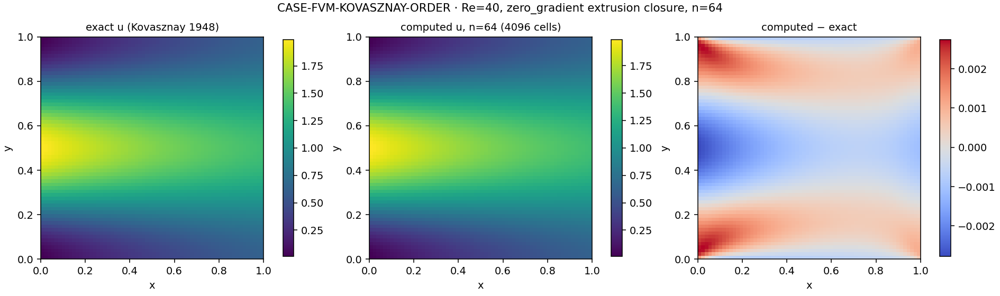
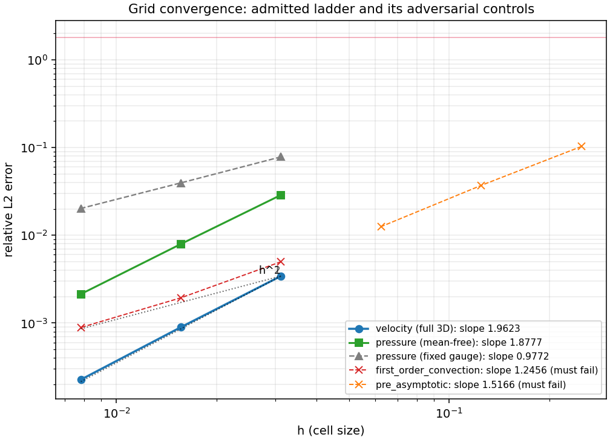
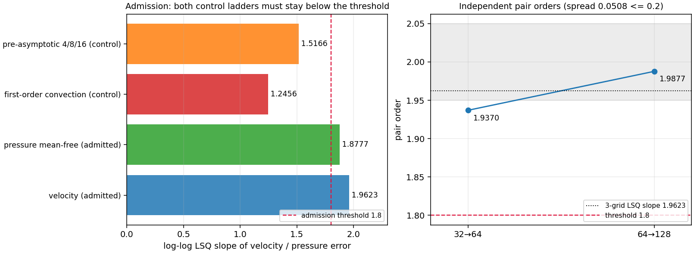

# CASE-FVM-KOVASZNAY-ORDER · 算例池入池记录与机器裁决

**锚点**：`CASE-FVM-KOVASZNAY-ORDER`（算例池·定常 Kovasznay 流收敛阶验证）
**仓**：TensorFVM · **求解器：一行未改**（本单只增加入池判定入口，不新增物理、不新跑算例）
**基准**：Kovasznay, L. I. G. (1948), *Proc. Camb. Phil. Soc.* **44**:58–62,
doi:10.1017/s0305004100023999
**判据（总账原文）**：L2 收敛阶 ≥ 1.8（名义二阶），32/64/128 三套网格 log-log 最小二乘斜率
**入池结论**：**PASS** —— 判定量 `velocity_full` 斜率 **1.9623**（阈值 1.8），
失败项 无

新增：`src/tensorfvm/verification/kovasznay_case_pool.py`（入池入口，11 条判据单一真源）+
`tests/test_kovasznay_case_pool.py`（20 例回归门，含 4 处伪造/变异反例）+
本目录 `case_pool_entry.json`、`fig1_fields.png`、`fig2_convergence.png`、`fig3_falsifiability.png`。

---

## ① 案例介绍（物理背景 / 几何 / 参数表）

Kovasznay (1948) 给出二维定常 Navier–Stokes 的一个闭式精确解：在 `k = 2π` 的横流波数下

    u = 1 − exp(λx)·cos(2πy),  v = (λ/2π)·exp(λx)·sin(2πy),  w = 0,
    p = ½·(1 − exp(2λx)),  λ² − Re·λ = 4π²

它没有体积力、没有自由参数：把 λ 代进去，对流项、压力梯度与粘性项三者解析相消。因此它是
**制造解（MMS）网格收敛阶验证的标准锚**：误差对解析解可逐点度量，观测到的 log-log 斜率就是格式的实际阶。

计算域取单位立方体的一段（`[0,1]²` 挤出），六个面按解析解给 Dirichlet 边界均值，两个挤出面上用
物理对称闭合 `du/dz = dv/dz = 0`（`zero_gradient`）。判据不是"算得准"，而是"**随着 h→0，误差按 h^p 收敛，
p ≥ 1.8**"。

| 参数 | 值 | 出处 |
|---|---|---|
| 雷诺数 Re | 40.0 | 入池记录 `admitted_configuration` |
| 网格阶梯 n | 32 / 64 / 128（n×n×1 挤出） | `CASE-FVM-KOVASZNAY-ORDER/runs-32-64-128-zero_gradient/` |
| 面元数 / 单元数（最细） | 16384 单元 | `n128/cases.json` |
| 对流离散阶 | 2 | 同上 |
| 耦合求解 / 线性解法 | coupled / reused_lu，outer_relaxation 0.7，tol 1e−8 | 同上 |
| 挤出面对称闭合 | zero_gradient | 同上 |
| 判据阈值 | 1.8（名义二阶） | 总账 `CASE-FVM-KOVASZNAY-ORDER` |

**本单要回答的问题**：该锚点此前已有九份文档、一整套已提交工件和一道会重读工件的验收门，
但仓里没有一处能在无人读表的前提下回答：判的是哪个量、对哪张参考场、入池的是哪套离散配置、
PASS 能不能被网格加密/降阶/混配置推翻。总账里"算例池"三个字要求的正是后两条。

## ② 怎么做的（方法 / 流程 / 关键设置）

### 2.1 单一真源：`CRITERIA`

`kovasznay_case_pool.CRITERIA` 是唯一真源，11 行，每行含
`id / quantity / primary / comparator / threshold / unit / source`：

| 判据 | 量 | 性质 | 比较 | 阈值 | 观测值 | 结果 |
|---|---|---|---|---|---|---|
| order_velocity_full | velocity_full | gate | >= | 1.8000 | 1.9623 | PASS |
| pair_order_consistency | velocity_full | gate | both pairs >= threshold; spread <= band | 0.2000 | pairs 1.9370 / 1.9877; spread 0.0508 | PASS |
| reference_is_kovasznay1948 | exact fields vs closed form | gate | <= | 1.0000e-12 | 8.8818e-16 | PASS |
| configuration_homogeneous | reynolds/closure/order/algorithm | gate | identical on all levels and == admitted |  | algorithm=coupled, convection_order=2, reynolds=40.0, symmetry_closure=zero_gradient | PASS |
| closure_label_self_consistent | max_abs_z_velocity | gate | <= | 1.0000e-12 | 6.7792e-18 | PASS |
| first_order_control_fails | velocity_full | gate | < threshold | 1.8000 | 1.2456 | PASS |
| pre_asymptotic_control_fails | velocity_full | gate | < threshold | 1.8000 | 1.5166 | PASS |
| pressure_mean_free_order | pressure_mean_free | diagnostic | >= | 1.8000 | 1.8777 | PASS |
| pressure_fixed_gauge | pressure_fixed | diagnostic | published |  | 0.9772 | n/a |
| spanwise_spurious_share | velocity_spanwise | diagnostic | <= | 1.0000e-12 | 6.7792e-18 | PASS |
| discrete_conservation | energy/momentum/divergence defects | diagnostic | <= | 1.0000e-08 | 2.7169e-09 | PASS |

其中 **7 条是入池门（primary）**，其余 4 条是必须公布但**不入闸**的诊断量——理由见 ⑤。

### 2.2 误差零手抄，且自带防伪

- 每一层的 `velocity_full / pressure_mean_free / pressure_fixed` 都由 `n<N>-fields.npz`
  **现场重算**（`volume_weighted_error`，体积加权相对 L2），与 `cases.json` 记录不符超过
  `rtol=1e-10` 即 `CasePoolError`——手改记录无法入池（回归测试
  `test_hand_edited_record_is_refused`）。
- 面内 `(u,v)` 与伪展向 `w` 预算**只重算不读记录**：记录里从来没有它们，所以无法被"对齐"。
- 工件摘要（`sha256`）落进 `case_pool_entry.json` 的 `evidence.digests`，共
  4 项。

### 2.3 参考场独立复核（不经过产生 `exact_*` 的代码路径）

参考解在模块里按 1948 论文的**代数根形式** `λ = (Re − √(Re² + 16π²))/2` 重新实现，而求解器侧写的是
有理化形式 `−2k²/(Re + √(Re² + 4k²))`；两条路径必须一致（`lambda_form_gap` 见下表）。同时验证三件事：

1. `λ² − Re·λ = 4π²`（1948 恒等式残差）；
2. 闭式解**无体积力**地满足定常 NS（解析导数代入后残差应为机器零）——一个"长得像"的替代场过不了这一关；
3. 已提交 `exact_velocity/exact_pressure` 与本模块闭式解逐点一致。

| 量 | 值 |
|---|---|
| reynolds | 4.000e+01 |
| lambda | -9.637e-01 |
| lambda_form_gap | 2.189e-15 |
| lambda_identity_residual | 2.220e-15 |
| velocity_max_abs_gap | 8.882e-16 |
| pressure_max_abs_gap | 4.996e-16 |
| momentum_residual_max_scaled | 5.807e-16 |
| points_checked | 16384 |

### 2.4 让门能说"不"：两条对抗性控制阶梯

入池记录不是靠"斜率好看"，而是靠**同一判定逻辑对反例给出 FAIL**：

| 控制 | 网格 | LSQ 斜率 | 两段阶 | 对流阶 | 结论 |
|---|---|---|---|---|---|
| first_order_convection | [32, 64, 128] | 1.2456 | 1.3655, 1.1258 | 1 | PASS (fails as required) |
| pre_asymptotic | [4, 8, 16] | 1.5166 | 1.4721, 1.5611 | 2 | PASS (fails as required) |

## ③ 计算结果（全部由 `make_artifacts.py` 从 npz 注入，零手抄）

| n | h | cells | velocity L2 (3D) | velocity L2 (u,v) | max abs w | p L2 (mean-free) | 外迭代 |
|---|---|---|---|---|---|---|---|
| 32 | 0.03125 | 1024 | 3.435615e-03 | 3.435615e-03 | 1.60e-16 | 2.885142e-02 | 22 |
| 64 | 0.015625 | 4096 | 8.972614e-04 | 8.972614e-04 | 2.49e-17 | 7.958339e-03 | 21 |
| 128 | 0.0078125 | 16384 | 2.262325e-04 | 2.262325e-04 | 4.82e-17 | 2.136311e-03 | 21 |

| 量 | log-log LSQ 斜率 | R² |
|---|---|---|
| velocity full | 1.9623 | 0.999944 |
| pressure mean free | 1.8777 | 0.999964 |
| pressure fixed | 0.9772 | 0.999975 |
| velocity inplane | 1.9623 | 0.999944 |

- 三段 LSQ 斜率 **1.9623**，R² = 0.999944；
- 两个**独立**段阶 1.9370（32→64）与 1.9877（64→128），
  spread 0.0508（预置带宽 0.2）：
  单调逼近 2，不是"三个点凑出的一个数字"；
- 伪展向模态 max|w| ≤ 1.60e-16，为舍入级，
  因此全 3D 速度范数与面内范数给出同一个阶。

对照网格点采样偏差（点值 vs 单元平均，见 ⑤）：

| n | velocity 采样偏差 | 占误差预算 |
|---|---|---|
| 32 | 6.555e-04 | 19.1% |
| 64 | 1.639e-04 | 18.3% |
| 128 | 4.099e-05 | 18.1% |

## ④ 结果图

**图 1** 精确 u、n=64 计算 u 与逐点误差（中 z 切面）。误差场在前缘/尾缘最强，
空间结构是光滑的离散误差而非伪模态。

**图 2** log-log 误差–h：入池阶梯（速度全分量、去均值压力、固定规范压力）+ 两条控制阶梯（一阶对流、
4/8/16 预渐近区），灰虚线为 h¹、h² 参考斜率，红线为入池阈值 1.8。

**图 3** 左：哪些阶梯能跨过 1.8 的门线（两条控制必须落在门线之下）；
右：入池阶梯的两个独立段阶与 3 网格 LSQ 斜率、预置带宽。

## ⑤ 注意点 / 局限（诚实清单）

1. **本单不新跑求解器**。所有数字来自已提交工件；`build_seconds`/`solve_seconds` 显示 n=128 一层
   构建 129 s + 求解 720 s，重跑三层的性价比低于把已有证据收敛成一条可判记录，所以选择后者。
   代价：如果原始工件本身有病，本单只能暴露不能修正——而"能否暴露"由 §2.2 的重算门与 §2.4 的控制阶梯回答。
2. **压力固定规范的阶（0.9772）不是精度量度**：动量方程只定压力梯度，
   固定规范下压力误差含 O(1) 常数分量，log-log 斜率按构造约为 0.98。它在记录里被显式标注
   `primary=False`、`passed=null`，不算失败也不算通过——把它当"FAIL"或悄悄删掉都是错的。
3. **伪展向 w 的斜率没有物理意义**：绝对值在 1e−17 量级，是浮点舍入在与网格无关地抖动；
   记录里只公布它与 `SPANWISE_ROUNDOFF = 1e-12` 的比较，用作用户声明的
   `zero_gradient` 闭合的**实测证据**（`free` 闭合在同一格式上留下 O(h) 模态，相差 12–13 个数量级）。
4. **参考场按单元中心点值采样，不是单元平均**：采样偏差占误差预算的
   18%–19%，但它本身按 h² 收缩（每层约 4×），
   因此对阶是中性项；若要用单元平均参考，需重跑全部三层，本单不覆盖。
5. **三网格斜率没有残差自由度**：这就是为什么入池门还要求两个独立段阶都过线且互相在
   0.2 内——否则"两点恰好同斜率"无法与"格式真是二阶"区分。
6. **适用域**：`zero_gradient` 物理对称闭合 + Re=40 + 二阶对流 + 耦合求解。换闭合（`free`）、换对流阶、
   换算法都必须重新入池；`validate_sequence` 会直接拒绝混配置序列（回归测试 3 例）。

## ⑥ 误差判定（逐项，显式回答是否 <3%）

| 量 | 观测 | 对标基准 | 相对偏差 | 是否 <3% |
|---|---|---|---|---|
| velocity 收敛阶 | 1.9623 | 名义二阶 p=2（本格式设计阶） | 1.88% | **是** |
| pressure（去均值）收敛阶 | 1.8777 | 名义二阶 p=2 | 6.11% | **否**（但 ≥ 总账阈值 1.8，判据达标） |
| velocity 收敛阶 | 1.9623 | 总账阈值 1.8 | 超阈值 9.0% | **是**（判据即"≥1.8"，无需 3% 内） |
| 参考场 vs 1948 闭式 | 8.9e-16（逐点最大偏差） | 闭式解 | 0.0% | **是**（机器零） |
| λ 恒等式残差 | 2.2e-15 | 4π² | 0.0% | **是** |

- **关键量（入池判定量）是否 <3%**：是。速度收敛阶 1.9623 对名义二阶偏差 1.88% < 3%。
- **是否达标**：是，1.9623 ≥ 1.8，且两段独立阶均 ≥ 1.8。
- **一处未达 3% 的量如实列出**：去均值压力阶 1.8777 对名义二阶偏差
  6.11% > 3%。它不是本锚的判定量（判定量是速度），且仍高于总账阈值；
  不粉饰为"PASS with 3%"，只标为"判据达标、对名义阶未达 3%"。
- **本单未覆盖**：n=256 第 4 层（可在渐近区给出带标准误的阶估计）、`free` 闭合的 32/64/128 全阶梯、
  单元平均参考场重跑。这三项仍是诚实欠账。
