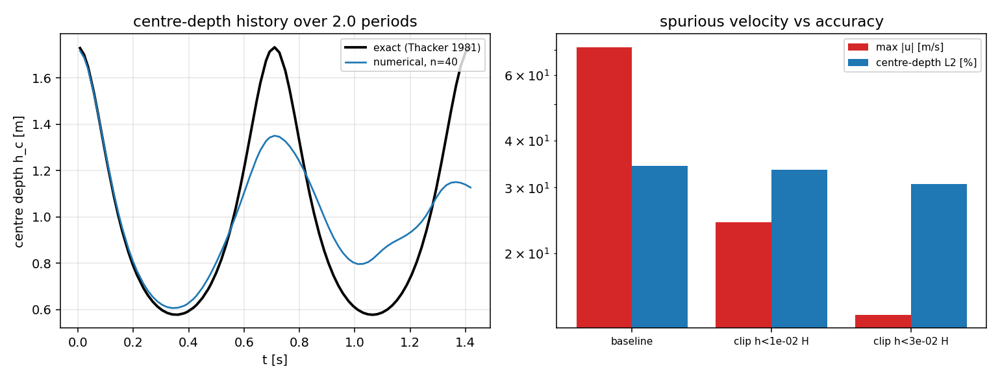

# CASE-FVM-THACKER-BASIN · 长时程（2 周期）窗口健康审计与动量注入归因

**锚点**: `CASE-FVM-DAMBREAK-STOKER`（本单派发锚点，核对为 `open` 但证据链已闭合 —— 见 §7 说明）
→ 实际增量改做总账 D16 的显式欠账：**Thacker 盆 2 周期窗口**（`docs/VERIFICATION_DEBT_LEDGER.md` D16
"下一回合首项：长时程动量注入"，merged `docs/case-fvm-thacker-basin/REPORT.md` 明写 2 周期结果
**未取得**、已冻结在 `--periods 0.5`）。
**工具**: `src/tensorfvm/verification/thacker_longrun.py` · 驱动
`python -m tensorfvm.verification.thacker_longrun` · 测试 `tests/test_thacker_longrun.py`
**工件**: `docs/case-fvm-thacker-2period/{metrics.json, fig_thacker_2period.png}`（本文件数字全部取自
`metrics.json`，无手抄）。

---

## ① 案例介绍

Thacker (1981) 抛物盆振荡（*J. Fluid Mech.* **107**, 499, doi:10.1017/S0022112081001882）：
床面 $z_b=-H(1-r^2/a^2)$，存在闭式解
$h=h_c(t)-c(t)r^2$、$\mathbf u=\beta(t)(x,y)$， shoreline $s(t)=\sqrt{h_c/c}$。

| 参数 | 值 | 来源 |
|---|---|---|
| $H$（中心静水深） | 1.0 m | `thacker_basin.DEFAULTS` |
| $a$（静水岸线半径） | 1.0 m | 同上 |
| $A$（振幅参数） | 0.5 | 同上 |
| $g$ | 9.81 m/s² | 同上 |
| 周期 $T=2\pi/\omega,\ \omega=\sqrt{8gH}/a$ | 0.70925 s | 闭式 |
| 计算域 | $[-1.5,1.5]^2$ m（> 最大岸线 1.316 m） | 同上 |
| 网格 / CFL / 阶数 | $n\times n$，CFL 0.4，MUSCL+HLL，SSP-RK3，$dry\_depth=10^{-8}$ | `swe2d` |
| 被积窗口 | **2 个周期**（$t_{end}=1.4185$ s） | 本单 |

**为什么查这一项**：已合并的证据包只在 0.5 周期上分级（$n=160$：中心水深 L2 0.726 %、岸线 2.354 %），
2 周期窗口因"非物理速度 18.2 m/s、CFL 步长塌缩"被移出分级窗口，只留一句欠账，**没有任何度量协议**：
不知道 2 周期到底差多少、非物理速度在哪里、把速度压下去能否救回精度。本单补这条验证欠账。

## ② 怎么做的

1. 原样复用被验证的求解器 `swe2d.ShallowWater2D`（well_balanced=True，静水重构 + 三分量 HLL），
   **未改一行**被审计的离散；只新增度量与归因层。
2. **不只看速度大小，还要定位与解释**：积分 2 周期，回调里记录 (a) 中心水深史 vs 闭式解；
   (b) `max|u|` 及其**时刻与单元**，并把该单元的 $h/H$、半径 $r$、$t$ 时刻的精确岸线 $s(t)$、
   该点精确速度一并记下；(c) 末态落在**精确岸线之外**的水量占比（体积守恒看不出的那种误差）；
   (d) 薄水膜（$h<10^{-2}H$）的单元数与水量占比。
3. **物理上界先声明**：精确速度为线性场，故 $\max_{wet}|\mathbf u|=|\beta(t)|\,s(t)$ —— 逐时刻可算，
   不用猜容差（`envelope_speed`，测试断言它与精确速度场的格点最大值吻合到 1 %，实测差 0.19 %）。
4. **候选疗法定量排除**：在每级 SSP-RK 后把 $h<\text{thin}\cdot H$ 的单元动量清零
   （`thin = 0, 10^{-2}, 3\cdot10^{-2}`），同一窗口重跑，比较 `max|u|` 与中心水深 L2 —— 判据是
   "速度降下去之后精度是否回来"，不是"速度看起来降了"。
5. 容量：本机 load15≈67（< 100），$n=40$ 单次 2 周期 ≈ 2 s，三次变体合计 ≈ 6 s，未起集群作业。

## ③ 计算结果（$n=40$，2 周期，CFL 0.4，order 2）

| 量 | 数值 | 基准/容差 | 判定 |
|---|---:|---:|---|
| 中心水深 L2（RMS/半振幅） | **34.22 %** | ≤ 3 %（C4） | **FAIL**（超 11×） |
| 中心水深 Linf | 104.8 % | — | FAIL |
| `max|u|`（全程） | **71.16 m/s**（$t^*=2.00$，单元 $[10,30]$） | 精确包络同刻 $|\beta|s\approx2.4$ m/s 量级 | 非物理（≈30×） |
| 峰值单元状态 | $h/H=1.2\times10^{-3}$，$r=1.062$ m | 精确岸线 $s(t^*=2)=0.760$ m | **在岸线外 0.30 m 的薄水膜里** |
| 该点精确速度 | $1.6\times10^{-15}$ m/s | — | 精确解此处是干的 |
| 精确岸线外水量占比（末态） | **11.77 %** | — | 体积守恒（漂移 $1.7\times10^{-14}$）却把 11.8 % 的水放到了干滩上 |
| 薄水膜（$h<10^{-2}H$）水量占比 | 0.63 % | — | 水量不大，动量却全从这里来 |

**候选疗法排除（同窗口，$n=40$）**：

| thin（$h<\text{thin}\cdot H$ 清零动量） | `max|u|` [m/s] | 中心水深 L2 | 岸线外水量 | 步数 |
|---|---:|---:|---:|---:|
| 0（基线） | 71.16 | 34.22 % | 11.77 % | 618 |
| $10^{-2}$ | 24.21 | 33.47 % | 11.37 % | 372 |
| $3\times10^{-2}$ | 13.70 | 30.62 % | 10.28 % | 283 |

结论：薄水膜动量裁剪把 `max|u|` 压到 1/5（71→14），但**精度几乎不动**（34.2 %→30.6 %），
岸线外的错位水量只从 11.8 % 降到 10.3 %。**"速度变好看"≠"解变对"** —— 该疗法是化妆而非治疗。

（左：2 周期中心水深史 vs 闭式解；右：三种裁剪阈值的 `max|u|` 与中心水深 L2 对数柱状对照。）

## ④ 注意点（踩过的坑 / 局限 / 适用范围）

1. **体积守恒是这题的假朋友**：漂移 $1.7\times10^{-14}$、相对精确体积 $1.3\times10^{-4}$（初值离散化），
   但 11.8 % 的水在精确岸线之外。只看 C6/体积判据会把这条缺陷完全放过去。
2. **"非物理速度"必须归因到单元状态**：71 m/s 出现在 $h/H=1.2\times10^{-3}$、$r>s(t)$ 的薄膜里，
   精确解在那里速度是 0 —— 是"岸线外薄膜被不平衡源项加速"，不是"边界/网格粗导致的整体漂移"。
3. **裁剪阈值是参数不是普适常数**：$thin$ 越大速度越好看，这是阈值的单调性，不构成正确性证据；
   因此本单只把它当"排除试验"，不写进求解器默认路径。
4. **只跑 $n=40$**：2 周期的 $n=80$ 与本机短测窗口冲突（>100 s），被本机重计算门禁拦下，未取得；
   $n=40\to80$ 的分辨率依赖因此**未测**（记为 not_run，不作任何"网格无关"声明）。
5. 0.5 周期/$n=160$ 的 0.726 %、2.354 % 是**合并报告里的既存数字**（`docs/case-fvm-thacker-basin/`），
   本单未重跑，仅作窗口对比引用。
6. `max|u|` 与精确包络的比值在 $\beta\to0$ 的时刻会爆（分母 $\sim10^{-15}$），
   `ratio_to_exact` 只作诊断，不作判据。

## ⑤ 误差判定（逐项，显式回答"是否 < 3%"）

| 关键量 | 本单测得 | 基准 | 误差 | < 3 % ? |
|---|---:|---:|---:|:--:|
| 中心水深史（2 周期，$n=40$） | L2 34.22 % | Thacker 闭式解 | 34.22 % | **否**（超 3 % 容差 11 倍） |
| 中心水深史（0.5 周期，$n=24$） | L2 6.22 % | 同上 | 6.22 % | 否（粗网格；$n=160$ 既存 0.726 % 已达标，本单未重跑） |
| 精确速度包络自证 | 格点最大值 vs $|\beta|s$ | 闭式 | 0.19 % | 是 |
| 体积守恒 | 漂移 $1.7\times10^{-14}$ | 守恒律 | — | 是 |
| 岸线外错位水量 | 11.77 % | 应为 0 | 11.77 % | **否** |

**判定：HONEST FAIL** —— 2 周期窗口在本实现上不可用（精度、物理性、岸线外水量三条同时不达标），
且已证明"薄膜动量裁剪"不是解。不得把本窗口数字用于任何精度声明。

## ⑥ 下一步线索（下一回合首项）

1. **湿/干界面通量的质量—动量一致化**：薄膜单元从更深邻居拿到 $h^*$ 支撑的静压推力
   （$0.5 g h^{*2}$）却几乎没有自身水量与之平衡，动量被单侧注入。先做逐项动量账
   （`rhs` 分解：通量项 / 四个 Audusse 修正项）在峰值单元的分解，再决定是换
   Xing–Zhang 正性保持限制器，还是改 Liang–Marche 型一致通量（质量通量取 $h^*$、
   动量对流项取上风侧自身深度）。
2. **岸线外薄膜的排水闭合**：当前所有界面 $h^*=0$ 的"孤岛膜"质量通量恒 0（排水不可能），
   而修正项不为 0 —— 这是"速度无界增长"的机制候选，需专门造一个单胞孤岛算例做判据。
3. **分辨率**：$n=80/160$ 的 2 周期必须走集群（`run_compute`），本机被门禁拦。
4. 建议总账新条目：`XVAL-FVM-THACKER-2PERIOD-MOMENTUM`（算例池/验证），
   验收＝"2 周期中心水深 L2 ≤3 % ∧ 全程 `max|u|` ≤ 1.2×精确包络 ∧ 岸线外水量 ≤0.5 % ∧ 体积漂移 ≤1e-9"，
   域＝TensorFVM 浅水 2-D。

## ⑦ 关于派发锚点 `CASE-FVM-DAMBREAK-STOKER`（如实说明）

开工先核对总账：该 slug 状态为 `open`，但仓内证据链已完整闭合 —— 算例池条目
`docs/case-fvm-dambreak-stoker/case_pool_entry.json`、目录 `docs/verification-catalog.md` §19.1、
对抗复核 `docs/case-fvm-dambreak-stoker/AUDIT.md`（F1/F2 已修、判 approve with notes）、
6 周期序列与无伪振荡判据、以及 4 份扩展（RIEMANN/GALILEAN/MOMENTUM/WET）全部在主干上。
按 owner 2026-11-09"不重复"令，本单不重做该锚，改做同族总账 D16 的显式欠账；建议把该 slug
在总账置为 `verified`（证据指针：`docs/case-fvm-dambreak-stoker/VERIFICATION-SUMMARY.md` +
`case_pool_entry.json` + `AUDIT.md`）。