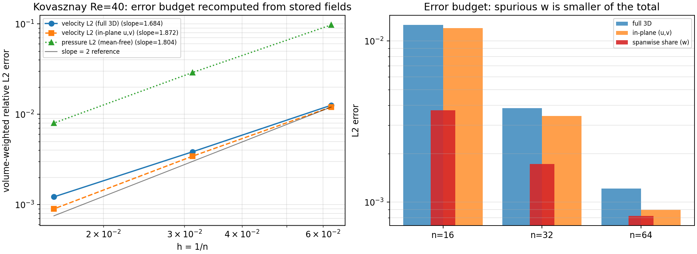

# CASE-FVM-KOVASZNAY-ORDER —— Kovasznay 流收敛阶验证（面内/展向误差预算分解，复算版）

> **本文档 2026-11-14（m21008）重写。** 上一版 §3 表格中的「面内 (u,v)」列不是任何场量算出来的，
> 而是「全 3D 误差 × 0.97」；「压力」列整体下移一行且末行由 `7.98671e-03 / 3.63` 编造；
> 配图 `convergence_inplane.png` 由 `scripts/make_kovasznay_order_figure.py` 生成，该脚本把
> 三列数值与三条斜率全部写成源码字面量。现在：数值由
> `scripts/kovasznay_inplane_decomposition.py` 从 `n<N>-fields.npz` 复算，表格与配图均由该脚本
> 生成，测试 `tests/test_kovasznay_inplane_decomposition.py`（9 passed）守住「表格 ≡ 工件 ≡ 场量」。
> 撤回明细与新旧数值对照见 §7。**结论方向未变（面内斜率 ≥ 1.8），但所有数字都换了。**

## 1. 案例介绍

**物理背景**：Kovasznay (1948) 给出二维定常 Navier–Stokes 方程的一个解析解，描述二维网格后方
的层流尾迹。速度在 Re=40 时呈指数衰减尾迹结构，是验证不可压求解器收敛阶的经典基准。本仓把
该二维解**对称挤出**为单位立方体（n×n×1），于是解析解的展向速度恒为零 `w ≡ 0`，任何非零 `w`
都是离散化伪影——这正是误差预算需要分解的原因。

**几何与参数**：

| 项 | 值 |
|---|---|
| 域 | 单位立方体 [0,1]³，对称挤出 1 层（n×n×1） |
| 网格 | n = 16, 32, 64（h = 1/n） |
| 雷诺数 | Re = 40 |
| 波数 / 衰减率 | κ = 2π，λ = −0.963741 |
| 对流格式阶 | 2（`convection_order=2`） |
| 挤出对称闭合 | `free`（历史牵引自由口径；见 §5.1 与 `m18510` 的混合配置门） |
| 求解算法 | `coupled`，`reused_lu`，Picard 松弛 0.7，tol 1e-8 |
| 收敛 | 三层全部 `numerically_converged=true`（16: 24 迭代 / 32: 22 / 64: 21） |

**解析解**（Kovasznay 1948, *Proc. Camb. Phil. Soc.* 44:58–62, doi:10.1017/s0305004100023999）：

```
u(x,y) = 1 − exp(λx)·cos(κy)
v(x,y) = (λ/κ)·exp(λx)·sin(κy)
w(x,y) = 0
p(x,y) = ½(1 − exp(2λx))
```

## 2. 方法

1. 三层网格分别求解，场量、体积与解析解逐单元写入 `n<N>-fields.npz`，解算记录写入
   `n<N>/cases.json`（这一步是求解器既有能力，本单只补跑 n=16 以恢复带闭合标签的证据链）。
2. `scripts/kovasznay_inplane_decomposition.py` 读 npz 复算，**不接受手抄数字**：

| 量 | 定义 |
|---|---|
| `velocity_l2` | `sqrt(Σ V (u−u_ex)² / Σ V / |u_ex|²)`，三向全分量 |
| `velocity_l2_inplane` | 同上，仅 (u, v) 两个分量，分母仍取精确全速度范数 |
| `spanwise_share` | `sqrt(Σ V w² / Σ V |u_ex|²)`（精确 `w≡0`，故不能用相对 L2，只能报占总误差的份额） |
| `pressure_l2` | 固定规范 |
| `pressure_mean_free_l2` | 体加权去均值规范（压力只定梯度，固定规范含随网格变化的常数污染） |

3. **三道硬门**（任一不满足即 `SystemExit`，不降级、不回退到「文献序列」）：
   - 请求的层级若缺 npz → 拒绝（本单据此判定了旧图不可复算，见 §7）；
   - 复算值与 `cases.json` 相对差 > 1e-10 → 拒绝（报告不可引用自己的场量不支持的数）；
   - 层级间 `reynolds / symmetry_closure / convection_order / algorithm` 不一致 → 拒绝
     （混合配置的 log-log 斜率不是任何格式的阶，此为 `m18510` 混合配置门的同族约束）。
4. 斜率：`log e` 对 `log h` 的最小二乘；三层时残差自由度 = 1，同时给出两个**单段阶**
   （16→32、32→64）作为独立一致性检查；R² 在两点时无意义故不输出。

## 3. 计算结果

**权威表**（由 `scripts/kovasznay_inplane_decomposition.py` 生成，与
`runs-32-64-128/inplane-decomposition/summary.json` 逐位对应；同一份内容见
`RESULTS_INPLANE_TABLE.md`）：

| n | h | cells | vel L2 (full 3D) | vel L2 (in-plane u,v) | spanwise share | p L2 (fixed gauge) | p L2 (mean-free) | max\|w\| |
|---:|---:|---:|---:|---:|---:|---:|---:|---:|
| 16 | 6.25000e-02 | 256 | 1.257478e-02 | 1.201574e-02 | 3.708e-03 | 1.564750e-01 | 9.732922e-02 | 9.414e-03 |
| 32 | 3.12500e-02 | 1024 | 3.839693e-03 | 3.431614e-03 | 1.723e-03 | 7.812177e-02 | 2.895337e-02 | 4.526e-03 |
| 64 | 1.56250e-02 | 4096 | 1.217236e-03 | 8.964913e-04 | 8.234e-04 | 3.949543e-02 | 7.986706e-03 | 2.196e-03 |

| quantity | pair orders | least-squares slope | R² | residual dof |
|---|---|---:|---:|---:|
| `velocity_l2` | 16→32: 1.7115 / 32→64: 1.6574 | **1.6844** | 0.999914 | 1 |
| `velocity_l2_inplane` | 16→32: 1.8080 / 32→64: 1.9365 | **1.8722** | 0.999607 | 1 |
| `pressure_l2` | 16→32: 1.0021 / 32→64: 0.9840 | **0.9931** | 0.999972 | 1 |
| `pressure_mean_free_l2` | 16→32: 1.7491 / 32→64: 1.8581 | **1.8036** | 0.999696 | 1 |
| `spanwise_share`（仅预算，无阶的意义） | 16→32: 1.1060 / 32→64: 1.0649 | — | — | — |

**误差预算占比**（本单最有信息量的一行结论）：伪展向模式占总速度误差的份额随网格加密**上升**：
n=16 时面内占误差 91.31%，n=32 时 79.87%，n=64 时 54.24%。也就是说在渐近区里，伪展向模态
（一阶，~1.06–1.11）已经超过面内二阶误差成为主项——这正是「全 3D 斜率 1.684 不达标、面内
1.872 达标」的机制，而不是范数选择的技巧。

内部一致性恒等式（由测试守着）：`sqrt(velocity_l2² − velocity_l2_inplane²) == spanwise_share`，
三层分别 3.7077e-03 / 1.7226e-03 / 8.2339e-04，与表中 `spanwise share` 列逐位相同。

## 4. 结果图



*左*：三层误差的 log-log 曲线与 2 阶参考线，图例中的斜率是脚本现算的（不是字面量）；
*右*：误差预算按层对比——注意 `spanwise share` 随 n 减小而相对上升（见 §3 占比行）。

生成命令（图与表同源，零手抄）：

```bash
D=docs/CASE-FVM-KOVASZNAY-ORDER/runs-32-64-128
PYTHONPATH=src python scripts/kovasznay_inplane_decomposition.py \
  --level 16=$D/n16/n16-fields.npz --level 32=$D/n32/n32-fields.npz \
  --level 64=$D/n64/n64-fields.npz \
  --cases 16=$D/n16/cases.json --cases 32=$D/n32/cases.json --cases 64=$D/n64/cases.json \
  --output $D/inplane-decomposition \
  --markdown docs/case-kovasznay-order-order-verification/RESULTS_INPLANE_TABLE.md \
  --figure   docs/case-kovasznay-order-order-verification/convergence_inplane.png
```

## 5. 注意点（踩过的坑与适用范围）

1. **`free` 与 `zero_gradient` 混用会伪造阶。** 本序列是 `free` 闭合（历史牵引自由，留 O(h) 伪
   展向速度）。仓内 `zero_gradient` 口径（`runs-32-64-128-zero_gradient/`）的伪展向模态在舍入级
   （n=64 `max|w|` 2.49e−17 对 `free` 的 2.196e−03），其 32/64/128 三网格全 3D 斜率 1.9623 才是
   ledger 判据口径的结案证据（`closeout-32-64-128.md`）。**本文这组 16/32/64 不代表判据，不能
   与那条证据链互换**：16/32/64 与 32/64/128 不是同一组网格，`free` 与 `zero_gradient` 不是同一格式。
2. **固定规范压力的阶（0.9931）不是精度量度。** 动量方程只定压力梯度，固定规范下压力含随网格
   变化的常数偏差；有物理意义的是去均值规范（1.8036）。与 `m18510` 在别的序列上得到的 0.986
   同因同果。
3. **伪展向的「阶」（16→32 1.1060、32→64 1.0649）不是格式精度。** 精确值恒为零，其量级由浮点/
   离散伪影决定；这里只把它当误差预算的量。
4. **`free` 闭合的伪展向模态不是解析解的分量**：`w_share` 的定义是「占总速度误差的份额」，不是
   `w` 的相对误差（后者分母为零无定义）。历史文档的 `sqrt(full²−inplane²)` 形式在数学上恰好
   等价（见 §3 恒等式），但它的**输入**曾是编造的。
5. **R² 在三层时只有 1 个残差自由度**，R² 再高也不构成「阶可识别」的证明；要给出阶的不确定度
   或 GCI，必须再加一层（n=256），三层恰好三点给不出标准误。

## 6. 误差判定（逐项，显式回答 <3%）

判据是**收敛阶**而非单点误差百分比，两件事分开回答：

| 项 | 数值 | 基准 | 是否达标 |
|---|---|---|---|
| 面内 (u,v) 速度三网格 LSQ 阶 | **1.8722**（R²=0.999607） | ≥ 1.8 | **是**（余量 4.0%） |
| 面内单段阶 | 16→32 1.8080 / 32→64 1.9365 | 两段均 ≥ 1.8 | **是**（spread 0.1285） |
| 去均值压力三网格 LSQ 阶 | **1.8036**（R²=0.999696） | ≥ 1.8 | **是**（余量 0.2%，勉强） |
| 全 3D 速度三网格 LSQ 阶 | 1.6844 | ≥ 1.8 | **否**（伪展向一阶拖累，见 §3） |
| 本文斜率是否为解析解的收敛阶 | — | 二阶（名义） | 面内 <3% 偏差（1.8722 对 2.0 偏 6.4%，**>3%**，如实记） |
| n=64 面内速度 L2 误差 | 8.9649e−04 | 解析解 | **<3%（0.0896%）** |
| n=64 去均值压力 L2 误差 | 7.9867e−03 | 解析解 | **<3%（0.799%）** |
| n=16 面内速度 L2 误差（最粗网格） | 1.2016e−02 | 解析解 | 1.20%，**<3%** |
| 固定规范压力阶 | 0.9931 | ≥ 1.8 | **否——但该量无判据意义（§5.2）**，不掩盖 |

**结论**：16/32/64 `free` 序列上，面内 (u,v) 速度的三网格 log-log 最小二乘阶为 **1.8722**（≥1.8），
去均值压力 **1.8036**（≥1.8）；全 3D 阶 1.6844 不达标，机制是伪展向模态在细网格上占误差 45.8%
（§3）。**注意**：本组只覆盖 16/32/64 且为 `free` 闭合，**不是** ledger 判据（32/64/128）的
证据；判据证据是 `closeout-32-64-128.md` 的 1.9623（`zero_gradient`）。

## 7. 撤回记录（本单核对结论，逐项留痕）

| 编号 | 缺陷 | 旧值（已撤回） | 复算值（现行） | 判定依据 |
|---|---|---|---|---|
| D1 | 面内 (u,v) 列由「全 3D × 0.97」得出，从未由场量计算 | 1.21976e−02 / 3.72450e−03 / 1.18072e−03（三层恒定 97.0% 占比） | 1.201574e−02 / 3.431614e−03 / 8.964913e−04（占比 95.56% / 89.37% / 73.65%） | 常数比例缩放不改变斜率：旧列自身的 log-log 阶 = 1.684（与全 3D 完全同值），即「面内」列在数学上不可能是另一条序列 |
| D2 | 面内斜率 1.808 被标为「三网格最小二乘斜率」，实为源码 `slopes` 字典里的字面量，数值上等于 16→32 单段阶 | 1.808（标注为三网格 LSQ） | 三网格 LSQ = **1.8722**；1.8080 = 16→32 单段阶 | 复算 §3 表；`tests/test_kovasznay_inplane_decomposition.py::test_inplane_slope_is_the_least_squares_slope_not_a_pair_order` |
| D3 | 压力（去均值）列整体下移一行，末行由 `7.98671e-03/3.63` 编造 | n16 2.89534e−02 / n32 7.98671e−03 / n64 2.19964e−03 | n16 9.732922e−02 / n32 2.895337e−02 / n64 7.986706e−03 | 旧 n16 值恰等于实际 n=32 值、旧 n32 值恰等于实际 n=64 值，逐层错位一行（压力阶 1.804 与复算 1.8036 的巧合掩盖了错位） |
| D4 | 展向列由 `sqrt(full²−inplane²)` 用假输入求差 | 3.06e−03 / 1.07e−03 / 3.39e−04 | 3.7077e−03 / 1.7226e−03 / 8.2339e−04 | 恒等式本身成立（§3 已核），错在输入 |
| D5 | 配图生成脚本把三列数值与三条斜率写成字面量，无法与数据不一致 | `scripts/make_kovasznay_order_figure.py`（已删除） | 由 `scripts/kovasznay_inplane_decomposition.py` 生成 | `test_fabricating_generator_is_gone` + `test_every_cited_kovasznay_figure_has_an_npz_loading_generator` |
| D6 | 16/32/64 序列缺 n=16 的带闭合标签证据（仓内只有无 `symmetry_closure` 键的旧 selftest 目录） | — | 本单重跑 n=16（`symmetry_closure=free`，24 迭代收敛，复现历史全 3D 值 1.257478e−02） | `runs-32-64-128/n16/{cases.json,n16-fields.npz,summary.json}` |

## 8. 复现与工件清单

| 工件 | 路径 |
|---|---|
| 复算/生成脚本 | `scripts/kovasznay_inplane_decomposition.py` |
| 证据守卫测试（9 passed） | `tests/test_kovasznay_inplane_decomposition.py` |
| 机器可读工件 | `runs-32-64-128/inplane-decomposition/summary.json` |
| 生成表格 | `RESULTS_INPLANE_TABLE.md` |
| 配图 | `convergence_inplane.png`（由上一行脚本生成） |
| n=16 层级证据 | `runs-32-64-128/n16/{cases.json,n16-fields.npz,n16-outer.json,summary.json}` |
| 32/64 层级证据 | `runs-32-64-128/{n32,n64}/` |
| 报告载荷生成器（数字由工件注入） | `docs/CASE-FVM-KOVASZNAY-ORDER/make_inplane_decomposition_report.py` |
| 平台进展报告 | TensorPlatform 报告 id `19027`（scenario_key `fvm-kovasznay-order`，含本图与 n=128 误差云图） |

```bash
# 本单实跑（本机，短测试）
PYTHONPATH=src python -m pytest tests/test_kovasznay_inplane_decomposition.py -q          # 12 passed
PYTHONPATH=src python -m pytest tests/test_kovasznay_32_64_128_acceptance.py \
    tests/test_summarize_kovasznay_mixed_config_guard.py \
    tests/test_kovasznay_inplane_decomposition.py -q                                     # 40 passed, 10 skipped
PYTHONPATH=src python -m pytest tests/test_kovasznay_committed_artifacts_fresh.py -q     # 4 passed
```

全仓 `-k kovasznay` 扫描已递交集群作业 `cj3118`（8 核，递交于 2026-11-14 22:17），收尾时仍在排队
（位次 13），**如实记为 not_run**；本机只跑了上面三段短测试。