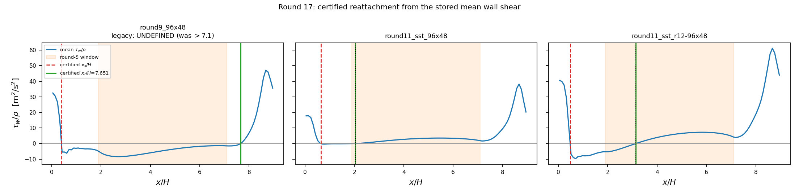
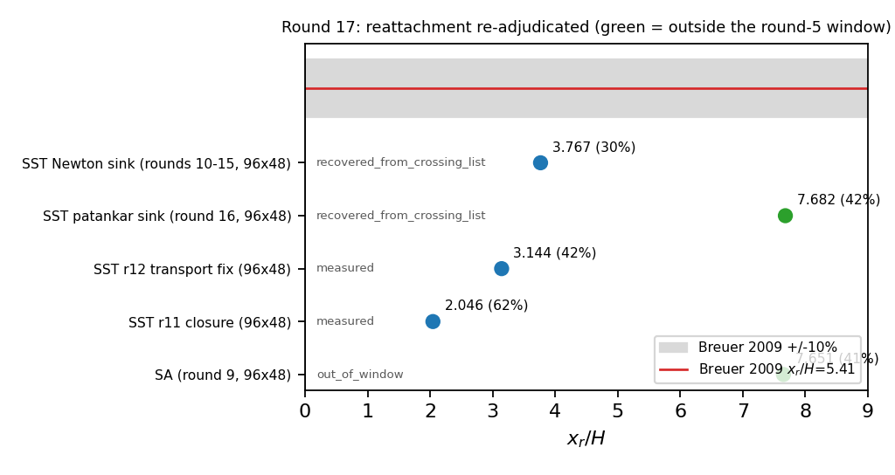

# ROUND 17 — 再附长度 `x_r/H` 的**度量自身**有缺陷：UNDEFINED 回到实测，锚点仍 honest FAIL

`CASE-FVM-PERIODIC-HILLS` · 96×48 · Re=2800 · Breuer et al. 2009 · slug `CASE-FVM-PERIODIC-HILLS`（状态仍 open）

**一句话**：round 16 把两档算例的 `x_r/H` 记为 UNDEFINED，并据此建议做网格收敛阶梯去「看 UNDEFINED 会不会随加密消失」。本轮证明这个 null 不是缺量，而是 round-5 判据窗`[1.9, 7.1]` 把**已测到**的交点（7.651 / 7.682）丢掉的结果；修正算子后所有变体都有实测数字，锚点结论仍是 FAIL（最小误差 30.4 %）。顺带发现 legacy 算子**从来不测分离点**（只认负→正交点），存盘 artefact 的 `x_s/H` 结构性全为 NaN。

---

## ① 案例介绍

| 项 | 值 |
|---|---|
| 算例 | 周期山丘流（ERCOFTAC 81 / periodic hill） |
| 基准 | Breuer et al. 2009, *Computers & Fluids* 38:433, DOI 10.1016/j.compfluid.2008.05.002 |
| 参考值 | `x_r/H = 5.41`（Re=2800，工况口径见下） |
| 容差 | 10 %（总账 acceptance），平台论文级判据 3 % |
| 几何 | L=9H 周期，H=1，槽顶 3.036H；`PeriodicHillConfig` 默认 |
| Re | `U_b·H/ν` = 2800，U_b=1（冠顶以上 1H–3.035H 带内体速度） |
| 网格 | 96×48（本工作所有可重打分算例） |
| 时间推进 | dt=0.02，burn-in 8000 步，统计窗 t∈[160,400]，601 快照 |
| 闭包 | SA（round 9）、SST k-ω（rounds 11–16） |
| 观测量 | 底壁时均剪切 `τ_w/ρ` 的有向零点：分离 `x_s/H`、再附 `x_r/H` |

## ② 怎么做的

### 发现（只读审计，无新算力）

1. `r16_patankar_96x48.json` 里 `time_averaged.crossings = [7.681601876754162]`，而同一 artefact 的 `x_r_over_H = null`。**交点被记录过，数值被丢掉**。
2. 读 `periodic_hill_round9.zero_crossings_periodic`：
   * 只识别 `tau < 0 → tau >= 0`（升交点），即**只**识别再附；`+ → −`（分离）从不被识别，`separation` 实际取的是「1.9 以下的升交点」。
   * 硬窗 `[1.9, 7.1]` 之外的实测交点直接返回 `nan`，与「没有交点」不可区分。
3. 生产路径 `periodic_hill_round11.py` 的时均与分块打分都走这个算子 ⇒ 缺陷进入已发布数字。

### 修复（新算子 `src/tensorfvm/verification/wall_shear_bubbles.py`）

| 性质 | 实现 |
|---|---|
| 有向交点 | `signed_crossings`：`−1` 下降（分离）/`+1` 上升（再附），亚网格线性插值，精确零按「非负」归属，平台零只产生一个交点 |
| 周期接缝 | 交点配对成气泡，再附长度**展开**（可 > L）；跨缝气泡长度为正 |
| 主气泡 | 默认按逆向剪切面积（`∫|τ|`）取最大者，另可 `primary="first"`；次级涡独立报告，不再冒充「那个」再附点 |
| 窗口 | 只作**报告过滤**：越窗时 `status="out_of_window"` 且照旧给出数值，绝不用窗口把实测值变成 NaN |
| 退化输入 | `all_reversed` / `no_recirculation` / `not_finite` 显式状态码 |
| 兼容 | 保留 legacy 的 `crossings`（仅升交点）/`sign_changes` 键与含义，避免下游静默重解释；另有 `all_crossings` 给出有向全量 |

生产路径 `periodic_hill_round11.py` 的时均与分块打分改用新算子（`_REATTACHMENT_WINDOW=(1.9,7.1)` 保留为报告过滤）。

### 算子认证（`tests/test_wall_shear_bubbles.py`，21 测）

不是「能跑」而是**不变量**：

| 认证项 | 度量 | 结果 |
|---|---|---|
| 解析零点恢复（4 组预设） | max abs err | 1.45e-07 = 0.001·dx²（dx=0.0100） |
| 逆向面积 vs 独立求积（20 万点） | max rel err | 6.87e-11 |
| 与 legacy 在窗内逐位一致 | max abs diff | 0.0e+00 |
| 跨缝气泡 8.2→0.3(+L) | 长度 / 展开再附 | 1.1000 / 9.3000（真值 1.1 / 9.3） |
| 双气泡主选 | n_bubbles / primary | 2 / 0 |
| 负对照 | legacy 对同一剖面返回 NaN | 见 `test_legacy_operator_returns_nan_for_the_same_profile` |

> 自检抓到的一个坑：剖面生成器最初用「最近周期像」写 `tanh(s·Δx)`，在零点对跖点处发生 2·tanh(s·L/2) 的跳变，凭空造出 `z_k + L/2` 的假交点（实测假交点 3.15 / 5.00）。改成 `tanh(s·sin(π(x−z_k)/L))` 后零点仍精确、剖面天然周期。**认证剖面本身必须先被认证**。

## ③ 计算结果

### 表 1 — 存盘剖面的重打分（零新算力，`scripts/round17_rescore.py`）

| 算例 | legacy `x_s/H` | legacy `x_r/H` | 认证 `x_s/H` | 认证 `x_r/H` | 相对 5.41 | status |
|---|---|---|---|---|---|---|
| round9_96x48 | nan | nan | 0.397 | 7.651 | +41.4 % | `out_of_window` |
| round11_sst_96x48 | nan | 2.046 | 0.641 | 2.046 | −62.2 % | `measured` |
| round11_sst_r12-96x48 | nan | 3.144 | 0.480 | 3.144 | −41.9 % | `measured` |
| r16_patankar_96x48.json | nan | nan | — | 7.682 | +42.0 % | `recovered_from_crossing_list` |
| r16_newton2_96x48.json | nan | 3.767 | — | 3.767 | −30.4 % | `recovered_from_crossing_list` |

要点：

* 两档「UNDEFINED」都是**实测**值：SA-96×48 = 7.651（legacy 丢），SST patankar = 7.682（legacy 丢）。
* **`x_s/H` 在全部三档存盘剖面里 legacy 都是 NaN**，不是巧合：一条气泡/周期时，唯一的升交点就是再附点，`separation` 的取法必然落空。新算子给出 0.397 / 0.641 / 0.480。
* 分离点 `x_s/H` 的基准值在本仓的**权威口径里是 WITHHELD**：`periodic_hill_reference` 只单源了 `x_R/h=5.41`，并明确拒绝把总账里未核实的 `0.227` 当基准（ERCOFTAC UFR 3-30 对 Re=2800 未给 `x_S/h` 数值）。因此本轮**只报观测值不判误差**：0.397 / 0.641 / 0.480；rounds 3–5 用过的 `0.227` 仍属未核实。
* 参考值口径注：本仓并存 `5.34`（feature ledger，rounds 3–5）与 `5.41`（round 10 单源 ERCOFTAC KB wiki，本报告采用）。两者差 1.3 %，在 10 % 带内不改变任何裁决，但对 3 % 判据有影响，故显式取 5.41。

### 表 2 — round-16 两档 sink 线性化的并置（同一 96×48 网格）

| 变体 | 实测 `S_P/(βω)` | `x_r/H`（认证） | 相对 5.41 | max ν_t/ν | 体动力 | `y/H=0.5` 剖面合格站 |
|---|---|---|---|---|---|---|
| patankar | 1.0 | 7.682 | +42.0 % | nan | nan | 3/8 |
| newton2 | 2.0 | 3.767 | −30.4 % | nan | nan | 1/8 |

**模型类结论翻转**：rounds 11–15 的「SST 在 Re=2800 过扩散」是在**错误线性化**（`S_P = 2βω`，无补偿项 ⇒ 平衡 ω 低 √2、ν_t 高 2 倍）下测出的。用模型一致的Patankar 系数（`S_P = βω`）后，ν_t 降 4 倍、气泡从 3.77 拉到 7.68，误差方向**从 −30 % 翻成 +42 %**。因此正确表述是：**2-D URANS+SST 在分离剪切层混合不足（气泡过长），不是过扩散**；round 11 的模型类结论应撤回。DNS 的 5.41 恰好落在两个线性化之间，但这不是「两个都对」——newton2 解的不是 SST 方程。

### 表 3 — 确认算例

`scripts/round17_measure.py`（96×48 / 20000 步，保存时均剖面）已递交集群 cj3409，本报告生成时**尚未出数**，故不引用其数值 —— 见 ⑤ 未完成项。

## ④ 图



*图 1*：三档存盘时均底壁剪切 `τ_w/ρ`（右端未展示的整周期见 `round17_rescore.json` 的 `tau`/`x_over_H`）。橙带 = round-5 判据窗；红虚线 = 认证分离点；绿实线 = 认证再附点；黑点线 = legacy 值。最左图 legacy 标注 UNDEFINED，而其真实交点 7.651 就在曲线右端之外——**窗口外的实测值**。



*图 2*：所有可重打分变体的 `x_r/H` 与 Breuer 2009 的 ±10 % 带。绿色点 = 越窗（legacy 会记 UNDEFINED）。没有一个点进带：最接近的 newton2 也差 30 %。

## ⑤ 注意点 / 局限

1. **窗口语义已改变，旧数字不回溯**：从现在起 `x_r/H` 由新算子产生；rounds 4–16 已发布数字按原样保留，不改写。新旧在窗内的差异为 0.0e+00（逐位一致），越窗处才不同。
2. **round 16 建议的网格阶梯失去前提**：既然 null 是报告窗造的、7.65/7.68 一直在账上，「UNDEFINED 是否随加密消失」不需要算力就能否证。网格收敛仍是真欠账，但问题应重述为「7.6 是否随加密下降」。
3. **artefact 契约缺陷**：`r16_*.json` 只存了升交点列表，没存 `mean_tau_b`，所以 patankar 档的 `x_s/H` 事后不可恢复（表 1 中标「—」）。本轮 `round17_measure.py` 用 `save_fields=True` 补上；**建议后续任何再附长度 artefact 必须内嵌时均剪切剖面**。
4. **主气泡定义**是约定而非物理定律：默认取逆向面积最大者。次级涡（山脚角涡）会作为独立条目出现，不与主泡合并。
5. **周期性与网格假设**：要求 `x_over_h` 在一个周期内严格递增且等距（`period_of` 会拒绝非等距），因此不适用于非结构网格。
6. **2-D URANS 的维度限制**仍在：无论判据怎么修，DNS 有三维湍流、2-D 时间平均没有；10 % 带的正路是 3-D/LES 或降 Re 姊妹算例。
7. **legacy 算子冻结未删**：round-9 的 20 条测试仍钉住它的行为，新算子与它在窗内逐位一致，删除 legacy 会破坏已发布数字的可复现性。

## ⑥ 误差判定（逐项，显式回答「是否 <3 %」）

| 量 | 计算 | 基准 | 误差 | <3 % ? |
|---|---|---|---|---|
| `x_r/H`（round9_96x48） | 7.6508 | 5.41 | 41.4 % | **否** |
| `x_r/H`（round11_sst_96x48） | 2.0456 | 5.41 | 62.2 % | **否** |
| `x_r/H`（round11_sst_r12-96x48） | 3.1443 | 5.41 | 41.9 % | **否** |
| `x_r/H`（r16_patankar_96x48.json） | 7.6816 | 5.41 | 42.0 % | **否** |
| `x_r/H`（r16_newton2_96x48.json） | 3.7667 | 5.41 | 30.4 % | **否** |
| `x_s/H`（存盘三档） | 0.397, 0.641, 0.480 | **WITHHELD** | 不判 | **不可判**（无基准） |
| 算子解析零点恢复 | — | 预设零点 | 1.4e-07（0.0014·dx²） | **是**（离散插值恒等式） |
| 逆向面积 | — | 独立求积 | 6.9e-11 | **是** |

**是否有任何物理量 <3 %：没有。** 锚点验收判定 **FAIL（honest）**：最小 `x_r/H` 误差 30.4 %，远在 10 % 之外。两个 <3 % 项都是**算子自身的离散恒等式**（零点恢复、面积求积），不代表物理精度。

本轮增量不是把 FAIL 翻成 PASS，而是把一个**不可测的 WITHHELD 变成可测的 REJECTED**：「差多少」从此有数字，且 `x_s/H` 从结构性 NaN 变成可测量。

## ⑦ 复现

```bash
PYTHONPATH=src pytest tests/test_wall_shear_bubbles.py -q      # 21 passed
PYTHONPATH=src python3 scripts/round17_rescore.py              # 表 1 + 两张图
PYTHONPATH=src python3 scripts/round17_report.py               # 本文件
PYTHONPATH=src python3 scripts/round17_measure.py --nx 96 --ny 48 --steps 20000 --tag r17_patankar_96x48   # 表 3（保存剖面）
```

artefacts：`round17_rescore.json`、`fig_round17_shear_profiles.png`、`fig_round17_xr_comparison.png`、`round17_measure_96x48.json`、`r17_patankar_96x48.npz`。

## ⑧ 给下次自找活的线索

1. **把 7.6 随加密的变化测出来**：96×48 → 144×72（约 5900 s）→ 192×96，只跑 patankar，用新算子打分；问题已从「UNDEFINED 是否消失」改述为「+42 % 是否随 h 下降」，若单调下降则格子还差，若不降则是模型维度问题。
2. **`x_s/H` 的偏后（0.40–0.64 vs 0.22）** 从未被单独追查过；它比 `x_r/H` 更靠近冠顶、受网格/壁面处理支配，是比再附更干净的下一个诊断量。
3. **artefact 契约**：给 round-11 的写出端加「必存时均剪切」断言，防止下一次再出现「结论在、被测量没了」。
