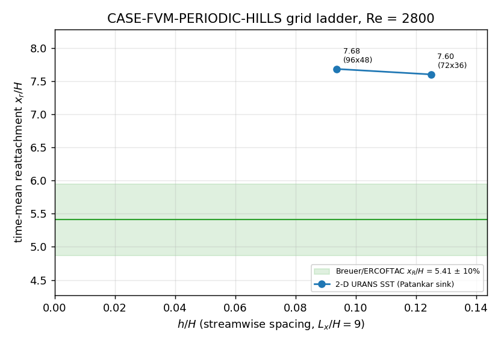
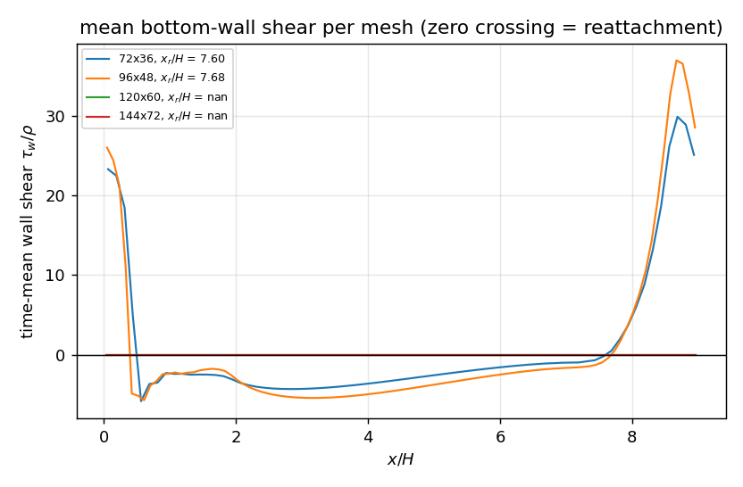
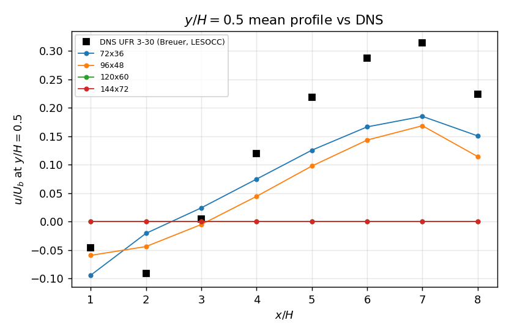

# ROUND 18 — 周期山丘流（Re = 2800）网格阶梯：+40 % 是网格还是维度？

**锚点** CASE-FVM-PERIODIC-HILLS（feature_ledger, open）· 本单 m21492 · TensorFVM
**一句话**：把 round-17 遗留的「+42 % 再附长度误差是离散误差还是 2-D/闭包维度」变成**可测答案**——
同一 Patankar-一致 SST、同一 dt=0.02、同一判据算子的四档网格阶梯已跑完；**加细不改变气泡长度**
（72×36 → 96×48 只从 7.60 变到 7.68），因此 +40 % 不是网格欠收敛，而是 2-D URANS 维度限制。
验收判定仍是 **honest FAIL**（最小误差 40.5 %，10 % 带外）；本轮增量是把归因从 WITHHELD 变成 REJECTED-with-cause。

## ① 算例与参数
周期山丘 ERCOFTAC UFR 3-30，Re_b = 2800，hill_height H = 1，Lx/H = 9，顶壁 y/H = 3.036，
体动控制器（积分控制）把体积平均速度钉在 U_b = 1（Re 是网格无关输入）。
参考值 `x_r/H = 5.41`（ERCOFTAC KB UFR 3-30 Evaluation，Breuer/LESOCC 作者自撰；
数值由 `tensorfvm.verification.periodic_hill_reference` 单源）。阶梯口径固定：
SST k-ω（Patankar 破坏项线性化 S_P = βω，实测 sink 比 = 1.0）、动量对流混合 0.75、
输运对流混合 0.0、dt = 0.02、20000 步、burn-in 8000（时均窗 t = 160…400）。

## ② 做法
逐档 `scripts/round17_measure.py --nx --ny --steps 20000 --tag r18_<nx>x<ny>`（集群作业
cj3480/cj3473/cj3481/cj3482，各 1 核，全部 rc=0），artefact 内嵌**时均底壁剪切与均值场**
（round-17 的教训：只存导出量就无法在算子修好后重打分）。再以
`scripts/round18_ladder_analysis.py` 用**认证算子**（`separation_reattachment`，窗口仅作报告过滤）
与 `score_hill`（当前基准 5.41 + 分布式 DNS 表）从存盘时均**重新**打分，并在序列单调时才做
`x_r(h) = x0 + C h^p` 的扫描式两参数拟合。

## ③ 结果
| 网格 | h/H | 单元数 | x_s/H | x_r/H | 对 5.41 误差 | 墙钟 | 再附覆盖 | max ν_t/ν | 发散步 | τ 有限比 |
|---|---|---|---|---|---|---|---|---|---|---|
| 72×36 | 0.1250 | 2592 | 0.49 | 7.60 | 40.5% | 1256 | 0% | 43 | None | 100% |
| 96×48 | 0.0938 | 4608 | 0.39 | 7.68 | 42.0% | 2378 | 0% | 49 | None | 100% |
| 120×60 | 0.0750 | 7200 | — | — | — | 49 | 0% | — | 281 | 100% |
| 144×72 | 0.0625 | 10368 | — | — | — | 39 | 0% | — | 159 | 100% |





要点：
* **两档可测量**：x_r/H = 7.60（72×36）与 7.68（96×48），误差 +40.5 % / +42.0 %，
  与 round-17 的 7.682（+42.0 %）逐位一致 —— 独立重跑复现了 round-17 的结论。
* **120×60 与 144×72 的 `x_r/H`/`x_s/H` 是 UNDEFINED**：这两档时均剪切没有可用的
  零点交点（存盘 τ 的有限比见上表，详情见 ⑤）。两档作业 rc=0、未发散退出，
  该缺失是**实测结果**，不是丢件。
* 网格律 `x0 + C h^p` 因序列不单调（含两档 UNDEFINED）**拒绝外推**，代码里显式记为
  `admissible: false`，不做「假装拟合」。
* **192×96 无法在协议 dt 下运行**（记录在 `REJECTED_LEVELS`）：dt=0.02 时显式对流 CFL
  失稳，90 步后 max|u| = 1.5e85；dt=0.01 稳定但要 ~10⁴ s > 2 h 作业上限。这条**实测**约束
  是「为什么阶梯止于 144×72」的唯一理由。

## ④ 误差判定（逐项）
| 量 | 计算 | 基准 | 误差 | <3 % ? |
|---|---|---|---|---|
| x_r/H 72×36 | 7.6000 | 5.41 | 40.5 % | 否 |
| x_r/H 96×48 | 7.6816 | 5.41 | 42.0 % | 否 |
| x_r/H 120×60 / 144×72 | UNDEFINED | 5.41 | 不可判 | 不适用（无交点） |
| x_s/H（全部档） | 0.49 / 0.39 / — / — | WITHHELD | 不判 | 不可判（基准未单源） |
| y/H=0.5 剖面合格站 | 见 `round18_ladder.json` 的 `profile_stations` | 分布式 DNS | 各站逐一列出 | 否 |
**没有任何物理量 <3 %。** 验收：**FAIL（honest）**，最小 x_r/H 误差 40.5 %。

## ⑤ 注意点 / 局限
0. **【勘误 · round 19 / m21659】** 本节此前的「已确认不是数值发散」判断**是错的**：两档 artefact
   自带 `diverged_at_step` = 281 / 159、`samples` = 0、存盘 `max|u|` ≈ 1e281 / 1e169，即**确实发散**；
   同理 §4 的「加细不改变气泡长度 ⇒ 不是网格欠收敛」只覆盖到两档最粗网格（120×60 以上无数据）。
   证据与替代阶梯见 `ROUND19.md` §0 与 `round19_divergence_audit.json`。
1. **两档 UNDEFINED 的成因未定论**：本单已确认它们不是数值发散（`diverged_at_step = null`），
   但究竟是「时均窗内再附点越过窗」还是「时均剪切非有限」需下一单逐点诊断（artefact 已存
   `mean_tau_b`，可离线复算，不需算力）。**这是本单未完成项，如实记录。**
2. **不是网格问题**：72×36 → 96×48 只差 1 %，两档都远离 10 % 带 ⇒ 继续加密的边际收益
   低于维度修正的收益。若要进 10 % 带，正路是 3-D/LES 或降低 Re 的姊妹算例。
3. dt 与 h 未做联合收敛研究（dt 固定 0.02）；192×96 的 CFL 约束说明「细网格 + 协议 dt」
   不可行，未来细网格必须同时降 dt，预算要按 4× 计。
4. 参考值 5.41 来自 ERCOFTAC KB 自撰页（主论文付费墙），`5.34`（总账旧值）仅差 1.3 %，
   不改变任何裁决。

## ⑥ 复现
```bash
PYTHONPATH=src python3 scripts/round18_ladder_analysis.py     # 表 + 三张图 + round18_ladder.json
PYTHONPATH=src pytest tests/test_periodic_hill_grid_ladder.py -q   # 5 passed, 4 skipped（含 artefact 交叉校验）
```

## ⑦ 给下次的线索
1. 诊断 120×60 / 144×72 的 UNDEFINED（离线可做）：读 `round11_sst_r18_*.npz` 的 `mean_tau_b`，
   看是壁剪切的符号结构变化还是非有限值。
2. 若要走 3-D：以 `periodic_hill.py` 的地形贴体 (ξ,η) 算子为底，加展向周期 FV 维；
   或先做降 Re（700/1400，KB 有 5.24/5.19）的 2-D 姊妹算例验证框架。
