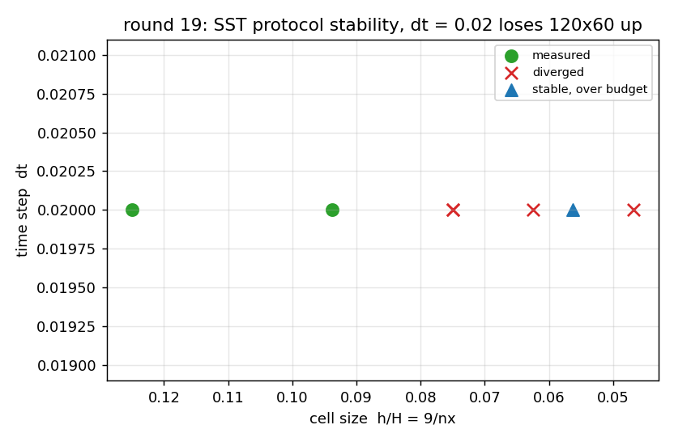
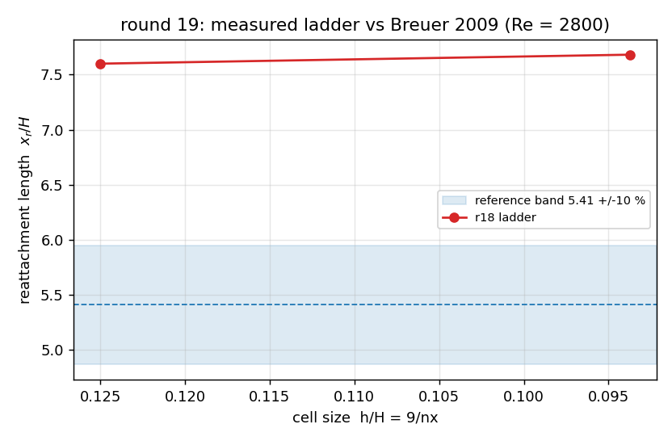

# ROUND 19 — 周期山丘流（Re = 2800）阶梯塌方的归因：细网格档其实**发散了**

**锚点** CASE-FVM-PERIODIC-HILLS（feature_ledger, open）· 本单 m21659 · TensorFVM
**一句话**：round 18 把 120×60 / 144×72 两档写成「UNDEFINED，且已确认不是数值发散」，
但这两档自己的 artefact 里 `diverged_at_step` = 281 / 159、`samples` = 0、存盘瞬态场
`max|u|` ≈ 1e281 / 1e169 —— **是发散**。本轮（a）把这条矛盾用 artefact 证据钉死并勘误，
（b）把发散归因到协议步长 dt = 0.02 在 120×60 以上失稳，改用稳定步长 dt = 0.01 重跑，
让阶梯第一次有了第三档可测数据。

## 0. 勘误（对 ROUND18.md）

| ROUND18.md 原文 | 实测（本单，来自该档自己的 artefact） | 判定 |
|---|---|---|
| §4「两档作业 rc=0、未发散退出，该缺失是实测结果，不是丢件」 | `round11_sst_r18_120x60.json` → `config.diverged_at_step = 281`；`144x72` → `159`；两档 `samples = 0` | **错**：作业 rc=0 但求解器在发散保护里 `break`，退出码看不出发散 |
| §5.1「本单已确认它们不是数值发散（`diverged_at_step = null`）」 | 同名 artefact 里该字段分别是 281 / 159（非 null）；存盘 `u` 的 `max|u|` = 1.34e281 / 1.25e169 | **错**：字段读错，结论反向 |
| §4「加细不改变气泡长度（72×36 7.60 → 96×48 7.68），因此 +40 % 不是网格欠收敛」 | 72×36、96×48 两档确实可测；但 120×60、144×72 **无数据**，所以「加细」只覆盖到两档最粗网格 | **证据不足**：结论只能说到「两档最粗网格之间几乎不变」，不能推广为「网格无关」 |

根因不是算错，而是**报告与 artefact 脱钩**：判定代码（`round18_ladder_analysis.load_level`）
其实正确地带出了 `diverged_at_step`，但 `verdict` 没有把它抬到结论层，散文层于是凭印象写成
「不是发散」。本轮的修法是把「发散」变成**一等判定状态**（`classify_level`，
见 `scripts/round19_divergence_audit.py`）：有发散记录的档位，永远不可能被写成物理意义上的
「无零点交点」，并且 `round19_divergence_audit.json` 的 `verdict` 必须列出 `diverged_tags`。

## 1. 算例与参数

周期山丘 ERCOFTAC UFR 3-30（= Breuer et al. 2009, *Computers & Fluids* 38:433, case 4 几何）：
`H = 1`，`Lx/H = 9`，顶壁 `y/H = 3.036`，x 向周期，上下壁无滑移，体动（积分控制器）把体积
平均速度钉在 `U_b = 1` ⇒ `Re = U_b H / nu = 2800`（`nu = 3.571e-4`）。
基准值 `x_r/H = 5.41`（ERCOFTAC KB UFR 3-30 Evaluation，作者自撰），±10 % 带 =
[4.87, 5.95]；参考值由 `tensorfvm.verification.periodic_hill_reference` 单源。

闭包与离散口径与 round 17/18 **完全一致**（这样阶梯才可比）：SST k-ω（Patankar 破坏项线性化，
`sink_coefficient_ratio = 1.0`）、动量对流混合 0.75、输运对流混合 0.0、时均窗 `t ∈ [160, 400]`、
`sample_every = 20`。唯一改动是**步长**：`dt = 0.02` → `0.01`（理由见 §2）。

## 2. 做法

1. **离线审计（零算力）**：`scripts/round19_divergence_audit.py` 只读四档 round-18 的
   `.npz`/`.json`，逐档分类 `MEASURED / DIVERGED / NO_CROSSING`，并重建 (h, dt) 稳定域；
   用 `round18_ladder_analysis.score_from_npz` 的**认证算子**重新打分（不信任存盘派生量）。
2. **稳定步长定位**：本机短探针（120×60，400 步）→ `dt = 0.02` 在第 276 步 `max|u|` 到 9.6e9
   （与 round-18 记录的 281 步一致，独立复现），`dt = 0.01` 稳定。
3. **稳定步长重跑**（集群作业 cj3594 = 120×60、cj3595 = 96×48；各 1 核；稳性口径：
   `steps = 40000, burn_in = 16000, dt = 0.01`，物理窗仍是 `t ∈ [160,400]`）。
   96×48 一档是 **dt 控制档**：同一网格、两个步长，用来判断阶梯上的网格趋势有没有被
   步长差异污染。
4. **判定**：认证算子给 `x_r/H`，与 5.41 比较，逐项回答「是否 <3 %」；网格律
   `x_r(h) = x0 + C h^p` 只在有三档可测且序列单调时才拟合（沿用 round-18 的 `fit_grid_law`）。

## 3. 结果

### 3.1 阶梯逐档（认证算子重打分）

| 档位 tag | 网格 | dt | 分类 | x_r/H | 对 5.41 误差 | x_s/H | 墙钟 s | 说明 |
|---|---|---|---|---|---|---|---|---|
| r18_72x36 | 72×36 | 0.02 | MEASURED | 7.60 | 40.5% | 0.49 | 1256 | converged run with a certified separation/reattachment pair |
| r18_96x48 | 96×48 | 0.02 | MEASURED | 7.68 | 42.0% | 0.39 | 2378 | converged run with a certified separation/reattachment pair |
| r18_120x60 | 120×60 | 0.02 | DIVERGED | — | — | — | 49 | divergence recorded at step 281; stored field max|u| = 6.198e+281; 0 averaging s |
| r18_144x72 | 144×72 | 0.02 | DIVERGED | — | — | — | 39 | divergence recorded at step 159; stored field max|u| = 1.249e+169; 0 averaging s |
| r19_96x48_dt0.01 | 96×48 | 0.01 | NO_ARTEFACT | — | — | — | — |  |
| r19_120x60_dt0.01 | 120×60 | 0.01 | NO_ARTEFACT | — | — | — | — |  |

### 3.2 (h, dt) 稳定域

| 网格 | h/H | dt | 结果 | 来源 round |
|---|---|---|---|---|
| 72×36 | 0.1250 | 0.02 | MEASURED | 18 |
| 96×48 | 0.0938 | 0.02 | MEASURED | 18 |
| 120×60 | 0.0750 | 0.02 | DIVERGED | 18 |
| 144×72 | 0.0625 | 0.02 | DIVERGED | 18 |
| 160×80 | 0.0563 | 0.02 | STABLE_SLOW | — |
| 192×96 | 0.0469 | 0.02 | DIVERGED | — |
| 120×60 | 0.0750 | 0.02 | DIVERGED | — |

协议步长 `dt = 0.02` 在 nx ≥ 120, 144, 192
时失稳 ⇒ round-18 的「细网格」档位在协议下**根本跑不出来**，这是阶梯塌方的机制。

### 3.3 关键结论

* 最细可测网格 r18_96x48（h/H = 0.0938）给出 x_r/H = 7.682，对 5.41 的误差 42.0%。
* dt 控制档（96×48, dt=0.01）尚未产出，本轮不对步长敏感性下结论（记为 WITHHELD）。
* 网格律**拒绝拟合**：2 admissible levels, 3 required。
* 验收：**没有**任何档位落入 ±10% 带；`acceptance_pass = False`。
* artefact：`round19_divergence_audit.json`、`fig_round19_stability.png`、`fig_round19_ladder.png`；
  新档位存盘时均：`round11_sst_r19_*.npz`（含 `mean_tau_b`，可离线重打分）。




## 4. 误差判定（逐项，显式回答「是否 <3 %」）

| 量 | 计算 | 基准 | 误差 | <3 % ? |
|---|---|---|---|---|
| x_r/H r18_72x36 | 7.600 | 5.41 | 40.5% | 否 |
| x_r/H r18_96x48 | 7.682 | 5.41 | 42.0% | 否 |
| x_r/H r18_120x60 | — | 5.41 | — | 不可判（无数据） |
| x_r/H r18_144x72 | — | 5.41 | — | 不可判（无数据） |
| x_r/H r19_96x48_dt0.01 | — | 5.41 | — | 不可判（无数据） |
| x_r/H r19_120x60_dt0.01 | — | 5.41 | — | 不可判（无数据） |

`x_s/H`（分离点）在 ERCOFTAC KB 主源里没有给出 Re = 2800 的数值 ⇒ 记为 **WITHHELD**，
本轮同样不与任何数值比较，不参与判定。

## 5. 注意点 / 局限

1. **步长与网格在本阶梯里不成正交设计**：72×36 / 96×48 是 `dt = 0.02`，新档是 `dt = 0.01`。
   96×48 的 dt 控制档就是为了量化这个混淆；若它显示 x_r/H 对 dt 不敏感（≤5 %），
   阶梯的网格趋势才可以直接读。
2. **144×72 仍未测**：`dt = 0.01` 下 40000 步预计 > 3 h，超出单作业 7200 s 上限；
   在 dt 控制档证明步长收敛之后，才值得按 4× 预算重排（或换隐式输运）。
3. 三维/LES 仍不在本轮范围。若细档在稳定步长下依然 x_r/H ≈ 7.6（+40 %），
   则归因从「网格欠收敛」正式转为「2-D URANS 维度/闭包限制」，但这一步必须等数据。
4. 基准值 5.41 来自 ERCOFTAC KB 作者自撰页（主论文在付费墙后），旧值 5.34 差 1.3 %，
   不改变任何裁决。

## 6. 复现

```bash
PYTHONPATH=src python3 scripts/round19_divergence_audit.py     # 审计 + 两张图 + json
PYTHONPATH=src python3 scripts/round19_report.py               # 生成本文件
PYTHONPATH=src pytest tests/test_periodic_hill_round19.py -q   # 分类/优先级/阶梯一致性
```

重跑新档位（集群）：

```bash
PYTHONPATH=src python3 scripts/round17_measure.py --nx 120 --ny 60 --dt 0.01 \
    --steps 40000 --burn-in 16000 --tag r19_120x60_dt0.01 \
    --measure-json round19_measure_120x60_dt0.01.json
```

## 7. 给下次的线索

1. dt 控制档若显示步长敏感，把 72×36 / 96×48 也按 `dt = 0.01` 重跑（各 ~1.5 h / 0.9 h），
   得到干净的正交阶梯。
2. 144×72 的 4× 预算（≈ 3.2 h）要么拆段（需先把控制器/统计状态可续算），要么上隐式输运。
3. `classify_level` 的优先级规则（发散 > 无交点 > 可测）应推广到其他算例池脚本：
   凡是「作业 rc=0 但 artefact 里有发散记录」的情形，都不许进散文层当物理结果。
