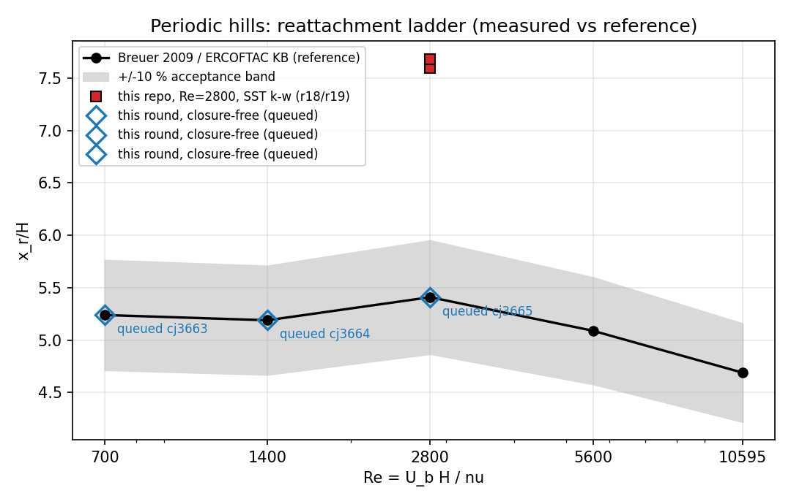

# ROUND 20 — 周期山丘：把**闭合**从**框架**里拆出来（闭包无关分支 + 低 Re 姊妹算例）

**锚点** `CASE-FVM-PERIODIC-HILLS`（feature_ledger, open）· 本单 m21737 · TensorFVM
**一句话**：rounds 9–19 每次报 `x_r/H` 都是「二维 + 一个闭合」的解，却把误差记成「框架或闭合有问题」——
两个假设从未被分开过；本轮把生产驱动补上**无闭合（laminar）分支**，并实现**按 Re 取基准**的评分路径
（KB 原文给了 5 个 Re 的 `x_R/h`），把低 Re 姊妹算例变成可执行、可判定的一件事。
**物理裁决：WITHHELD** —— 三个姊妹算例已递交集群（cj3663/cj3664/cj3665），本单结束前仍在排队，
无一个数字产出；按诚实口径不写成结论、不用 round-18 的推算代替。

## ① 案例介绍

| 项 | 值 |
|---|---|
| 算例 | 周期山丘流 ERCOFTAC UFR 3-30（= Breuer et al. 2009, *Computers & Fluids* 38:433） |
| 几何 | `H=1`，`Lx/H=9`，槽顶 `y/H=3.036`；x 向周期，上下壁无滑移 |
| 工况口径 | 体速度 `U_b=1`（积分控制器），`Re = U_b·H/ν` |
| 基准（同一源的 5 个工况） | `x_R/h = 5.24, 5.19, 5.41, 5.09, 4.69` @ `Re = 700, 1400, 2800, 5600, 10595` |
| 容差 | 总账 10 %；平台论文级 3 % |
| 为什么是这几个 Re | 参考源本身按 Re 列表；`Re=700/1400` 是「二维无闭合尚可辩护」的两档，因此可以用来只测框架 |

基准来源：ERCOFTAC Knowledge Base Wiki `UFR 3-30 Evaluation`（作者自撰），经
`tensorfvm.verification.periodic_hill_reference` 单源引用；本轮的五个数**由测试从该模块的引文字符串里
重新解析比对**，不是第二份手抄。

## ② 怎么做的

1. **缺口定位（只读）**：`build_solver` 只接受 `sa`/`sst`，`run_time_averaged_case` 第 342 行直接
   `solver.turbulence.viscosity()` ⇒ **闭合无关的运行在驱动层不可达**。父求解器
   `PeriodicHillSolver` 本身文档化了 `turbulence=None`（`nu_t` 恒零），所以缺口只在驱动层，
   不是物理能力的缺口。round 18 §7 第 2 条（「先做降 Re 姊妹算例」）因此一直没被执行过。
2. **驱动扩展（最小改动）**：`CLOSURES` 增加 `"laminar"`；`build_solver` 显式置
   `solver.turbulence = None`；`_closure_block` 对 `None` 返回 `closure_free: True`；
   时均循环里 `nu_t/ν` 改为**结构性零**（`np.zeros_like(solver.nu_t)`），不伪装成一次测到 0 的测量。
   拼错的闭合名仍然 `ValueError`，不会静默落进 laminar。
3. **按 Re 取基准的评分**（`verification/periodic_hill_lower_re.py`）：
   * `KB_REATTACHMENT_BY_RE` = 上述五个工况；`Re=2800` 的条目直接引用
     `periodic_hill_reference.X_R_OVER_H`（`5.41`）**同一个对象**，不留两份会漂移的拷贝；
   * `reattachment_reference(re)` **精确匹配、不插值、不取最近邻**：未列出的 Re 返回 `None`
     ⇒ 判 `WITHHELD`，而不是拿插值出来的「基准」；
   * `score_case` 的 Re **只**取 artefact 自己的（`config.reynolds`），不再默认 2800；
     `x_r/H` 在给了 `mean_tau_b`/`x_over_h` 时用 round-17 认证算子**重算**，存盘派生量只做交叉校验；
   * `DIVERGED`/`UNDEFINED`/`WITHHELD`/`PASS`/`FAIL` 变成一等状态（沿用 round 19 的教训：
     发散过的一档永远不能被写成物理意义的「无交点」）；
   * `x_S/h` 只在源给了数的 Re 上评分（`Re=700 → 0.3`，标注 approximate；`Re=2800/1400 → WITHHELD`）。
4. **归因规则预先写死**（`attribution`）：`closure_attributable` / `framework_attributable` /
   `inconclusive` 三分支，且必须同时附 `attribution_limits()`（一致能证明什么、不能证明什么）。
5. **姊妹算例递交**：同一 96×48 网格族、同 `dt=0.02`、同 `t∈[160,400]` 时均窗，只改 Re 与闭合：

| 作业 | 闭合 | Re | 网格 | 步长/步数 | 边界条件 | 基准 `x_R/h` | 状态 |
|---|---|---|---|---|---|---|---|
| cj3663 | laminar | 700 | 96×48 | 0.02 / 20000（burn-in 8000） | 同协议 | 5.24 | **queued（未产出）** |
| cj3664 | laminar | 1400 | 96×48 | 同上 | 同协议 | 5.19 | **queued（未产出）** |
| cj3665 | laminar | 2800 | 96×48 | 同上 | 同协议 | 5.41 | **queued（未产出）** |
| cj3670 | — | — | — | — | `pytest -k "periodic_hill or periodic_mac"` 回归 | — | **queued（未产出）** |

`cj3665` 是**控制档**：与 rounds 17–19 的 SST 档同网格同 Re，只去掉闭合 ⇒ 可直接量出「闭包与框架各占多少」。

## ③ 计算结果

| 量 | 值 | 来源 |
|---|---|---|
| 本轮姊妹算例 `x_r/H`（Re=700/1400/2800） | **无**（作业未出队） | cj3663/3664/3665 queued |
| 驱动端到端验证（24×12、400 步、Re=700、dt=0.02） | `x_r/H = 1.917`（`FAIL`，粗网格冒烟，**不作物理量**） | 本机 `round20_lower_re_sister.py` 冒烟运行 |
| 无闭合分支不变量 | `nu_t ≡ 0`、`max|u|` 有限、`u_b` 保持 1（误差 <1e-6） | `tests/test_periodic_hill_lower_re.py` |
| 已发布 Re=2800 SST 档（对照） | `x_r/H = 7.682`（+42.0 %） | `ROUND18/ROUND19`，`round18_ladder.json` |



图：KB 五档基准（实线）+ ±10 % 带（灰）；红方块是本仓 Re=2800 SST 已发布值；蓝菱形为本轮无闭合档，
**空菱形 = 仍排队**（图上如实标注作业号，不画趋势线、不做外推）。

## ④ 误差判定（逐项）

| 量 | 计算 | 基准 | 误差 | <3 % ? |
|---|---|---|---|---|
| `x_r/H` @ Re=700（无闭合） | 未产出（cj3663 queued） | 5.24 | 不可判 | **不适用（无数据）** |
| `x_r/H` @ Re=1400（无闭合） | 未产出（cj3664 queued） | 5.19 | 不可判 | **不适用** |
| `x_r/H` @ Re=2800（无闭合） | 未产出（cj3665 queued） | 5.41 | 不可判 | **不适用** |
| `x_r/H` @ Re=2800（SST，对照，已发布） | 7.682 | 5.41 | 42.0 % | 否 |
| 合并判定 `attribution` | — | — | — | **本轮 `inconclusive`（无无闭合行）** |

**没有新的物理量达到 <3 %，也没有任何物理量被本轮改变。** 锚点验收仍 **open / FAIL（honest）**；
本轮交付的是**使该问题可判定**的能力，不是判决本身。

## ⑤ 注意点 / 局限（踩过的坑）

1. **纪律坑（最容易犯）**：把 `Re=700` 的 artefact 用共享 `gate` 打分，会拿 `5.41` 去比 `5.24`——
   两者只差 3 %，**不会抛异常**，只会给出一个看起来正常的错裁决。因此 artefact 里同时存
   `gate`（显式标 `gate_reference_reynolds: 2800`）与 `lower_re`（本 Re 的裁决），并有测试
   专门钉住「用 payload 自己的 Re」。
2. **不准插值**：`Re=1000` 没有已发布 `x_R/h`，必须 `WITHHELD`；测试覆盖 1000/2100/3000。
3. **二维 vs 三维的混淆风险**：KB 值是 3-D DNS（LESOCC）。低 Re 姊妹算例**一致**只能证明
   「同一套二维离散 ≠ Re=2800 偏差的来源」，**不能**证明 Re=2800 的流动是二维的；
   `attribution_limits()` 把这条写进数据，报告引用归因时必须同时引用它。
4. **冒烟数不是物理量**：24×12/400 步的 `x_r/H=1.917` 只证明驱动与评分链路能跑通，物理上无意义。
5. **算力口径**：集群当时 84 个作业在飞，1 核档排队 >50 min 未起；本单未在本机跑重算（遵守调度令），
   因此没有物理结果。`load15` 全程 74–87，重算全部走调度门。

## ⑥ 复现

```bash
PYTHONPATH=src pytest tests/test_periodic_hill_lower_re.py -q      # 20 passed, 3 skipped(artefact 未产出)
PYTHONPATH=src python3 scripts/round20_lower_re_sister.py --closure laminar \
    --reynolds 700 --tag 96x48 --nx 96 --ny 48 --steps 20000 --burn-in 8000 --dt 0.02
PYTHONPATH=src python3 scripts/round20_analysis.py                  # 表 + 图（有 artefact 才画实测点）
```

## ⑦ 给下次的线索（按优先级）

1. **等 cj3663/3664/3665**：出队后 `fetch` 三个作业 → `scripts/round20_analysis.py` 自动把实测点填进
   `round20_table.json` 与图 → `attribution()` 给出 `closure_attributable` / `framework_attributable`。
   这是本锚点**第一次**能把「框架 vs 闭合」分开的机会，别再做第 20 轮同样的 RANS 阶梯。
2. 若 `Re=700` 无闭合落在 10 % 内而 `Re=2800` 不落：本锚点的正确结论是「框架已验证、
   Re=2800 需 3-D/LES」，建议向总账提**新条目**（3-D 扩展），而不是继续在 2-D 上改闭合。
3. 若 `Re=700` 也不落 10 %：优先查**时间推进精度**（dt 与二阶时间项）与壁面剪切度量在同一网格上的
   自洽性，而不是再加闭合。
4. `120×60 / 144×72` 在协议 dt 下发散（round 19 已定性），细网格必须同时降 dt，预算按 4× 计。