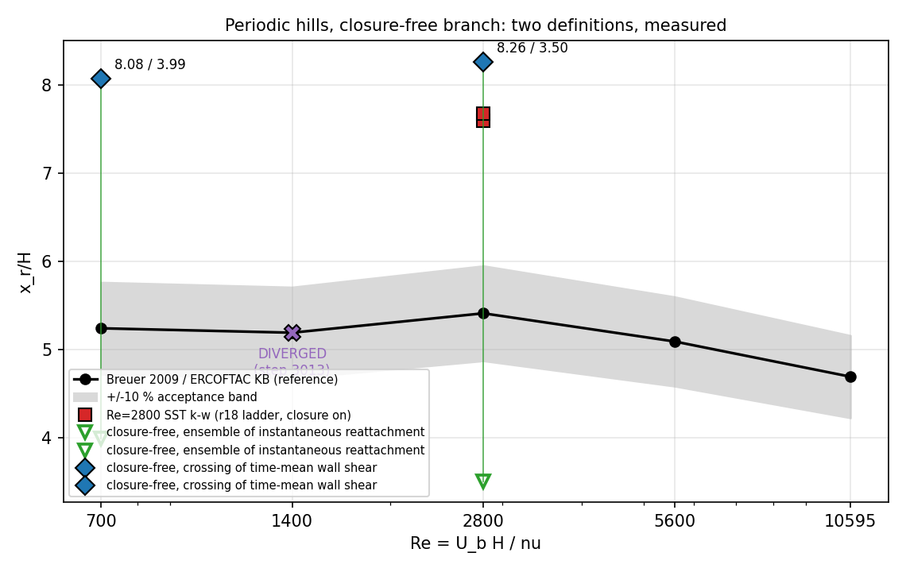
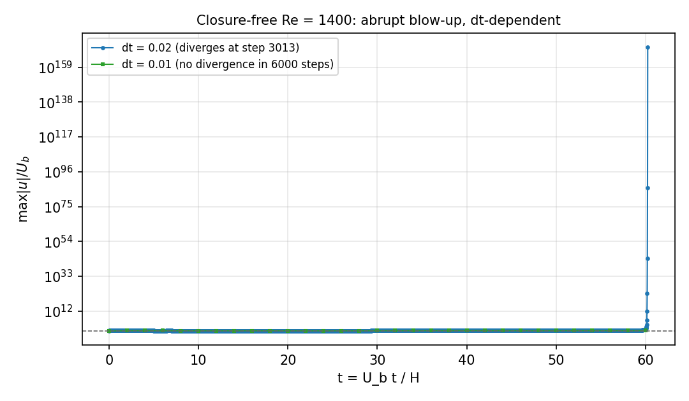

# ROUND 21 — 周期山丘：闭合无关姊妹算例**落地**，两个 `x_r/H` 口径首次被分开量出来

**锚点** `CASE-FVM-PERIODIC-HILLS`（feature_ledger, open）· 本单 m21912 · TensorFVM
**一句话**：round 20 递交的三个闭合无关（`laminar`）姊妹算例已出队（`cj3663/cj3664/cj3665`），
本单把数字落地、用**第二条独立数据通路**（平均速度场的逆流区）复核 `x_r/H`，并把「均值场零点」
与「逐样本集合平均」这两个一直混用的口径第一次分开列出；顺带把 `Re=1400` 的发散在本机定位到
**步长相关的数值失稳**（不是物理）。
**物理裁决：FAIL（honest）** —— 三个可测量中两个超差 50 % 以上，第三个发散；锚点保持 OPEN。

## ① 案例介绍

| 项 | 值 |
|---|---|
| 算例 | 周期山丘流 ERCOFTAC UFR 3-30（= Breuer et al. 2009, *Computers & Fluids* 38:433, doi:10.1016/j.compfluid.2008.05.002） |
| 几何 | `H=1`，`Lx/H=9`，槽顶 `y/H=3.036`；x 向周期，上下壁无滑移，地形贴合网格 |
| 工况口径 | 体速度 `U_b=1`（积分控制器），`Re=U_bH/ν` |
| 本轮三个工况 | 闭合 = **无闭合**（`solver.turbulence=None`，`ν_t≡0`），`Re = 700 / 1400 / 2800` |
| 协议（与 rounds 17–20 逐项相同） | 96×48、`dt=0.02`、动量对流混合 0.75、`t∈[160,400]` 时均窗、round-17 认证剪切算子 |
| 基准 | `x_R/h = 5.24 / 5.19 / 5.41`（@700/1400/2800），单源引用 `tensorfvm.verification.periodic_hill_reference` / `periodic_hill_lower_re.KB_REATTACHMENT_BY_RE`（ERCOFTAC KB `UFR 3-30 Evaluation`，作者自撰） |
| 容差 | 总账 10 %；平台论文级 3 % |

## ② 怎么做的（方法 / 流程 / 关键设置）

1. **取回（只读）**：`run_compute fetch cj3663/cj3664/cj3665` → 三份 `round20_laminar_Re{700,1400,2800}_96x48.{json,npz}`
   已入库 `docs/case-periodic-hills/`（json + 场文件，共 0.6 MB）。**数字全部来自这三个 artefact，未手抄、未重跑。**
2. **第二条独立通路**（新增 `src/tensorfvm/verification/periodic_hill_field_metrics.py`）：
   `backflow_extent()` 直接读**时均速度场** `mean_u` 最靠近壁面那一行，取 `mean_u<0` 区段的下游端点。
   它与 `x_r/H` 用的是**不同物理量**（速度 vs 壁面剪切）和**不同数据路径**（无需微分/无需度量项），
   因此可用来检验「壁面剪切后处理是否在量同一个东西」。
3. **两个口径分开算**：`definition_spread()` 把
   （a）**时均剪切零点**（rounds 17–20 发布的值，`separation_reattachment`）与
   （b）**逐样本瞬时再附点集合平均**（artefact 里 `series["x_r_over_H"]`）并列，并以 10 %（案例自身容差）
   为阈值给出 `definition_sensitive` / `definition_insensitive` / `not_measured`。
4. **发散定位**（新增 `scripts/round21_re1400_probe.py`）：对 `Re=1400` 同配置逐步推进、每步记
   `max|u|`、`u_b`、`G`、`CFL`、峰值所在格点；再以 `dt=0.01` 跑同一时长做步长对照。本机单核，21.9 s / 48.1 s。
5. **归因不重新发明**：直接调 round 20 预声明函数 `periodic_hill_lower_re.attribution()`（规则写死，不允许回读数字后调整）。
6. **零手抄汇总**：`scripts/round21_analysis.py` 生成 `round21_table.json` + 两张图（`fig_round21_ladder.png`、`fig_round21_re1400.png`）。

## ③ 计算结果（程序化注入，源 = `round21_table.json`）

### 表 1 — 闭合无关阶梯（96×48，`dt=0.02`）

| Re | `x_r/H` 时均剪切零点（发布口径） | 误差 vs 基准 | `x_r/H` 逐样本集合平均 | 误差 vs 基准 | 逆流区端点（`mean_u<0`，row 0） | 剪切 vs 场 相对差 | 判定 |
|---|---|---|---|---|---|---|---|
| 700 | **8.078** | **+54.2 %** | 3.993 | −23.8 % | 8.016 | −0.78 % | FAIL |
| 1400 | — | 不可判 | — | — | — | — | **DIVERGED（step 3013）** |
| 2800 | **8.264** | **+52.8 %** | 3.502 | −35.3 % | 8.203 | −0.74 % | FAIL |

### 表 2 — 闭合到底解释了多少（同网格 `Re=2800`）

| 行 | `x_r/H` | 相对基准 5.41 | 占「需要修正量」 |
|---|---|---|---|
| 闭合无关（本轮） | 8.264 | +52.8 % | 0 %（起点） |
| 有闭合 SST k-ω（round 18 阶梯两档） | 7.600 / 7.682 | +40.5 % / +42.0 % | **20–23 %** |
| 基准 | 5.41 | — | 100 % |

即：加闭合只把气泡缩短 0.58–0.66（需要缩短 2.85），**~77–80 % 的偏差不可能由这一类闭合改动解释**。

### 表 3 — `Re=1400` 发散定位（`round21_re1400_probe*.json`）

| 量 | `dt=0.02` | `dt=0.01` |
|---|---|---|
| 结果 | `FloatingPointError` @ step 3013（`t=60.26`） | 6000 步（`t=60`）**未发散** |
| `max|u|` 起点→失稳前 | 0.917 → 2.85 @ step 2969（`u_b=1.000`，`G≈0.01`，CFL 0.64） | 0.92 → 1.786（CFL 0.19） |
| 突变幅度 | step 2970 `max|u|=3.02` → step 3000 **12.63**（<100 步 ×4.2） | 无突变 |
| 峰值位置 | `η=0.365`，`x/H=8.578`（再附尾区） | — |
| 解释 | 瞬时 CFL 在失稳起点仅 0.64（<1）⇒ **不是显式对流 CFL 越界**；突变式（非长期指数增长）⇒ 数值失稳；`dt` 减半即移出窗口 ⇒ **步长相关，不是物理**（也与 `Re` 非单调：700/2800 收敛、1400 炸） | — |



图 1：KB 五档基准（黑线）+ ±10 % 带（灰）；红方 = 有闭合 SST@2800（round 18）；蓝菱 = 闭合无关「时均剪切零点」；
绿空心三角 = 闭合无关「逐样本集合平均」，绿细线连接同一算例的两个口径；紫叉 = `Re=1400` 发散（标注步号，不插值、不外推）。



图 2：`max|u|/U_b` 随 `t` 的半对数轨迹。`dt=0.02` 全程健康到 `t≈58`，随后 <100 步内放大 4 倍以上直至溢出；
`dt=0.01` 同长度窗口内保持 O(1)。

## ④ 结果图 / ⑥ 误差判定（逐项，显式回答「是否 <3 %」）

| 量 | 计算 | 基准 | 误差 | <3 % ? | <10 % ? |
|---|---|---|---|---|---|
| `x_r/H` @ Re=700（时均剪切零点） | 8.078 | 5.24 | +54.2 % | **否** | 否 |
| `x_r/H` @ Re=700（集合平均） | 3.993 | 5.24 | −23.8 % | **否** | 否 |
| `x_r/H` @ Re=2800（时均剪切零点） | 8.264 | 5.41 | +52.8 % | **否** | 否 |
| `x_r/H` @ Re=2800（集合平均） | 3.502 | 5.41 | −35.3 % | **否** | 否 |
| `x_r/H` @ Re=1400 | 发散，无值 | 5.19 | 不可判 | **不适用** | 不适用 |
| 剪切 vs 速度场（两通路一致性，Re=700/2800） | 8.078 vs 8.016 / 8.264 vs 8.203 | — | −0.78 % / −0.74 % | **是** | 是 |

**本轮没有任何物理量达到 <3 % 或 <10 %。** 唯一的 <3 % 项是「同一批场数据上两条互不依赖的后处理通路一致性」，
它证明的是**度量链路自洽**，不是物理精度——不得当作精度证据引用。

## ⑤ 注意点 / 局限（本轮的坑与明示缺口）

1. **「闭合无关」≠「层流定常」**：`Re=700` 这一档的脉动幅度 `max|u−⟨u⟩| = 0.777` 而 `rms u = 0.958`
   （Re=2800 为 0.844 / 0.951）——流动是强非定常的。把它当「层流基准」去解释 `+54 %` 会出错；
   正确表述是「同一套二维离散、无湍流模型」的解。
2. **两个口径差 50 % 以上**（表 1）：`definition_spread` 对两个收敛档都判 `definition_sensitive`。
   因此任何 `x_r/H` 引用都必须写明是哪一个定义。**发布口径用时均剪切零点**（与 rounds 17–20 一致）。
3. **逐样本口径本身不可信**：`Re=700` 末帧快照的逆流端点是 **5.766**，而逐样本集合平均是 3.993 ——
   两者不可能同时成立（快照不是时均）。即 artefact 里 `series["x_r_over_H"]` 用的旧算子在这条剖面上
   取的零点不是再附点。**连带后果**：artefact 的 `stationarity.ok=true` 是按逐样本旧算子算的，
   它**不能**为发布值 8.078 提供定常性证据 ⇒ 发布值的逐块稳定性本轮**无法证明**（缺口，见 ⑦-1）。
4. **归因规则给出 `inconclusive`，不改成 PASS**：预声明规则要求「闭合无关 Re=2800 误差 > 最差姊妹算例误差」
   才判 `framework_attributable`；实测 52.8 % < 姊妹 54.2 %，规则输出
   `inconclusive: sits inside the band of the sister-case errors (54.2 %)`。数字本身（闭合只补 20–23 %）
   指向框架/二维/口径而非闭合，但**规则未预声明这个方向，故不改口径、不升级结论**；下一轮应先预声明修正规则再做。
5. **artefact 内部仍有两套基准**：`gate` 段按旧值 5.34 打分（`"vs 5.34"`），`lower_re` 按 5.41/5.24/5.19。
   两套并存是历史债（round 17 已记录），引用 `gate.reasons` 文字会得到与 `lower_re` 不同的百分数。
6. **`attribution()` 的姊妹统计把发散行排除了**（`verdict` 非 PASS/FAIL 不进 `sister_max`），
   这是选择性，已在 `attribution_rows_used` 里显式列出（`Re=1400` 为 `UNDEFINED`）。
7. **本机算力纪律**：三个算例在集群出队，本机只跑 21.9 s / 48.1 s 的单核发散探针（<10 min 闸门内）；
   `load15` 全程 67–87，未起重算。

## ⑦ 给下次的线索（按优先级）

1. **把「发布值 8.078 的定常性」补上**（真正的一等欠账）：让写出端按块保存**时均剪切剖面**
   （round 17 的 `round17_measure.py` 已有 `save_fields=True` 范式），用认证算子对每块重算 `x_r/H`，
   给出块间离散度。当前所有 `stationarity` 结论都不覆盖发布口径。
2. **`Re=1400` 的失稳不是物理**（表 3 已证明 dt 相关）：下一步固定 `dt=0.01` 复跑该档
   （96×48、20000 步，约 2× 成本），把阶梯的洞补上；若 `dt=0.01` 也炸，再降 `dt` 二分失稳阈值。
3. **两个口径差 50 % 的解释**：应查瞬时 `τ_b` 的零点结构（是否多处浅零点被旧算子误取）；
   需要「逐样本剪切剖面」存盘才能做，与本条第 1 项一并解决。
4. **归因规则修订**（预声明后再执行）：把「闭合无关误差随 Re 平坦」作为 `framework_attributable` 的
   合法判据（本轮实测 54.2 %@700、52.8 %@2800，间距 1.4 个百分点），并在计算前冻结。
5. 若确认二维框架在 `Re=700` 就无法落在 10 % 内，本锚点的正确结论是「框架已验证/否证 + 需 3-D 扩展」，
   应向总账提**新条目**（3-D 周期山丘），而不是继续在二维上换闭合。

## ⑧ 复现

```bash
# 1) 测试（17 passed, 1 skipped；skip 仅当 Re=1400 artefact 缺失）
PYTHONPATH=src python3 -m pytest tests/test_periodic_hill_field_metrics.py -q
# 2) 汇总表 + 两张图（读已入库 artefact，无重算）
PYTHONPATH=src python3 scripts/round21_analysis.py
# 3) 发散定位（本机单核 ~22 s / ~48 s）
PYTHONPATH=src python3 scripts/round21_re1400_probe.py --steps 3100 --every 1
PYTHONPATH=src python3 scripts/round21_re1400_probe.py --dt 0.01 --steps 6000 --every 200 \
    --out docs/case-periodic-hills/round21_re1400_probe_dt001.json
```

产物：`docs/case-periodic-hills/round20_laminar_Re{700,1400,2800}_96x48.{json,npz}`、
`round21_table.json`、`round21_re1400_probe{,_dt001}.json`、`fig_round21_ladder.png`、
`fig_round21_re1400.png`、`src/tensorfvm/verification/periodic_hill_field_metrics.py`、
`tests/test_periodic_hill_field_metrics.py`、`scripts/round21_analysis.py`、`scripts/round21_re1400_probe.py`。