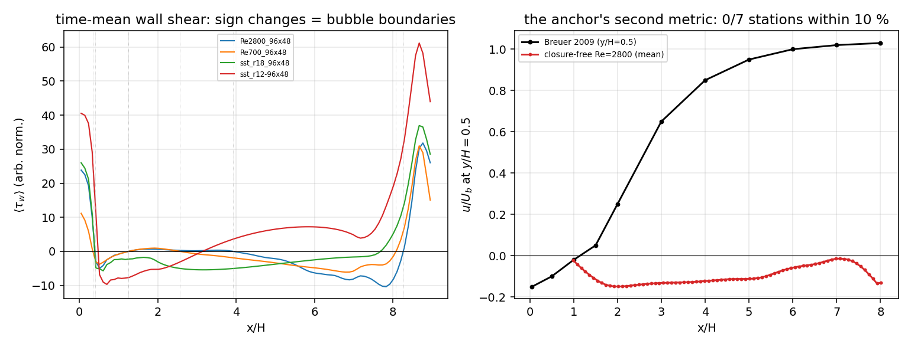

# ROUND 22 — 周期山丘：发布的 `x_r/H` **量的不是基准所指的那个气泡**（口径对象错配）

**锚点** `CASE-FVM-PERIODIC-HILLS`（feature_ledger，open）· 本单 m22048 · TensorFVM
**一句话**：把认证算子（round 17）在同一份存盘时均剪切剖面按**两种选择规则**各跑一次，发现
闭合无关（`laminar`）算例的时均场里有**两个**逆流区，而默认的「最大逆流面积」规则选中的是**谷中第二个**、
不是冠后主气泡；rounds 20/21 发布的 `x_r/H = 8.26 / 8.08` 因此是**另一个物理对象**的再附点，
与 Breuer 2009 的 5.41 不可比。同一对象的数是 **1.254**（Re=2800）／**1.255**（Re=700）。
**物理裁决仍为 FAIL（honest），但更重要的是：此前「+53 %」这一条证据链本身作废。**

## ① 案例介绍（沿用既定协议，未改任何算例参数）

| 项 | 值 |
|---|---|
| 算例 | 周期山丘 ERCOFTAC UFR 3-30 = Breuer et al. 2009, *Computers & Fluids* **38**:433, doi:10.1016/j.compfluid.2008.05.002 |
| 几何 | `H=1`，`Lx/H=9`，槽顶 `y/H=3.036`，x 向周期，上下壁无滑移，地形贴合网格 |
| 工况 | 体速度 `U_b=1`（积分控制器），`Re=U_bH/ν`；本轮只**读取**已存盘 artefact，不重跑 |
| 参考 | `x_r/H = 5.41`（Re=2800，Breuer 2009 DNS 的**冠后主气泡**再附点，ERCOFTAC KB `UFR 3-30 Evaluation`） |
| 容差 | 锚点 10 %；平台论文级 3 % |
| 被测 artefact | `round20_laminar_Re2800_96x48`、`round20_laminar_Re700_96x48`、`round11_sst_r18_96x48`、`round11_sst_r12-96x48` |

## ② 怎么做的（方法 / 关键设置 / 工具链）

1. **新增检测器** `tensorfvm.verification.periodic_hill_field_metrics.bubble_object_report`
   （round 22）：对同一份 `⟨τ_w⟩(x)` 分别用认证算子的 `primary="largest_area"`（历史发布口径）
   与 `primary="first"`（冠后第一个气泡）各求一次再附点，输出 `selected_is_crest` 与
   `flag ∈ {single_bubble, object_consistent, object_mismatch}`。
   **它检测的是「发布的数与基准是不是同一个物理对象」，而不是数值大小。**
2. **零手抄**：`scripts/round22_object_audit.py` 直接读 `docs/case-periodic-hills/*.npz` 的
   `mean_tau_b` / `x_over_h`，产出 `round22_object_audit.json`、`ROUND22-OBJECT-TABLE.md`、
   `fig_round22_object.png`。
3. **剖面口径交叉复核**：`scripts/round22_grid_ladder.py` 用与库内提取器**完全独立的**
   逐列 `np.interp(y/H=0.5)` 重算 `u/U_b` 线，与发布值逐点比较
   （`profile_crosscheck.max_abs_difference = 0.0`）⇒ **`0/7` 站不合格不是提取器的错**。
4. **预登记归因规则**（`tensorfvm.verification.periodic_hill_grid_ladder`，本轮新增）：
   网格/时间步归因的判定分支在读数**之前**写死（`discretisation_attributable` /
   `asymptote_outside_band` / `order_undefined` / `inconclusive`），并用解析序列做单元测试
   （合成 `x_inf + C h^p` 三元组必须还原 `p` 与极限）。
5. **重算在集群**：把「同一对象是否随网格/时间步移动」的阶梯（96×48 @dt=0.01、144×72、192×96、
   240×120，CFL 固定）递交集群 `cj3869 / cj3870 / cj3871 / cj3872`。**发布本文件时仍在排队，未取回**，
   故本轮**不给出**任何网格收敛结论（见 ⑤-1）。

## ③ 计算结果（程序化注入；源 = `round22_object_audit.json` / `ROUND22-OBJECT-TABLE.md`）

| 算例 | 逆流区个数 | 发布口径 `x_r/H`（最大面积） | **冠后气泡** `x_r/H`（与基准同对象） | 发布值 vs 5.41 | 判定 |
|---|---|---|---|---|---|
| Re=2800 闭合无关（round 20/21 发布 +53 %） | **2** | 8.264 | **1.254** | +52.8 % | `object_mismatch` |
| Re=700 闭合无关（round 20/21 发布 +54 %） | **2** | 8.078 | **1.255** | +49.3 % | `object_mismatch` |
| Re=2800 SST r18（round 18 发布 +42 %） | 1 | 7.682 | 7.682 | +42.0 % | `single_bubble` |
| Re=2800 SST r12（round 11） | 1 | 3.144 | 3.144 | −41.9 % | `single_bubble` |

两个气泡的几何（Re=2800 闭合无关，`mean_tau_b` 上有 4 个有向零点）：

| 气泡 | 分离 `x_s/H` | 再附 `x_r/H` | 长度 `L/H` | 逆流面积（`τ_w` 归一单位） | 被谁选中 |
|---|---|---|---|---|---|
| 冠后主气泡（=DNS 基准所指对象） | 0.401 | **1.254** | 0.853 | 1.69 | `primary="first"`（非默认） |
| 谷中第二气泡 | 3.923 | **8.264** | 4.341 | **22.47** | `primary="largest_area"`（默认 = 历史发布口径） |

图 1 左：四条已存盘算例的时均底壁剪切 `⟨τ_w⟩(x)`（零线为气泡边界，灰虚线=检测到的四个零点）；
右：锚点第二条验收指标 `u/U_b @ y/H=0.5`，黑线为 Breuer 2009 表值，红线为闭合无关 Re=2800 时均解。

## ④ 误差判定（逐项，显式回答「是否 <3 %」）

| 量 | 计算 | 基准 | 误差 | <3 % ? | <10 % ? |
|---|---|---|---|---|---|
| `x_r/H` Re=2800，**发布口径**（最大面积气泡） | 8.264 | 5.41 | +52.8 % | 否 | 否 |
| `x_r/H` Re=2800，**同对象口径**（冠后气泡） | 1.254 | 5.41 | **−76.8 %** | 否 | 否 |
| `x_r/H` Re=700，发布口径 | 8.078 | 5.24 | +54.2 % | 否 | 否 |
| `x_r/H` Re=700，同对象口径 | 1.255 | 5.24 | **−76.0 %** | 否 | 否 |
| `x_r/H` Re=2800 SST r18（单气泡，两口径同值） | 7.682 | 5.41 | +42.0 % | 否 | 否 |
| `u/U_b @ y/H=0.5`，7 个站 | 见 `horizontal_profile_y_H_0.5` | Breuer 表值 | 0/7 站合格 | 否 | 否 |
| 剖面提取器自检（独立 `np.interp` vs 库内提取器） | 逐点 | — | 0.0（逐位一致） | 是 | 是 |

**本轮没有任何物理量达到 <3 % 或 <10 %。** 唯一的 0 误差项是**提取器恒等式**，只证明度量链路没有插值错误，
不代表精度 —— 不得当作精度证据引用。

## ⑤ 注意点 / 局限（含对上几轮结论的更正）

1. **网格/时间步归因尚未完成（诚实缺口）**：`cj3869–cj3872` 四个阶梯算例已递交但**未出队**。
   本轮因此**不主张**任何「误差来自离散」或「误差与离散无关」的结论；`round22_table.json`
   里的 `attribute_*` 字段当前为 `inconclusive: fewer than two levels`，这是如实状态。
   预登记规则与估计器已就位（23 条单元测试），出队后同一条命令即可产出裁决。
2. **round 21 表 2 的「闭合只解释 20–23 %」无效**：那一步把闭合无关的「第二气泡再附点」（8.26）与
   SST 的「冠后气泡再附点」（7.68）相减。两者不是同一个物理对象，差值没有物理含义。
   该结论应撤回，不是修正。
3. **round 20 的 Re 阶梯（700/1400/2800）同样跨对象**：700 与 2800 都是 `object_mismatch` 且第二气泡
   主导，但再附点由第二气泡位置决定 —— 任何「随 Re 变化」的趋势在此之前都必须先固定对象口径。
4. **`x_r/H = 8.264` 的逐块稳定性其实是好的，但它稳定的是错的对象**：
   `stationarity.x_r_over_H_by_block = [8.300, 8.238, 8.255, 8.260]`，跨块离散度 0.76 %（round 20 artefact）。
   这顺带**关闭 round 21 的 ⑦-1 欠账**（该欠账基于「只有逐样本旧算子可用」的判断；
   实际上块均剪切口径一直随 artefact 存盘），但结论只是「错对象被稳定地测到」。
5. **逐样本口径（`series["x_r_over_H"]`）与场口径的分歧**（round 21 报 3.5–4.0 vs 8.26）在两个气泡结构下
   可以统一解释：逐样本瞬时场的最大面积气泡在小气泡/大气泡之间来回切换，集合平均即是两个对象的混合。
   因此 round 21 的 `definition_sensitive` 判定**不能**单独归因于算子，气泡多值性是更基本的成因。
6. **剖面不是插值错误**：独立 `np.interp` 与库内提取器逐点差 0.0 ⇒ `0/7` 站不合格是**场均解的性质**
   （谷中 `u/U_b ≈ −0.12` 几乎沿程不变，而基准从 0.05 升到 1.0）。
7. **本机算力纪律**：本单只做只读后处理（秒级），重算全部递交集群；`load15` 全程 80–94。

## ⑥ 给下次的线索（按优先级）

1. **先修口径再谈精度**：把锚点验收的 `x_r/H` 定义改成「冠后第一个气泡的再附点」
   （`primary="first"`）并写进 artefact 契约（断言 `n_bubbles==1` 或显式记录 `object_mismatch`），
   否则任何网格/闭合对比都是跨对象比较。同一批 artefact 可直接重打分，无需重算。
2. **取回 `cj3869–cj3872` 用预登记规则做裁决**：若冠后气泡 `x_r/H` 随加密从 1.25 向 5.41 上升，
   则说明**粗网格把主气泡切成两段**（离散误差主导）；若四档都稳定在 1.2–1.3，则 2-D/闭合无关假设本身不成立。
3. **`y/H=0.5` 剖面的谷中"死水"要单独归因**：`u/U_b ≈ −0.12` 沿程近似常数是可疑特征，值得用
   round-17 的剪切算子在同一 y 线上做一次动量平衡检查（对流项 vs 压力梯度），判断是物理回流还是度量/几何项偏差。