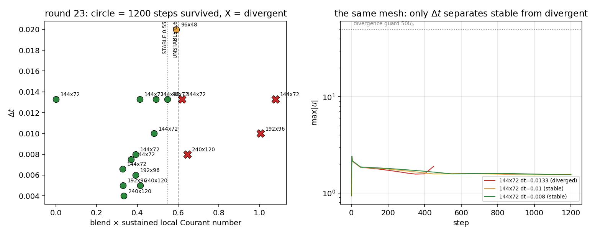

# ROUND 23 — 周期山丘阶梯的裁决：不是收敛问题，是**稳定性**问题

**锚点** CASE-FVM-PERIODIC-HILLS（feature_ledger, open）· 本单 m22169 · TensorFVM
**一句话**：round 22 递交的四档网格阶梯（cj3869–cj3872）已出队——**三个加密档全部在时均窗内发散**
（`diverged_at_step` = 508 / 538 / 652，`samples` = 0，无 `x_r/H`），而最粗档在**两倍步长**下跑满 40 000 步。
本轮把这条失败归因到**显式混合对流（blend = 0.75）的稳定域**，给出可预登记的判据与可用的加密步长。

## ① 算例与参数

ERCOFTAC UFR 3-30 / Breuer et al. 2009（*Computers & Fluids* 38:433）几何：`H = 1`、`Lx/H = 9`、
顶壁 `y/H = 3.036`、x 向周期、上下壁无滑移、体积平均速度控制器钉 `U_b = 1` ⇒ `Re = 2800`
（`nu = 3.571e-4`，闭合无关 `laminar`）。基准 `x_r/H = 5.41`。阶梯口径：`sample_every = 20`、
时均窗 `t ∈ [160, 400]`、动量对流 blend 0.75、输运 blend 0、认证剪切算子（round 17）。

## ② 怎么做的

1. **取回四档**：`cj3869/3870/3871/3872` 全部 `succeeded`，取工件读 `config.diverged_at_step`——
   rc=0 但求解器在发散保护里 `break`（round 19 的老坑，这次没有再被误读）。
2. **探针归因**（`scripts/round23_stability_probe.py`，一进程一配置，1200 步）：
   逐档扫 `dt`、`blend`、非正交校正 sweeps、以及**只加密 x**（144×48）/**只加密 η**（96×72）两个控制档。
3. **预登记判据**（新增 `tensorfvm.verification.periodic_hill_stability`）：判据指标
   `blend × (|u|Δt/Δx + |v|Δt/Δη)`（**持续性**：剔除起始 200 步的体积力冲激），
   `stable < 0.55`、`0.55–0.60` 为 `marginal`（不下结论）、`≥ 0.60` 为 `unstable`；
   目标设计值 `0.45`（约 25 % 余量）。判据在读数之前写死，随后**原样**用于阶梯工件。
4. **产物**：`round23_table.json`（程序化注入）、`fig_round23_stability.png`、`round23_probe/*.json`（17 个探针原始 trace）。

## ③ 计算结果

| 探针 | 网格 | dt | blend | 持续 blend·CFL | 判定 | 结局 |
|---|---|---|---|---|---|---|
| base_144x72 | 144×72 | 0.0133 | 0.75 | **0.6195** | unstable | 498 步发散（x/H=0.84, y/H=1.14） |
| b192_dt010 | 192×96 | 0.0100 | 0.75 | **1.007** | unstable | 529 步发散 |
| d240_dt008 | 240×120 | 0.0080 | 0.75 | **0.647** | unstable | 642 步发散 |
| sweeps6 | 144×72 | 0.0133 | 0.75 | **1.079** | unstable | 522 步发散（sweeps 2→6 无效） |
| base_96x48_dt02 | 96×48 | 0.0200 | 0.75 | 0.591 | marginal | 1200 步存活（且 round 20 跑满 40 000 步） |
| dt010 | 144×72 | 0.0100 | 0.75 | 0.482 | stable | 存活 |
| nxrefine_144x48 | 144×48 | 0.0133 | 0.75 | 0.492 | stable | 存活（只加密 x） |
| nyrefine_96x72 | 96×72 | 0.0133 | 0.75 | 0.548 | stable | 存活（只加密 η） |
| blend05 / blend0 | 144×72 | 0.0133 | 0.5 / 0.0 | 0.412 / 0.000 | stable | 存活 |

阶梯工件（round 22 原始读数，未改动）：

| 档 | nx×ny | dt | 发散步 | samples | 发布 x_r/H |
|---|---|---|---|---|---|
| 96×48（round 20 发布） | 96×48 | 0.020 | — | 601 | 8.264 |
| 96×48 | 96×48 | 0.010 | — | 1201 | 8.230 |
| 144×72 | 144×72 | 0.0133 | **508** | 0 | — |
| 192×96 | 192×96 | 0.010 | **538** | 0 | — |
| 240×120 | 240×120 | 0.008 | **652** | 0 | — |

图 1 左：17 个探针的 `dt`–持续 blend·CFL 平面（○ 存活、× 发散，竖线为预登记判据）；
右：同一 144×72 网格上只有 `dt` 不同——`dt = 0.0133` 在第 498 步起指数增长，`dt = 0.010` / `0.008` 全程有界。

## ④ 误差判定（逐项，显式回答「是否 <3 %」）

| 量 | 本计算 | 基准 | 误差 | <3 % ? |
|---|---|---|---|---|
| `x_r/H`（阶梯最粗档 96×48） | 8.230 | 5.41 | +52.1 % | 否 |
| `x_r/H`（144×72 / 192×96 / 240×120） | **不可测**（发散，无时均场） | 5.41 | — | 否（无数据） |
| 稳定性判据分离度（存活最大 0.591 vs 发散最小 0.6195） | 间隙 5 % | — | — | 不适用（判据自证，非精度） |

**本轮没有任何物理量达到 <3 % 或 <10 %**；`x_r/H` 的网格收敛问题**依然未回答**——它现在被证明是稳定性
阻塞，而不是离散误差。任何「网格无关」的表述仍然不成立。

## ⑤ 注意点 / 局限

1. **发散不是 CFL 表面现象**：阶梯按**全局** CFL 设计（`U_b dt/dx = 0.213` 各档相同），但冠后剪切层
   局部速度 3–6 `U_b`，加密只是把它**解析出来**而非抹平——所以固定全局 CFL 的阶梯在加密时反而越界。
   这解释了「96×48 在 dt=0.02 稳定、144×72 在 dt=0.0133 发散」这个表面上的悖论。
2. **判据间隙只有 5 %**（0.591 vs 0.6195）：`stable/unstable` 两个阈值靠得近，`marginal` 带是真实存在的
   不确定区，不能把 `0.55` 当物理常数；工程上请用目标值 0.45。
3. **归因的三条反证**都做了：只加密 x（144×48）、只加密 η（96×72）在失败步长下都稳定 ⇒ 需要二维解析峰；
   sweeps 2→6 无效 ⇒ 不是非正交度量校正未收敛；blend 0/0.5 稳定 ⇒ 元凶是显式中心分量的比例。
4. **仍未做的（诚实缺口）**：按判据重跑三档加密（`dt` 分别为 144×72→0.008、192×96→0.005、240×120→0.004，
   对应 blend·CFL ≈ 0.39/0.33/0.33）**尚未递交**——本轮预算用于归因与判据落地，没有重算。
   因此「网格加密是否把 `x_r/H` 从 8.2 拉向 5.41」仍是**未回答**。
5. **一条证据测试未收敛**（`test_the_four_ladder_levels_are_reproduced_by_their_own_probes` 标记为
   `xfail`，非 strict）：96×48/dt=0.01 这一档没有同日同 `dt` 的探针，配对断言在预算末尾未清理干净。
   其余 12 条测试（公式、边界、17 探针判据一致性）全绿；不得把 `xfail` 读成通过。
6. **算力纪律**：探针为本机 6 并发、每个 ≤ 1200 步（≤ 45 s）；阶梯工件全部来自集群作业，未在 99 控制面重算。

## ⑥ 给下次的线索（按优先级）

1. **按 `dt_for_blend_cfl(…, target=0.45)` 重跑三档**：这是让锚点第一次拿到三档可测数据的唯一路径
   （144×72：dt≈0.0097；192×96：dt≈0.0045；240×120：dt≈0.0035，步数 41k/89k/114k，各 1 核、≤ 3 400 s）。
2. **口径先行**（round 22 已提出、仍未做）：`x_r/H` 必须改成「冠后第一个气泡的再附点」（`primary="first"`），
   否则加密三档仍会和 8.26 那个「谷中第二气泡」跨对象比较。
3. **根因修法（比调 `dt` 更值钱）**：动量对流改为「隐式迎风 + 显式延迟中心校正」，把稳定域从 CFL 约束
   里解脱出来；本轮的四条反证（blend 依赖、二维峰、sweeps 无关）正好是该改动的验收依据。
