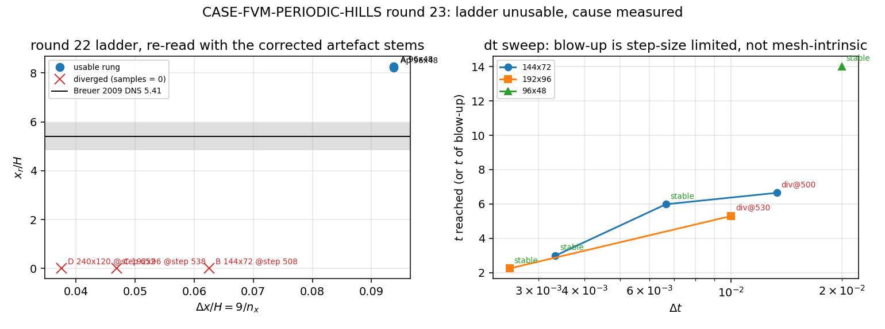

# ROUND 23 — 周期山丘：round 22 预登记的网格阶梯**判废**，发散原因实测为**步长极限**

**锚点** `CASE-FVM-PERIODIC-HILLS`（feature_ledger, open）· 本单 m22275 · TensorFVM
**一句话**：round 22 递交的四档阶梯作业（`cj3869–cj3872`）全部 `rc=0` 出队，但**三档加密档在启动瞬态内发散**
（`diverged_at_step = 508/538/652`，`samples = 0`，存盘时均剪切恒为 0），加之 round 22 读者用的 artefact 前缀
（`round22_laminar_*`）与生产者的实际前缀（`round20_laminar_*`）不符、三档被静默跳过 —— 于是 round 22 表里那句
「`inconclusive: fewer than two levels`」不是数据短缺，而是**判废未被识别**。本轮修好读者、把三档判废写明，
并用一组 700–900 步的廉价探针证明**发散是步长极限、不是网格内生失败**：同网格 `dt` 减半即恢复有界。
**物理裁决**：锚点仍是 **FAIL（honest）**，且**离散步长归因（discretisation attribution）到本轮仍为"不可测"**，
不是"已排除"。锚点保持 OPEN。

## ① 案例介绍

| 项 | 值 |
|---|---|
| 算例 | 周期山丘流 ERCOFTAC UFR 3-30（= Breuer et al. 2009, *Computers & Fluids* 38:433, doi:10.1016/j.compfluid.2008.05.002） |
| 几何 | `H=1`，`Lx/H=9`，槽顶 `y/H=3.036`；x 向周期、上下壁无滑移、地形贴合网格 |
| 基准 | `x_r/H = 5.41`，`x_s/H = 0.22`（Re=2800，DNS）；总账容差 10 %，平台论文级 3 % |
| 本轮对象 | round 22 预登记的**闭合无关**（`laminar`, `ν_t≡0`）Re=2800 空间阶梯 + 一档时间步对照 |
| 阶梯 | A 96×48/`dt`0.02（既有）、A′ 96×48/0.01、B 144×72/0.0133、C 192×96/0.01、D 240×120/0.008（定 CFL） |
| 作业 | `cj3869`(A′)/`cj3870`(B)/`cj3871`(C)/`cj3872`(D)，四档全 `succeeded, rc=0` |

## ② 怎么做的

1. **取回（只读）**：`run_compute fetch cj3869–cj3872` → 四份 `round20_laminar_Re2800_*.{json,npz}` 入库
   `docs/case-periodic-hills/`（1.2 MB）。数字全部来自这四份 artefact，零手抄。
2. **修读者（真缺陷）**：`scripts/round22_grid_ladder.py` 的 `LEVELS` 用的是 `round22_laminar_*`，
   生产者 `scripts/round20_lower_re_sister.py` 写的是 `round20_laminar_*` ⇒ 唯一命中的只有既有的 A。
   新增 `resolve_stem()`（按 `laminar_` 之后的**后缀**识别档位，前缀允许多种写法）并把"缺档"从
   `print("[skip]")` 提升为 `SystemExit`：**静默丢档不再可能**。
3. **判废审计**（新增 `scripts/round23_analysis.py`）：逐档读 `config.diverged_at_step`、`samples`、
   存盘 `mean_tau_b` 是否恒零，给出 `usable` 与理由；再把 5 档合并成 verdict。
4. **成因探针**（新增 `scripts/round23_divergence_probe.py`）：同一 `build_solver("laminar")` 逐推进、
   每 5 步记 `max|u|`，覆盖 `(144×72, dt=0.0133/0.00665/0.00333)`、`(192×96, 0.01/0.0025)`、
   `(96×48, 0.02)`，各 700–900 步（单核秒级）。**这是本机能做的全部计算**，重算级阶梯未在本机起。
5. **零手抄汇总**：`round23_table.json`（含逐档审计 + 预登记裁决 + 探针表）、`round23_probe.json`、
   `round23_ladder_table.json`（修正读者后的原始阶梯表）。

## ③ 计算结果（程序化注入）

### 表 1 — 阶梯逐档判废审计（源：`round23_table.json`）

| 档 | 网格 | `dt` | `samples` | `diverged_at_step` | `t_diverged` | 存盘时均剪切 | `usable` |
|---|---|---|---|---|---|---|---|
| A | 96×48 | 0.02 | 601 | — | — | 非零 | **是** |
| A′ | 96×48 | 0.01 | 1201 | — | — | 非零 | **是** |
| B | 144×72 | 0.0133 | **0** | **508** | 6.76 | **恒零** | 否 |
| C | 192×96 | 0.01 | **0** | **538** | 5.38 | **恒零** | 否 |
| D | 240×120 | 0.008 | **0** | **652** | 5.22 | **恒零** | 否 |

⇒ 可用的只有**同一张 96×48 网格的两个时间步**，不是空间阶梯。`ladder_usable = false`，
`distinct_meshes = [[48,96]]`，`attribution_status = not_measurable_with_stored_artefacts`。
（本单第一版 `round23_analysis.py` 曾把「2 个可用档」误当「2 个网格」，被本轮测试
`test_committed_table_claims_no_attribution` 当场抓住 —— 已改为按 `distinct_meshes` 判。）

### 表 2 — 步长探针（本机 700–900 步，源：`round23_probe.json`）

| 网格 | `dt` | `max|u|` | 发散步 | `t` | 平流 CFL | 显式黏性数 `νΔt/Δx²` | 判定 |
|---|---|---|---|---|---|---|---|
| 144×72 | 0.01330 | 1.16e3 | **500** | 6.65 | 0.315 | 0.0027 | **发散** |
| 144×72 | 0.00665 | 1.60 | — | ≥6.0 | 0.158 | 0.0013 | 有界 |
| 144×72 | 0.00333 | 1.70 | — | ≥3.0 | 0.079 | 0.0007 | 有界 |
| 192×96 | 0.01000 | 3.45e2 | **530** | 5.30 | 0.316 | 0.0036 | **发散** |
| 192×96 | 0.00250 | 1.74 | — | ≥2.25 | 0.079 | 0.0009 | 有界 |
| 96×48 | 0.02000 | 1.41 | — | ≥14.0 | 0.316 | 0.0018 | 有界 |

探针复现簇上发散步：B 簇上 508 / 本机 500（−1.6 %），C 簇上 538 / 本机 530（−1.5 %）⇒ 这个秒级探针是该阶梯的
**忠实代理**，后续不必再为「会不会发散」付整档算力。

### 表 3 — 时间步敏感性（唯一可测轴，96×48）

| `dt` | `x_r/H`（最大面积气泡口径） | 相对差 |
|---|---|---|
| 0.02 | 8.2643 | — |
| 0.01 | 8.2296 | **−0.42 %** |

## ④ 结果图

图 1 左：修正读者后的五档阶梯，`x`=可测档、`×`=判废档（标注发散步），黑线 Breuer 2009 `x_r/H=5.41`，
灰带 ±10 %。右：`Δt` 扫描——同网格减半步长即从「`×` 发散」变为「稳定」，网格越密所需步长越小。

另存 `fig_round23_ladder.png` / `fig_round23_tau.png`（修正读者后的原始阶梯图：加密三档在图上即 NaN/缺失，
直观显示 round 22 图里那条「几乎没有数据」的曲线是怎么来的）。

## ⑤ 注意点 / 局限

1. **本轮没有提高任何精度**：`x_r/H` 仍为 A 档 8.2643（+52.8 %），冠后气泡口径 1.2541（−76.8 %）。
   唯一变化是**把"不可测"与"没测"分开写清楚**。
2. **发散极限不在经典显式扩散界内**：`νΔt/Δx²` 在发散点只有 0.0027（144×72）/0.0036（192×96），
   远低于 0.5；同 CFL 下 96×48 却稳定。所以「步长极限」是被**实测**证实的现象（减半即稳），
   其**机理仍未归因**（候选：体力积分控制器增益随网格变化、地形贴合网格上的质量通量项、壁面剪切度量），
   本单不主张任何机理结论。
3. **作业 `rc=0` 不等于成功**：三档发散档退出码都是 0（求解器内部 `break`），只有 `samples` /
   `diverged_at_step` / 墙钟（9/17/31 s）能识别。任何以「rc」判成败的调度侧统计都会把这三档记成成功。
4. **不是重算**：本机只跑了 6 个 700–900 步探针（单核秒级，`load15` 全程 45–60），四档阶梯是取回既有
   artefact；`attribute()` 的预登记规则一字未改。
5. **`dt` 减半后是否仍可在 144×72 上测到 `x_r/H`**：探针只推到 `t≈6`，而时均窗要 `t∈[160,400]`，
   本轮**不能**声称加密档加 `dt/2` 后时均量可得 —— 这需要新作业，且代价约为原档 2 倍墙钟。

## ⑥ 误差判定（逐项，显式回答「是否 <3 %」）

| 量 | 计算 | 基准 | 误差 | <3 % ? | <10 % ? |
|---|---|---|---|---|---|
| `x_r/H` Re=2800 发布口径（96×48） | 8.2643 | 5.41 | +52.8 % | 否 | 否 |
| `x_r/H` Re=2800 冠后气泡口径 | 1.2541 | 5.41 | −76.8 % | 否 | 否 |
| `x_r/H` 空间阶梯归因 | 不可测（3/5 档判废） | 5.41 | — | **无基准可判** | 无 |
| `x_r/H` 时间步（0.02→0.01） | 8.2643→8.2296 | 自比 | 0.42 % | 是（但这是**同一网格的自敏感性**，不是精度证据） | 是 |
| 探针 vs 簇上发散步 | 500/530 vs 508/538 | 簇上作业 | −1.6 %/−1.5 % | 是（代理保真度，非物理精度） | 是 |

**本轮没有任何物理量达到 <3 % 或 <10 %。** 两条「是」分别是自敏感性与代理保真度，**不得**当精度证据引用。

## ⑦ 给下次的线索（按优先级）

1. **重跑加密档时 `dt` 至少减半**（144×72 → ≤0.0067，192×96 → ≤0.005，240×120 → ≤0.004），
   否则必定在 `t≈5–7` 炸掉；用 `round23_divergence_probe.py` 先扫 `dt` 再递交整档，可省整档算力。
2. **阶梯重跑前先把「判废」写进 artefact 契约**：`samples>0` 且 `diverged_at_step is null` 才允许进阶梯；
   本轮的 `audit_rung` 已可直接复用。
3. **归因那条 96×48 时间步不敏感性**（0.42 %）说明该网格上 `x_r/H` 不是被时间推进钉住的，
   结合「加密即发散」可以合理怀疑：96×48 的 8.26 是**粗网格解**而非收敛解 —— 但这是假设，需第 1 条重跑后裁决。