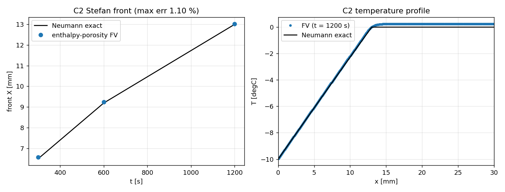
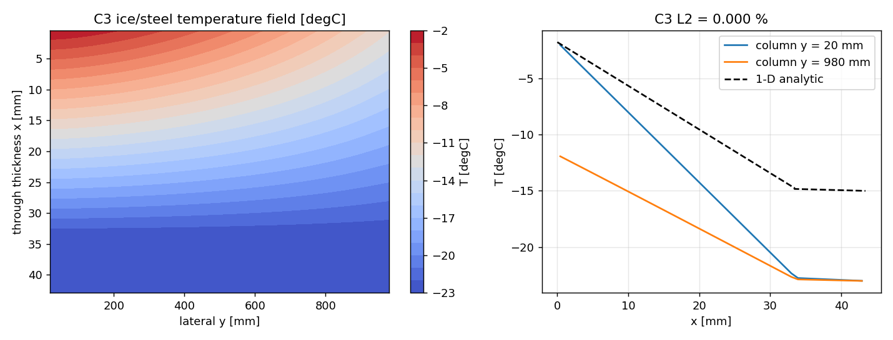
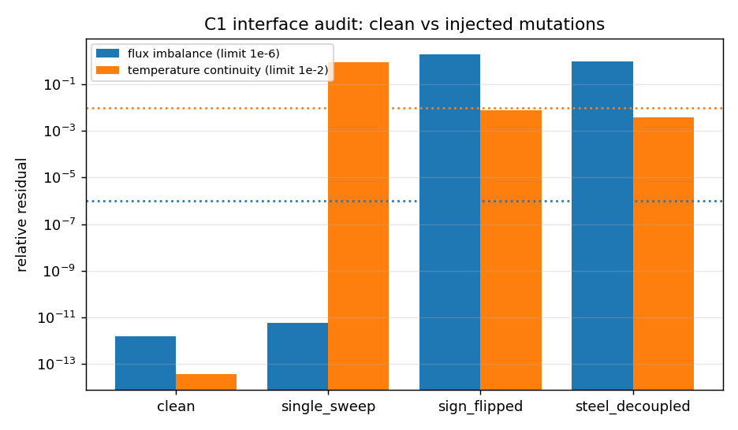
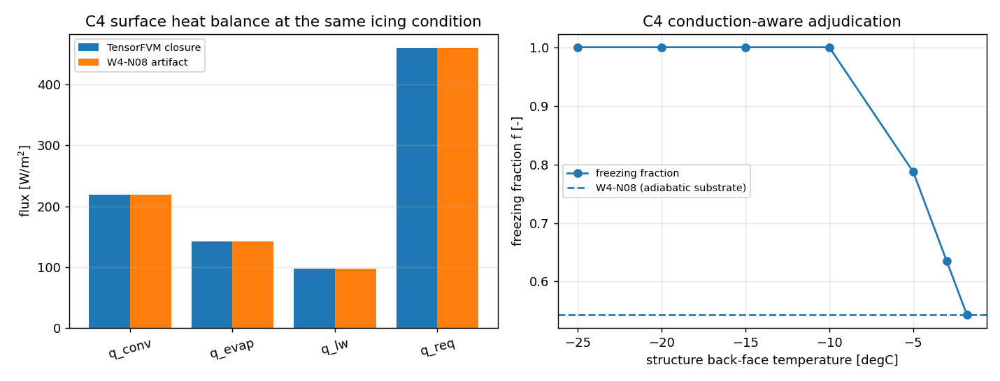

# CHT / Stefan / ice-steel verification results (auto-generated)

> Generated by `python -m tensorfvm.cht.runner_phase --case all` from the JSON ledgers in `src/tensorfvm/verification/artifacts/cht-stefan/`. Do not edit by hand.

## C1 ice/steel interface

| quantity | value | limit | pass |
|---|---|---|---|
| temperature continuity (rel. to dT drive) | 3.508e-14 | 1e-2 | True |
| interface heat-flux residual | 1.529e-12 | 1e-6 | True |
| q vs analytic series | 1.434e-13 | - | - |
| all mutations detected | True | true | True |

| mutation | flux imbalance | temperature continuity | red |
|---|---|---|---|
| single_sweep | 5.684e-12 | 8.827e-01 | True |
| sign_flipped | 2.000e+00 | 7.946e-03 | True |
| steel_decoupled | 1.000e+00 | 3.924e-03 | True |

## C2 Stefan phase change vs Neumann

| t [s] | front FV [mm] | front exact [mm] | rel. error | max T error [K] |
|---|---|---|---|---|
| 300 | 6.569 | 6.498 | 1.10 % | 0.047 |
| 600 | 9.238 | 9.189 | 0.53 % | 0.078 |
| 1200 | 13.023 | 12.995 | 0.21 % | 0.087 |

Energy ledger imbalance: 2.576e-15 (limit 1e-9), Stefan number 0.06287, lambda = 0.17549.

| nx | dt [s] | dT_mush [K] | max front error | energy imbalance |
|---|---|---|---|---|
| 200 | 1.0 | 0.5 | 2.51 % | 1.12e-15 |
| 200 | 0.5 | 0.5 | 1.80 % | 2.69e-15 |
| 400 | 1.0 | 0.5 | 1.67 % | 2.01e-15 |
| 400 | 0.5 | 0.5 | 1.10 % | 2.58e-15 |
| 800 | 1.0 | 0.5 | 1.33 % | 1.90e-15 |
| 800 | 0.5 | 0.5 | 0.66 % | 2.13e-15 |
| 400 | 0.5 | 0.5 | 1.10 % | 2.58e-15 |
| 400 | 0.5 | 0.2 | 1.44 % | 4.51e-16 |
| 400 | 0.5 | 0.05 | 1.98 % | 1.24e-15 |

## C3 ice/steel steady field

| n_ice | n_steel | L2 rel. error | max abs error [K] |
|---|---|---|---|
| 10 | 4 | 0.0000 % | 1.14e-13 |
| 20 | 5 | 0.0000 % | 5.68e-14 |
| 40 | 10 | 0.0000 % | 1.08e-12 |
| 80 | 20 | 0.0000 % | 1.65e-12 |

Acceptance L2 = 0.0000 % (limit 5 %), series flux q = 852.613 W/m$^2$, contact jump = 0.0853 K.

## C4 cross-adjudication with W4-N08 icing

Condition (from the W4-N08 artifact): `T_a=-10 C, U=10 m/s, T_sea=-1.8 C, RH=0.8, 2 m x 2 m wall`; artifact sha256 `5b4395d7ee3f9d4e…`.

| quantity | TensorFVM | W4-N08 | rel. error |
|---|---|---|---|
| q_conv [W/m2] | 218.9928 | 218.9928 | 1.72e-07 |
| q_evap [W/m2] | 142.5713 | 142.5713 | 9.47e-08 |
| q_lw [W/m2] | 98.1371 | 98.1371 | 1.35e-07 |
| q_req [W/m2] | 459.7012 | 459.7012 | 5.35e-11 |
| freezing_fraction | 0.543297 | 0.543297 | 6.11e-08 |
| icing_rate_mm_per_h | 5.572267 | 5.572267 | 4.01e-08 |

* temperature field L2 (CHT vs independent reference, same ice 33.43 mm): **0.0000 %** (limit 5 %)
* wall resistance surface->back: 0.015497 m$^2$K/W, contact jump 0.0852 K, series q = 851.77 W/m$^2$
* conduction-aware adjudication at the cold hold (-15.0 degC): regime wet -> dry, f = 0.543 -> 1.000, icing rate 5.57 -> 10.26 mm/h

| back-face T [degC] | regime | f | surface T [degC] | q_cond [W/m2] | icing rate [mm/h] |
|---|---|---|---|---|---|
| -1.8 | wet | 0.543 | -1.80 | 0.0 | 5.57 |
| -3.0 | wet | 0.635 | -1.80 | 77.4 | 6.51 |
| -5.0 | wet | 0.787 | -1.80 | 206.5 | 8.08 |
| -10.0 | dry | 1.000 | -3.05 | 448.6 | 10.26 |
| -15.0 | dry | 1.000 | -5.67 | 602.2 | 10.26 |
| -20.0 | dry | 1.000 | -8.36 | 751.2 | 10.26 |
| -25.0 | dry | 1.000 | -11.11 | 896.2 | 10.26 |

## Figures

