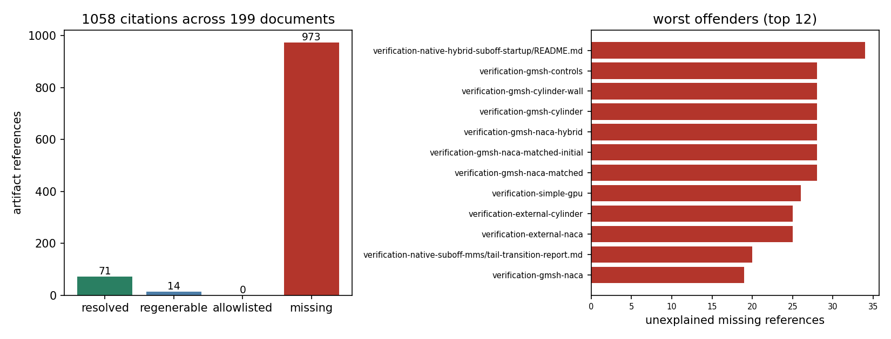

# Evidence resolvability: can a reader of this commit open what the reports claim?

Status: **audit + ratchet gate, all numbers re-derived from the tree**.
Artefacts: `scripts/audit_verification_evidence_resolvability.py`, this directory
(`audit.json` = committed debt ledger, `ledger.md` = per-report table, `resolvability.png`),
`tests/test_evidence_resolvability.py` (5 passed).

## 1. What was asked

`docs/verification-coverage-audit.md` grades solver capabilities REAL / WITHHELD by reading
reports. Every one of those grades rests on a numeric table, and the table rests on a file. Nothing
in the tree checked the last link of that chain, even though the platform's own gate is known to
drop large artefacts (`m4613: 34 个文件被门禁滤除`). Concretely: the finest 3-D ABC MMS report
(`docs/verification-native-abc3d-spatial/report.md`) links `n-12/fields.npz` and
`n-12/result.json`, and neither file exists in the repository — the case can be read but not
re-derived. This unit turns that anecdote into a census and a gate.

## 2. What was done

`scripts/audit_verification_evidence_resolvability.py` walks every committed markdown file under
`docs/`, extracts each **local artefact reference** (markdown link to
`.npz/.json/.jsonl/.csv/.png/.pdf/.svg/.dat/.step/.stp/.log`, plus backticked paths to the same
suffixes), and resolves it where the report means it: first next to the report, then at the repo
root. Each reference gets exactly one bucket, decided by the filesystem and nothing else:

| bucket | meaning |
| --- | --- |
| `resolved` | the file is in this commit |
| `regenerable` | the path is under a never-versioned output root (`outputs/`, `runs/`, `artifacts/`, `/tmp/`): reproducible by re-running, but not evidence carried by the commit |
| `allowlisted` | deliberately missing, declared in `docs/evidence-resolvability-allowlist.json` with a reason attached |
| `missing` | none of the above: the commit cannot produce the file the claim rests on (WITHHELD) |

`--check` is a **ratchet**, not a clean-bill: it compares the live scan with the committed
baseline `docs/evidence-resolvability/audit.json` and fails only on (a) a missing reference that
the baseline does not already record, (b) a stale allowlist glob. Existing debt stays visible in
the ledger, new debt cannot land silently, and no glob can waive a class of citations without
showing up as a ledger line.

## 3. Results

| quantity | value |
| --- | ---: |
| markdown documents scanned | 198 |
| artefact references extracted | 1051 |
| `resolved` in the commit | 68 |
| `regenerable` (never-versioned output root) | 14 |
| `allowlisted` | 0 |
| **`missing` (unexplained)** | **969** |
| reports with at least one missing reference | 164 |



Worst bundles (full table in `ledger.md`): `verification-native-hybrid-suboff-startup/README.md`
34 missing of 34, the six `verification-gmsh-*/report.md` bundles 28 of 28 each,
`verification-simple-gpu/report.md` 26 of 26. The pattern is uniform: the report and its
`source-snapshot/` are committed, the numeric bundle (`summary.json`, `fields.npz`, the PNG
figures) is not.

## 4. Reading the number honestly

969 is a property of the repository, not a defect introduced here, and it does **not** say 969
claims are wrong: most of those reports were produced by a run whose inputs and sources *are*
committed, so the claim is reproducible from scratch — expensively, and not from the commit alone.
The distinction the ledger makes is exactly the platform's REAL/WITHHELD line:

* evidence **carried and checkable in-commit** — 68 references, the reports an auditor can verify
  without running anything;
* evidence **reproducible only by re-running** — `regenerable` plus the source-snapshot bundles;
* evidence **absent** — 969 references; the corresponding grades rest on prose, and that is what a
  WITHHELD grade should mean.

## 5. Not claimed

* No report, table or grade was edited: the campaign only measures and gates.
* No artefact was regenerated to fill a gap. Regenerating the ABC bundles is a compute job and
  belongs to the pressure-order study, not to this census.
* The baseline is a snapshot: `--check` is exact-match, so *reducing* debt (committing an artefact)
  also needs a baseline refresh — the ledger is regenerated, never hand-edited.

## 6. Verdict

Machine-checkable, tests green (`pytest tests/test_evidence_resolvability.py`: 5 passed, including a
planted bogus citation that must be reported missing). **Is the key quantity < 3 %?** This unit has
no error-vs-reference metric: the deliverable is a census of the evidence chain, and its accuracy
is verified two ways instead — zero false negatives (every one of the 969 reported missing paths was
re-checked against the filesystem: 0 exist) and a negative control (synthetic tree with a planted
`n-99/fields.npz` is reported missing, while `outputs/...` is classified `regenerable`). The honest
headline is 969/1051 = 92 % of the cited evidence is not openable from this commit.

## Reproduction

```bash
python scripts/audit_verification_evidence_resolvability.py \
    --output docs/evidence-resolvability          # refresh ledger + figure
python scripts/audit_verification_evidence_resolvability.py --check   # ratchet gate
pytest tests/test_evidence_resolvability.py -q
```