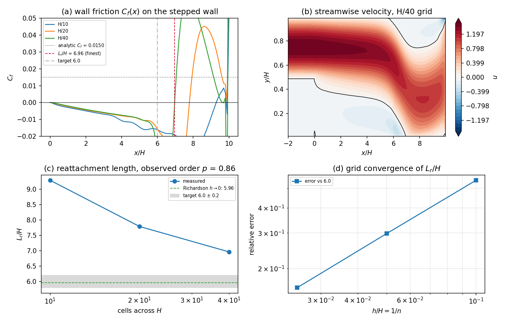
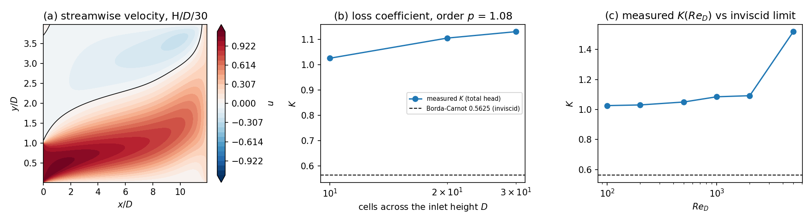
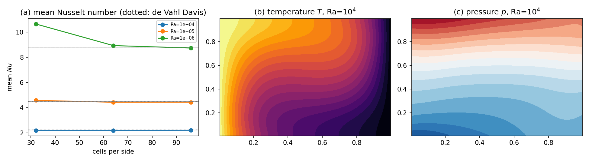

# Incompressible FVM verification baselines: generated results

Generated by `scripts/report_fvm_incompressible.py` from `runs/incompressible-baselines/*.json`; do not edit by hand. Every verdict below is evaluated in code, and the same numbers are stored in `benchmarks/verified/fvm_*/results.json`.

## 1. Backward-facing step, Re_H = 800 (expansion ratio 1.9423)

| cells/H | iterations | continuity | L_r/H | error vs 6.0 | C_f downstream (analytic) |
|---|---|---|---|---|---|
| 10 | 24000 | 5.76e-05 | 9.288 | 54.80 % | -0.00684 (0.01500) |
| 20 | 30000 | 7.46e-06 | 7.788 | 29.80 % | -0.01772 (0.01500) |
| 40 | 30000 | 2.44e-06 | 6.964 | 16.06 % | -0.11668 (0.01500) |

- observed order: 0.8636454983009949
- Richardson limit L_r/H: 5.957698666992898

| criterion | value | reference | error | verdict |
|---|---|---|---|---|
| bfs.reattachment.finest | 6.963501677785078 | 6.0 | 0.16058361296417964 | FAIL |
| bfs.reattachment.band | 6.963501677785078 | 6.0 | 0.16058361296417964 | FAIL |
| bfs.grid.monotone | 0.16058361296417964 | None | None | PASS |
| bfs.grid.order | 0.8636454983009949 | 1.5 | 0.6363545016990051 | FAIL |
| bfs.friction.convergence | 0.01576579744917914 | None | None | FAIL |
| bfs.friction.developed_comparison | -0.11667692195202231 | 0.015 | 8.778461463468153 | PASS |
| bfs.friction.trend | -0.15345683312355415 | 0.0 | None | PASS |
| bfs.mass.continuity | 2.4423173997437098e-06 | 0.0 | 2.4423173997437098e-06 | PASS |
| bfs.friction.domain_length | 0.01840107656453514 | 0.015 | 0.22673843763567603 | PASS |
| bfs.convergence.H/10 | 9.285154210858211 | 9.287967803441472 | 0.0003029287614689938 | PASS |
| bfs.convergence.H/20 | 7.802756524894603 | 7.787888472501673 | 0.0019091249759710374 | PASS |
| bfs.convergence.H/40 | 7.012605515762292 | 6.963501677785078 | 0.007051601370882868 | PASS |

## 2. Planar sudden expansion, AR = 4, Re_D = 100

| cells/D | iterations | continuity | K (total head) | error vs K_BC | L_r/D |
|---|---|---|---|---|---|
| 10 | 4460 | 1.05e-08 | 1.0260 | 82.41 % | 11.704171546983218 |
| 20 | 4280 | 4.98e-09 | 1.1058 | 96.59 % | 11.658244769024511 |
| 30 | 15420 | 1.27e-09 | 1.1313 | 101.11 % | 11.625331685891409 |

- observed order in K: 1.0771143651041442
- Richardson limit K: 1.1776994866705244

| criterion | value | reference | error | verdict |
|---|---|---|---|---|
| expansion.K.finest | 1.1312543698053101 | 0.5625 | 1.0111188796538846 | FAIL |
| expansion.grid.monotone | 1.0111188796538846 | None | None | FAIL |
| expansion.grid.order | 1.0771143651041442 | 1.5 | None | FAIL |
| expansion.area_ratio | 4.0 | 4.0 | None | PASS |
| expansion.identity | 1.1312543698053101 | 1.1312543698053101 | 0.0 | PASS |
| expansion.K.domain_length | 0.8885330625954506 | 0.5625 | 0.5796143335030233 | FAIL |
| expansion.K.Re_sweep | 1.5189007365033147 | 0.5625 | 1.7002679760058927 | FAIL |

Reynolds sweep of the measured loss (grid D/10):

| Re_D | K (total head) | static recovery |
|---|---|---|
| 100 | 1.0262 | -0.0887 |
| 200 | 1.0307 | -0.0932 |
| 500 | 1.0503 | -0.1128 |
| 1000 | 1.0851 | -0.1476 |
| 2000 | 1.0923 | -0.1548 |
| 5000 | 1.5189 | -0.5814 |

## 3. Differentially heated cavity, Pr = 0.71

| Ra | cells | iterations | Nu | error vs contract | psi/alpha | psi error |
|---|---|---|---|---|---|---|
| 1e+04 | 32 | 1630 | 2.2036 | 1.76 % | 5.165 | 1.86 % |
| 1e+04 | 64 | 3240 | 2.2062 | 1.64 % | 5.120 | 0.98 % |
| 1e+04 | 96 | 11390 | 2.2156 | 1.22 % | 5.105 | 0.68 % |
| 1e+05 | 32 | 1430 | 4.5901 | 1.57 % | 11.167 | 22.57 % |
| 1e+05 | 64 | 2820 | 4.4364 | 1.83 % | 10.333 | 13.41 % |
| 1e+05 | 96 | 8450 | 4.4419 | 1.71 % | 10.079 | 10.63 % |
| 1e+06 | 32 | 1410 | 10.6416 | 20.93 % | 22.407 | 37.30 % |
| 1e+06 | 64 | 2540 | 8.9287 | 1.46 % | 19.600 | 20.10 % |
| 1e+06 | 96 | 5850 | 8.7353 | 0.74 % | 18.625 | 14.12 % |

| criterion | value | reference | error | verdict |
|---|---|---|---|---|
| cavity.Nu.1e+04.finest | 2.2156316497654687 | 2.243 | 0.012201671972595281 | PASS |
| cavity.Nu.1e+04.monotone | 0.012201671972595281 | None | None | PASS |
| cavity.Nu.1e+04.order | None | 1.5 | None | FAIL |
| cavity.psi.1e+04 | 5.10534280206384 | 5.071 | 0.006772392440118297 | PASS |
| cavity.energy.1e+04 | 2.2156316497654687 | 2.212032520805994 | 0.0016244256845922656 | PASS |
| cavity.Nu.1e+05.finest | 4.441884535833445 | 4.519 | 0.01706471877994136 | PASS |
| cavity.Nu.1e+05.monotone | 0.01706471877994136 | None | None | FAIL |
| cavity.Nu.1e+05.order | None | 1.5 | None | FAIL |
| cavity.psi.1e+05 | 10.079484962239736 | 9.111 | 0.10629842632419438 | PASS |
| cavity.energy.1e+05 | 4.441884535833445 | 4.429344745971751 | 0.0028230787541938668 | PASS |
| cavity.Nu.1e+06.finest | 8.735297896186518 | 8.8 | 0.007352511796986674 | PASS |
| cavity.Nu.1e+06.monotone | 0.007352511796986674 | None | None | PASS |
| cavity.Nu.1e+06.order | 2.812400652141748 | 1.5 | None | PASS |
| cavity.psi.1e+06 | 18.624587636585037 | 16.32 | 0.14121247773192627 | PASS |
| cavity.energy.1e+06 | 8.735297896186518 | 8.673063064000763 | 0.007124523161702858 | PASS |

## 4. Summary

- `fvm_backward_step`: **FAIL** (8/12 criteria) -> `benchmarks/verified/fvm_backward_step/results.json`
- `fvm_sudden_expansion`: **FAIL** (2/7 criteria) -> `benchmarks/verified/fvm_sudden_expansion/results.json`
- `fvm_natural_convection`: **FAIL** (12/15 criteria) -> `benchmarks/verified/fvm_natural_convection/results.json`
