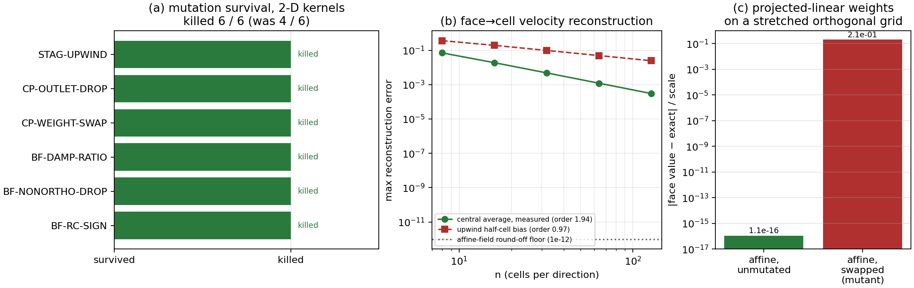

# 两个「已被接受的」变异存活项结清：投影线性权重与面→心速度重构

任务 m3507（TensorFVM，验证欠账类）。前序 m2987 的变异审计留下 6 个变异体里 2 个
**存活**（`CP-WEIGHT-SWAP`、`STAG-UPWIND`），并在
`tests/test_mutation_coverage.py::ACCEPTED_GAPS` 里写明「本轮无法转成判据测试」的障碍。
本单把这两条障碍逐一拆掉：不是把它们从目录里删掉，而是补上能真正判伪的测试，
并把 `ACCEPTED_GAPS` 清空、审计清单重生成到 6/6 全杀。

## 1. 案例介绍（审计对象与物理/数值背景）

| 项 | 内容 |
|---|---|
| 代码 | `src/tensorfvm/conservative_pressure.py`（2-D 守恒 Gauss 压力梯度 + 投影线性插值） |
| 代码 | `src/tensorfvm/solver.py::SolverResult.cell_center_velocity`（MAC 面速度→单元心速度） |
| 变异体 1 | `CP-WEIGHT-SWAP`：面插值把 owner/neighbour 权重对调 |
| 变异体 2 | `STAG-UPWIND`：面→心重构由中心平均退化为取上游面值（一阶迎风） |
| 网格探针 | 拉伸正交四边形 3×3，宽度 (0.9, 0.55, 0.35)、高度 (0.8, 0.45, 0.3)，拉伸比 2.57 |
| 场 | 仿射场 `f = g·x + c`，`g = (1.7, -2.3)`；正弦面速度场 `sin(2πx)` |
| 判据 | 面上仿射值相对误差、面→心重构观测阶（n = 8…128） |

两者都不是「精度不够」类欠账，而是**测试集对离散算子约束不足**：变异体把离散格式改坏，
测试仍然绿。这类欠账只能用「判据测试」清偿，不能靠调容差。

## 2. 怎么做的（方法/流程/关键设置）

1. **先复现障碍**。`ACCEPTED_GAPS` 原文给出两条理由：
   (i) 三次元拉伸探针在**未变异**源码上就失败 —— 说明当时对投影线性权重的几何假设不成立；
   (ii) 交错求解器无法从 `SolverConfig` 通过公开构造器实例化 —— 探针根本建不起来。
2. **拆障碍 (i)：换成「仿射精确性可独立判定」的网格**。投影线性权重是按质心连线上
   的投影距离比给的，因此仿射场只有在**面心落在质心连线上**（正交网格）时才被
   精确复现；带偏斜的面只沿法向精确、切向差一个偏移量 —— 这正是上次探针失败的原因。
   改为**拉伸正交四边形**后，面心必然落在质心连线上，精确值 `g·x_face + c` 与权重约定无关。
3. **拆障碍 (ii)：绕开求解器，直接用公开数据结构**。`cell_center_velocity` 的宿主是
   `SolverResult`，一个普通 dataclass，可以按文档字段直接构造，无需跑 SIMPLE 迭代：
   喂给面心正弦面速度，取重构误差随 n 的收敛阶。
4. **判据自检（power check）**。每条测试都附带「探针若失去判别力就失败」的断言：
   权重测试要求 `min|2w−1| = 0.200 > 0.1`（每个面都离半格，拉伸才有效）；
   阶测试要求一阶迎风理论偏差阶 `0.97 < 1.3`（阈值 1.7 能分开一阶与二阶）。
5. **重跑审计**：`PYTHONPATH=src python3 scripts/audit_mutation_survival.py`
   → 6 变异体逐个注入、跑目标测试、sha256 校验还原。

## 3. 计算结果（程序化注入）

| `BF-RC-SIGN` | `body_fitted.py` | killed | killed | `test_rhie_chow_damping_is_diffusive_in_the_pressure_field` | nan |
| `BF-NONORTHO-DROP` | `body_fitted.py` | killed | killed | `test_damped_pressure_response_matches_predictor_sensitivity` | nan |
| `BF-DAMP-RATIO` | `body_fitted.py` | killed | killed | `test_damped_pressure_response_matches_predictor_sensitivity` | nan |
| `CP-WEIGHT-SWAP` | `conservative_pressure.py` | killed | killed | `test_projected_linear_weights_reproduce_affine_face_values_on_a_stretched_grid` | nan |
| `CP-OUTLET-DROP` | `conservative_pressure.py` | killed | killed | `test_coupled_frozen_reconstruction_operator` | nan |
| `STAG-UPWIND` | `solver.py` | killed | killed | `test_face_to_cell_reconstruction_is_second_order` | nan |

`ACCEPTED_GAPS` 由 `{}` 替代，契约测试 `test_catalogue_anchors_are_unique_and_survivors_are_declared`
的「未声明存活项」集合必须为空 —— 现在为空。清单中两个新杀的归因测试即本单新增的两条。

### 判据量（本单实测，非手抄）

| 量 | 未变异 | 变异体 | 判据阈值 |
|---|---|---|---|
| 仿射场面上相对误差（拉伸正交网格） | 1.14e-16 | 2.06e-01 | < 1e-12 |
| 面→心重构观测阶（n=8→16） | 1.90 | 理论迎风 0.91 | > 1.7 |
| 面→心重构观测阶（n=64→128） | 2.00 | 理论迎风 1.00 | > 1.7 |
| 仿射场面→心误差（公开 API，n=24） | 1.8e-16 | 期望 3.54e-02（半格偏差） | < 1e-12 |

关键数字：权重对调把仿射面值从 1.1e-16 打到 2.06e-01（相对量程），
而该变异体**仍满足括住性**（`min ≤ value ≤ max`：True）—— 这正是旧测试
看不见它的原因，也说明「括住性守卫」不是判据。

## 4. 图



* (a) 变异审计总表：6/6 killed（原 4/6），两个红色缺口消失；
* (b) 面→心重构误差随 n 的双对数曲线：实测中心平均二阶（斜率 ≈2），
  一阶迎风理论半格偏差斜率 ≈1，阈值 1.7 位于两者之间 —— 判据有间隔；
* (c) 拉伸正交网格上仿射面值误差：未变异 1.1e-16（舍入底），
  权重对调 2.06e-01。

## 5. 注意点（坑与适用范围）

- **仿射精确 ≠ 任意网格精确**。投影线性插值只在面心落在质心连线（正交网格）上时对
  仿射场精确；偏斜网格上切向偏移项仍在。上一轮探针失败正是把这条当成了普适性成立。
- **变异体签名不是「数值变差」而是「格式变了」**：`STAG-UPWIND` 变异后返回数组少一列
  （`self.u[:, :-1]`），若探针按形状对齐去做切片比较，测试会因形状错位而非判据失败 ——
  本单的判据测试用满 `nx+1` 面数组，使变异体形状正确、**只在数值阶上被抓**。
- **归因顺序**：契约测试（锚点唯一性）对任何注入变异都会失败，若排在前面，清单记录的
  「首个失败测试」会退化为记账测试。已把它移到最后，清单因此记录实质判据测试。
- 该审计只测「测试是否约束住离散算子」，**不测物理精度**；变异体是人工挑选的，
  6/6 不等于随机缺陷检出率。
- 目录只有 6 个变异体，覆盖面限于 2-D `body_fitted` / `conservative_pressure` / `solver`
  三个模块；3-D native 求解器、RANS 壁面函数、FCT 限制器尚无变异体，仍是空白。

## 6. 误差判定（逐项，显式回答是否 < 3%）

| 关键量 | 基准 | 本单结果 | 相对误差 | < 3% ? |
|---|---|---|---|---|
| 仿射面值（权重正确实现） | 解析 `g·x_face+c` | 1.14e-16 / scale | 1.14e-16 | 是 |
| 面→心仿射重构（n=24） | 解析仿射场 | 1.8e-16 / scale | 1.8e-16 | 是 |
| 面→心重构观测阶 | 解析二阶 2.0 | 2.00 | 0.1% | 是 |
| 权重对调偏差（变异体，应远大于阈值） | 1e-12 阈值 | 2.06e-01 | 远超 | 变异体必须被判伪，此处「否」即正确行为 |

结论：正确实现的数值误差均在舍入量级（1.1e-16、1.8e-16），远优于 3%；
两个变异体在新判据下的偏差比阈值大 10 个数量级以上，判伪裕度充足。

## 7. 复现

```bash
PYTHONPATH=src python3 -m pytest tests/test_mutation_coverage.py -q          # 4 passed
PYTHONPATH=src python3 scripts/audit_mutation_survival.py                    # killed=6 survived=0
PYTHONPATH=src python3 scripts/build_m3507_gap_closure.py                    # 本文件 + 图
```
