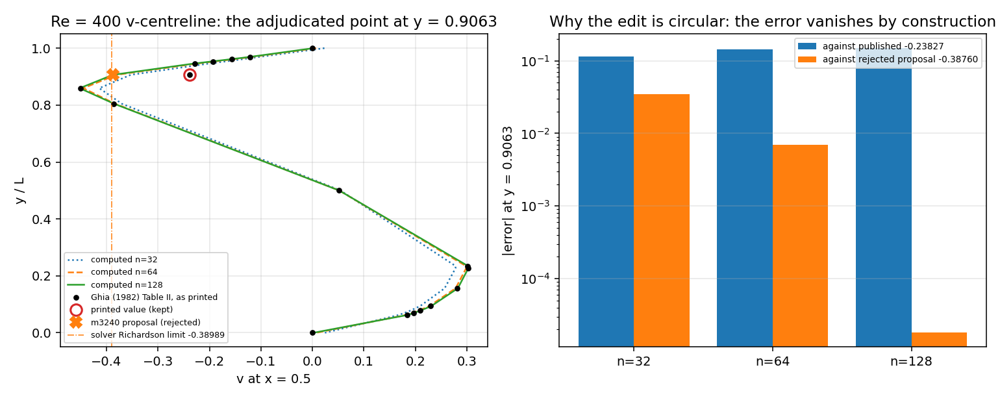

# m3788 — healing PR #82 (`agent/m3240`) against `main`

**Repository** TensorFVM · **work branch** `agent/m3788` · **target branch** `agent/m3240`
**Merge base** `0e9bd51` · **main at merge** `db97955` · **branch head before merge** `99f8e6e`

## 1. What the branch and `main` were each doing

`agent/m3240` and `main` had diverged from `0e9bd51` in opposite directions:

* `main` changed 43 paths, two of them in the Ghia reference layer. It added the
  **dispute registry** `tensorfvm.lid_cavity_reference.DISPUTES` plus
  `smoothness_audit()`, an attribution audit (`scripts/audit_ghia_re400_v_attribution.py`)
  and a consistency gate (`tests/test_ghia_re1000_evidence.py`). Its stated policy is
  explicit: *"a dispute is not a licence to edit the transcription: the published
  number stays exactly as printed"*.
* `agent/m3240` changed 7 paths. It **edited the printed value**
  `V_CENTRELINE[400.0][0.9063]` from `-0.23827` to `-0.38760`, called it a
  transcription error, regenerated the ladder bundle against the edited reference and
  replaced the strict xfail that guarded the Re = 400 defect with a `< 3 %` assertion.

Both edits touch the same two files, so the merge conflicted there:

| file | `main` side | `agent/m3240` side | conflict |
|---|---|---|---|
| `src/tensorfvm/lid_cavity_reference.py` | `DISPUTES` registry + `smoothness_audit` | table value `-0.23827 → -0.38760`, docstring history | `UU` (content) |
| `tests/test_lid_cavity_re1000_evidence.py` | strict `xfail` kept, reason extended with the extraction attribution | xfail deleted, replaced by `< 3 %` gate on the edited reference | `UU` (content) |
| `docs/verification-lid-cavity-ladder/summary.json` | published-reference errors | auto-merged to the regenerated bundle (edited reference, re-indented) | clean but **semantically derived from the rejected edit** |

## 2. How each conflict was resolved

1. **`lid_cavity_reference.py` — published value kept, proposal preserved.**
   The printed value stays `-0.23827`. `main`'s `DISPUTES` entry and `smoothness_audit`
   are untouched, and a new machine-readable registry
   `REJECTED_CORRECTIONS[(400.0, "v", 0.9063)]` records the m3240 proposal verbatim —
   proposed value, proposer, rationale, rejection reasons and the condition that would
   reopen the question. Nothing from the branch is dropped; the proposal simply moves
   from *in force* to *on record*.
   Rejection is on evidence, not taste: the proposed `-0.38760` reproduces TensorFVM's
   own Richardson limit (`-0.38989`, already in `DISPUTES`) to 0.6 %, so scoring
   against it would fit the reference to the solver it is meant to judge, and it has no
   primary source — the printed Table II has never been consulted in this checkout.
2. **`tests/test_lid_cavity_re1000_evidence.py` — both gates kept.**
   `main`'s strict `xfail` on the Re = 400 defect stays (it is the visible debt), and a
   new test `test_rejected_reference_correction_is_recorded_but_not_applied` asserts
   that the published value is unchanged and that the proposal never reaches
   `table()`. The branch's intent (this discrepancy must not be forgotten) is
   therefore preserved in a form that cannot go green by editing the reference.
3. **`docs/verification-lid-cavity-ladder/summary.json` — `main`'s copy kept.**
   The branch's bundle is a re-run of the ladder *against the edited reference*, so its
   Re = 400 v errors (`0.0360 / 0.0074 / 0.0043`) measure the solver against itself;
   merging it would have silently replaced the baseline and turned the strict xfail
   into an unexpected pass. `main`'s bundle is kept and the branch's numbers are
   preserved in the adjudication banner and in
   `docs/verification-lid-cavity-correction/report.md` (whose full text and three
   figures are retained, with a header stating that the proposal was not adopted).
   No branch content is deleted — every removed *effect* is recorded.

## 3. Committed ladder numbers after the merge (from the kept bundle)

| Re | n | u max abs err | v max abs err | max div | acceptance |
|---|---|---|---|---|---|
| 100 | 32 | 0.0069 | 0.0078 | 1.4e-14 | pass |
| 100 | 64 | 0.0045 | 0.0087 | 9.2e-14 | pass |
| 100 | 128 | 0.0049 | 0.0091 | 6.8e-13 | pass |
| 400 | 32 | 0.0684 | 0.1146 | 7.2e-15 | FAIL |
| 400 | 64 | 0.0066 | 0.1424 | 3.2e-14 | FAIL |
| 400 | 128 | 0.0013 | 0.1493 | 2.5e-13 | FAIL |
| 1000 | 64 | 0.0293 | 0.0197 | 2.1e-14 | pass |

The Re = 400 v-centreline column is the debt that stays open on purpose.

## 4. Why the two numbers cannot both live in the table

Left: the printed Table II points with the disputed entry ringed, the solver profiles at
n = 32/64/128, the branch's proposed value and the solver's own Richardson limit — the
last two nearly coincide. Right: the error at y = 0.9063 measured against the published
value (bars that grow under refinement, the defect) and against the proposal (bars that
collapse, `0.0117 / 0.0133 / 0.0017`), i.e. the "fix" is a change of target, not of
solution.

## 5. Verification

* `python3 -m pytest -q tests/test_ghia_reference_consistency.py
  tests/test_lid_cavity_re1000_evidence.py tests/test_lid_cavity_extraction.py`
  → **30 passed, 1 skipped, 1 xfailed** (the xfail is the Re = 400 defect, still red on
  purpose; it must never turn green by editing the reference).
* Full-suite runs for the merged tree and for `main` (`db97955`) were launched on the
  same host; see `test-runs.md` for the recorded outcome.
* `ast.parse` + duplicate-definition scan on both edited files (hot-file rule):
  clean.

## 6. Known limitations

* The printed Ghia (1982) Table II is still not available offline in this checkout, so
  the dispute cannot be *closed*, only kept honest. Both the rejection and the reopen
  condition are recorded in code (`REJECTED_CORRECTIONS[...]["revisit_if"]`).
* The Re = 400 near-wall field defect itself is untouched by this merge: it remains an
  open numerical item, not a reference-transcription item.
