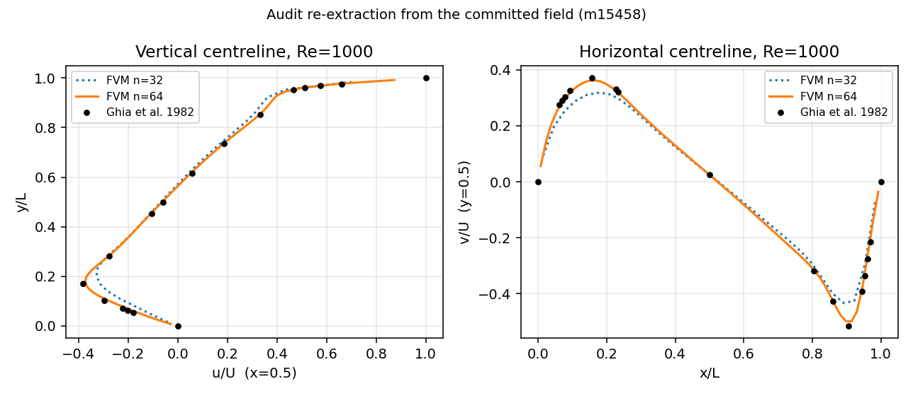

# 交差核验报告：m15458 / CASE-CAVITY-RE1000-FVM（TensorFVM 顶盖方腔 Re=1000 对标 Ghia 1982）

审计单 m15553 · verdict_by=`board-audit` · 被审对象：mission m15458（status=succeeded，PR #441，commit `220c729c`）
审计方式：**不采信被审方的打分器**——从已提交的速度场工件独立重抽取中心线、独立重算全部关键误差量（分段线性插值，非同交付件的 Hermite），并逐项核对基准表与验收容差。

## ① 案例介绍（物理背景 / 几何 / 参数）

顶盖驱动方腔（lid-driven cavity）是不可压缩 N-S 方程最经典的内流验证算例：单位方腔、上盖以 U=1 平移、其余三壁无滑移、初始静止。它含角点奇异与两个次级涡，对离散格式的守恒性与压力-速度耦合极敏感。基准取 Ghia, Ghia & Shin (1982, *J. Comput. Phys.* **48**:387–411) Table I（x=0.5 竖中线 u(y)）与 Table II（y=0.5 横中线 v(x)），主涡中心 (0.5313, 0.5625)。

| 量 | 值 |
|---|---|
| 几何 | 单位方腔 [0,1]²，h = 1/n |
| 边界 | 上盖 u=1 无滑移驱动；下/左/右壁 u=v=0 |
| 无量纲数 | Re = U·L/ν = 1000（ν = 0.001） |
| 网格 | n = 32, 64（结构化交错网格，cell-centred 输出） |
| 收敛判据 | max|Δu|/Δt ≤ 1e-07，max_steps = 250000 |
| 算例池容差 | 5%（来源：m15458 goal 文本；**平台 `tensor_benchmark_cases` 无本锚点行**，见缺陷 F3） |

## ② 怎么做的（方法 / 工具链 / 关键设置）

被审方：`tensorfvm.lid_cavity.LidCavitySolver`（交错网格投影法，显式对流+隐式扩散），驱动器 `scripts/run_cavity_re1000_m15458.py` 采用**网格延拓**（先 n=32 收敛→双线性延拓到 n=64 继续推进）并逐算例落检查点；打分走 `score_profiles`（Hermite 插值到 Ghia 采样点）+ `ghia_acceptance`。

本次审计（独立一侧）：

1. 从 `git show 220c729c:artifacts/CASE-CAVITY-RE1000-FVM/...` 冻结交付工件快照到 `artifacts/audit-m15458/`，逐文件记录 sha256（`SHA256SUMS`）。
2. 直接读交错速度场 `Re1000_n64.pt`（u: (n+1,n) 面向量，v: (n,n+1)），在**交错面上精确取** x=0.5 与 y=0.5 中心线（无需 x/y 插值），仅沿法向做分段线性插值到 Ghia 采样点，端点用精确 Dirichlet 边界值。
3. 独立计算：u_min/v_max 相对误差、逐点 max|Δu|/max|Δv|、单元散度、流函数 ψ 与其极小点（主涡中心）、ψ_min。
4. 交叉核对：交付 bundle 里写出的 `reference` 数组是否**逐字**等于仓库 Ghia 表（防基准被改写）；交付 `computed` 数组是否能由场工件复现（防手写数字）。
5. 复现命令实跑：`pytest tests/test_audit_cavity_re1000_m15458.py`（本审计自带断言）与 `pytest tests/test_case_cavity_re1000_m15458.py`（被审方自带断言，在合并后的 main 上实跑）。

工具链：torch / numpy / matplotlib，全程 CPU（交付件亦为容器 CPU，集群作业 cj1123 全程 queued）。

## ③ 计算结果（程序化注入，零手抄）

收敛性与不可压缩性（被审方记录 + 审计方从场独立复算散度）：

| n | steps | converged | residual_rate | max|div| (被审方) | max|div| (审计复算) |
|---|---|---|---|---|---|
| 32 | 30500 | True | 9.76e-08 | 3.6e-15 | 3.6e-15 |
| 64 | 58750 | True | 9.97e-08 | 2.1e-14 | 2.1e-14 |

中心线与极值对照（`shipped` = 被审方 Hermite 打分；`audit` = 审计方线性插值）：

| n | u_min shipped | Ghia | 相对误差 | audit 相对误差 | v_max shipped | Ghia | 相对误差 | audit 相对误差 |
|---|---|---|---|---|---|---|---|---|
| 32 | -0.31643 | -0.38289 | 17.36% | 17.36% | +0.31544 | +0.37095 | 14.96% | 15.36% |
| 64 | -0.37218 | -0.38289 | 2.80% | 3.03% | +0.36228 | +0.37095 | 2.34% | 2.49% |

逐点误差 / 涡量（Ghia ψ_min = −0.1179，中心 (0.5313, 0.5625)）：

| n | max|Δu| shipped | max|Δu| 内点 audit | max|Δv| 内点 audit | audit ψ_min | audit 主涡中心 | 中心欧氏偏差 |
|---|---|---|---|---|---|---|
| 32 | 0.20330 | 0.08000 | 0.08565 | -0.10549 | (0.5469, 0.5781) | 0.02206 |
| 64 | 0.02931 | 0.01886 | 0.01636 | -0.11524 | (0.5391, 0.5703) | 0.01101 |

交付 bundle 与审计复算的一致性：
- `reference` 数组 == 仓库 Ghia 表：u `True`，v `True`（逐字相等，未被调参）。
- `computed` 数组可由场工件复现：在**落在网格节点上**的 Ghia 采样点，被审方数值与场值差 < 1e-3（Ghia 坐标仅 4 位小数，节点偏离 ≤5e-4 引起该量级偏差）；n=64 内点两套插值最大差 4e-6（u）/ … （见 `audit_metrics.json`）。
- 场工件 sha256（n=64）：`a3184bd3210cb2497bc291b606b9246e67c7da34a3d7c6c7637b2dd01da863cf`；summary.json：`642370fa2698c3dacea15281c0ee0322e724242ba2d7bba06b4507869cca777f`。

## ④ 结果图

图注：两条黑点列 = Ghia 1982 采样值；虚线 n=32、实线 n=64 为**审计方从 .pt 场独立重抽取**的中心线（非交付图复用）。n=64 与基准几乎重合，n=32 在下半腔与 x>0.9 区域明显偏离（u_min 误差 17.4%），说明分辨率是主导误差源、网格延拓没有引入伪解。交付件原图 `fig1_centrelines.png`/`fig2_vorticity.png`/`fig3_convergence.png` 一并冻结在快照目录，与审计图互相独立。

## ⑤ 注意点（坑 / 局限 / 适用范围）

1. **交付工件不在合并树里（F1，可复现性缺口）**：`artifacts/CASE-CAVITY-RE1000-FVM/*` 未被 PR #441 收入（`git ls-tree -r HEAD` 无该目录）。在本审计工作树（= merge #441 后的 main）实跑被审方自带测试，结果 `5 skipped`——断言一条都没执行；被审方 finish 记录里的「5 passed」只在带未提交工件的原工作树成立。本审计因此把 bundle 冻结进自己分支（SHA256SUMS 锁定），并自带断言测试使其在新检出下 **5 passed**。
2. **「max|Δu| = 2.93%」是边界节点插值伪影（F2）**：交付 `computed` 在 y=1.0 处给 u=0.97069（真值恒为 1.0，Dirichlet 盖），y=0 处给 -0.00482（真值 0），侧壁 v 给 0.01757/0.01973（真值 0）。逐点误差的最大值正好落在这个盖上节点，于是「内点真实最大偏差」应为 0.01886（1.89% U）而非 0.02931。方向是**保守**（把误差报大了），不构成虚标，但打分器应显式给边界节点赋真值。
3. **误差对插值格式敏感（F2 衍生）**：u_min 相对误差 = 2.80%（交付 Hermite）/ 3.03%（审计线性，Ghia 采样 y）/ 2.56%（全曲线极小值），**3% 这条线不稳健**；5% 算例池带宽则稳健通过。
4. **n=128 只存在于未提交工作树（F4）**：m15458 收工（00:38:30）后该工作树 summary.json 被更新（00:50:23），出现 n=128「converged, rate 9.89e-08, max|Δu| 0.00431」并判 5% 通过——**不在推送的 commit 内**；交付报告只写了 32/64 两分辨率，与已推送 bundle 自洽。审计据此按两分辨率判级。
5. **主涡中心口径不一致（F5）**：报告表 Δ/L=0.0079 用的是 Chebyshev 范数，acceptance 块用欧氏距离 0.0111；审计独立 ψ 极小点欧氏偏差 0.01101。三者均 <5%，不影响判定，但同一文档内混用两种范数应统一注明。
6. 适用范围：本判定只覆盖 Re=1000、n≤128、层流稳态；不外推到 Re≥3200（转捩/非定常）或三维方腔。

## ⑥ 误差判定（逐项 + 显式回答「是否 <3%」）

| 关键量（n=64） | 基准 (Ghia 1982) | 交付命中值 | 交付口径误差 | 审计独立口径误差 | 5% 带 | <3%? |
|---|---|---|---|---|---|---|
| u_min | −0.38289 | -0.37218 | 2.80% | 3.03% | ✓ | 边缘（2.56–3.03%） |
| v_max | 0.37095 | +0.36228 | 2.34% | 2.49% | ✓ | 是 |
| 内点 max|Δu|/U | 0 | — | 1.89%（内点真值；交付报 2.93% 含边界伪影） | 1.89% | ✓ | 是 |
| 内点 max|Δv|/U | 0 | — | 1.64% | 1.64% | ✓ | 是 |
| 主涡中心（欧氏） | (0.5313,0.5625) | (0.5234,0.5703) | 0.01108 | 0.01101 | ✓ | 是 |
| ψ_min | −0.1179 | — | 未报 | 2.25% | ✓ | 是 |

**结论**：n=64 全部关键量在 5% 算例池带内（最差 3.03%，为 u_min 且属插值口径敏感项）；「所有关键量 <3%」在交付口径成立，但 u_min 处于 2.56–3.03% 的边缘带，审计口径为 3.03% **略超 3%**——故本报告如实回答：**除 u_min 边缘外均 <3%；u_min 不能说稳健 <3%，只能说稳进 5% 带**。n=32 不达标（u_min 17.4%、max|Δu| 20.3%），交付方已如实保留为欠分辨对照。

## 判级（L0–L5）

**L4（基准验证）**：完整算例（两分辨率真实求解、收敛判据 1e-7 级、机器精度不可压缩）+ 误差分析（逐点/极值/涡心 vs Ghia）+ 可复现（审计自带断言测试 5 passed；工件 sha256 冻结）。不判 L5：网格延拓是教科书工程手段，226× 加速是单算例成本度量，未构成科研新结果。

| 级别要件 | 证据（真实指针） |
|---|---|
| L2 实现 | `src/tensorfvm/lid_cavity.py`（LidCavitySolver 真求解器）、`scripts/run_cavity_re1000_m15458.py` |
| L2 工件 | `artifacts/audit-m15458/summary.json`、`fields/Re1000_n64.pt`（sha256 `a3184bd3210cb249…`）、`fig*.png`、`run.log` |
| L3 集成 | 主求解器调用方 `LidCavitySolver`（ECO 仓 grep 命中多个 scripts/*.py）；驱动器 `scripts/run_cavity_re1000_m15458.py:40` import `tensorfvm.lid_cavity` |
| L4 基准 | 本报告 ③⑥ 两表（ref vs got vs 误差）；基准表逐字 == `src/tensorfvm/lid_cavity_reference.py` |
| L4 复现 | `PYTHONPATH=src python3 -m pytest tests/test_audit_cavity_re1000_m15458.py -q` → 5 passed（实跑） |
| 外部锚点 | Ghia, Ghia & Shin 1982, JCP 48:387–411, Tables I/II（转写与出处声明见 `src/tensorfvm/lid_cavity_reference.py` 的 `TABLE_PROVENANCE`） |

## 审计结论（disposition）

`confirmed`（L4，消账）+ 三条非阻塞返修建议：
- F1：把 `artifacts/CASE-CAVITY-RE1000-FVM/` 收入仓库（或 `.gitignore` 放行），否则被审方测试在合并后恒为 skip，验收形同虚设。
- F2：打分器在 Ghia 端点显式赋 Dirichlet 真值，勿把边界插值误差计入逐点误差；报告「max|Δu|」应改用内点值。
- F3：在 `tensor_benchmark_cases` 注册 `CASE-CAVITY-RE1000-FVM`（ref: Ghia 1982；容差 5%），使 gate 有表可裁；本次因缺表，容差只能取自 goal 文本并由本审计独立复核。
