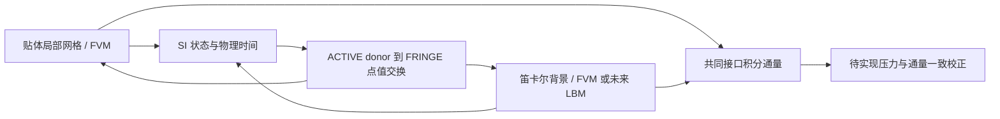

# Overset development and FVM–LBM coupling contract

## Geometry and ownership

The Cartesian background represents the outer fluid domain. A body-fitted
component supplies the physical wall and near-wall resolution. Their indices
remain independent: HOLE cells do not advance, ACTIVE cells supply donors, and
FRINGE cells receive simultaneous data from ACTIVE donors. Receiver values must
never become donors in the same exchange. An orphan is an error, not an implicit
nearest-neighbor boundary condition.

Existing [circular](../verification-overset-poisson/report.md) and
[NACA](../verification-overset-naca/report.md) cases solve scalar diffusion on
actual body-fitted and Cartesian meshes. Their scalar accuracy certificates do
not certify a Navier–Stokes pressure/velocity coupling.



The diagram describes the intended solver layout. The LBM solver adapter and
pressure/flux correction shown in it are future work.

## Implemented exchange primitives

- `overset3d.py`: native 3D Cartesian hexahedra and radially structured triangular
  wedge shells, actual donor-cell facet containment, ACTIVE-only barycentric
  interpolation and a sphere-safe separating half-space. This first geometry
  contract is spherical; arbitrary SUBOFF solid cutting is not implemented.
- `overset_exchange.py`: SI point states `(rho, velocity, pressure, time)`, explicit
  lattice scales, pressure reference and density policy; synchronized spatial
  exchange and bracketed temporal interpolation. Inputs are single-phase
  isothermal states; no populations are reconstructed.
- `overset_flux.py`: integrated flux transfer through a common planar surface,
  using the intersections of two independent segment/rectangle partitions.
  Opposite outward normals have sign -1. Matching complete coverage is required;
  duplicate patches and gaps fail. Uniform donor-face flux density is assumed.

[Actual nonmatching interface verification](../verification-overset-flux/report.md)
records three refinements with raw geometry, fluxes and producer snapshots.
This common-surface operator is independent of the point-value fringe operator.
The two overset fringe surfaces may differ geometrically, so their raw net
fluxes cannot be set equal without accounting for storage and sources in the
region between them. The common-surface operator has not been inserted into
an overset pressure solve.

[三维实际连接与三级插值报告](../verification-overset3d/publication-report.md) 保存真实
笛卡尔和球壳网格、双向 donor、分类和插值误差图。最细两向向量 L2
误差分别为 0.1012% 与 0.0807%，三级单调下降。这些是规定场的插值
验证，尚未求解三维 overset 流动。

## Explicit SI and lattice conversion

Let `c = dx/dt` and `rho_scale` be the SI mass-density represented by one lattice
unit. Then `u_lattice = u_SI/c`, `nu_lattice = nu_SI dt/dx²`, and

```
p_SI - p_ref = rho_scale cs_lattice² c²
                 (rho_lattice - rho_ref/rho_scale).
```

For the incompressible reference policy, FVM material density stays `rho_ref`
while LBM density perturbation encodes pressure. The isothermal EOS policy instead
requires SI density to match the encoded lattice density. Inconsistent density,
negative encoded density, unsynchronized exchange times, unbracketed temporal
queries and excessive configured lattice Mach number are rejected. This checks
input admissibility; it does not guarantee accuracy or numerical stability.

TensorLBM's local D3Q19 routines provide `equilibrium3d` and `macroscopic3d`.
Their populations are not interchangeable with the SI state arrays. A future
adapter must preserve appropriate non-equilibrium stress and match collision,
forcing and time conventions rather than replace incoming populations with an
unchecked equilibrium state.

## Gates before a coupled flow benchmark

1. Solve a static incompressible overset manufactured velocity/pressure case;
   replay the actual momentum equations and reconstructed interface mass flux.
2. Implement a common interface ownership and pressure/flux correction; audit
   mass and momentum including overlap storage without double counting.
3. Add the TensorLBM population boundary adapter and consistent non-equilibrium
   stress exchange; verify matched viscosity and pressure gauge.
4. Advance both solvers at common physical times with audited subcycling;
   verify constant flow and a viscous manufactured case before physical cases.
5. Add moving-body connectivity and geometric conservation, then turbulence,
   SUBOFF, free-surface or ice coupling as separately validated extensions.

No new coupled FVM–LBM flow, moving-body result or GPU acceleration certificate
is claimed by these interfaces. Existing SUBOFF drag/Cp qualification remains
tracked independently in the [SUBOFF report](../verification-suboff-validation/report.md).

## Regression checks

The existing 2D connectivity/scalar cases plus new state/flux contracts passed
30 tests (`test_overset_flux`, `test_overset_exchange`, `test_overset`,
`test_overset_poisson`, `test_naca_overset`, `test_multi_solid_overset`).
The native 3D suite separately passed 10 tests, including actual 3D SI state
exchange, solid-crossing rejection and convex donor containment.
