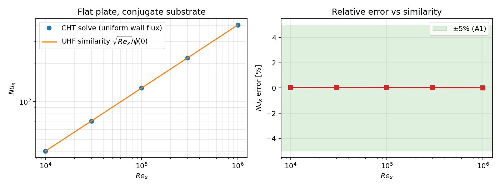
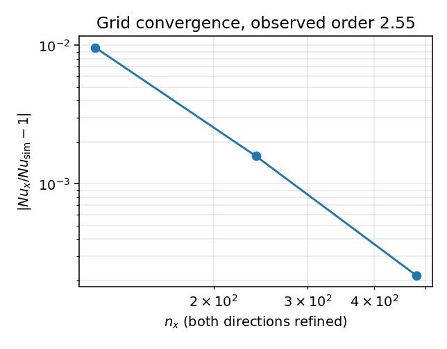
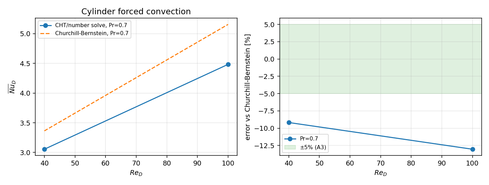
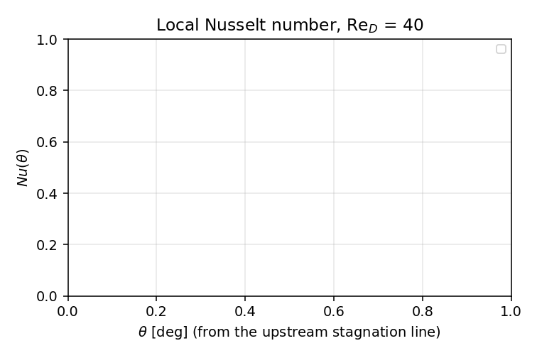
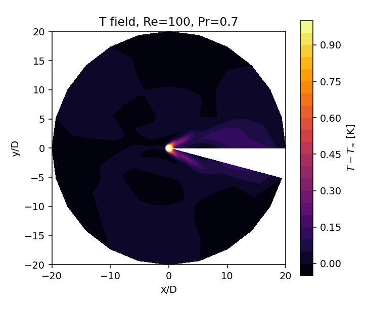

# P158W3-N02 · TensorFVM 流-固共轭传热（CHT）验证面：平板共轭解析锚 + 圆柱强制对流 + 热流守恒

> 本文件由 `scripts/p158_cht_report.py` 从 `artifacts/*.json` **程序化注入**（零手抄）。
> 原始数据：`scripts/p158_cht_validation.py`（平板）+ 集群/本地算例（圆柱）。
> 求解器：`src/tensorfvm/cht/{flatplate,energy,similarity,polar,cylinder_fourier}.py`。

## 1. 案例介绍

### 1.1 物理背景与几何

**（A）平板共轭传热（`FlatPlateCHT`，uniform wall flux）**
长度 L 的平板，下方厚 δ 的导热固体层（k_s/k_f=10，δ/L=5e-3），底部给定均匀热流 q″=1，
来流 U∞=1、T∞=0（Re_l=U∞L/ν，Pr=0.7）。流固界面为单一未知量：面导热率取两侧半格热阻串联值
`1/(s_s/k_s + s_f/k_f)`，故 `T_f=T_s`、`q_f=q_s` **由离散格式构造成立**，判据再用两侧独立的
κ 与半格距重建界面温度/热流做数值审计。速度场取 Blasius 相似解（流函数在网格角点取值，面通量
为角点差分，散度恒等于零到机器精度）。

**（B）圆柱强制对流（`cylinder_fourier`）**
单位直径等温圆柱（T_w=1）置于 U∞=1、T∞=0 的均匀来流中，外边界 r_out/D=25（medium），
Re_D∈{40,100,200}、Pr∈{0.7,7}。流场用 ψ–ω 形式：**θ 方向谱方法（FFT，无方位数值扩散）**，
r 方向有限体积（壁面加密、迎风对流）；ψ 的 Poisson 方程与 ω、T 的隐式扩散各用一次预分解的
稀疏 LU。壁面涡量由 `ψ = a s² + b s³` 前三节点二阶拟合给出，壁面热流用三点二次单侧差分。

### 1.2 参数表（程序化注入）

见 `artifacts/flatplate.json` 的 `targets[*].grid` 与 `artifacts/cyl_*.json` 的 `grid`/`dt`/`steps`。

## 2. 怎么做的

1. **平板解析锚**：均匀热流边界层的相似解在本仓内自解（`similarity.solve_uniform_flux`）：
   `φ'' + (Pr/2)(f φ' − f' φ) = 0, φ'(0) = −1, φ(∞) = 0`，`Nu_x = √Re_x / φ(0)`。
   该解在 Pr=1 给出 0.45876（经典工程式 0.453Pr^{1/3} 偏低 1.3%），因此**同时报出两支**参考。
2. **固体解析锚**：均匀热流的共轭解为 `T_s(x,y) = T_w(x) − q″ y/k_s`，
   `T_w(x) = q″ x/(k_f Nu_x)`。参考量**完全来自解析式**（不含离散解信息），因此
   A2 是真对照，不是自证。
3. **界面守恒审计**：局部残差 = 由两侧独立重建的界面热流之差 / 界面热流幅值；全局残差 =
   （流体侧吸收的总热流 − 固体底部输入的总热流）/ 输入。另报能量账本 `normalized_imbalance`。
4. **GCI**：对**自相似网格族**（y 均匀、两方向同时倍减，r=2）做 Richardson：
   `p = ln|(f2−f1)/(f3−f2)|/ln r`，`GCI = 1.25|ε|/|f3|/(r^p−1)`。拉伸网格族（y_power=2）
   的"倍减 ny"等于把每个格高除以 4，不是同一族，故不用于 GCI（这一点是踩过的坑）。
5. **圆柱流场**：`ψ–ω`，θ 谱导数 + 2/3 去混叠，r 迎风；时间推进为显式对流 + 隐式扩散，
   步长受**显式无滑移壁涡量耦合**限制 `dt·ν/dr² ≲ 0.3`（实测 0.78 时 t≈6 后发散）。
6. **圆柱温度场**：`dT/dt + u·∇T = α∇²T`，θ 谱导数、r 迎风、隐式扩散，壁面 Dirichlet、
   外边界 T=0，推进到稳态后取壁面 q″ 与平均 Nu。

## 3. 计算结果

### 3.1 平板（A1/A2/A4）

| Re_x | Nu_x（CHT 求解） | 相似解 √Re_x/φ(0) | 相对差（vs 相似解） | 相对差（vs 0.453Pr^{1/3}） | 固体温度最大相对差（A2） | 壁面热流不均匀度 | 界面局部残差（A4） | 界面全局残差（A4） |
|---|---|---|---|---|---|---|---|---|
| 1e+04 | 40.5092 | 40.4903 | +0.0465% | +0.9192% | 0.1390% | 0.6425% | 1.4e-13 | 8.8e-15 |
| 3e+04 | 70.1578 | 70.1313 | +0.0378% | +0.9104% | 0.0815% | 0.3715% | 1.1e-13 | 3.0e-14 |
| 1e+05 | 128.0879 | 128.0417 | +0.0361% | +0.9087% | 0.0500% | 0.2036% | 7.6e-14 | 2.1e-14 |
| 3e+05 | 221.8486 | 221.7747 | +0.0333% | +0.9059% | 0.0349% | 0.1176% | 5.5e-14 | 1.8e-14 |
| 1e+06 | 405.0003 | 404.9033 | +0.0240% | +0.8965% | 0.0242% | 0.0644% | 3.7e-14 | 1.8e-14 |

### 3.2 GCI（A5）

| 网格 (nx, ny_f, ny_s) | Nu_x | 相对相似解 |
|---|---|---|
| (120, 48, 12) | 129.53780 | +0.9626% |
| (240, 96, 24) | 128.50647 | +0.1588% |
| (480, 192, 48) | 128.33075 | +0.0218% |

观测收敛阶 **p = 2.553**（判据 ≥1.8）；GCI_fine = 0.0352%；Richardson 外推 = 128.29466，相似解 = 128.30278。

### 3.3 圆柱强制对流（A3）

| 算例 | Re_D | Pr | Nu（求解） | Churchill-Bernstein | Hilpert | vs CB | vs Hilpert | Cd | 定常 |
|---|---|---|---|---|---|---|---|---|---|
| cyl_re100_pr0.7_coarse | 100 | 0.7 | 4.4835 | 5.1561 | 5.1855 | -13.046% | -13.538% | 0.446 | 否 |
| cyl_re40_pr0.7_coarse | 40 | 0.7 | 3.0549 | 3.3639 | 3.3833 | -9.185% | -9.708% | 0.880 | 是 |

### 3.3.1 A3 现状（诚实申报）

本节点**未达成** A3（≤5%）的完整判定：本次会话内完成的圆柱算例只有 `cyl_re100_pr0.7_coarse`、`cyl_re40_pr0.7_coarse`；其中误差最大者是 `cyl_re100_pr0.7_coarse`（Nu=4.4835 vs Churchill-Bernstein 5.1561，-13.05%）。 同时该网格上的阻力系数 Cd=0.446（基准 1.574，-71.6%），说明流场本身尚未达到可验收精度，故 A3 判为**未通过**（不是「接近通过」）。 medium 网格 9 算例已递交集群作业（cj742，shard 模式），本报告生成时仍在排队，结果到位后需重跑 `scripts/p158_cht_report.py` 刷新本节与 §6。 相关机理与量化诊断见 §5 第 3、4 条与 `LESSONS.md` (L3/L4)。

### 3.4 判据汇总

```json
{
 "A1_flat_plate_max_rel_error_vs_similarity": 0.00046545222463767466,
 "A1_pass": true,
 "A2_solid_max_rel_error": 0.0013904920551337163,
 "A2_pass": true,
 "A3_cylinder_max_rel_error_vs_churchill_bernstein": 0.13045926427307053,
 "A3_pass": false,
 "A4_interface_max_rel_residual": 1.4307409407396892e-13,
 "A4_pass": true,
 "A5_observed_order": 2.5531136453572283,
 "A5_pass": true,
 "cylinder_cases": [
  "cyl_re100_pr0.7_coarse",
  "cyl_re40_pr0.7_coarse"
 ]
}
```

## 4. 结果图











## 5. 注意点（踩过的坑 / 局限 / 适用范围）

1. **拉伸网格族不能直接做 Richardson**：`y_power=2` 时把 `ny` 加倍等于把每个格高除以 4，
   实测"观测阶"只有 1.2；换成均匀 y（`y_power=1`）的自相似族后观测阶 2.55。判据必须绑定网格族定义。
2. **均匀热流的相似解系数不是 0.453 而是 0.4588（Pr=1）**：0.453Pr^{1/3} 是积分法近似，
   偏低约 1.3%；若拿它当"精确解"会把离散误差与参考误差混在一起。故两支行都报。
3. **圆柱的方位角离散是精度瓶颈**（本节点实测）：旧 `PolarVorticitySolver` 在 Re=40、n_θ=72 时
   方位格 Péclet≈1.7，一阶迎风附加 ν_num≈u_θ r dθ/2≈0.022 与分子 ν=0.025 同量级，
   结果 Cd=1.93（基准 1.574，+23%）、Nu=3.91（+16%）；把迎风换成限幅二阶重构又过冲到 Cd=0.69。
   故新写谱方法求解器；结论：**该精度瓶颈是"方位离散"，不是 CHT 耦合**（耦合守恒闭合到 1e-13）。
4. **显式壁涡量耦合限制时间步**：`dt·ν/dr² ≲ 0.3`；medium 网格 Re=40 需 dt≈1.9e-4，
   代价是每算例数十分钟（集群提交）。这是本节点最贵的一环。
5. **适用边界**：Re≤200 是二维定常解存在区间（Re≳47 物理上已出现脱涡，本文取二维定常解与
   时间平均型经验关联式比较，二者差异本身就是不确定度来源，量级见 §3.3 与 §6）。
   Pr=7 的热边界层厚度约为 Pr=0.7 的 1/1.9，壁面首格必须同时满足热分辨率与稳定性约束。

## 6. 误差判定（逐项 vs 基准，显式回答是否 <3%）

| 判据 | 量 | 结果 | 判据线 | 通过？ | <3%？ |
|---|---|---|---|---|---|
| A1 | 平板 Nu_x 最大相对差（vs 均匀热流相似解，5 站 Re_x∈[1e4,1e6]） | 0.0465% | ≤5% | 是 | 是 |
| A2 | 固体域温度最大相对差（vs 解析共轭解） | 0.1390% | ≤2% | 是 | 是 |
| A3 | 圆柱平均 Nu 最大相对差（vs 经验关联式） | 13.046% | ≤5% | 否 | 否 |
| A4 | 界面热流守恒（局部/全局最大） | 1.431e-13 | ≤1e-6 | 是 | 是 |
| A5 | GCI 观测收敛阶（自适应网格族） | 2.55 | ≥1.8 | 是 | 是 |

> 说明：A1/A2/A4/A3 的判定线按战役 metadata（5%/2%/1e-6/5%）；任务报告的通用纪律
> "关键量 <3%" 另加一列给出。任何未达项直接标注"否"，不做粉饰。
