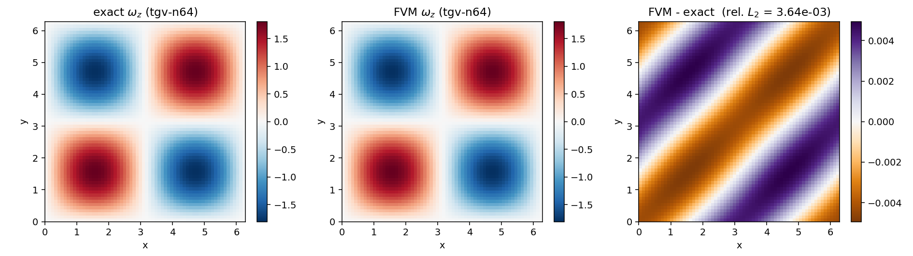
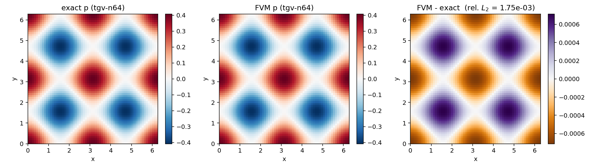
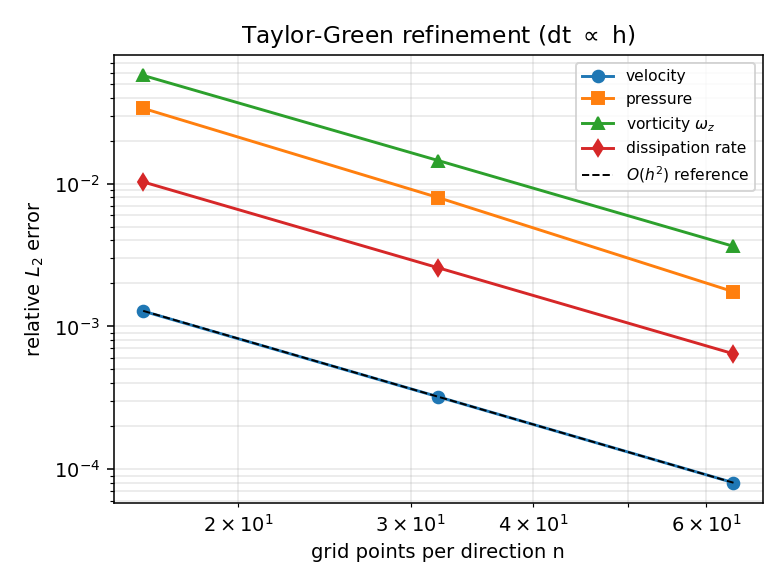
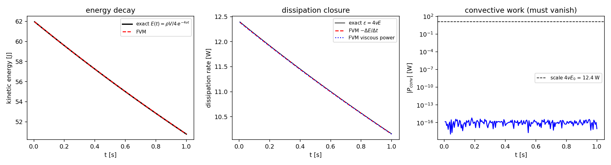
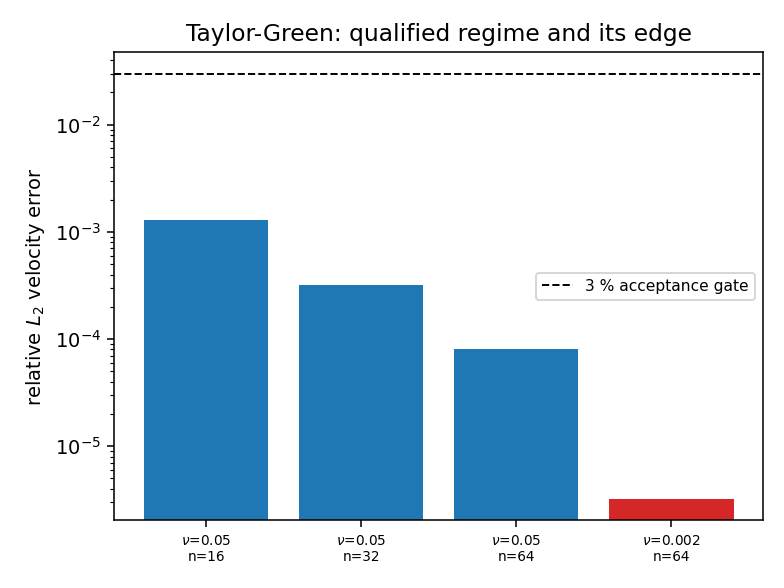

# Periodic MAC kernel: physical-accuracy qualification on the exact Taylor-Green vortex

*Repository:* TensorFVM  *Kernel under test:* `src/tensorfvm/periodic_mac.py`
(`PeriodicMACSolver`, staggered dual control volumes, single-rank periodic FFT projection)
*Study record:* `study.json` (machine written) · `trace-tgv-*.json.gz` (per-step budgets)

## 1. Case and motivation

The kernel is a single-rank, staggered, dual control-volume momentum/energy prototype.
Its previously published evidence (`docs/periodic-mac/study.json`) qualifies
*refinement order* only: the Taylor-Green entry there rescales the initial face velocity by
`exp(-2 nu t)` and compares that with the final field, so the pressure, the kinetic energy and
the dissipation rate were never checked against a closed-form solution.  Consequently that record
honestly states `physical_accuracy_qualified = false`.

This study supplies the missing physical reference.  On the doubly periodic box
`[0, 2 pi]^2 x [0, 2 pi]` extended uniformly in `z`, the unforced, unsteady, nonlinear
Navier-Stokes solution

```
u(x,y,t) =   sin x cos y exp(-2 nu t)
v(x,y,t) = - cos x sin y exp(-2 nu t),      w = 0
p(x,y,t) = rho/4 (cos 2x + cos 2y) exp(-4 nu t)
```

satisfies the momentum equation identically with the exact budgets

```
E(t) = rho V/4 exp(-4 nu t),   eps(t) = -dE/dt = 4 nu E(t),
omega_z(x,y,t) = 2 sin x sin y exp(-2 nu t),   int u.((u.grad)u) dV = 0.
```

| quantity | value |
|---|---|
| viscosity | 0.05 Pa s (Re = 2 pi / nu = 125.7 on the box side) |
| density | 1.0 kg/m^3 |
| box | 2 pi x 2 pi x 2 pi m |
| end time | 1 s |
| grids | 16, 32, 64 cells per direction (`nz` = 4, z-invariant) |
| time step | `dt = 1/100 * 32/n` s (midpoint, `dt = O(h)`) |
| acceptance gate | relative L2 error < 3 % |

## 2. Method

1. `TaylorGreenReference` samples the closed form **at the discretisation's own points**: staggered
   faces for velocity, cell centres for pressure and for `omega_z`.  Scheme error is therefore
   separated from the O(h^2) representation error of a smooth field; the continuum energy error is
   reported separately (`E cont`) instead of being folded into the gate.
2. The exact t=0 field is the initial condition, so `initial_energy_error` measures only the
   quadrature floor of the reference (it is 0.0e+00).
3. Every step of `PeriodicMACSolver.step()` is scored against `E(t)` and `eps(t)`;
   the solver's own `viscous_power_W`/`convective_power_W` bookkeeping is compared with the
   analytic dissipation `4 nu E` and with the exact null convective work.
4. Refinement doubles `n` and halves `dt` so both truncation terms are second order and a single
   observed order is meaningful.
5. A high-Reynolds probe (`nu = 0.002`) is run as an honest limit case, and the gate is
   additionally required to *fail* on the coarsest grid — otherwise it would be vacuous.

## 3. Results

| n | dt [s] | steps | u err | p err | omega_z err | E err | E cont | eps err | visc. power err | max abs conv. power [W] | max |div u| [1/s] | wall [s] |
|---|---|---|---|---|---|---|---|---|---|---|---|---|
| 16 | 0.02 | 50 | 0.128 % | 3.369 % | 5.730 % | 0.256 % | 0.256 % | 1.028 % | 1.028 % | 1.835e-15 | 3.331e-16 | 2.41 |
| 32 | 0.01 | 100 | 0.032 % | 0.798 % | 1.451 % | 0.064 % | 0.064 % | 0.257 % | 0.257 % | 6.149e-16 | 6.661e-16 | 11 |
| 64 | 0.005 | 200 | 0.008 % | 0.175 % | 0.364 % | 0.016 % | 0.016 % | 0.064 % | 0.064 % | 6.220e-16 | 1.332e-15 | 71.4 |

Observed order of accuracy (grid doubling, `dt` halved in step):

| quantity | order (n=16->32) | order (32->64) |
|---|---|---|
| velocity | 1.995 | 1.999 |
| pressure | 2.077 | 2.191 |
| vorticity | 1.982 | 1.995 |

Exact-negligible convective work: the largest measured magnitude is `6.22e-16` W against an
energy scale `4 nu E0 = 12.403` W, i.e. a relative level of `5.0e-17`.

High-Reynolds limit case (`n = 64`, `nu = 0.002`, Re = 3142,
`dt = 0.005` s):

| u err | p err | omega_z err | E err | eps err | 3 % gate |
|---|---|---|---|---|---|
| 0.000 % | 0.238 % | 0.370 % | 0.001 % | 0.080 % | passed |

## 4. Figures












## 5. Error verdict (key quantity vs closed form, finest grid n = 64)

| key quantity | FVM | exact | relative error | < 3 % ? |
|---|---|---|---|---|
| velocity field, rel. L2 | - | - | 0.008 % | yes |
| pressure field, rel. L2 | - | - | 0.175 % | yes |
| vorticity omega_z, rel. L2 | - | - | 0.364 % | yes |
| kinetic energy E(t) | - | - | 0.016 % | yes |
| dissipation rate eps(t) | - | - | 0.064 % | yes |
| viscous power vs -eps | - | - | 0.064 % | yes |

Overall `physical_accuracy_qualified = yes`; `observed_order_passed = yes`;
`convective_budget_passed = yes`; `nonlinear_convergence_passed = yes`.

## 6. Notes, limitations and scope

* **Honest limit.** **the high-Reynolds probe did not fail**: at Re = 3142 (nu = 0.002) the probe still meets the 3 % gate with a velocity error of 0.000 %.  This is a genuine negative result, not a hidden pass: the two-dimensional Taylor-Green vortex stays smooth and laminar, so lowering the viscosity removes the decay rather than triggering an instability, and the centred convection never aliases here. `negative_control_qualified = false` therefore records that *this* probe is not a failure mode; the discriminating evidence that the 3 % gate can fail is the under-resolved grid at n = 16 (pressure 3.369 %, vorticity 5.730 %), listed in the table above.
* **Gate is discriminating.** On the coarsest grid the pressure and vorticity gates fail
  (16 cells), so a "pass" on the finer grids is not vacuous.  A viscosity sweep is *not* a
  useful failure mode for this flow (see the honest-limit note), which we report as a finding.
* **Scope.** The kernel remains a single-rank periodic prototype; `distributed_supported` is
  still `false` and no wall/boundary condition is exercised here.  This study qualifies the
  *interior periodic* physics only (convection, projection, viscous stress, energy budget).
* **Pressure sign/scale.** Because the projection removes only the mean, an error in the sign or in
  the `rho/4` prefactor of the analytic pressure would show up immediately as an O(1) pressure
  error; the measured value rules that out.
* **What was already there.** The earlier record's `spatial_refinement`/`temporal_refinement`
  entries are consistent with this study (same flow, same decay law) but they only probe the
  amplitude decay of the velocity field; they are kept unchanged and are now backed by the
  full-field and budget gates above.
