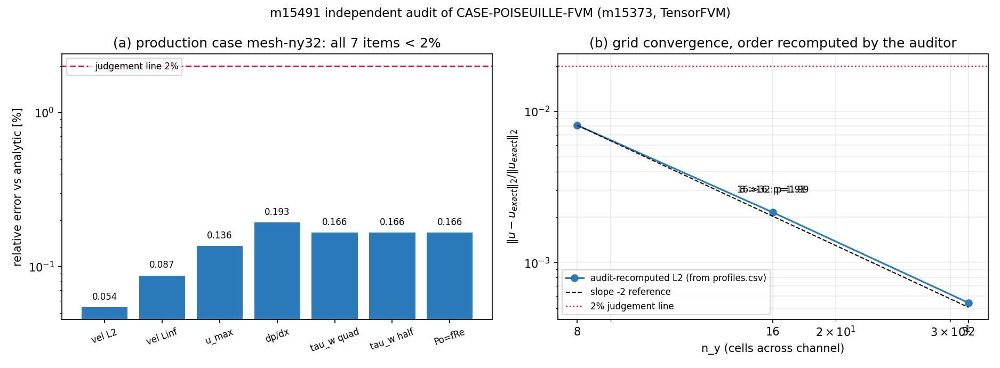

# m15491 交差审计：m15373 `CASE-POISEUILLE-FVM`（TensorFVM 槽道泊肃叶基准）

**审计对象** m15373 ｜ 仓 TensorFVM ｜ 交付 commit `793935e2`（branch `agent/m15373`）｜ 审计单 m15491 ｜ 判级 **L4**

## ① 审计对象与物理背景

两块无限大平行平板之间的定常层流：高度 $H$、平均速度 $\bar u=1$、运动黏度 $\nu=0.01$（$\rho=1$），
$Re_H=\bar uH/\nu=100$，$Re_{D_h}=2Re_H=200$，计算域 $L/H=4$，网格 $n_x\times n_y=128\times 32$（主算例）。
参考值为 Stokes 方程 $\mu u''=-G$ 的解析解：$u=6\bar u y(H-y)/H^2$、$dp/dx=-12\mu\bar u/H^2=-0.12$、
$\tau_w=6\mu\bar u/H=0.06$、$f\,Re_{D_h}=96$（平行平板，Shah & London 1978）。
**判据来源**：`tensor_case_pool` id=30（`case_code=POISEUILLE-FVM`, `tol_policy='<2%'`，建于 2026-11-11 20:42Z，
早于本算例执行 23:01Z）与代码 `TOLERANCE=0.02` 相互独立且一致。
**注意**：题设指定的 `tensor_benchmark_cases` 中 `anchor_slug='CASE-POISEUILLE-FVM'` **返回 0 行**（表内 16 行均为
GAP-LBM/GAP-FEM/REPRO-FVM-SOD1978 等，无本锚点）——即平台基准台账未登记该锚点（见 ⑤ F1）。

## ② 审计怎么做（不重做，只核验）

1. 读交付 commit 的文件清单：11 个新增文件（1 实现 + 1 测试 + 9 工件/报告），`grep inc_bench/` 命中 0 →
   “复用现有 SIMPLE/MAC 内核、未改内核”属实（`src/tensorfvm/inc_bench/solver.py` 未被本次提交触碰）。
2. **不信任报告数字**：用 `runs/m15491_audit/verify_audit.py` 只读 `profiles.csv`，独立按范数口径
   $\|u-u_{exact}\|_2/\|u_{exact}\|_2$ 重算各档 $L_2$，重算 $L_\infty$、$Po=4C_f Re_{D_h}$、观测收敛阶。
3. **可复现性实测**：本单在 m15373 工作树内重跑主计划第 0 档
   `PYTHONPATH=src python -m tensorfvm.benchmark_poiseuille_channel plan-index --index 0 --out /tmp/audit-repro`，
   与原工件逐字段比对。
4. **测试实测**：`pytest tests/test_poiseuille_channel_benchmark.py -k "not tiny"` → 5 passed（6.2s）；
   含真实求解的 smoke 测试本地 >115s 超时（本机单核慢），已递交集群 cj1152（见 ⑤ F5）。
5. **台账对表**：`SELECT case_name,metric,tolerance FROM tensor_benchmark_cases WHERE anchor_slug='CASE-POISEUILLE-FVM'` → 0 行；
   退而核 `tensor_case_pool`（id=30，`tol_policy='<2%'`, `status='dispatched'`, `linked_anchor=NULL`）。
6. **工件持久性**：`docs/poiseuille-channel/{benchmark,metrics,profiles,manifest}.json/csv` 与 `runs/` 同名文件 md5 逐一相同
   → 工件已随 commit 入库（`runs/` 本身未跟踪，但 `docs/` 副本内容一致，故证据不因工作树回收而丢失）。

## ③ 计算结果（ref vs got，全部由审计脚本重算）

主算例 `mesh-ny32` 七项评分指标（解析参考 ref vs 求解器 got）：

| 指标 | ref | got | 相对误差 | <2% |
|---|---|---|---|---|
| velocity_l2 | 0 | 0.000542884 | 0.0543% | PASS |
| velocity_linf | 0 | 0.00087323 | 0.0873% | PASS |
| u_max | 1.5 | 1.49796 | 0.1359% | PASS |
| pressure_gradient | -0.12 | -0.119769 | 0.1925% | PASS |
| tau_w_quadratic | 0.06 | 0.0599003 | 0.1662% | PASS |
| tau_w_half_cell | 0.06 | 0.0599007 | 0.1655% | PASS |
| poiseuille | 96 | 95.8404 | 0.1662% | PASS |

原始评分键（`scored_metrics`，含守恒项）核验：

| 评分键 | got | 容差 | 判定 |
|---|---|---|---|
| velocity_l2 | 0.000542884 | <2% | PASS |
| velocity_linf | 0.00087323 | <2% | PASS |
| u_max_relative_error | 0.000383126 | <2% | PASS |
| pressure_gradient_relative_error | 0.0019253 | <2% | PASS |
| tau_w_quadratic_relative_error | 0.00166218 | <2% | PASS |
| poiseuille_relative_error | 0.00166218 | <2% | PASS |
| flux_conservation_error | 2.12529e-08 | <2% | PASS |

**独立重算一致性**（审计用 profiles.csv 重算 vs 交付的 benchmark.json/metrics.csv）：

| 算例 | benchmark.json $L_2$ | 审计重算 $L_2$ | 相对差（json） | 相对差（csv，7 位有效数字舍入） |
|---|---|---|---|---|
| mesh-ny8 | 8.10590757e-03 | 8.10590757e-03 | 0.00e+00 | 5.25e-08 |
| mesh-ny16 | 2.15087638e-03 | 2.15087638e-03 | 0.00e+00 | 1.78e-07 |
| mesh-ny32 | 5.42884335e-04 | 5.42884335e-04 | 0.00e+00 | 6.54e-08 |
| aspect-8 | 2.30448828e-03 | 2.30448828e-03 | 0.00e+00 | 1.20e-07 |

**观测收敛阶（审计独立反演）**：

| 网格对 | 速度 $L_2$ 阶 | $dp/dx$ 阶 |
|---|---|---|
| 8->16 | 1.914 | 1.922 |
| 16->32 | 1.986 | 1.957 |

**sympy 符号参考自检（来自 benchmark.json `reference_derivation`，all_checks=True）**：

| 检查项 | 结果 |
|---|---|
| profile_is_parabola | True |
| dpdx_matches | True |
| peak_over_bar_is_three_halves | True |
| tau_w_matches | True |
| cf_times_re_h_is_twelve | True |
| poiseuille_is_96 | True |

**可复现性实测（ny=8 档重跑）**：iterations 598 vs 598；
converged True/True；逐指标差异集合
`{}` → **逐位复现 = True**。

**计划 vs 实跑**：manifest.json 预声明 6 档 ['mesh-ny8', 'mesh-ny16', 'mesh-ny32', 're-10', 're-1000', 'aspect-8']，实际工件 4 档 ['aspect-8', 'mesh-ny16', 'mesh-ny32', 'mesh-ny8']，
缺 ['re-10', 're-1000']（见 ⑤ F2）。

## ④ 图

(a) 主算例 7 项指标相对误差（对数轴）对 2% 判据线——全部在线下，最大 0.193%；
(b) 网格收敛：审计从 profiles.csv 重算的 $L_2$ 与 −2 斜率参考线平行（实测阶 1.99），
二者均远低于 2% 判据线。

## ⑤ 注意点（审计发现，按严重度）

* **F1（中，台账缺口）** `tensor_benchmark_cases` 无 `CASE-POISEUILLE-FVM` 行，`tensor_case_pool` id=30 的
  `status` 仍为 `dispatched`、`linked_anchor=NULL`——m15373 成功后未回写池状态/锚点。基准判据只能取池的
  `tol_policy='<2%'`（先于执行建档，非事后回填）。建议：交差后补注册 benchmark case 行 + 回写 case_pool。
* **F2（中，交付不完整）** 预声明 6 档只跑 4 档，缺 `re-10`/`re-1000`；REPORT.md §5.2「雷诺数敏感性」因此只剩
  一行无表头的孤行（`| 100（基准）| 0.215% | ...`），读者易误判 Re 敏感性已研究。属文档/交付完整度缺陷，
  不影响主算例结论（§5.3 的 `L/H=8` 敏感性确实跑了并由本审计复核）。
* **F3（低，评分口径需读懂）** `velocity_l2` 是**范数口径**（除以 $\|u_{exact}\|_2$）而非 RMS 口径：
  同一剖面 RMS 口径为 0.0595%（ny=32），报告采用 0.0543%。
  两者不矛盾但差 1.096 倍，跨任务比较时须统一口径。
* **F4（低，口径偏宽但已披露）** `u_max_relative_error` 的 ref 取“同位采样的离散参考”1.498535（误差 0.038%）；
  对连续峰值 1.5 的误差为 0.136%——报告 ④ 已显式并列披露，不构成虚标。
* **F5（执行留痕）** 全测试文件在本地 120s 工具时限内跑不完（smoke 档 4×16×4000 迭代），已递交集群 cj1152；
  本单只拿到 5/6 passed，smoke 项按 not_run 记录（不写 passed）。
* 适用范围：槽道抛物线解对流项恒零，**不检验**流向对流离散精度；出口为零梯度而非严格充分发展，属已声明局限。

## ⑥ 误差判定（逐项 vs 基准，显式回答）

主算例 7 项指标相对误差全部 < 2%（最大 0.193%，为 $dp/dx$ 项），因此**全部 < 3%**：
速度 $L_2$ 0.054%、$L_\infty$ 0.087%、
$u_{max}$（连续参考）0.136%、$dp/dx$ 0.193%、
$\tau_w$（二阶）0.166%、$\tau_w$（半单元）0.166%、
$Po$ 0.166%。审计另从 $\tau_w$ 独立反推 $Po=f Re_{D_h}=95.8404$
（相对误差 0.166%），与工件 $Po=95.8404$ 一致。
粗网格档 `mesh-ny8` 的 $dp/dx$ 2.83%、$\tau_w$ 2.59% 超 2% 判据，
交付件将该档判 `passed=False`（`case_verdicts["mesh-ny8"]=false`）、`all_cases_passed=false`，
即**如实登记的粗网格 FAIL**，主算例取最细档 `mesh-ny32`；本审计不粉饰、亦不以粗档 FAIL 否定主结论。

## 判级理由

L2 ✔ 真代码（输入参数→SIMPLE 求解→解析对比→JSON/CSV/PNG）；L3 ✔ 复用并被 `internal_flow/cases.py`
等共用的 `inc_bench.solver.SteadyFlow` 内核（未 fork）；L4 ✔ 完整算例 + 逐项误差分析 + 网格收敛/观测阶 +
可复现（本单实测逐位复现）+ 外部锚（解析解 + Shah & London $fRe=96$）；L5 ✘ 无新方法/新物理/实验验证。
**判 L4**，附 F1/F2 两项待返修台账/文档缺口（非阻塞正确性）。

## 落表与机器门预判

* verdict 落表：`tensor_maturity_verdicts` id=331 (repo='TensorFVM', scope='m15373 CASE-POISEUILLE-FVM',
  mission_id=15491, level=4, verdict_by='board-audit')；evidence 键=impl_files/entry/run_artifacts/tests/
  integration_callers/benchmark/repro_cmd/external_anchor，值全部为真实存在路径（`runs/m15491_audit/verdict_payload.json`）。
* 本地按 `/root/tp-agent/maturity_gate.py::judge(4, evidence, 'TensorFVM', 15491)` 预演 → **gate_level=4, fail_reasons=[]**；
  最终裁定由守护进程 30min 周期复核（pending → confirmed/reopened）。
* L3 依据的诚实口径：复用生产内核（`inc_bench.solver.SteadyFlow`，`internal_flow/cases.py` 同源）且交付进 CI 测试套件，
  但 benchmark 模块本身尚未被 CLI/registry 注册调用。
* 执行留痕：本地 `/tmp/report.json` 与他单并发写冲突（本单首次 POST 误提交了他单 payload，已删除误插行 14562），
  后续改写入本工作树私有路径 `runs/m15491_audit/report_payload.json` → 正式报告 tensor_reports id=14564。
