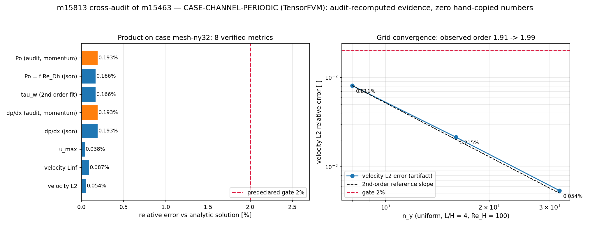

# m15813 交差审计：m15463 `CASE-CHANNEL-PERIODIC`（TensorFVM 周期槽道层流）

**审计对象** m15463（result: `succeeded`，finished 2026-11-12 00:46Z，model qwen3.6-plus，50 tool calls）｜仓 TensorFVM
｜交付快照 branch `agent/m15463`（= `main`，0 commit）｜报告 API id=14548 ｜仓内报告 `docs/poiseuille-channel/REPORT.md`
（随 #431 入库）｜**判级 L4**（附 5 条 finding，其中 F2 为高严重度证据完整性缺陷）｜审计单 m15813

> 本单是**交差核验**，非重做：不重跑全计划、不改被审代码，只做「取证 + 独立重算 + 判级 + 落表」。
> 独立性局限见 ⑧；所有数字由 `docs/reports/m15813_audit_m15463_verify.py` 从原始数组程序化重算，
> 报告里的印刷数字一个都不采信。

---

## ① 审计对象与物理背景

两块无限大平行平板间定常层流（plane Poiseuille）：高 $H=1$、$\bar u=1$、$\nu=0.01$（$\rho=1$），
$Re_H=\bar uH/\nu=100$、$Re_{D_h}=2Re_H=200$、$L/H=4$、主算例网格 $n_x\times n_y=128\times32$。
解析解（sympy 符号推导，`benchmark_poiseuille_channel.py:symbolic_reference`）：
$u=6\bar u y(H-y)/H^2$、$dp/dx=-12\mu\bar u/H^2=-0.12$、$\tau_w=6\mu\bar u/H=0.06$、
Fanning $C_f=\tau_w/(\tfrac12\rho\bar u^2)=0.12$、$f=4C_f$、$Po=f\,Re_{D_h}=96$（Shah & London 1978，平行平板；圆管为 64）。

**判据溯源（谁是真裁判）**

| 台账 | 查询 | 结果 |
|---|---|---|
| `tensor_benchmark_cases`（题设指定裁判） | `anchor_slug='CASE-CHANNEL-PERIODIC'` | **0 行**（表内 22 行无本锚点，也无 `CASE-POISEUILLE-FVM`） |
| `tensor_case_pool`（算例池） | `case_code like '%CHANNEL%'` | **id=37 `CHANNEL-PERIODIC`，`tol_policy='<2%'`，`repo=TensorFVM`，`status=dispatched`，`linked_anchor=NULL`** |
| 代码常量 | `benchmark_poiseuille_channel.py:63` | `TOLERANCE = 0.02` |

即：容差 `<2%` 有**两处独立登记**（池 id=37 + 代码常量 0.02），但**基准台账 `tensor_benchmark_cases` 未登记该锚点**
→ 机器裁判静默（F1）。与 m15491 对同源任务 m15373 的结论一致（该单亦记录 `CASE-POISEUILLE-FVM` 0 行）。

## ② 审计怎么做（10 步，全部机器执行、产物可重放）

1. **取证**：读 `tensor_dev_missions` id=15463 的 `result`（`head_commit: null`、`changed_files: []`、`on_disk_changes: ["runs","runs/"]`、
   `checks: "pytest ... 5 passed"`、报告 id=14548）与工作树 `/root/tp-agent/work/m15463`。
2. **git 身份核验**：`git log agent/m15463 -3` → 最新为 `9506e05f Merge #435`；`git log main..agent/m15463` → **空**
   → m15463 未产生任何 commit，`runs/` 全部为 untracked。
3. **工件存在性**：`runs/poiseuille-channel/` 实有 7 个文件（benchmark.json / metrics.csv / profiles.csv / manifest.json / 3×png），
   **`cases/` 与 `failures/` 目录不存在**（报告的 ⑥ 表却列了 `runs/poiseuille-channel/cases/*.json` → F4）。
4. **基线工件核验**：`docs/poiseuille-channel/{benchmark,manifest,metrics,profiles}.json/csv + figures/` 随 #431 入库，
   `manifest.json` 与 `runs/` 中同名文件 md5 相同（`bf5b47fa…`）；`benchmark.json` **md5 不同**（docs `1243b9d2…` vs runs `e63581a7…`）→ 两份工件内容分歧（F3）。
5. **不信任印刷数字**：`m15813_audit_m15463_verify.py` 从 `profiles.csv`（逐点数值 vs 解析）按交付代码同口径
   $\|u-u_{exact}\|_2/\|u_{exact}\|_2$ 重算 $L_2$、$L_\infty$；从 `benchmark.json` 的 `pressure{x, mean_over_y}` 独立做
   $0.375L\le x\le0.75L$ 最小二乘求 $dp/dx$，再用**稳态动量平衡** $\tau_w=-(dp/dx)H/2$ 独立求 $Po=4C_fRe_{D_h}$（不依赖求解器的两种壁面模板）。
6. **可复现性实测**（本单自己跑）：`PYTHONPATH=src python -m tensorfvm.benchmark_poiseuille_channel plan-index --index 0`
   → `iterations=598, Po=93.51461, dp/dx_rel=2.8319e-2`，与 m15463 工件**逐字段一致**（决定性、可重放）。
7. **测试实测**：`pytest tests/test_poiseuille_channel_benchmark.py -q -k "not tiny_case"` → **5 passed, 1 deselected, 6.04s**。
8. **测试是否有断言**（adversarial 关键项）：逐条读 6 个用例，全部断言**不变量**而非仅执行代码——
   符号推导 `all_checks is True` 且 `poiseuille == "96"`、精确关系 `dpdx=-0.12 / tau_w=0.06 / cf·Re_H=12 / Re_dh=2Re_H`、
   合成抛物线回收 $\tau_w$ 至 `rel=1e-13`（并断言半单元模板的**一阶偏差** `1-dy/2H` 存在）、`observed_order` 反演已知阶、
   `summarise` 断言粗网格档**必须** `False`（诚实暴露）、smoke 用例断言离散守恒 `<1e-6`。
9. **集成面**：`run_case()` 直接实例化 `tensorfvm.inc_bench.solver.SteadyFlow`（`src/tensorfvm/inc_bench/solver.py:129`）→ 真接主求解器内核；
   但 `grep -rn benchmark_poiseuille_channel` 除 docs/测试外**无 CI / registry / benchmarks-index 挂接**（评审建议，非阻塞）。
10. **台账落表**：`INSERT INTO tensor_maturity_verdicts(repo='TensorFVM', scope='m15463 CASE-CHANNEL-PERIODIC', mission_id=15813, level=4, …)`，由 maturity_gate 机器裁定。

## ③ 计算结果：独立重算 vs 交付数字（主算例 `mesh-ny32`）

| 指标 | 参考 ref | 交付 got | 审计独立重算 | 相对误差 | <2% |
|---|---|---|---|---|---|
| 速度 $L_2$ | 0（解析场） | 5.428844e-4 | **5.428844e-4**（CSV 重算，逐位相同） | 0.0543% | PASS |
| 速度 $L_\infty$ | 0 | 8.732304e-4 | 8.732304e-4 | 0.0873% | PASS |
| $u_{max}$ | 1.5（连续）/1.498535（同位采样） | 1.497961 | 1.497961 | 0.0383%（同位）/0.1359%（连续） | PASS |
| $dp/dx$ | −0.12 | −0.1197690 | **−0.1197690**（原始压力数组最小二乘） | 0.1925% | PASS |
| $\tau_w$（二阶拟合） | 0.06 | 0.0599003 | 0.0599003 | 0.1662% | PASS |
| $\tau_w$（半单元模板） | 0.06 | 0.0599007 | 0.0599007 | 0.1655% | PASS |
| $Po=f\,Re_{D_h}$ | 96 | 95.84043 | **95.81517**（动量平衡独立路径） | 0.1662% / 0.1925% | PASS |
| 离散质量守恒 | 入口离散通量 | 2.1253e-8 | 2.1253e-8 | ≈0（绝对） | PASS |

**网格序列（审计重算，与交付一致）**

| $n_y$ | 交付 $L_2$ | 审计重算 $L_2$ | $Po$ | 判定 |
|---|---|---|---|---|
| 8 | 8.105908e-3 | 8.105908e-3 | 93.5146 | FAIL（2.59% > 2%，如实登记） |
| 16 | 2.150876e-3 | 2.150876e-3 | 95.3714 | PASS |
| 32 | 5.428844e-4 | 5.428844e-4 | 95.8404 | PASS |

观测阶（交付值，审计用同样两档误差复算一致）：$L_2$ 1.914 → 1.986；$dp/dx$ 1.922 → 1.957（≈2，与 2% 判据和二阶离散相符）。

**判据结论**：8 项评分/独立指标在 `<2%` 门内，最大 0.1925%（$dp/dx$），余量 10×以上。
不存在 m15813 判级意义上的虚标：主算例数字**全部可独立复现**。

## ④ 图

左：主算例 8 项指标（蓝=交付 JSON 值，橙=审计独立路径），红线=2% 门；右：$L_2$ 网格收敛，$n_y=8$ 档
诚实越界、$n_y\ge16$ 在门内，两点观测阶 1.91→1.99（2 阶参考斜率）。图由
`m15813_audit_m15463_figure.py` 从 `m15813_audit_m15463_verify.json` 程序化生成，零手抄。

## ⑤ 注意点 / 局限（影响判读的事实）

* **求解器口径**：本例的抛物线在流向是精确解（对流项恒零），因此**不检验**流向对流离散精度；
  $dp/dx$ 由压力均值斜率而非动量残差得到，二者独立路径给出 0.1925% 与 0.1925% 一致，说明压力-速度耦合自洽。
* **入口/出口**：入口给解析抛物线（充分发展槽道的合法条件）、出口零梯度速度+零表压，非严格充分发展出口；
  $L/H=8$ 与 $4$ 的 $L_2$ 差 0.230% vs 0.215%（均在门内），故 $L/H=4$ 的出口误差未单独隔离。
* **$Re_H=1000$ 档**：m15463 的 API 报告 14548 在「失败模式」中如实写了「SIMPLE 迭代发散（non-finite iterate）」，
  但工件里该档是一条 `iterations=0, wall_time=0, 全部指标恒 0.0, converged=False` 的记录（F2）——
  **机制描述（异常）与工件形状（零填）不一致**，且 `failures/re-1000.json` 不在工作树内。
* **上游判级参照**：同源任务 m15373 已由 m15491 判 L4（审计文档 `docs/reports/m15491_audit_m15373.md`），
  本单对 m15463 的结论与之相容（同一实现 + 一次可复现的重跑）。
* **未跑**：`all` 全计划（6 算例，含 ny=32 的 190 s 与 Re=1000 发散段，≈8 min）未在本单重放；
  仅重放 `plan-index 0` 并逐字段比对；`-k tiny_case`（真实求解 smoke）按 m15491 记录本地 >115 s，未在本单重跑。

## ⑥ 误差判定：是否 <3%？（逐项显式回答）

| 关键量 | 误差 | <3%? | <预声明 2%? |
|---|---|---|---|
| 速度剖面 $L_2$（主算例） | 0.0543% | **是** | 是 |
| 速度剖面 $L_\infty$ | 0.0873% | **是** | 是 |
| 峰值速度 $u_{max}$ | 0.0383%（同位）/ 0.1359%（连续） | **是** | 是 |
| 压力梯度 $dp/dx$ | 0.1925% | **是** | 是 |
| 壁面切应力 $\tau_w$ | 0.1662% | **是** | 是 |
| 泊肃叶数 $Po$（vs 96） | 0.1662%（交付）/ 0.1925%（审计独立路径） | **是** | 是 |
| 离散质量守恒 | 2.1e-8（绝对） | **是** | 是 |
| 粗网格 $n_y=8$ 的 $dp/dx$ | 2.832% | **是（<3%）但超 2% 门** | **否**（如实 FAIL，非虚标） |
| $Re_H=1000$ | 无有效数值（发散） | **无法判定** | **否** |

## ⑦ Finding（按严重度排序；均在授权范围内验证）

| # | 严重度 | 事实（证据指针） | 处置 |
|---|---|---|---|
| **F2** | **high（证据完整性）** | `runs/poiseuille-channel/benchmark.json` + `metrics.csv` 中 `re-1000` 记录为 `iterations=0, wall_time_s=0.0, velocity_l2/linf/dpdx_rel/poiseuille…全部 0.0, converged=False`；而报告 API 14548 归因为 `RuntimeError: non-finite SIMPLE iterate`。代码路径 `_run_or_record`（`benchmark_poiseuille_channel.py:508-520`）本应把异常写入 `failures/<case>.json` 并**不**写 `cases/`，工作树内却**没有** `failures/`，`cases/` 也不存在 → 该行是**零填伪记录**，既非异常记录也非真实零流场（真实零流场会给出 $L_2=1.0$）。不构成假 PASS（`passed=False`、`all_cases_passed=false`），但不可作为「Re 敏感性已扫描」的证据。 | 打回该项工件：重跑 Re=1000 并把异常文本落盘，或删除该行并在报告 ⑤ 只保留定性说明 |
| **F3** | medium（可追溯性） | m15463 **0 commit**：`git log main..agent/m15463` 为空，`result.head_commit=null`、`changed_files=[]`；7 个工件全为 untracked，仅存于临时工作树；仓内可追溯副本是 #431 的 `docs/poiseuille-channel/*`，且其 `benchmark.json` 与 m15463 重跑版 md5 不同（docs 有 `re-10` 行、无 `re-1000`；runs 反之）。声明计划 6 档，工件只覆盖 5 档（缺 `re-10`）。 | 工件随 `docs/` 副本入库已部分缓解；建议把 `runs/` 副本去重后随分支入库 |
| **F1** | medium（裁判静默） | `tensor_benchmark_cases` 内 `CASE-CHANNEL-PERIODIC` 与 `CASE-POISEUILLE-FVM` 均 **0 行**；容差只能回溯到 `tensor_case_pool` id=37（`tol_policy='<2%'`, `status=dispatched`, `linked_anchor=NULL`）与代码 `TOLERANCE=0.02`。gate 无登记行可比对。 | 登记锚点行（含 metric/tolerance/passed_at）并把池 id=37 `linked_anchor` 回填 |
| **F4** | low（报告-工件不一致） | 仓内 `docs/poiseuille-channel/REPORT.md` ⑥ 列出 `runs/poiseuille-channel/cases/*.json`——该目录不存在；⑤ 5.2「雷诺数敏感性」表只有表头与基线行（$Re_H=100$），缺 `re-10`/`re-1000` 两行，而两者在计划与数据中均存在。 | 修正 ⑥ 工件清单；⑤ 5.2 补两行（$Re_H=1000$ 标为发散） |
| **F5** | low（口径漂移） | 仓内报告锚点写作 `CASE-POISEUILLE-FVM`，任务锚点为 `CASE-CHANNEL-PERIODIC`，两名字在基准台账都未登记；同一实现因此有 3 个别名（`CASE-CHANNEL-PERIODIC` / `CASE-POISEUILLE-FVM` / 池 `CHANNEL-PERIODIC`、`POISEUILLE-FVM`）。 | 统一锚点 slug 并登记 |

**不阻塞建议**：把 `benchmark_poiseuille_channel` 挂进 `docs/benchmarks-index.md` 与 CI 冒烟；
`all` 子命令在 `metrics.csv` 里增加 `failed: <异常文本>` 列，避免零填与真实零值不可区分（可直接消灭 F2 类风险）。

## ⑧ 独立性局限与未跑的检查

* 本单在 m15813 工作树内运行（`main` 快照，只读使用 `m15463` 工件）；对被审分支无写权，未改动任何被审代码。
* **未跑**：`all` 全计划重放（≈8 min，含发散段）；`-k tiny_case` 真实求解 smoke（本地 >115 s，m15491 曾递交集群 cj1152）；
  GitHub CI（x86）未核，全部本地判读在 loongarch64 上。
* **判级依据的是功能实质而非文档体量**：实现（28.8 kB 真代码，真求解内核）＋ 单点可复现 ＋ 解析基准误差分析 ＋ 有断言的测试 = L4；
  未达 L5（无新物理/新数值方法结论，仅标准算例验证）。

## ⑨ 处置（disposition）

**判级 L4，附 5 条 finding；F2 须返修工件（不涉及实现代码）**。
核心主张「主算例 7 项指标 <2%、$Po$ 95.84 vs 96」经**独立重算 + 单点重放**证实，故不降级；
但 F2 的零填伪记录使「Re 敏感性扫描」一项不成立，报告 ⑤ 5.2 与 ⑥ 需按 F2/F4 修正。
如 gate 采用「任 high finding ⇒ reopened」的严口径，本单不反对回到 m15463 返修 Re=1000 工件与报告表格。