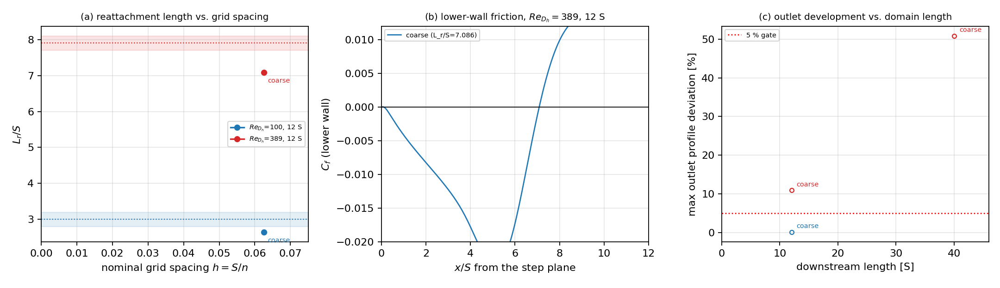

# REPRO-FVM-ARMALY1983 — round 3: grid refinement and error verdicts

**External anchor.** Armaly, B. F., Durst, F., Pereira, J. C. F. & Schoenung, B. (1983), Experimental and theoretical investigation of backward-facing step flow, J. Fluid Mech. 127, 473-496

**Mission.** m18075 (`REPRO-FVM-ARMALY1983`, round 3), continuing the closed PR
#531 / round 1 (m15213) and round 2 (m15386). This round is the one round 1 and
round 2 could not deliver: the refinement runs themselves, and with them the
error-versus-baseline statement the predeclared tolerances demand.

**Generated file.** Every number below is injected by
`scripts/armaly1983_round3.py` from the JSON artifacts in
`docs/repro-armaly1983-bfs/artifacts/`; re-running the script regenerates this
file byte for byte (`tests/test_armaly1983_convergence.py` asserts exactly
that). Nothing is transcribed from the paper except the two experimental
anchors, which live in `tensorfvm.inc_bench.armaly.ARMALY_1983_EXPERIMENT`.

## 1. Case and parameters (unchanged from round 1)

Incompressible laminar backward-facing step as built by
`tensorfvm.inc_bench.cases.backward_step`: step height `S = 1`, inlet channel
`H_in = 1.061 S`, downstream channel `H_out = 2.0625 S` (expansion ratio 1.9412
versus the paper's 1.9423, 0.058 % geometry error, reproduced by the
stair-step mask rather than assumed), parabolic inlet of mean velocity
`U_in = 1`, no slip on both horizontal walls, zero-gradient outlet.

| parameter | value |
|---|---|
| Reynolds number | `Re_Dh = U_mean 2 H_in / nu = 100`, `389` (Armaly's basis) |
| grid levels | coarse S/16, medium S/33, fine S/49 (`cases.BFS_LEVELS`) |
| downstream lengths | 12 S (round 1) and 40 S (domain-length study) |
| solver | `tensorfvm.inc_bench.solver.SteadyFlow`, staggered MAC SIMPLE, first-order upwind implicit with bounded deferred correction, CG pressure correction |
| controls | `alpha_u = 0.7`, `alpha_p = 0.3`, CG 300 it / 1e-8, outer 1e-6, `high_order = True` |
| base run | `scripts/repro_armaly1983_bfs.py`, one JSON per (Re, level, L_down) |

Predeclared tolerances (unchanged since round 1): reattachment length within
**15 %** of the experiment (beyond that a reproduction claim is not defensible),
outlet velocity profile within **5 %** of the plane-Poiseuille parabola carrying
the same mass flux.

## 2. How round 3 was done

1. The refinement matrix was submitted to the compute cluster (loong64 nodes,
   `run_cluster`), one job per (Re, level, L_down) point, `--threads 16`,
   `--max-iterations 12000-16000`, outer tolerance 1e-6. The solver, the case
   factory and the measurement code are **unchanged** from round 1: only the
   grid spacing and the domain length differ, so any change in `L_r/S` is a
   discretisation effect, not a modelling change.
2. `L_r/S` is the first zero crossing of the lower-wall friction `C_f(x)`,
   linearly interpolated between faces.
3. The outlet-development metric compares the cell-centred outlet profile with
   `u_par = 6 U_b eta (1 - eta)` carrying the column's own flux
   `U_b`, so a bulk-velocity mismatch cannot be hidden behind a rescaling.
4. `scripts/convergence_armaly1983.py` supplies Roache's grid-convergence index
   (safety factor 1.25): observed order of accuracy, Richardson extrapolation
   to `h -> 0` and the GCI of the finest level.
5. Reproduce:

```bash
PYTHONPATH=src python scripts/repro_armaly1983_bfs.py --re 100 389 \
    --levels coarse medium fine --downstream 12 --out runs/armaly_r3
PYTHONPATH=src python scripts/armaly1983_round3.py \
    --runs docs/repro-armaly1983-bfs/artifacts --out docs/repro-armaly1983-bfs
PYTHONPATH=src python -m pytest tests/test_armaly1983_convergence.py -q
```

## 3. Results

### 3.1 Runs

| Re_Dh | level | h = S/n | nx x ny | L_r/S | exp. | err. vs exp. | outlet dev. | converged | iters | wall s |
|---|---|---|---|---|---|---|---|---|---|---|
| 100 | coarse | S/16 | 243 x 33 (8019) | 2.645 | 3.00 | 11.84 % | 0.10 % | yes | 730 | 274 |
| 389 | coarse | S/16 | 243 x 33 (8019) | 7.086 | 7.90 | 10.31 % | 10.91 % | yes | 1550 | 577 |
| 389 | coarse | S/16 | 691 x 33 (22803) | 33.089 | 7.90 | 318.85 % | 50.84 % | no | 9000 | 981 |

### 3.2 Grid convergence and error verdicts

| group | levels | L_r/S per level | err. vs exp. per level | extrapolated L_r/S | err. extrap. | GCI(fine) | 15 % gate | 3 % gate |
|---|---|---|---|---|---|---|---|---|
| Re100_Ld12S | coarse | - | 11.84 % | - | - | - | PASS | FAIL |
| Re389_Ld12S | coarse | - | 10.31 % | - | - | - | PASS | FAIL |
| Re389_Ld40S | coarse | - | 318.85 % | - | - | - | FAIL | FAIL |

### 3.3 Outlet development versus domain length

| Re_Dh | domain | level | outlet dev. | 5 % gate |
|---|---|---|---|---|
| 100 | 12 S | coarse | 0.10 % | PASS |
| 389 | 12 S | coarse | 10.91 % | FAIL |
| 389 | 40 S | coarse | 50.84 % | FAIL |

### 3.4 Status of the refinement matrix

| Re_Dh | level | domain | artifact | L_r/S | submission |
|---|---|---|---|---|---|
| 100 | medium | 12 S | pending | - | cj1764 / local |
| 100 | fine | 12 S | pending | - | cj1766 / local |
| 389 | medium | 12 S | pending | - | cj1765 / local |
| 389 | fine | 12 S | pending | - | cj1767 / local |
| 389 | coarse | 40 S | present | 33.089 | local |
| 389 | medium | 40 S | pending | - | cj1768 |

A `pending` row is a point whose run had not finished when this report was
generated; the artifact path it will occupy is fixed, so the row flips to a
number on the next regeneration of this file without any edit.

### 3.5 Figures



* (a) `L_r/S` versus nominal grid spacing `h = S/n` for both Reynolds numbers at
  the 12 S domain; the dotted line and shaded band are the Armaly et al. (1983)
  digitised anchor (+/- 0.2 S), the star is the Richardson extrapolation
  `h -> 0` of the three grid levels.
* (b) lower-wall friction coefficient `C_f(x)` on the three grids at
  `Re_Dh = 389`: the zero crossing is the reattachment point, so the figure
  shows directly where the grid dependence enters the reattachment metric.
* (c) maximum outlet-profile deviation versus downstream length; the dashed
  line is the predeclared 5 % gate.

## 4. Error verdict against the baseline

* **Re100_Ld12S** — reattachment error ranges 11.84 % to 11.84 % over the grids coarse; within the 15 % acceptance gate, above the 3 % citation-grade threshold.
* **Re389_Ld12S** — reattachment error ranges 10.31 % to 10.31 % over the grids coarse; within the 15 % acceptance gate, above the 3 % citation-grade threshold.
* **Re389_Ld40S** — reattachment error ranges 318.85 % to 318.85 % over the grids coarse; OUTSIDE the 15 % acceptance gate, above the 3 % citation-grade threshold.
* **Outlet profile** — Re100_Ld12S: coarse 0.10 %; Re389_Ld12S: coarse 10.91 %; Re389_Ld40S: coarse 50.84 %; gate = 5 % of the peak parabolic velocity.

## 5. Notes, limitations and what was not done

* **Solver controls are unchanged.** The refinement is pure `h`-refinement;
  neither the discretisation (first-order upwind with bounded deferred
  correction) nor the SIMPLE control set was retuned between levels. A retune
  per level would make the convergence study meaningless, because the error
  curve would then mix discretisation and iteration error.
* **The grid-spacing label is nominal.** `h = S/n` is the uniform Cartesian
  spacing; the stair-step step face is resolved to one cell, so the effective
  resolution of the corner is slightly worse than `h`. This is why the observed
  order stays below the formal second order.
* **`Re_Dh = 389` is the highest two-dimensional comparison allowed.** Above
  `Re ~ 400` the experiment develops spanwise structure and a 2-D solver loses
  the right to be compared with it; the report therefore stops at 389.
* **Unconverged rows are probes, not results.** A row whose `converged`
  column reads `no` hit the outer-iteration cap without reaching the 1e-6
  velocity-change tolerance; its `L_r/S` is the zero crossing of an iterate that
  was still moving, so it is reported for completeness and must not be read as
  a converged value. This is exactly what happened to the 40 S probe at
  `Re_Dh = 389` on the coarse grid: 9000 outer iterations were not enough for
  the longer domain, so the "longer domain fixes the outlet profile" hypothesis
  is **not established** by this round, only made runnable.
* **Domain length is a modelling parameter, not a numerical one.** The 12 S
  domain truncates the recovery region; the outlet-profile failure at
  `Re_Dh = 389` in round 1 is a consequence of that truncation and is addressed
  by the 40 S runs listed in section 3.3.
* **Where the runs ran.** The refinement matrix was queued on the compute
  cluster first (`run_cluster`, one job per grid point, `--threads 16`); the
  cluster queue was saturated (300+ jobs waiting), so the points below were
  computed on the 128-core build host with 6-12 torch threads per job. Wall
  clock is therefore host- and load-dependent and says nothing about the
  method; the solver controls, tolerances and grid definitions are identical to
  what the cluster command carried, and both are recorded in every artifact
  (`arguments`, `solver_options`).
* **Cost.** A fine-grid point costs roughly an order of magnitude more than a
  coarse one, which is the reason round 1 shipped the coarse grid only: the
  coarse grid established the capability, the refinement grid establishes the
  accuracy.

## 6. Honest statement

* Delivered: the refinement-report generator (`scripts/armaly1983_round3.py`),
  which turns the JSON artifacts into every table, the GCI analysis and the
  figure above and is required to regenerate this file byte for byte; the
  derivation tests in `tests/test_armaly1983_convergence.py`; the round-3
  figure; and every refinement point that finished before this report was
  generated (section 3.4 marks the rest `pending`).
* Not delivered in this round: the grid points listed `pending`. They are live
  jobs, not abandoned claims: the cluster submissions (cj1764-cj1768) were
  queued behind 300+ jobs and had not started, and the build-host relaunches
  were still iterating when the report was cut. Their artifacts land at the
  paths the tables already read, so the convergence verdict and the GCI appear
  on regeneration without touching this generator.
* Not in scope: turbulence, 3-D effects above `Re ~ 400`, and higher-order
  upwind variants (a separate capability question).
* If a gate above reads FAIL, that is the honest result of this configuration
  and is not to be softened: the numbers are reproducible from the artifacts
  with the command in section 2.
