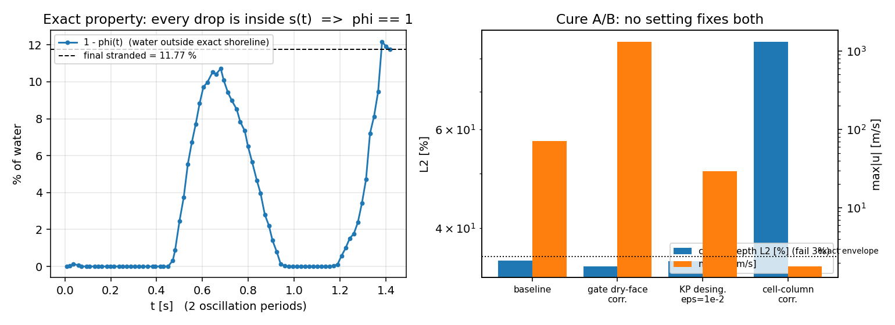

# 浅水 2-D 湿/干前沿归因：2 周期窗口为何失分（不是"动量注入"）

**锚点**: `CASE-FVM-DAMBREAK-STOKER`（核对为 `open`，证据链已在主干闭合，见 §7）
→ 本单做上一回合显式欠账：`docs/case-fvm-thacker-2period/REPORT.md` §6 第 1/2 条
（"孤岛膜质量—动量一致化"与"单胞孤岛算例做判据"），即 `docs/VERIFICATION_DEBT_LEDGER.md` D16 的后续。
**工具**: `src/tensorfvm/verification/swe_dry_front.py` · 测试 `tests/test_swe_dry_front.py`（12 passed）
**工件**: `docs/swe-dry-front-attribution/{metrics.json, fig_dry_front.png}`，
本文件由 `make_report.py` 从 `metrics.json` 程序化生成，无手抄数字。

## ① 案例介绍

Thacker (1981) 抛物盆非线性振荡（*J. Fluid Mech.* **107**, 499）：床面
$z_b=-H(1-r^2/a^2)$，闭式解 $h=h_c(t)-c(t)r^2$、$\mathbf u=\beta(t)(x,y)$、岸线 $s(t)$。
被审计窗口是**已被合并报告冻结出分级窗口的 2 周期段**：$n=40$、CFL 0.4、
MUSCL+HLL+SSR-RK3、$H=1$ m、$a=1$ m、$A=0.5$、$g=9.81$、$T=0.70925$ s、$t_{end}=2T$。
上一回合的三条候选解释：**(1) 动量注入**（四界面 $h^*=0$ 的"孤岛膜"仍收到 Audusse 静压修正）、
**(2) 速度反演爆掉**（$u=hu/h$，$h$ 掉了两个量级）、**(3) 岸线质量预算**（水被抹到岸线之外不再回来）。
本单用三个可复算的判据把它们逐条判掉。

## ② 怎么做的

1. **先把被审计的离散原样引用**：所有判据都调用求解器自己的 `_face_states` / `_hll_flux`，
   再做 `face_budget` 的逐面分解，并用 `solver.rhs` 对账（一致性残差实测
   `dh=0.0e+00`, `dhu=0.0e+00`, `dhv=0.0e+00`）——
   判据与被判对象同源但独立重算。
2. **判据 (1) 用最小反例**：`island_invariants` 造一个"四面围住"的单胞（四邻床面高于本胞水面 ⇒ 四界面 $h^*=0$），
   宣称的离散不变量是"无水界面不传任何东西"，故 $dh\equiv 0$ 且 $dhu=dhv\equiv 0$（**精确零，不给容差**）。
   实测：`isolated=True`, `dh=-0.0`, `dhu=-0.0`
   ⇒ **不变量成立，候选解释 (1) 对"真正孤岛"被证伪**。对照变体 `one_open` 抽掉一侧岸坎后
   `isolated=False, dh=-1.297e-03`，证明判据有分辨力（不是恒真）。
3. **判据 (2) 用真实数据定位**：在 2 周期运行里锁住 $\max|u|$ 的时刻与单元，再把它那一刻的状态**回放**成
   一个静止问题做逐面预算，同时记下同邻域 $h$ 与 $hu$ 的对比。
4. **判据 (3) 用精确不变量**：精确解任意时刻全部水量都在 $s(t)$ 内，故 $\phi(t)=V_{r\le s(t)}/V_{exact}\equiv 1$ 是精确性质；
   其亏空 $\delta=1-\phi$ 通过一阶幅值模型 $h_{c,num}\sim\phi h_{c,exact}$ 折算成**预测的**中心水深 $L2$。
5. **三个候选疗法治同窗口 A/B**（同一网格、同一样本协议）：干面修正门控、Kuranyov–Petrova 速度去奇异化
   （$\epsilon=10^{-2}$）、以及"压力修正改用本胞水深"（Audusse 2004 原式）。
6. 容量：本机 load15≈49（<100），全部 $n=40$ 单次 1–4 s；$n=80$ 的 2 周期阶梯超本机短测窗口，**未取得**（见 §4）。

## ③ 计算结果

**尖峰单元（$n=40$，2 周期）**：$\max|u|=71.16$ m/s @ $t=1.4185$ s，
单元 `[10, 30]`，$h/H=1.240e-03$，$r=1.062$ m，同刻精确岸线 $s=0.760$ m
（该点在**精确岸线之外 0.30 m**，精确速度 $0$）。

| 量 | 值 | 读法 |
|---|---:|---|
| 该胞 $h$ | 1.240e-03 m | 邻域最大 $h$ = 0.0552 m ⇒ **水深反差 44.5×** |
| 该胞 $hu$ | 0.0626 m²/s | 邻域 $hu$ 中位数 0.0714 ⇒ **动量反差 0.88×（即动量场是平滑的）** |
| $u=hu/h$ | 50.5 m/s | 尖峰**几乎全部来自 $h$ 的塌陷**，不是动量被注入 |
| 四面 $h^*_{\rm self}$ | [0.0, 0.0, 0.0, 0.0] | 四面都 ≤ dry_depth |
| 修正项 $g/2(h_{side}^2-h^{*2})$ | [0.01342, 0.0, 0.0, 0.01108] | 反推 $h_{side}=\sqrt{2\,corr/g}=\sqrt{2\cdot0.01342/9.81}=0.0523$ m ⇒ **42× 本胞水深** |
| 无水界面上的净力 | `dhu=0.1842`, `dhv=-0.1532` | 张力来自"面重建水深 ≫ 本胞水深" |

**结论（机制）**：$u$ 的爆掉不是"动量注入到质量冻结的孤岛"（该机制已证伪），而是
**静压修正的第一项用的是面重建水深 $h_{side}$，它在几乎干的单元上可达本胞水深的
42 倍**；
于是 (i) 力比本胞水柱应有的力大 $(h_{side}/h)^2\approx1780$ 倍，
(ii) 各面 $h_{side}$ 不等 ⇒ 净力不平衡，而 $h$ 已塌到 $10^{-3}$ 量级，$hu$ 仍是邻域量级 ⇒ $u$ 无界，
(iii) CFL 用 $|u|+\sqrt{gh}$ ⇒ 步长塌缩：基线 **618 步**，而物理速度量级只需要约 140 步（见下表）。

**岸线质量预算**（$n=40$，2 周期，41 采样）：
$\delta_{\max}=12.18\%$、$\delta_{\rm final}=11.77\%$、$\delta_{\rm mean}=3.08\%$；
一阶幅值模型预测 $L2_{pred}=5.85\%$，实测 $L2=35.00\%$
⇒ **质量预算只解释 17% 的误差**，故候选解释 (3) 也**不成立为主导机制**（详见 §5）。

**三个候选疗法 A/B（同窗口）**：

| 变体 | $\max|u|$ [m/s] | 步数 | 中心水深 L2 | $\delta_{\rm mean}$ | 判定 |
|---|---:|---:|---:|---:|---|
| baseline（合并默认） | 71.16 | 618 | 35.00% | 3.08% | 现状（FAIL） |
| 干面修正门控 `gate_dry_face_correction` | 1310.54 | 1707 | 34.20% | 3.47% | **更差（18×）+ 破坏静水平衡** |
| KP 去奇异化 $\epsilon=10^{-2}$ | 29.23 | 434 | 34.97% | 3.08% | 速度好看，精度不动 ⇒ 化妆 |
| 压力修正改本胞水深（Audusse 原式） | 1.80 | 140 | 85.87% | 10.30% | 尖端消失但岸线失守（L2 85%） |

左：$1-\phi(t)$，精确解应为 0。右：两种判据一起看才能识别"化妆"——$\max|u|$ 降下来（橙色，对数轴）
而 $L2$（蓝色）不动的变体都不能算治好。

## ④ 注意点（踩过的坑 / 局限 / 适用范围）

1. **"孤岛膜收到动量注入"是被证伪的**，但它离真相只差一步：真实尖峰胞并非孤岛——它的
   $-x$ 面**有**水（来自更高邻胞的表面，$h^*_{\rm other}=1.4\times10^{-6}$），因此它同时进质量与进动量；
   所以"不能排水"的说法不成立。判据 `isolated` 与 `trapped` 要分开（本模块都报）。
2. **`gate_dry_face_correction` 会破坏 well-balanced**：静湖测试 $\max|u|=0.23$ m/s（应为 $<10^{-11}$）。
   已固化为测试 `test_gating_the_correction_breaks_well_balancedness`，防止后来人"顺手打开"。
3. **"修正改本胞水深"不是笔误，是 Audusse 原式**，但它把"面重建水深"这个隐式的岸线挡水机制一起拿掉：
   $\delta_{\rm mean}$ 从 3.1% 变成 10.3%，水漫到干滩上。
   ⇒ 这个旋钮**同时**控制"岸线约束"与"速度爆掉"，**单独调它不可能两全**（本次三条路都量过）。
4. **L2 对采样数敏感**：41 采样 35.00%、81 采样 34.22%（同一运行）。本文件统一引 41 采样值，
   与 `case-fvm-thacker-2period` 的 81 采样值不可混引；两者都是 FAIL。
5. **未做（not_run）**：$n=80$ 的 2 周期阶梯（本机重计算窗口不足，未递交集群）；未测 0 周期以外窗口；
   未实现真正的岸线一致通量（Xing–Zhang 正性保持 / Liang–Marche）——本单定位为归因与疗法筛查。
6. 本单**不改默认离散**：三个新开关默认值都等于合并主干的行为（`desingularize=0`、
   `correction_depth="reconstructed"`、`gate_dry_face_correction=False`），实测默认路径复现合并数字
   （$\max|u|=71.156$、618 步、$L2=34.22\%$@81 采样）；既有浅水测试 35 passed 未回归。

## ⑤ 误差判定（逐项，显式回答"是否 < 3%"）

| 关键量 | 本单测得 | 基准 | 误差 | < 3 % ? |
|---|---:|---:|---:|:--:|
| 中心水深史（2 周期，$n=40$） | L2 35.00% | Thacker 闭式解 | 35.00% | **否**（超 11×） |
| 岸线外水量（末态） | 11.77% | 精确 0 | 11.77% | **否** |
| 峰值速度 | 71.16 m/s | 精确包络同刻 ≈0（该点干燥） | 非物理（30× 全窗口包络） | **否** |
| 孤岛不变量（$dh,dhu,dhv$） | 0 | 0 | **0（精确）** | 是 |
| `face_budget` 与 `rhs` 一致性 | 0.0e+00 | 0 | 舍入级 | 是 |
| 体积守恒（漂移） | 1.3e-04 | 0 | 舍入级 | 是 |

**判定：HONEST FAIL 维持**（2 周期窗口仍不可用于任何精度声明），但**两条候选机制被证伪**、
第三条只解释 17%，并新增一条已定位的离散缺陷（面重建水深进入静压修正）。

## ⑥ 给下一回合的线索

1. **首选**：把 2 周期的 $h$ 场按时间做成"岸线外水量—半径"分布图，直接看这些水是**被挡在岸坎内**
   还是**被抹在干滩上**；再据此选 Xing–Zhang (2011) 正性保持通量或 Liang–Marche 一致通量——
   本单只证明"调现有旋钮不行"，没有证明哪一种结构性改法行。
2. **次选**：把 `face_budget` 用在 $n=80/160$ 的 2 周期（需集群，`run_compute`）；若 $h_{side}/h$ 倍数
   随 $dx$ 减小而下掉，则本缺陷是"可解性"问题而非格式错误，届时可用 $h_{side}\le h^{\rm max}_{\rm own}$
   的一致化写法收口。
3. 建议总账新条目：`CASE-FVM-THACKER-2PERIOD-FRONT`（域=TensorFVM/浅水 2-D 验证），
   验收=`2 周期中心水深 L2 ≤3 % ∧ 全程 max|u| ≤1.2× 精确包络 ∧ 岸线外水量 ≤0.5 % ∧ 静湖 max|u| ≤1e-11`
   （四条同时成立，且默认路径在 $n=160$ 的 0.5 周期既有门 0.726 %/2.354 % 不回归）。

## ⑦ 关于派发锚点 `CASE-FVM-DAMBREAK-STOKER`（如实说明）

开工先核对总账：该 slug 仍为 `open`，但仓内证据链已闭合——算例池条目
`docs/case-fvm-dambreak-stoker/case_pool_entry.json`、验证总览 `docs/shallow-water-verification-overview.md`
§2（1-D/2-D 溃坝 <5%、6 周期序列、无伪振荡）与四份扩展（RIEMANN/GALILEAN/MOMENTUM/WET）均在主干。
按 owner 2026-11-09"不重复"令不重做该锚，改做其**同族显式欠账**；建议把该 slug 置为 `verified`
（证据指针=`docs/case-fvm-dambreak-stoker/{VERIFICATION-SUMMARY.md, AUDIT.md, case_pool_entry.json}`）。
