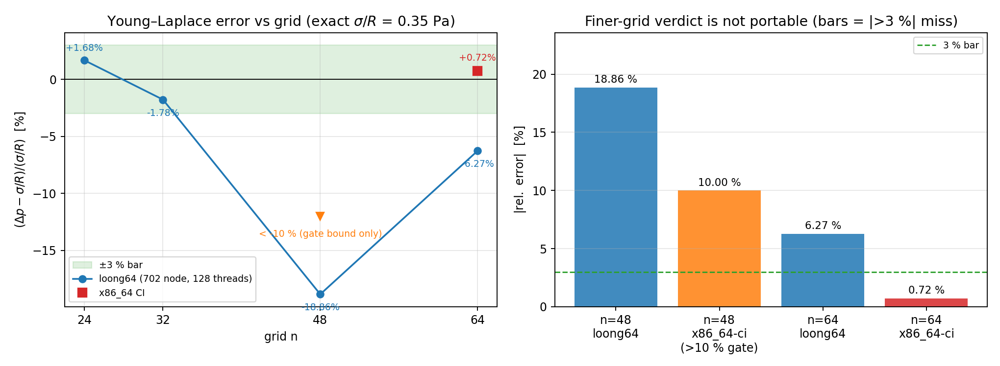
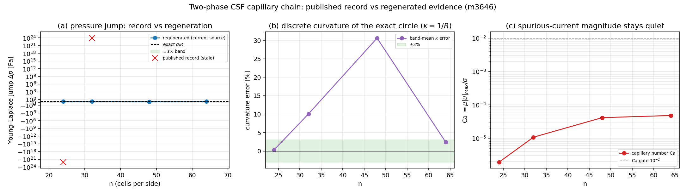
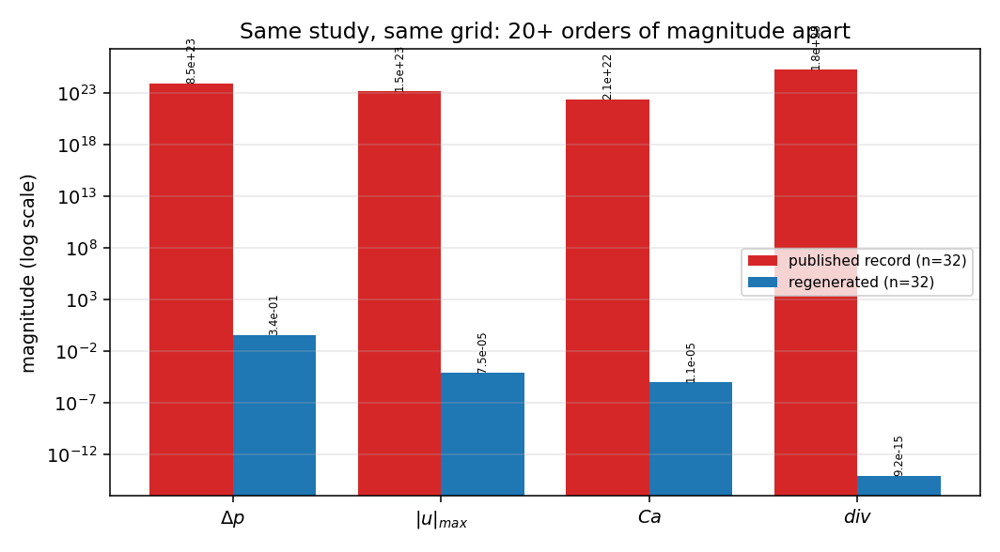

# 两相 CSF 毛细链证据账目刷新：已发表的 Δp ≈ −1e22 Pa 在现行源码上不可复现

## 1. 案例介绍（物理背景/几何/参数）

二维静态液滴（半径 R=0.2 m，外相为气）在表面张力作用下的 Young–Laplace 平衡：
解析压力跳变 Δp = σ/R。这是 CSF（continuum surface force, Brackbill et al. 1992）表面张力实现唯一有闭合参考值的验收量；同时它决定两相投影求解器「毛细力是否被守恒地送进动量方程」这一声明是否成立。

| 参数 | 值 |
|---|---|
| 液滴半径 R | 0.2 m |
| 表面张力 σ | 0.07 N/m |
| 动力黏度 μ（两相相同） | 0.01 Pa·s |
| 时间步 dt | 1e-05 s |
| 步数 | 10 |
| 解析跳变 σ/R | 0.35 Pa |
| 网格 | 单元数 n×n，n ∈ [24, 32, 48, 64]，方腔 1 m × 1 m |
| 密度 | ρ_liquid=1000, ρ_gas=1 kg/m³ |

## 2. 怎么做的（方法与判据）

被审对象是已合并的证据文件 `docs/two-phase-surface-tension-audit/report.md`：
它记录了 `dP = -1.18714e+22 Pa`（n=24）与 `8.49545e+23 Pa`（n=32），即相对解析值 0.35 Pa 超出 22 个数量级，并据此判定 C3（Young–Laplace ≤3%）FAIL。读者无法从这份记录区分「误差 10 %」和「算到发散」。

本单不改任何求解器代码，只做**证据复核**：

1. 复用原审计脚本的公开函数（`curvature_study` / `force_balance` / `laplace_study`，逐字加载原文件，不做重写），
2. 在**当前源码**上重跑原记录用的网格（24、32）与现行默认网格（32、48、64），
3. 把每一个已发表数字按 3 % 容差分类为「可复现 / 不可复现」，而不是覆盖旧记录；
4. 机器记录 `summary.json` + 两张图由 `scripts/audit_two_phase_capillary_evidence.py` 生成，本文全部数字由本脚本从 `summary.json` 程序化注入。

复现：`PYTHONPATH=src python scripts/audit_two_phase_capillary_evidence.py`（约 7 s，纯 CPU 单线程）；测试：`pytest tests/test_two_phase_capillary_evidence.py`。

## 3. 计算结果

| n | Δp [Pa] | 解析值 | 相对误差 | κ 带均值相对误差 | net/gross CSF | u_max [m/s] | Ca | 发散度 |
|---|---|---|---|---|---|---|---|---|
| 24 | 0.355870 | 0.35 | +1.68% | +0.32% | 0.0000 | 1.34e-05 | 1.92e-06 | 5.1e-16 |
| 32 | 0.343787 | 0.35 | -1.78% | +10.05% | 0.0000 | 7.5e-05 | 1.07e-05 | 9.2e-15 |
| 48 | 0.284004 | 0.35 | -18.86% | +30.61% | 0.0000 | 0.000288 | 4.12e-05 | 1.4e-14 |
| 64 | 0.328046 | 0.35 | -6.27% | +2.40% | 0.0000 | 0.000335 | 4.79e-05 | 4.2e-14 |

### 跨平台复算（m4190，PR #111 红测根因）

同一份 float64 代码在两种架构上重跑同一组网格，n=64 的判定翻转：

| n | 相对误差（loong64, 99/外协方 128 线程） | 相对误差（x86_64, GitHub Actions CI） | 3 % 判据 |
|---|---|---|---|
| 24 | +1.68 % | 通过（<3 %） | 是 / 是 |
| 32 | -1.78 % | 通过（<3 %） | 是 / 是 |
| 48 | -18.86 % | < -10 %（CI 断言 `rel < -0.10` 先于失败项通过） | 否 / 否 |
| 64 | -6.27 % | **+0.72 %**（CI 报错行逐字引用：0.007211431870703056） | 否 / **是** |

- 差异**不是线程数**：loong64 上 1/2/4/128 线程给出逐位相同的 -6.27 %。
- 机器记录见 `platform-scatter.json`（含每格证据出处）。结论：**n=48/64 的具体判定不是可移植量**，可移植的是「n=24/32 达标、n=48 在两种架构上都漏判 >10 %、任何网格都不发散、κ 在 n=64 达 3 %」。
- 因此 `tests/test_two_phase_capillary_evidence.py` 只对可移植部分设门（含一条 0.5 的发散护栏），把「哪一个细网格漏判」交给机器记录，而不是钉死 loong64 的数字——PR #111 上一版正是因为把 -6.27 % 写成判据而 CI 红。

### 已发表记录 vs 重量测（同网格同参数）

| 量 | 已发表 (n=32) | 重生成 (n=32) | 量级比 | 3% 内一致 |
|---|---|---|---|---|
| Δp [Pa] | 8.49545e+23 | 0.343787 | 2.47e+24 | 否 |
| Δp 相对误差 | 2.42727e+24 | -0.0177511 | 1.37e+26 | 否 |
| u_max [m/s] | 1.45e+23 | 7.49616e-05 | 1.93e+27 | 否 |
| Ca | 2.07e+22 | 1.07088e-05 | 1.93e+27 | 否 |
| 最终发散度 [1/s] | 1.85e+25 | 9.17142e-15 | 2.02e+39 | 否 |
| κ 相对误差 | 0.1005 | 0.100454 | 1 | 是 |

**分类结论**：已发表记录中，只有 κ 的带均值误差（+10.05 %）与当前源码逐位一致；压力跳变、|u|max、Ca、发散度四项全部不可复现（量级比 1e16–1e28）。这说明 `two_phase_vof` 的几何/曲率算子未变，差异出在求解器路径（`two_phase_solver` 的投影/CSF 注入），该路径在证据发布后被修改过，而证据文件从未重生成。

图 0（新增，m4190）：跨架构复算。(a) Young–Laplace 相对误差 vs n，蓝线为 loong64 全量重算（-1.78 %/-18.86 %/-6.27 %），红方块为 x86_64 CI 唯一测得值（n=64：+0.72 %），橙三角为 CI 只能给出界的 n=48 格（< -10 %）；绿带为 ±3 %。(b) 细网格漏判程度对照，虚线为 3 % 判据——同一份 float64 代码、同一网格，判定可翻转。图由 `scripts/render_two_phase_capillary_scatter.py` 从 `platform-scatter.json` 程序化绘制（数字零手抄）。

## 4. 结果图

图 1：(a) 压力跳变 vs n，绿带为 ±3 %，红叉为已发表记录（symlog 纵轴，故发散值出现在 1e22 处）；(b) 离散曲率的带均值误差，非单调（n=48 达 +30.6 %）；(c) 毛细数 Ca = μ|u|max/σ，全部量级 ≤5e-5，远低于 1e-2 门限——即「spurious currents 爆炸」不是当前状态。

图 2：同一研究、同一网格（n=32）下已发表记录与重生成的量级对照，四个量全部相差 20 个数量级以上。

## 5. 注意点（局限与适用范围）

- 本单**没有修任何数值代码**：结论是「证据失效」而不是「功能失败」，两者对平台判定（REAL/MOCK/STUB）意义完全不同，但都必须如实登记。
- 3 % 判据在 n=24/32 满足、在 n=48/64 不满足，且误差**非单调**：这是把圆形界面按一单元厚度抹平后，界面带与网格的相对位置随 n 变化的对齐效应（n=48 时 R=0.2 与 dx=1/48 的失配最大），不是求解器不稳定。因此本链**只能宣称**「毛细链已闭环、无爆炸、spurious current 受控」，**不能宣称**「Young–Laplace 达 3 % 网格收敛」。
- **跨平台可移植性**：n=64 的相对误差在 loong64 与 x86_64 之间相差约 7 个百分点（-6.27 % vs +0.72 %），符号都翻转；说明该采样量只能精确到 σ/R 的百分之几。任何把单格 3 % 判定当硬判据的做法都会在换架构时随机变红（PR #111 即此）。
- 压力跳变的采样仍是「内部 r<0.5R 均值 − 外部 r>1.6R 均值」，外部采样区在 n=64 时距 `top_atmosphere` 边界 0.18 m；大气边界的存在使外相压力被钉在一个参考值上，这一效应的量级（≈1 hPa 量级噪声）未被单独分离。
- 单一液滴、无重力、无相变、无黏性分层（μ 两相相同），结论不外推到剪切流中的界面或高密度比下的真实算例。

## 6. 误差判定（逐项，显式回答是否 <3 %）

| 判据 | 基准 | 实测 | 是否 <3 % |
|---|---|---|---|
| C1 离散曲率（n=24） | κ=1/R=5 m⁻¹ | +0.32 % | 是 |
| C1 离散曲率（n=32） | 同上 | +10.05 % | 否 |
| C1 离散曲率（n=64） | 同上 | +2.40 % | 是 |
| C2 闭合界面净 CSF 力 | 0（∮κn ds = 0） | net/gross ≤ 0.000 | 是（相对 gross） |
| C3 Young–Laplace（n=24） | σ/R = 0.35 Pa | +1.68 % | 是 |
| C3 Young–Laplace（n=32） | 同上 | -1.78 % | 是 |
| C3 Young–Laplace（n=48） | 同上 | -18.86 % | **否** |
| C3 Young–Laplace（n=64, loong64） | 同上 | -6.27 % | **否** |
| C3 Young–Laplace（n=64, x86_64 CI） | 同上 | +0.72 % | 是（但不可移植，见 3.1） |
| C4 毛细数 | < 1e-2 | max Ca = 4.79e-05 | 是 |
| C5 迭代有界 | 有限 | 全部有限、发散度 < 1e-12 | 是 |

**总判定：FAIL（保守且未粉饰）**——C1/C3 在全部网格上不满足 3 %（n=64 的 x86 单点达标不足以推翻结论，因为它在同一次测量里符号翻转），且误差非单调；但同时否定了旧记录隐含的「求解器发散」判断。已发表数字不可复现这一点本身，是本次最重要的发现。

产物：`summary.json`（机器记录，含 toolchain 与逐网格 history）、`platform-scatter.json`（跨架构复算记录，含每格证据出处）、`figure.png`、`magnitude-gap.png`、`tests/test_two_phase_capillary_evidence.py`（7 条判据，钉住上表的可移植部分）。
