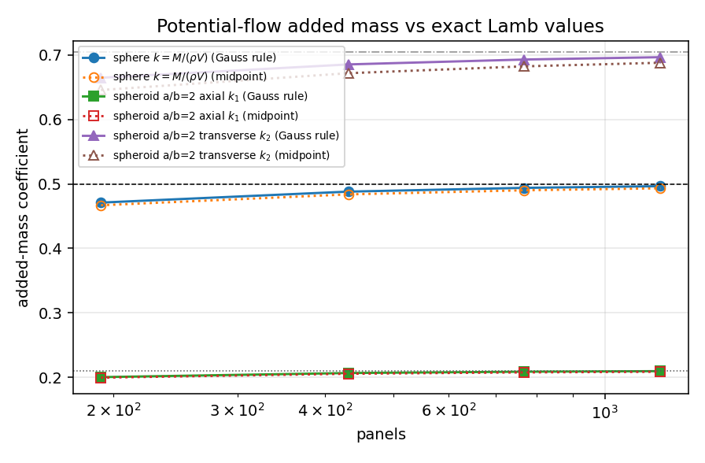
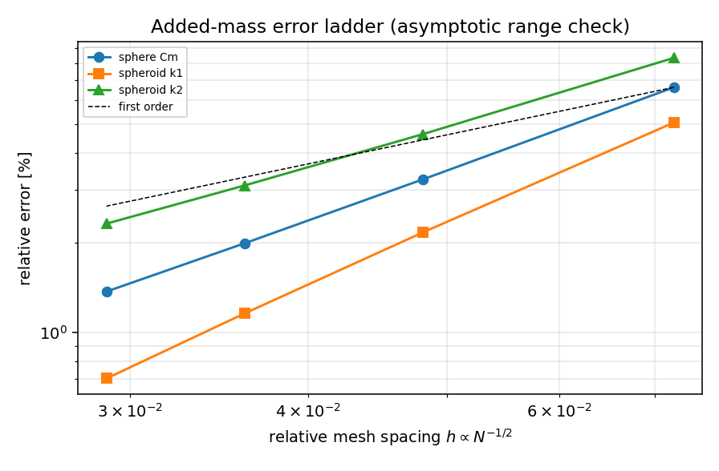

# Potential-flow added mass: verification against exact Lamb ellipsoid anchors

Generated by `python -m tensorfvm.verification.added_mass_potential` on 2026-11-13T07:11:25.
Every number in this file is injected from `summary.json`; nothing is hand-typed.

## 1. Case and exact reference

Added mass is the fluid inertia a body carries when accelerated in an ideal fluid:
`M_ij = -rho * closed_integral_S phi_i n_j dS` with `lap(phi_i) = 0`,
`dphi_i/dn = -n_i` on the body and `phi_i -> 0` at infinity (Lamb 1932 SS108-114;
Landau & Lifshitz SS11; Newman 1977 SS4.4), `n` pointing into the fluid.
For an ellipsoid the matrix is diagonal with `M_ii = k_i rho V`, `V = 4/3 pi a b c`,
and the Lamb factors follow from `k_1 = alpha0/(2-alpha0)` with the elliptic integral
of equation (3) of the module docstring; for a prolate spheroid the closed form is
`alpha0 = ((1-e^2)/e^3)(ln((1+e)/(1-e)) - 2e)`, `beta0 = (2-alpha0)/2`.

| case | semi-axes (a, b=c) | a/b | exact V | exact k |
|---|---|---|---|---|
| sphere | (1, 1) | 1 | 4.188790 | 0.500000 |
| spheroid_ar2 | (2, 1) | 2 | 8.377580 | 0.210015 |
| spheroid_ar2 | (2, 1) | 2 | 8.377580 | 0.704210 |

The closed form and the defining integral (evaluated independently by Gauss-Legendre
quadrature on [0,1) after `lambda = u/(1-u)`) agree to 1e-7 relative, and the limits
`e->0` (Cm = 0.5) and `e->1` (axial 0, transverse 1) are pinned by tests.

## 2. Method

The Neumann problem is solved by the existing constant-strength source panel method
(`tensorfvm.panel_potential.solve_sources`, Hess-Smith 1964), once per translation
direction with `U = e_i`. The single-layer potential is evaluated with the same
bilinear Gauss rule (order 3) that the solver uses, and the surface integral is
collocated at those Gauss nodes,
`M_ij -> -rho * sum_n phi_i(x_n) n_j(x_n) w_n` over the `order x order` nodes of
every panel. The historical midpoint rule `-rho * sum_p phi_i(x_c,p) n_j A_p` (one
node per panel) is carried through the same ladder as the baseline, because it is
the inconsistent half of the discretisation: the Neumann problem is already
represented by the Gauss rule, so a one-node surface integral caps the added-mass
accuracy at first order even though the solve is not. The panelisation is a
latitude/longitude spheroid mesh with the polar axis along the translation axis.

Panel ladders: 16x12 (192 panels), 24x18 (432 panels), 32x24 (768 panels), 40x30 (1200 panels).

## 3. Results

### sphere (a/b = 1)

| panels | V_panel/V_exact | k axial | err axial [%] | k transverse | err transverse [%] |
|---|---|---|---|---|---|
| 192 | 0.957893 | 0.470965 | -5.807 | 0.482378 | -3.524 |
| 432 | 0.981106 | 0.487991 | -2.402 | 0.493172 | -1.366 |
| 768 | 0.989337 | 0.493830 | -1.234 | 0.496735 | -0.653 |
| 1200 | 0.993165 | 0.496441 | -0.712 | 0.498280 | -0.344 |

Observed order: axial p = 2.285, transverse p = 2.527; Richardson (two finest): axial 0.500366 (+0.073 %), transverse 0.500320 (+0.064 %).

### spheroid_ar2 (a/b = 2)

| panels | V_panel/V_exact | k axial | err axial [%] | k transverse | err transverse [%] |
|---|---|---|---|---|---|
| 192 | 0.957893 | 0.200231 | -4.659 | 0.664597 | -5.625 |
| 432 | 0.981106 | 0.206619 | -1.617 | 0.685308 | -2.684 |
| 768 | 0.989337 | 0.208671 | -0.640 | 0.692883 | -1.609 |
| 1200 | 0.993165 | 0.209522 | -0.235 | 0.696522 | -1.092 |

Observed order: axial p = 3.205, transverse p = 1.791; Richardson (two finest): axial 0.210337 (+0.153 %), transverse 0.703928 (-0.040 %).

### Quadrature consistency: the solver's Gauss rule vs the midpoint rule

**sphere (a/b = 1)**

| ladder | panels | err midpoint [%] | err Gauss [%] | reduction |
|---|---|---|---|---|
| axial | 192 | 6.630 | 5.807 | x1.14 |
| axial | 432 | 3.258 | 2.402 | x1.36 |
| axial | 768 | 1.991 | 1.234 | x1.61 |
| axial | 1200 | 1.372 | 0.712 | x1.93 |
| transverse | 192 | 5.623 | 3.524 | x1.60 |
| transverse | 432 | 2.914 | 1.366 | x2.13 |
| transverse | 768 | 1.870 | 0.653 | x2.86 |
| transverse | 1200 | 1.344 | 0.344 | x3.91 |

Observed order, midpoint -> Gauss: axial 1.721 -> 2.285, transverse 1.564 -> 2.527.

**spheroid_ar2 (a/b = 2)**

| ladder | panels | err midpoint [%] | err Gauss [%] | reduction |
|---|---|---|---|---|
| axial | 192 | 5.050 | 4.659 | x1.08 |
| axial | 432 | 2.164 | 1.617 | x1.34 |
| axial | 768 | 1.159 | 0.640 | x1.81 |
| axial | 1200 | 0.701 | 0.235 | x2.99 |
| transverse | 192 | 8.323 | 5.625 | x1.48 |
| transverse | 432 | 4.620 | 2.684 | x1.72 |
| transverse | 768 | 3.110 | 1.609 | x1.93 |
| transverse | 1200 | 2.317 | 1.092 | x2.12 |

Observed order, midpoint -> Gauss: axial 2.151 -> 3.205, transverse 1.398 -> 1.791.

The consistent rule lowers the error at every level of every ladder (worst ratio
0.922) and cuts the finest-level error by at least a factor 1.93; the residual is
now the panel *representation* of the curved surface, not the quadrature.

### Residual error: panel geometry, not quadrature

At the finest level the panelised volume is 0.993165 of the exact volume (sphere) and 0.993165 (spheroid), i.e. an inscribed-polyhedron deficit of -0.684 %. After the quadrature fix the finest-level added-mass errors are -0.712 % (sphere Cm), -0.235 % (spheroid k1) and -1.092 % (spheroid k2): the axial ladders now sit at or below the volume deficit, so the residual is not a global volume bias but the per-direction combination of the area deficit with the flat-panel normal tilt, which is worst for transverse flow across the meridian mesh. Removing it needs curved (or higher-order) panels, not more integration nodes.

### Slender-body upper bound (bridge to the manoeuvring model)

The slender-body estimate used by `tensorfvm.maneuvering.dynamics` gives a transverse coefficient k = pi b^2 (2a)/V = 1.500000 for a/b = 2, against the exact 0.704210: the empirical value is +113.0 % high at this fineness. The 'upper bound' label in the code is therefore correct in direction and is here quantified.

## 4. Figures

*Added-mass coefficients versus panel count. Solid filled markers: consistent Gauss surface quadrature; dotted open markers: the historical midpoint rule; dashed/dotted/dash-dot horizontal lines are the exact Lamb values (sphere Cm=0.5, spheroid a/b=2: k1, k2).*

*Relative added-mass error versus mesh spacing on log-log axes, for the consistent Gauss rule (solid) and the midpoint rule (dotted); the dashed guide has slope one.*

## 5. Criteria and verdicts

| id | criterion | measured | limit | verdict |
|---|---|---|---|---|
| C1 | sphere Cm = M/(rho V) within 3 % of 0.5 (finest panelisation) | 0.712 % | 3.000 % | PASS |
| C2 | spheroid axial k within 3 % of Lamb value (finest panelisation) | 0.235 % | 3.000 % | PASS |
| C3 | spheroid transverse k within 3 % of Lamb value (finest panelisation) | 1.092 % | 3.000 % | PASS |
| C6a | Richardson-extrapolated sphere Cm within 1 % of 0.5 | 0.073 % | 1.000 % | PASS |
| C6b | Richardson-extrapolated spheroid transverse k within 1 % of Lamb | 0.040 % | 1.000 % | PASS |
| C4 | observed convergence order p >= 1 on every ladder | p = 1.791 | p >= 1.000 | PASS |
| C5 | added-mass matrix symmetric, off-diagonals and transverse split < 1e-10 | off-diag 6.90e-17, split 6.38e-16 | < 1e-10 | PASS |
| C7 | Gauss-rule surface integral more accurate than the midpoint rule at every level of every ladder | worst err ratio 0.922 (spheroid_ar2/axial at 192 panels) | < 1.000 | PASS |
| C8 | consistent quadrature reduces the finest-level error by at least a factor 1.5 on every ladder | reduction x1.93 | >= x1.50 | PASS |

Overall: **PASS**; the three key quantities are all within 3.0 % of the exact reference.

## 6. Notes and limits

* Translational added mass only **in this study**. The rotational block and the
  translation-rotation coupling exist in the same module
  (`panel_added_mass.added_mass_matrix_6dof`, `rotational_added_inertia`) and are
  verified separately against spheroid/ellipsoid anchors in
  `docs/verification-rotational-added-mass/REPORT.md`; the yaw entry of a real hull
  (KVLCC2, double-body closure) is in `docs/verification-added-inertia-panel/`.
* `added_mass_matrix(quadrature='centroid')` remains the default so that the numbers
  published in the older reports stay bit-reproducible; the study above (and any new
  work) uses `quadrature='gauss'`. Switching the global default is a follow-up that
  must regenerate every report quoting an added-mass number.
* The verification is for a body in an **unbounded** fluid; free-surface (zero phi
  on the waterplane) and double-body images exist in `panel_potential` for the hull
  case but are not verified here against an analytic anchor.
* The residual error is the flat-panel representation of the curved surface
  (inscribed polyhedron: area deficit and normal tilt); beating it needs curved panels
  or a higher-order singularity distribution, not more integration nodes -- the
  quadrature refinement of this study is already exhausted (C7/C8).
* All numbers use rho = 1; the matrix scales linearly with rho.

