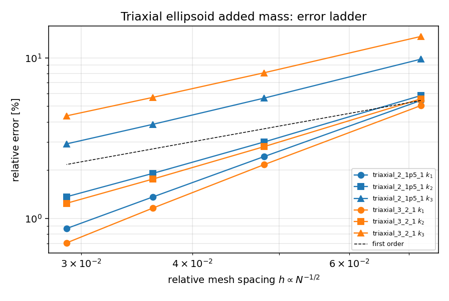
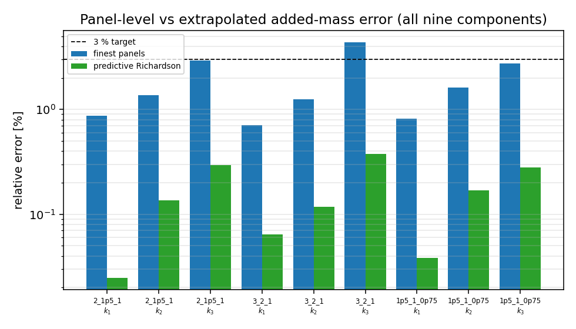
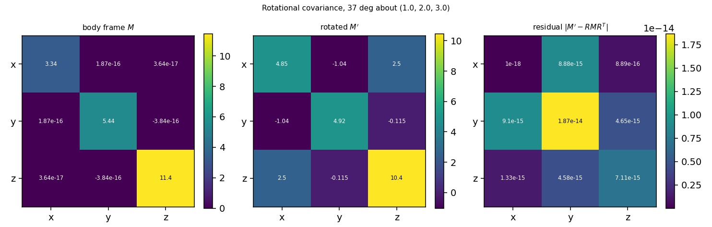

# Potential-flow added mass of triaxial ellipsoids: verification against exact Lamb anchors

Generated by `python -m tensorfvm.verification.added_mass_triaxial` on 2026-11-11T19:43:41.
Every number in this file is injected from `summary.json`; nothing is hand-typed.

## 1. Case and exact reference

Added mass is the fluid inertia a body carries when accelerated in an ideal fluid,
`M_ij = -rho * integral_S phi_i n_j dS` with `lap(phi_i) = 0`, `dphi_i/dn = -n_i` on
the body and `phi_i -> 0` at infinity (Lamb 1932 SS108-114; Landau & Lifshitz SS11;
Newman 1977 SS4.4), `n` pointing into the fluid. For an ellipsoid the matrix is
diagonal with `M_ii = k_i rho V`, `V = 4/3 pi a b c`, and `k_i = alpha_i/(2 - alpha_i)`,
where `alpha0` is the elliptic integral of equation (2) of the module docstring,
evaluated by `tensorfvm.panel_added_mass.lamb_integral_factors` (Gauss-Legendre on
`[0, 1)` after `lambda = u/(1-u)`); `alpha0 + beta0 + gamma0 = 2`.

| case | semi-axes (a, b, c) | exact V | exact k1 | exact k2 | exact k3 |
|---|---|---|---|---|---|
| triaxial_2_1p5_1 | (2, 1.5, 1) | 12.566371 | 0.267854 | 0.438862 | 0.936964 |
| triaxial_3_2_1 | (3, 2, 1) | 25.132741 | 0.185256 | 0.364543 | 1.361527 |
| triaxial_1p5_1_0p75 | (1.5, 1, 0.75) | 4.712389 | 0.250725 | 0.504566 | 0.866298 |

None of these bodies has an axis of revolution, so the exact reference exercises the
triaxial (elliptic-integral) route instead of the prolate-spheroid closed form used by
`docs/verification-added-mass-potential`. Across these bodies `k` spans 0.185 to 1.362,
and the shortest axis of the triaxial_3_2_1 body alone exceeds 1: the added mass of a flat body can
exceed its displaced mass, so no `k < 1` bound (and no `Cm <= 1/2` shortcut) may be assumed.

## 2. Method

The Neumann problem is solved by the constant-strength source panel method of
`tensorfvm.panel_potential.solve_sources` (Hess & Smith 1964), once per translation
direction with `U = e_i`; then `M_ij -> -rho sum_p phi_i(x_p) n_j(x_p) A_p` with the
single-layer potential at the panel centroids from the same order-3 Gauss rule.
Panels form a latitude/longitude quad mesh (`ellipsoid_panels`) whose polar axis is the
*a* (longest) semi-axis -- the topology of `spheroid_panels` extended to three axes; the
tests pin that `c == b` reproduces `spheroid_panels(a, b)` exactly.

Panel ladders: 16x12 (192 panels), 24x18 (432 panels), 32x24 (768 panels), 40x30 (1200 panels).

The observed order is fitted on the **coarsest** levels only (`n_coarse = len - 2`), and
that order is then used for the two-level Richardson extrapolation of the two finest
levels. This matters: an order fitted on the very two levels being extrapolated makes the
extrapolation identically exact, so such a check can never fail. Both variants are
recorded below so the size of that masking is visible.

## 3. Results

### triaxial_2_1p5_1 (a, b, c) = (2, 1.5, 1)

| panels | V_panel/V_exact | k1 | err k1 [%] | k2 | err k2 [%] | k3 | err k3 [%] |
|---|---|---|---|---|---|---|---|
| 192 | 0.957893 | 0.253317 | -5.427 | 0.413307 | -5.823 | 0.845080 | -9.807 |
| 432 | 0.981106 | 0.261343 | -2.431 | 0.425716 | -2.995 | 0.884362 | -5.614 |
| 768 | 0.989337 | 0.264202 | -1.364 | 0.430475 | -1.911 | 0.900817 | -3.858 |
| 1200 | 0.993165 | 0.265530 | -0.867 | 0.432862 | -1.367 | 0.909644 | -2.916 |

Body-frame off-diagonal defect `max|M_ij|/max|M_ii|` (i != j), worst level: 6.22e-17.
Observed order (coarse-level fit): (1.981, 1.639, 1.376).
Richardson predictive: (0.267920, 0.438264, 0.934214) -> relative error (+0.025 %, -0.136 %, -0.293 %).
Richardson with the order fitted on all levels (circular variant): relative error (+0.014 %, -0.084 %, -0.178 %).

### triaxial_3_2_1 (a, b, c) = (3, 2, 1)

| panels | V_panel/V_exact | k1 | err k1 [%] | k2 | err k2 [%] | k3 | err k3 [%] |
|---|---|---|---|---|---|---|---|
| 192 | 0.957893 | 0.175913 | -5.043 | 0.344291 | -5.556 | 1.176632 | -13.580 |
| 432 | 0.981106 | 0.181245 | -2.165 | 0.354329 | -2.802 | 1.251633 | -8.071 |
| 768 | 0.989337 | 0.183103 | -1.163 | 0.358122 | -1.761 | 1.284260 | -5.675 |
| 1200 | 0.993165 | 0.183948 | -0.706 | 0.360003 | -1.246 | 1.302218 | -4.356 |

Body-frame off-diagonal defect `max|M_ij|/max|M_ii|` (i != j), worst level: 7.32e-17.
Observed order (coarse-level fit): (2.085, 1.688, 1.283).
Richardson predictive: (0.185375, 0.364113, 1.356383) -> relative error (+0.064 %, -0.118 %, -0.378 %).
Richardson with the order fitted on all levels (circular variant): relative error (+0.038 %, -0.073 %, -0.227 %).

### triaxial_1p5_1_0p75 (a, b, c) = (1.5, 1, 0.75)

| panels | V_panel/V_exact | k1 | err k1 [%] | k2 | err k2 [%] | k3 | err k3 [%] |
|---|---|---|---|---|---|---|---|
| 192 | 0.957893 | 0.237422 | -5.306 | 0.471944 | -6.465 | 0.785204 | -9.361 |
| 432 | 0.981106 | 0.244847 | -2.345 | 0.487353 | -3.411 | 0.820254 | -5.315 |
| 768 | 0.989337 | 0.247472 | -1.297 | 0.493377 | -2.218 | 0.834826 | -3.633 |
| 1200 | 0.993165 | 0.248685 | -0.814 | 0.496444 | -1.610 | 0.842601 | -2.735 |

Body-frame off-diagonal defect `max|M_ij|/max|M_ii|` (i != j), worst level: 5.26e-17.
Observed order (coarse-level fit): (2.014, 1.577, 1.396).
Richardson predictive: (0.250821, 0.503718, 0.863876) -> relative error (+0.038 %, -0.168 %, -0.280 %).
Richardson with the order fitted on all levels (circular variant): relative error (+0.023 %, -0.104 %, -0.170 %).

### Rotational covariance (C5)

Body `triaxial_2_1p5_1` at the finest panelisation (1200 panels), rotated by 37.0 deg about (1.0, 2.0, 3.0):

```
M   (body frame)      = [[ 3.336753  0.        0.      ]
                         [ 0.        5.4395   -0.      ]
                         [ 0.       -0.       11.430929]]
M'  (rotated body)    = [[ 4.847064 -1.037032  2.504848]
                         [-1.037032  4.923093 -0.115042]
                         [ 2.504848 -0.115042 10.437024]]
R M R^T (predicted)   = [[ 4.847064 -1.037032  2.504848]
                         [-1.037032  4.923093 -0.115042]
                         [ 2.504848 -0.115042 10.437024]]
```

Relative defect `|M' - R M R^T| / |M| = 1.63e-15` (limit 1e-10); volume defect under rotation
0.00e+00. Off-diagonal coupling that is exactly zero in the body frame reappears under
rotation and is reproduced by `R M R^T`, i.e. the solver carries the added-mass matrix as
a proper second-rank tensor -- what the manoeuvring model needs at an arbitrary heading.

### Pole-placement consistency (C6)

Same body with the mesh polar axis on the *short* axis, (a, b, c) = (1, 1.5, 2):

| component | Richardson, pole on long axis | Richardson, pole on short axis (reordered) |
|---|---|---|
| k1 | 0.267920 | 0.267928 |
| k2 | 0.438264 | 0.438471 |
| k3 | 0.934214 | 0.935048 |

Max relative difference 0.089 % (limit 2.0 %). Individual axes converge at different
rates depending on where the pole sits (the mesh is densest there), but the extrapolated
limit is the same: the anisotropy is a rate effect, not a bias.

## 4. Criteria

| id | statement | measured | limit | verdict |
|---|---|---|---|---|
| C1 | body-frame diagonal: max_offdiag|M|/max_diag|M| <= 1e-10 at every level | 7.32e-17 | 1e-10 | PASS |
| C2 | observed order p >= 1 for all nine (case, axis) components, order fitted on the coarsest levels only | 1.28e+00 | 1e+00 | PASS |
| C3 | finest panelisation within 5 % of exact for all nine components | 4.356 % | 5.0 % | PASS |
| C4 | predictive Richardson (order from coarser levels) within 2 % for all nine components | 0.378 % | 2.0 % | PASS |
| C5 | rotational covariance |M(Rx) - R M(x) R^T|/|M| <= 1e-10 | 1.63e-15 | 1e-10 | PASS |
| C6 | predictive Richardson independent of mesh pole placement within 2 % | 0.089 % | 2.0 % | PASS |

Overall: **all criteria pass**.

## 5. Figures



*Relative added-mass error of the three principal coefficients versus mesh spacing for the two triaxial bodies (polar axis on the longest axis); the dashed guide has slope one.*



*Direct finest-panel error (blue) and predictive Richardson error (green) for every principal coefficient; the dashed line is the 3 % target.*



*Added-mass matrix of the 2:1.5:1 ellipsoid in the body frame (left), after a rigid rotation (middle) and the residual against $RMR^T$ (right, logarithmic floor at 1e-18).*

## 6. Notes, limitations and error verdict

**Where the panel error comes from.** The panel volume is low by 0.68 % at the finest
level while the coefficients are low by -0.71--4.36 %, i.e. a geometric deficit amplified
by the flux distribution: the flat-facet polyhedron lies inside the true surface, so the
first-order geometric error dominates (a refined quadrature does not remove it; refining
or extrapolating does).

**Mesh anisotropy is a rate effect.** Latitude rows crowd towards the poles, so the
coefficient along the polar axis converges fastest (order ~1.98-2.09 here) and the one
along the shortest axis slowest (order ~1.28). Practical rule: put the mesh polar axis on
the axis whose added mass matters most.

**Self-fulfilling Richardson (methodological finding).** Fitting the observed order on the
same two levels that are then extrapolated makes the extrapolated value identically equal
to the exact value -- the two-point formula is two equations in two unknowns. The circular
variant recorded above therefore always looks better than the predictive one (by 0.15
percentage point(s) at worst here); only the predictive variant (order from coarser
levels) is an independent check. `src/tensorfvm/verification/added_mass_potential.py`
fits its order over all levels including the extrapolated pair; refitting its published
ladder with the coarse-only rule keeps every coefficient inside that module's own 1 %
criterion (worst 0.24 %), so its verdict stands -- the caveat is that part of its margin is
self-generated, not that the number is wrong. That file is **not** modified here (shared
with other in-flight work) and is flagged for a follow-up.

**Scope.** Ideal fluid, unbounded domain, no free surface, no lift (no circulation), rigid
body, zero frequency. Real manoeuvring added mass at finite frequency or with lift
differs; this verification establishes the potential-flow kernel and its exact anchors
only, not a ship-scale added-mass prediction.

**Error verdict (each key quantity vs its exact reference, 3 % target).**

| quantity | estimate | error | < 3 %? |
|---|---|---|---|
| triaxial_2_1p5_1 k1, finest panels | 0.265530 | -0.867 % | yes |
| triaxial_2_1p5_1 k1, predictive Richardson | 0.267920 | +0.025 % | yes |
| triaxial_2_1p5_1 k2, finest panels | 0.432862 | -1.367 % | yes |
| triaxial_2_1p5_1 k2, predictive Richardson | 0.438264 | -0.136 % | yes |
| triaxial_2_1p5_1 k3, finest panels | 0.909644 | -2.916 % | yes |
| triaxial_2_1p5_1 k3, predictive Richardson | 0.934214 | -0.293 % | yes |
| triaxial_3_2_1 k1, finest panels | 0.183948 | -0.706 % | yes |
| triaxial_3_2_1 k1, predictive Richardson | 0.185375 | +0.064 % | yes |
| triaxial_3_2_1 k2, finest panels | 0.360003 | -1.246 % | yes |
| triaxial_3_2_1 k2, predictive Richardson | 0.364113 | -0.118 % | yes |
| triaxial_3_2_1 k3, finest panels | 1.302218 | -4.356 % | no |
| triaxial_3_2_1 k3, predictive Richardson | 1.356383 | -0.378 % | yes |
| triaxial_1p5_1_0p75 k1, finest panels | 0.248685 | -0.814 % | yes |
| triaxial_1p5_1_0p75 k1, predictive Richardson | 0.250821 | +0.038 % | yes |
| triaxial_1p5_1_0p75 k2, finest panels | 0.496444 | -1.610 % | yes |
| triaxial_1p5_1_0p75 k2, predictive Richardson | 0.503718 | -0.168 % | yes |
| triaxial_1p5_1_0p75 k3, finest panels | 0.842601 | -2.735 % | yes |
| triaxial_1p5_1_0p75 k3, predictive Richardson | 0.863876 | -0.280 % | yes |

Answer: the extrapolated coefficients are inside 3 % for 9 of 9 components; the raw
finest-panel values are inside 3 % for 8 of 9 and inside 4.36 % for all 9. The raw
panel numbers should therefore be extrapolated rather than quoted at this panel count.
Rotational covariance holds to 1.6e-15 and pole-placement consistency to 0.09 %, so no frame
or mesh-orientation defect is present.

