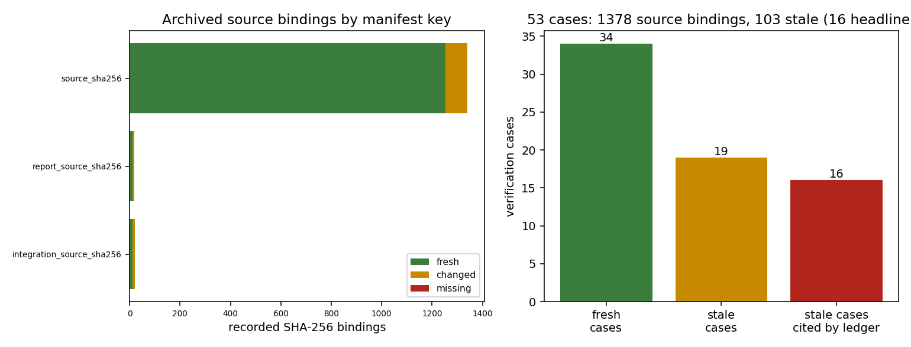

# Archived source staleness audit

Generated by `scripts/audit_archived_source_staleness.py`; the tables below are printed from `staleness.json`, not typed by hand.

## Summary

| cases | bindings | fresh | changed | missing | stale cases | stale and cited by `docs/benchmarks-index.md` |
|---:|---:|---:|---:|---:|---:|---:|
| 53 | 1378 | 1275 | 102 | 1 | 19 | 16 |

## Stale cases

| case | bindings | fresh | stale | missing | cited by ledger | changed or missing paths |
|---|---:|---:|---:|---:|:---:|---|
| `verification-sa-refinement` | 28 | 14 | 14 | 0 | yes | `pyproject.toml`, `src/tensorfvm/solver.py`, `src/tensorfvm/verification/__main__.py`, `src/tensorfvm/verification/cases.py`, `src/tensorfvm/verification/dfg.py`, `src/tensorfvm/verification/engineering.py`, `src/tensorfvm/verification/engineering_audit.py`, `src/tensorfvm/verification/extended.py`, `src/tensorfvm/verification/gpu.py`, `src/tensorfvm/verification/report.py`, `src/tensorfvm/verification/simple_gpu.py`, `src/tensorfvm/verification/simple_gpu_audit.py`, `src/tensorfvm/coupled_coarse.py`, `scripts/verify_sa_mesh_refinement.py` |
| `verification-simple-gpu` | 27 | 14 | 13 | 0 | yes | `pyproject.toml`, `src/tensorfvm/solver.py`, `src/tensorfvm/verification/__main__.py`, `src/tensorfvm/verification/cases.py`, `src/tensorfvm/verification/dfg.py`, `src/tensorfvm/verification/engineering.py`, `src/tensorfvm/verification/engineering_audit.py`, `src/tensorfvm/verification/extended.py`, `src/tensorfvm/verification/gpu.py`, `src/tensorfvm/verification/report.py`, `src/tensorfvm/verification/simple_gpu.py`, `src/tensorfvm/verification/simple_gpu_audit.py`, `src/tensorfvm/coupled_coarse.py` |
| `verification-engineering` | 24 | 13 | 11 | 0 | yes | `pyproject.toml`, `src/tensorfvm/solver.py`, `src/tensorfvm/verification/__main__.py`, `src/tensorfvm/verification/cases.py`, `src/tensorfvm/verification/dfg.py`, `src/tensorfvm/verification/engineering.py`, `src/tensorfvm/verification/engineering_audit.py`, `src/tensorfvm/verification/extended.py`, `src/tensorfvm/verification/gpu.py`, `src/tensorfvm/verification/report.py`, `src/tensorfvm/wall_functions.py` |
| `verification-gpu` | 25 | 14 | 11 | 0 | yes | `pyproject.toml`, `src/tensorfvm/solver.py`, `src/tensorfvm/verification/__main__.py`, `src/tensorfvm/verification/cases.py`, `src/tensorfvm/verification/dfg.py`, `src/tensorfvm/verification/engineering.py`, `src/tensorfvm/verification/engineering_audit.py`, `src/tensorfvm/verification/extended.py`, `src/tensorfvm/verification/gpu.py`, `src/tensorfvm/verification/report.py`, `src/tensorfvm/wall_functions.py` |
| `verification-suboff-development` | 20 | 11 | 9 | 0 | yes | `src/tensorfvm/native_mesh3d.py`, `scripts/initialize_suboff_native.py`, `scripts/prepare_suboff_mesh.py`, `scripts/run_body_fitted_cylinder3900.py`, `scripts/report_suboff_development.py`, `tests/test_external_mesh_contract.py`, `tests/test_multi_element_flow.py`, `tests/test_native_mesh3d.py`, `tests/test_suboff_geometry.py` |
| `verification-dfg` | 19 | 12 | 7 | 0 | yes | `pyproject.toml`, `src/tensorfvm/solver.py`, `src/tensorfvm/verification/__main__.py`, `src/tensorfvm/verification/cases.py`, `src/tensorfvm/verification/dfg.py`, `src/tensorfvm/verification/extended.py`, `src/tensorfvm/verification/report.py` |
| `verification-dfg-control` | 19 | 12 | 7 | 0 | no | `pyproject.toml`, `src/tensorfvm/solver.py`, `src/tensorfvm/verification/__main__.py`, `src/tensorfvm/verification/cases.py`, `src/tensorfvm/verification/dfg.py`, `src/tensorfvm/verification/extended.py`, `src/tensorfvm/verification/report.py` |
| `verification-extended` | 18 | 12 | 6 | 0 | yes | `pyproject.toml`, `src/tensorfvm/solver.py`, `src/tensorfvm/verification/__main__.py`, `src/tensorfvm/verification/cases.py`, `src/tensorfvm/verification/extended.py`, `src/tensorfvm/verification/report.py` |
| `verification-benchmarks` | 15 | 10 | 5 | 0 | yes | `pyproject.toml`, `src/tensorfvm/solver.py`, `src/tensorfvm/verification/__main__.py`, `src/tensorfvm/verification/cases.py`, `src/tensorfvm/verification/report.py` |
| `verification-cylinder3900-body-fitted-primary` | 14 | 9 | 5 | 0 | yes | `scripts/run_body_fitted_cylinder3900.py`, `src/tensorfvm/body_fitted_transient3d.py`, `src/tensorfvm/cylinder3900_statistics.py`, `src/tensorfvm/multi_element.py`, `src/tensorfvm/solver.py` |
| `verification-cylinder3900-wall-refinement` | 15 | 11 | 4 | 0 | yes | `scripts/report_cylinder3900_development.py`, `src/tensorfvm/multi_element.py`, `src/tensorfvm/solver.py`, `tests/test_body_fitted_transient3d.py` |
| `verification-cylinder3900-body-fitted` | 8 | 5 | 3 | 0 | yes | `scripts/run_body_fitted_cylinder3900.py`, `src/tensorfvm/body_fitted_transient3d.py`, `src/tensorfvm/cylinder3900_statistics.py` |
| `verification-cylinder3900-pressure-coupling` | 3 | 1 | 2 | 0 | yes | `scripts/report_cylinder3900_pressure_coupling.py`, `tests/test_body_fitted_transient3d.py` |
| `conservative-transport-audit` | 4 | 3 | 1 | 0 | no | `src/tensorfvm/conservative3d.py` |
| `periodic-mac-audit` | 3 | 2 | 1 | 0 | no | `scripts/run_periodic_mac.py` |
| `verification-gmsh-controls` | 45 | 44 | 0 | 1 | yes | `docs/verification-gmsh-cylinder/meshes/scale-1.msh` (MISSING) |
| `verification-sa-diagnostic` | 6 | 5 | 1 | 0 | yes | `src/tensorfvm/solver.py` |
| `verification-sparse-sa-consistency` | 3 | 2 | 1 | 0 | yes | `src/tensorfvm/solver.py` |
| `verification-wall-law-reference` | 1 | 0 | 1 | 0 | yes | `scripts/compare_wall_law_coles.py` |

## Figure

