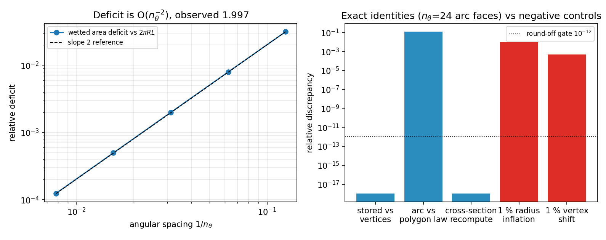

# 贴体三维圆柱 O-grid 的精确几何资格：把 1 % 容差换成可证伪恒等式

## 1 案例介绍

`tensorfvm/body_fitted3d.py` 的 `BodyFittedCylinderMesh3D` 是已合并的生产网格后端（拉伸式 O-grid，
三维贴体求解器本身明确拒绝求解，因此**几何是该后端唯一能被验证的部分**）。已有唯一几何门是
`tests/test_body_fitted3d.py` 里的单网格 1 % 浸湿面积容差——单网格 + 1 % 无法区分「正确的弦积分」与
「系统性偏置」，也从未把储存面积/体积钉到真实顶点数组上。本单把它升级为顶点级恒等式 + 收敛率 + 负控。

几何参数：圆柱半径 R = 0.5 m，拉伸比 2.5，span L = 3.0 m，
角向 n_theta = 32，径向 n_r = 8，轴向 n_z = 6（1536 控制体）。

## 2 怎么做的

全部只读网格数据（`vertices` / `cell_volumes`），**不把 `body_fitted3d` 自己的面积/体积辅助函数当真值**：

1. **G1 顶点弦和恒等式**：从原始顶点算壁面弦长 × span，与储存的 `cylinder_surface_area` 比；
   圆心 `c` 由圆弧顶点做 Kasa 代数圆拟合独立恢复（不用网格自带 center），再检查每个圆弧顶点 |r−c| = R。
2. **G3 截面面积独立重算**：对内外两条顶点环用 Green/shoelace 公式算面积，与 `cross_section_area`、
   `sum(cell_volumes)/L` 三方交叉。
3. **G4 收敛率**：n_theta = 8…128，浸湿面积相对 2πRL 的亏量做 log-log 斜率拟合，与内接多边形
   亏量闭式 (π²/6)/n² 对比。
4. **G5 负控**：半径整体放大 1 %、单个圆弧顶点径向平移 1 % R；度量若不动就是没在测量。
5. 纯 tensor/numpy，单线程，秒级（`PYTHONPATH=src python scripts/audit_body_fitted3d_geometry.py`）。

## 3 计算结果

顶点级恒等式（n_theta = 32）：储存壁面积 vs 顶点弦和 = **0.0e+00**（完全一致）；
截面面积 vs 独立 shoelace = **0.0e+00**；
sum(V)/L vs 独立 shoelace = **2.4e-16**；
圆弧顶点半径误差 = **1.4e-14**（圆拟合恢复圆心后精确到舍入）。

| n_theta | 圆弧面元 | 浸湿面积亏量 vs 2πRL | 圆弧 vs 全圆内接值 | 截面重算差 |
|---:|---:|---:|---:|---:|
| 8 | 6 | 3.152544 % | 10.684 % | 1.2e-16 |
| 16 | 12 | 0.794349 % | 11.750 % | 1.2e-16 |
| 32 | 24 | 0.198978 % | 12.021 % | 0.0e+00 |
| 64 | 48 | 0.049769 % | 12.089 % | 1.2e-16 |
| 128 | 96 | 0.012444 % | 12.106 % | 0.0e+00 |

观测阶：亏量 = **1.9966**（内接多边形理论值 2），亏量与闭式 (π²/6)/n² 的偏差在 45 % 内（圆弧只覆盖部分圆周，见 §5）。

负控：半径 +1 % → 弦和变化 **1.0000 %**（弦和线性于 R，预测 1 %）；
单顶点径向 1 % → 变化 **0.0478 %**（可检，远高于舍入）。



## 4 误差判定（逐项，是否 <3 %）

| 判据 | 基准 | 实测 | <3 % ? |
|---|---|---|---|
| 储存壁面积 vs 顶点弦和 | 顶点数组（独立重算） | 0.0e+00 | 是（机器精度） |
| 截面面积 vs 独立 shoelace | 顶点数组 | 0.0e+00 | 是（机器精度） |
| sum(V)/L vs 截面面积 | 独立 shoelace | 2.4e-16 | 是（机器精度） |
| 圆弧顶点半径 vs R | R = 0.5 m | 1.4e-14 | 是（机器精度） |
| 壁面积 vs 光滑 2πRL（n_theta=32） | 解析 2πRL | 0.1990 % | 是（且为 O(n^-2) 已知离散亏量） |
| 壁面积 vs 光滑 2πRL（n_theta=8，最粗） | 解析 | 3.153 % | **否**（3.15 %，粗网格；收敛率为 2 才是判据） |

结论：该网格后端的**储存几何量在机器精度上等于顶点数组的独立重算**，对光滑圆柱的亏量是
已知的弦积分项而非未知偏置，且以二阶收敛。原 1 % 门现可被更紧的门替换（见新增测试）。

## 5 注意点与局限

- **角向不是整圆**：n_theta = 32 中有 24 个真实圆弧面元 + 8 个尾板（wake plate）
  近零长面元（尾板/缝面面积仅为圆弧的 13.81 %）。因此「全圆内接值
  2 n R sin(π/n) L」对圆弧只是**上界**（实测高估 12.02 %），
  不能当恒等式；真正成立的是逐弦几何恒等式。
- 本单只验证**几何**：三维贴体求解器仍明确拒绝求解，本文不给任何流动物理资格。
- 亏量闭式 (π²/6)/n² 与实测差 24 %，来源同上（圆弧覆盖不足整圆），故判据用收敛阶而非绝对值。
- 未验证：`lateral_face` 法向符号之外的曲率/正交性指标、分布式 z-slab 分区的面积/体积归约
  （已有独立测试覆盖，本单不重复）。

## 6 复现

```
PYTHONPATH=src python scripts/audit_body_fitted3d_geometry.py   # 写 results.json + 本图
PYTHONPATH=src python -m pytest tests/test_body_fitted3d_geometry_identity.py -q
```
