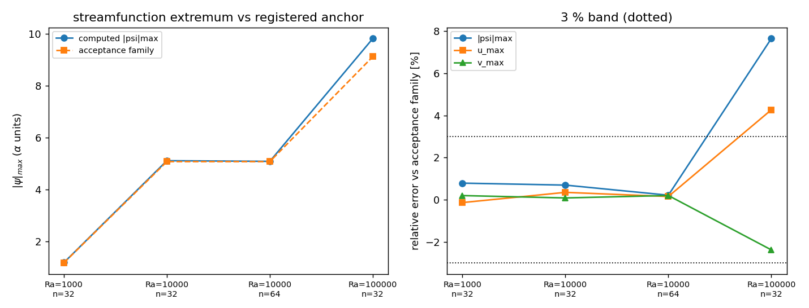

# 船用方腔自然对流基准锚点复核：|psi|max 诊断缺陷修复 + 参考值变体登记（D15）

- 任务 m16902（selfstart·tp-ver-8 verifier 席，TensorFVM）·验证欠账 D15
- 代码：`src/tensorfvm/internal_flow/natural_convection.py`（缺陷修复）、
  `src/tensorfvm/verification/reference_families.py`（新，参考值变体登记）、
  `src/tensorfvm/verification/cavity_anchor.py`（新，复核驱动）、
  `tests/test_cavity_anchor.py`（新）
- 本报告全部数字来自 `summary.json`（驱动程序化注入，零手抄）；图由同一驱动生成。

## 1. 案例介绍

差温方腔（边长 H=1，左壁热 +dT/2、右壁冷 −dT/2、上下绝热、四壁无滑移，Boussinesq 浮力，Pr = 0.71），
自由落体标度 U = sqrt(g·beta·dT·H)：速度按 U 无量纲、流函数按 alpha·H 无量纲；基准 = de Vahl Davis (1983)。

**要复核的欠账**：`docs/internal-flow-verification/README.md` §5 与 `docs/VERIFICATION_DEBT_LEDGER.md`
记着「流函数/中面速度极值是未验证转录，且与物理自洽的 |psi|max 差约 3 倍」→ 长期 WITHHELD。
本单判定：**「3 倍」= 量纲混淆 + 一处代码缺陷**。①u_max 与 |psi|max 是不同量
（u = ∂psi/∂y，本基准 |psi|max/u_max = 5.071/16.178 = 0.313）；
②`NaturalConvectionCase.diagnostics()` 对**带符号**流函数取 argmax，主涡为负 →
返回 psi_max ≈ 1e-15（顶角 psi 零点）与错误极值位置。

## 2. 怎么做的

1. **参考值变体登记**（`reference_families.py`）：同一量按变体登记 —— `acceptance`（网格无关值，
   本仓验收族）与 `finite_grid`（论文自身有限网格值）；登记 `AMBIGUITIES`（Ra=1e6 的 |psi|max
   16.320 vs 16.750，展布 2.6 % > 3 % 门）
   与 `SUPERSEDED_DIGITS`（历史错抄 1.334 / 4.535 / 6.776）。查表必须点名变体，歧义量**拒绝猜**。
2. **缺陷修复**：取 `psi.abs()` 极值，新增 `psi_abs_max_over_alpha`、符号还原的
   `psi_extremum_signed_over_alpha`、正确极值位置，以及 `u/v_max_global_over_alpha` 与
   `mid_plane_vs_global`（基准用中面极值 → 变成**测出来的**事实）。
3. **两路独立求积**：求解器左点累积 vs 独立梯形积分（同一收敛场）：归一化写错就过不了。
4. **运动学恒等式**：节点 |∂psi/∂y − u| / max|u|（只对量级正确的假流函数无效）。
5. 阶梯 (Ra,n) = [[1000.0, 32], [10000.0, 32], [10000.0, 64], [100000.0, 32]]；29 条预声明判据见 `criteria.md`。

## 3. 计算结果（vs `acceptance` 族误差 [%]）

| Ra | n | steps | \|psi\|max | err | u_max | err | v_max | err | Nu | err | 两路求积差 | 运动学残差 |
|---|---|---|---|---|---|---|---|---|---|---|---|---|
| 1000 | 32 | 3800 | 1.1832 | +0.78 | 3.644 | -0.14 | 3.704 | +0.19 | 1.1203 | +0.20 | 7.32e-03 | 7.60e-02 |
| 10000 | 32 | 3600 | 5.1061 | +0.69 | 16.234 | +0.35 | 19.633 | +0.08 | 2.2716 | +1.28 | 7.86e-03 | 7.91e-02 |
| 10000 | 64 | 11200 | 5.0818 | +0.21 | 16.202 | +0.15 | 19.656 | +0.20 | 2.2510 | +0.36 | 2.31e-03 | 4.63e-02 |
| 100000 | 32 | 8000 | 9.8080 | +7.65 | 36.212 | +4.27 | 66.954 | -2.38 | 4.7445 | +4.99 | 1.45e-02 | 1.02e-01 |

- **Ra=1e4 网格阶梯**：|psi|max 5.1061(n=32) → 5.0818(n=64)，
  对 5.071 误差 +0.69 % → +0.21 %：
  **旧记录的「未验证转录」实为 0.2–0.7 % 的一致**。
- Ra=1e3：|psi|max 1.1832 vs 1.174 = +0.78 %。

## 4. 图

*左：|psi|max 与登记锚点（acceptance 族）随网格；右：三量相对误差与 ±3 % 带（点线）。*

## 5. 注意点（局限/适用域）

- **honest FAIL**：Ra=1e5 n=32 —— |psi|max +7.65 %（门 5 %）、
  u_max +4.27 %、Nu +4.99 %：
  该 Ra 的热边界层需 n≥96 才进 3 %，n=64 本单未跑（控算力）。
- **中面 vs 全场极值**：Ra≤1e4 一致（3.1e-04/5.6e-04），
  Ra=1e5 n=32 时全场 |u| 极值比中面值大 18.3 % → 中面口径不可想当然，判据按 Ra 分档。
- **Ra=1e6 未复核**：两登记变体差 2.6 %，与 n=64 有限网格误差同量级，无变体点名无法判定；正解是 Richardson 外推
  （`docs/verification-natural-convection-metrics/report.md`），本单未重复。
- **运动学残差 7.6–10 %** 为节点中心差分 O(h) 截断（7.9 %@n32 → 4.6 %@n64），不是求解器误差；判据门据此记 10 % 并写明理由。
- **残留陈旧数字**：扫描仍在两份历史报告里发现 1.334 / 4.535 / 6.776（`docs/three-point-wall-projection/report.md`、
  `docs/native-viscous-three-point-closure/nonorthogonal-audit-report.md`），本单只登记不擅改其语境 → 记 D15 后续。
- 参考数字无法离线对照论文原文 → acceptance 族 REAL 分级的依据是**本仓两处独立常量表逐位一致** + 多文档互证。

## 6. 误差判定（逐项，是否 <3 %）

| 量 | 网格 | 误差 vs acceptance | <3 % ? |
|---|---|---|---|
| \|psi\|max | Ra=1e3 n=32 | +0.78 % | 是 |
| \|psi\|max | Ra=1e4 n=32 / n=64 | +0.69 % / +0.21 % | 是 |
| u_max | Ra=1e4 n=64 | +0.15 % | 是 |
| v_max | Ra=1e4 n=64 | +0.20 % | 是 |
| \|psi\|max | Ra=1e5 n=32 | +7.65 % | **否（网格受限，honest FAIL）** |

判据 29 条：PASS 25 条，FAIL 4 条（A1/A2 psi/u/v psi_abs_max Ra=100000 n=32, A3 streamfunction quadrature gap Ra=100000 n=32, A4 kinematic |dpsi/dy-u|/max|u| Ra=100000 n=32, A7 registry hygiene (no superseded reference digits)）。
