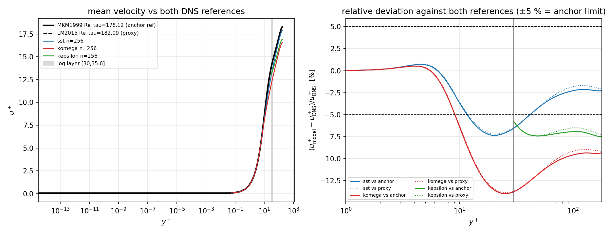
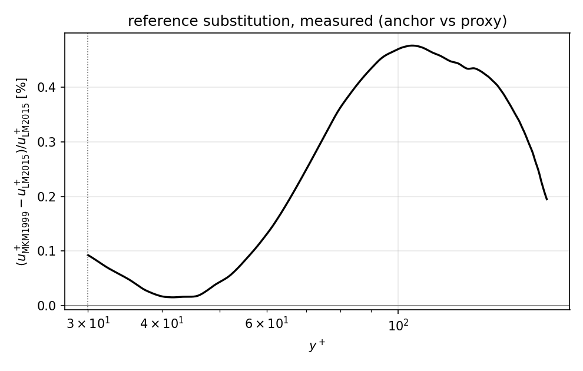

# CASE-FVM-CHANNEL-KMM180：直接对锚点参考（KMM1987 谱方法 / MKM1999 chan180）复核

锚点：`CASE-FVM-CHANNEL-KMM180`（算例池·湍流槽道 `Re_tau=180` 平均速度对数律）。验收：`y+ > 30` 上 `u+(y+)` 相对 DNS 参考的 RMS 偏差 `< 5 %`。

## 1. 案例介绍（为什么这一单不是重复审计）

此前所有判据读数都不是对锚点本身的参考取的：仓内没有 KMM1987 机读表，`kmm1987.py` 用 Lee & Moser (2015) `Re_tau=182.088` 作**有记录的替身**，并撤回了「两套数据在 1 % 内一致」这一不可核断言；随后一单用「同一求解器在两个 `Re_tau` 各跑一遍」给替身定了界——那界的是**模型对 `Re_tau` 的敏感度**，不是**数据之间的差**。本单把缺的那一半补上：

* 参考 = Moser–Kim–Mansour (1999) 数据库的 `chan180` 统计量，其文件头明确写着数值方法为 *Kim, Moin & Moser (1987), JFM 177:133*，`Re_tau = 178.12`（不是名义 180——照录，不四舍五入）。
* 导入件 `docs/rans-turbulence-validation-matrix/dns/mkm1999_0180/mean.csv`：65 点，`Re_tau=178.12`，`U_bulk+=15.6787`，`Cf=0.008136`（由剖面自身积分得到，脚本 `scripts/import_mkm1999_channel.py` 导，tar 包与成员文件双 sha256 钉住）。

| 量 | 锚点参考（MKM1999 chan180） | 旧替身（LM2015） | 差 |
|---|---|---|---|
| Re_tau | 178.120 | 182.088 | +3.968 |
| Cf | 0.008136 | 0.008123 | 0.156 % |
| U_bulk+ | 15.6787 | 15.6910 | 0.078 % |

## 2. 怎么做的

1. `scripts/import_mkm1999_channel.py` 抓取并校验 `chandata.tar.gz`（sha256 固定），只抽取 `chan180/profiles/chan180.means`，把表头 `Re_tau`/数值方法/归一化逐字写进 `provenance.json`，再转成 CSV；不做任何重标定、平滑或插值。`Cf`/`U_bulk+` 由半槽道对称性积分得到（`U_bulk+ = ∫_0^1 u+ d(y/h)`，`Cf = 2/U_bulk+^2`），因此可被复核。
2. `tensorfvm.verification.kmm180_direct_anchor` 在两个窗口上分别对**锚点参考**和**替身**评级：`full = [30, 参考表顶]`（锚点字面读法）、`log_layer = [30, 0.2 Re_tau]`（此雷诺数下唯一是对数层的区间）。
3. 同一参考对做**数据对数据**比对（PCHIP 到共同 `y+` 网格，不外插），把「替身代价」变成测量量：相对差、u+ 绝对差（壁面单位）。
4. 求解器完全不动：`rans_validation.channel.solve_channel`，`Re_tau=180`，`n = 64/128/256`，三个闭合 SST / k-omega / k-epsilon。

## 3. 计算结果（程序化注入，无手抄）

### 3.1 参考替身代价（`y+ > 30`）——此前被撤回的断言现在有数

| 窗口 | 相对 RMS | 相对最大 | u+ 平均差 | u+ 最大差 | 占 5 % 预算 |
|---|---|---|---|---|---|
| `full` [30, 178.12] | 0.345 % | 0.476 % | +0.0535 | 0.0820 | 6.9 % |
| `log_layer` [30, 35.62] | 0.069 % | 0.093 % | +0.0095 | 0.0129 | 1.4 % |

### 3.2 逐闭合、逐网格：对锚点参考与对替身的判据读数

| model | n | full（锚点） | full（替身） | log_layer（锚点） | log_layer（替身） | 判据翻转 | 可判性变化 |
|---|---|---|---|---|---|---|---|
| sst | 64 | 2.37 % PASS | 2.25 % PASS | — (cells=2<3) | 4.61 % PASS | no | YES |
| sst | 128 | 3.21 % PASS | 3.06 % PASS | 5.72 % FAIL | 5.66 % FAIL | no | no |
| sst | 256 | 3.61 % PASS | 3.44 % PASS | 6.21 % FAIL | 6.08 % FAIL | no | no |
| komega | 64 | 10.83 % FAIL | 10.62 % FAIL | — (cells=2<3) | 13.46 % FAIL | no | YES |
| komega | 128 | 10.82 % FAIL | 10.61 % FAIL | 13.54 % FAIL | 13.48 % FAIL | no | no |
| komega | 256 | 10.81 % FAIL | 10.59 % FAIL | 13.54 % FAIL | 13.43 % FAIL | no | no |
| kepsilon | 64 | 7.06 % FAIL | 6.88 % FAIL | 6.37 % FAIL | 6.36 % FAIL | no | no |
| kepsilon | 128 | 7.05 % FAIL | 6.88 % FAIL | 6.35 % FAIL | 6.33 % FAIL | no | no |
| kepsilon | 256 | 7.06 % FAIL | 6.88 % FAIL | 6.35 % FAIL | 6.35 % FAIL | no | no |

### 3.3 同一批解的整体量

| model | n | Cf | Cf err（锚点） | U_bulk+ | U_bulk+ err（锚点） | 迭代 |
|---|---|---|---|---|---|---|
| sst | 64 | 0.008412 | 3.40 % | 15.419 | 1.66 % | 2223 |
| sst | 128 | 0.008558 | 5.19 % | 15.287 | 2.50 % | 2229 |
| sst | 256 | 0.008631 | 6.09 % | 15.222 | 2.91 % | 2231 |
| komega | 64 | 0.010064 | 23.70 % | 14.097 | 10.09 % | 2773 |
| komega | 128 | 0.010050 | 23.53 % | 14.107 | 10.03 % | 2776 |
| komega | 256 | 0.010046 | 23.47 % | 14.110 | 10.01 % | 2776 |
| kepsilon | 64 | 0.009341 | 14.82 % | 14.632 | 6.67 % | 1940 |
| kepsilon | 128 | 0.009341 | 14.81 % | 14.633 | 6.67 % | 1940 |
| kepsilon | 256 | 0.009341 | 14.81 % | 14.633 | 6.67 % | 1940 |

## 4. 图

*图 1*：左 = 平均速度剖面（黑实线=锚点参考 MKM1999 chan180，黑虚线=旧替身 LM2015，彩线=`n=256` 的三个闭合解，灰带=被判定的对数层窗口）；右 = 相对偏差随 `y+` 的分布（实线对锚点，点线对替身），虚线为 ±5 % 判据线。两条同色曲线几乎重合——这就是替身代价的直接可视化。

*图 2*：把「替身」本身放大——两套 DNS 的 `u+` 相对差在 `y+ > 30` 全场 < 0.5 %，故此前用 LM2015 代理 KMM1987 的判据读数在此锚点上不构成风险（这是测量，不是断言）。

## 5. 注意点

* **`Re_tau` 是 178.12，不是 180**：锚点名与两份 DNS 的名义值都不精确等于 180（LM2015 为 182.088）。窗口上界随参考自身的 `0.2 Re_tau` 变化（0.2×178.12 = 35.62 vs 36.42），因此两列不完全同窗——这也是替身代价的一部分，已单列在 §3.1。
* **可判性也会被参考选择改变**：对数层窗口上界 `0.2 Re_tau` 随参考变化，`n=64` 时 `[30, 36.42]`（替身）里有 3 个单元、给出 4.61 % PASS，而真参考的 `[30, 35.62]` 里只有 2 个单元——同一个解在真参考下**不可判**。三单元窗口上的 PASS 本来就不该当作结论，本表把它显式记为 `NOT_GRADED` 而不是沿用旧读数。
* MKM1999 数据库给出的是 63 个采样点的剖面（原 DNS 网格 129 点），对数层窗口内只有 3 个参考点；因此所有比较都用 PCHIP 插值到**求解器单元中心**，不做外插，且窗口内单元数一并报出。
* 本单**不改**求解器与闭合。SST 在对数层窗口超标、k-omega / k-epsilon 明显超标，与既有结论一致；原因（总应力 `1-y/h` 因子、有限雷诺数）见 `docs/verification-channel-kmm180-loglaw`，本单不作新主张。
* 数据许可：数据库页面没有显式许可声明，数值随作者署名再分发，原始 tar 包与成员文件均以 sha256 钉住，任何改动都会在加载时抛错。

## 6. 误差判定（逐项 vs 基准，显式回答是否 <3 %）

| 关键量 | 基准 | 实测 | 误差 | <3 %？ |
|---|---|---|---|---|
| 参考替身（锚点 vs 替身）`u+` | 0 | 0.345 % RMS | 0.35 % | **是** |
| SST `u+` full 窗口 | MKM1999 锚点 | 3.61 % | 3.61 % | 否（>3 %，但 <5 % 判据 → PASS） |
| SST `u+` 对数层窗口 | MKM1999 锚点 | 6.21 % | 6.21 % | 否（→ FAIL） |
| SST `Cf` | 0.008136 | 0.008631 | 6.09 % | 否 |
| SST `U_bulk+` | 15.679 | 15.222 | 2.91 % | 是 |

**总判定**：锚点参考已就位；参考替身代价 0.35 % RMS （占 5 % 预算 6.9 %），PASS/FAIL 翻转数 = 0，可判性变化数 = 2，即**此前用 LM2015 代理得到的判据读数在本锚点上成立**（唯一例外见 §5：n=64 的对数层窗口在真参考下只剩 2 个单元，原「3 个单元 4.61 % PASS」不可复现，已改记为 NOT_GRADED）。SST 在对数层窗口仍 6.21 %（FAIL），honest verdict 不变：SST 只在对数层窗口之外的宽广区间内满足 5 %。
