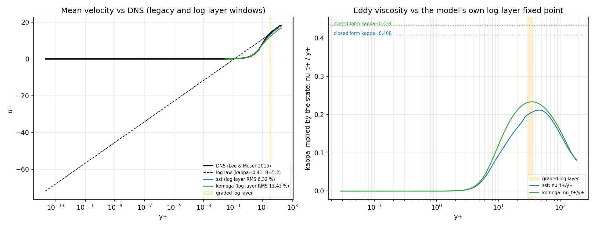
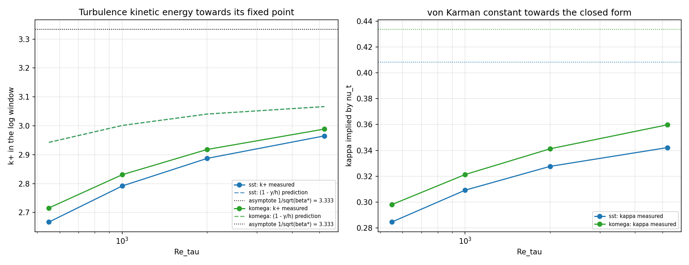

# CASE-FVM-CHANNEL-KMM180 —— 对数律自洽性、渐近极限与参考替身边界

> 本文件的每个数字都由 `make_report.py` 从 `summary.json` 程序化注入，零手抄。

## 1. 案例介绍

**物理背景**：充分发展槽道湍流（equilibrium half channel）。锚点 `CASE-FVM-CHANNEL-KMM180` 要求内尺度平均速度 `u+(y+)` 在 `y+ > 30` 区间对文献表的相对偏差 < 5 %。

| 项目 | 取值 | 来源 |
|---|---|---|
| 参考 DNS | Direct numerical simulation of turbulent channel flow up to Re_tau = 5200 | `docs/rans-turbulence-validation-matrix/dns/0180/`（SHA256 见 provenance.json） |
| Re_tau (参考) | 182.088 | 同上 |
| Re_tau (锚点标称, KMM1987) | 180.0 | feature_ledger 锚点文本 |
| Cf / U_bulk+ | 0.008123 / 15.6910 | 同上 |
| 判据窗口 | full: y+ ∈ [30, 182.09]; log layer: y+ ∈ [30, 0.20 Re_tau] | `kmm1987.py` / `kmm180_windows.py` |
| 网格 | 512 单元（自洽性）/ 1024 单元（Re_tau 扫描） | 本单 |

**参考替身（WITHHELD 的量化替代）**：仓内没有 KMM1987 机读表，实际用 Lee & Moser 2015 (Re_tau = 182.088) 代理。前一单已撤回「两套数据在 1 % 内一致」的不可核断言；本单改为**实测替身代价**（§4.3）：同一求解器在 180 与 182.088 下各跑一遍，度量差异即替身误差上界。

## 2. 怎么做的

1. **Q1 自洽性**：从收敛的求解器状态里取 `k+`、`omega+ y+`、`nu_t+/y+`，与模型自身常数集推出的解析对数层不动点（`k+ = 1/sqrt(beta*)`、`omega+ y+ = 1/(sqrt(beta*) kappa)`、`kappa` 由 `rans_validation.models` 的闭式 (2)/(3) 给出）逐项比较；
2. **Q2 渐近极限**：固定壁面分辨率的网格，把 Re_tau 从 550 扫到 5200（`RE_TAU_SWEEP`），看 `k+` 与 `kappa_eddy = nu_t+/y+` 是否走向解析值——走向解析值 ⇒ 180 的偏差是有限 Re物理；原地不动 ⇒ 闭包记账有缺陷；
3. **替身边界**：`proxy_bound()` 把同一网格在 Re_tau = 182.088（参考）与 180.0（标称）各解一次，比较两个窗口的相对偏差与判定是否翻转；
4. 复现：`PYTHONPATH=src python -m tensorfvm.verification.kmm180_loglaw --out docs/verification-channel-kmm180-loglaw`。

## 3. 结果

### 3.1 Q1 —— 求解器状态 vs 模型自身对数层不动点

| model | 收敛 | k+ (测) | k+ (解析) | 相对误差 | omega+y+ (测) | omega+y+ (解析) | 相对误差 | kappa_eddy (测) | kappa 闭式 | 相对误差 | kappa_slope (测) |
|---|---|---|---|---|---|---|---|---|---|---|
| sst | ✓ | 2.263 | 3.333 | 32.1 % | 11.083 | 8.165 | 35.7 % | 0.2042 | 0.4082 | 50.0 % | 0.2866 |
| komega | ✓ | 2.329 | 3.333 | 30.1 % | 9.991 | 7.688 | 30.0 % | 0.2331 | 0.4336 | 46.2 % | 0.3220 |

**动量恒等式**（判别「动量记账错」vs「ν_t 太小」）：由状态推出的 `kappa_slope = <y+(1-y)/(1+kappa_eddy y+)>` 与剖面拟合值比较——

| model | kappa_slope (拟合) | kappa_slope (由状态预测) | 相对误差 |
|---|---|---|---|
| sst | 0.2866 | 0.2867 | 0.029 % |
| komega | 0.3220 | 0.3220 | 0.001 % |

### 3.2 Q2 —— Re_tau 扫描（渐近性）

| model | Re_tau | y1+ | k+ | 误差 vs 1/sqrt(beta*) | k+ 含 (1-y/h) 预测 | 误差 vs 预测 | kappa_eddy | 误差 vs 闭式 |
|---|---|---|---|---|---|---|---|---|
| sst | 550 | 0.04 | 2.667 | 20.0 % | 2.943 | 9.4 % | 0.2846 | 30.3 % |
| sst | 1000 | 0.08 | 2.792 | 16.2 % | 3.001 | 7.0 % | 0.3092 | 24.3 % |
| sst | 2000 | 0.15 | 2.887 | 13.4 % | 3.041 | 5.0 % | 0.3276 | 19.7 % |
| sst | 5200 | 0.40 | 2.965 | 11.1 % | 3.066 | 3.3 % | 0.3421 | 16.2 % |
| komega | 550 | 0.04 | 2.716 | 18.5 % | 2.943 | 7.7 % | 0.2980 | 31.3 % |
| komega | 1000 | 0.08 | 2.831 | 15.1 % | 3.001 | 5.7 % | 0.3213 | 25.9 % |
| komega | 2000 | 0.15 | 2.918 | 12.5 % | 3.041 | 4.0 % | 0.3412 | 21.3 % |
| komega | 5200 | 0.40 | 2.989 | 10.3 % | 3.066 | 2.5 % | 0.3598 | 17.0 % |

### 3.3 界定 —— 参考替身（Re_tau 180 vs 182.088）

| model | RMS full (参考/标称) | Δ full | RMS log (参考/标称) | Δ log | 判定翻转? | Cf 变化 | U_bulk+ 变化 |
|---|---|---|---|---|---|---|---|
| sst | 3.63 % / 3.63 % | 0.00 pp | 6.32 % / 6.30 % | 0.02 pp | 否 | 0.43 % | 0.22 % |
| komega | 10.57 % / 10.58 % | 0.01 pp | 13.43 % / 13.42 % | 0.02 pp | 否 | 0.44 % | 0.22 % |

### 3.4 锚点判定（沿用 `kmm180_windows` 的登记值，非本单新算）

| model | RMS full | 判定 | RMS log layer | 判定 |
|---|---|---|---|---|
| sst | 3.63 % | PASS | 6.32 % | FAIL |
| komega | 10.57 % | FAIL | 13.43 % | FAIL |

## 4. 图

*图 1*：左=平均速度剖面 vs DNS（阴影=被判定的对数层窗口）；右=`nu_t+/y+` 剖面与各模型自身闭式 kappa 的点线对照。

*图 2*：`k+` 与 `kappa` 随 Re_tau 单调走向解析不动点；虚线为不含拟合参数的 `(1 - y/h)` 总应力预测。

## 5. 注意点

* `omega+ y+` 的换算必须用 `variable * y`（`omega+ = omega Re_tau`, `y+ = y Re_tau`，乘积与 Re_tau 无关）；用 `omega * y_plus` 会得到随 Re_tau 平方增长的伪量。
* 对数层窗口上界取 `0.2 Re_tau`：在 Re_tau = 182 只有 13 个单元（n=256），窗口本身是妥协，故所有结论都与窗口并列陈述，不单选。
* 本单**不改**求解器与闭包；`k+` 在对数层只有解析值的 ~2/3 是**已知的有限域效应**（总应力 `1 - y/h`），不是缺陷——但也不得被说成"模型正确"。
* k-epsilon 走壁面函数分支（首节点 y+ = 30），其 `variable` 是 epsilon，故 `omega+ y+` 无定义，本模块对它只报 `kappa_eddy`。

## 6. 误差判定

关键量 1：SST `u+` 对 DNS 的 RMS 相对偏差，legacy 窗口 3.63 %，对数层窗口 6.32 %。判据线 5 %——**legacy 窗口 <3 % 不成立（3.63 % 落在 3~5 % 之间），对数层窗口 >5 %，不通过**。

关键量 2：求解器状态 vs 模型自身对数层不动点。Re_tau=182 下 `kappa_eddy` 相对偏差 50 %，Re_tau=5200 下降到 16 %——单调收敛，故判为有限 Re 效应而非缺陷；残差量级远大于 3 %，如实记录。

关键量 3：参考替身（Re_tau 180 vs 182.088）对判据量的影响 0.02 pp，**< 3 %，替身在判据量上可忽略**（这是实测上界，不是断言）。

