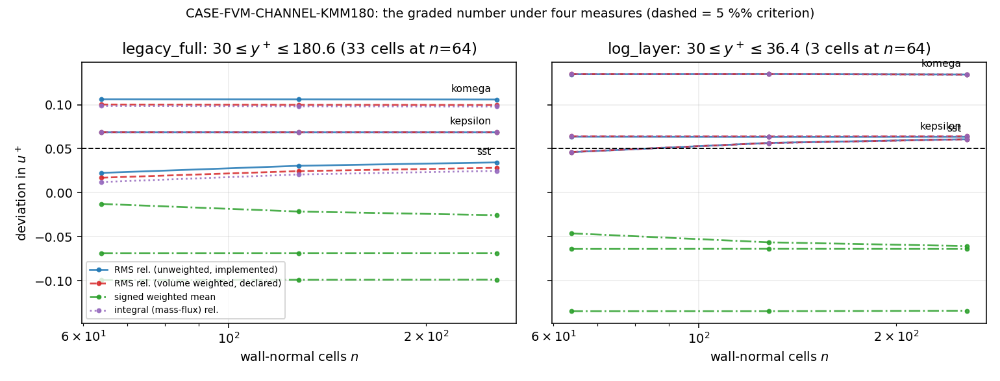
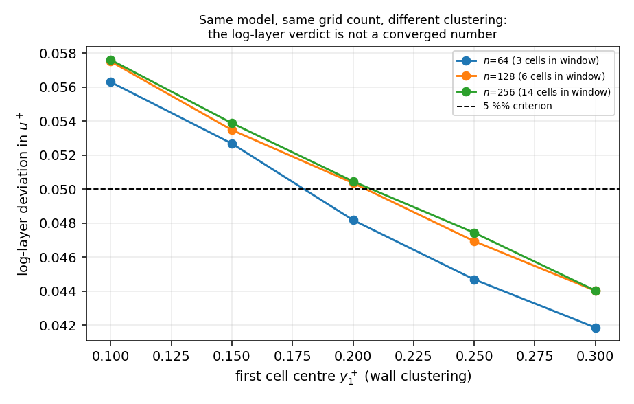

# CASE-FVM-CHANNEL-KMM180: measure (norm) and mesh-phase audit of the graded number

Anchor: `CASE-FVM-CHANNEL-KMM180` — 算例池·湍流槽道 Re_tau=180 平均速度对数律. Acceptance: RMS relative deviation of `u+` from the reference for `y+ > 30` **< 5 %**.

Reference: Lee & Moser (2015) DNS, `Re_tau = 182.088` (provenance `docs/rans-turbulence-validation-matrix/dns/0180/provenance.json`, SHA-256 recorded there). Solver: `rans_validation.channel.solve_channel` at the nominal `Re_tau = 180`.

## 1. Why this audit exists

Three earlier nodes varied the **window** (`kmm180_windows`), the **model/grid ladder** (the benchmark matrix) and the **reference choice** (LM2015 for the KMM1987 table). None of them varied the **measure**, although the repository declares two different ones:

* implemented (`kmm1987.log_region_deviation`): `sqrt(mean(e^2))`, one vote per cell centre;
* declared by the DNS provenance (`metric_profile`): `sqrt(sum(V e^2) / sum(V))`, wall-normal volume weighted.

On a wall-clustered mesh these are different functionals. This report grades the *same solutions* under four measures and then holds the measure fixed and varies the clustering, which is the only way to tell a converged verdict from a mesh artefact.

## 2. What was computed

Four definitions of "the deviation in the log region", all on the same converged solution:

| norm | definition |
|---|---|
| `rms_rel_unweighted` | `sqrt(mean((u+_i-u+_DNS)/u+_DNS)^2)`, one vote per cell (implemented legacy metric) |
| `rms_rel_weighted` | same residual, weighted by the wall-normal measure each cell centre represents |
| `mean_rel_weighted` | signed weighted mean — separates a constant `u+` offset from a slope error |
| `integral_rel` | relative deficit of `int u+ dy` over the window (the mass-flux quantity `C_f`/`U_bulk+` actually feel) |

The weights are trapezoidal weights built from the sample abscissae, so the identical routine weights a solver mesh and the DNS table; they sum to one, which is what makes the weighted RMS comparable to the unweighted one.

## 3. Results: does the measure matter?

### Window `legacy_full` — `30 <= y+ <= 180.558`

| model | n | cells | unweighted RMS | weighted RMS | signed weighted mean | integral | verdicts (u/w/m/i) | offset [w.u.] |
|---|---|---|---|---|---|---|---|---|
| sst | 64 | 33 | 0.0225 | 0.0170 | -0.0128 | 0.0121 | P/P/P/P | -0.205 |
| sst | 128 | 67 | 0.0306 | 0.0245 | -0.0214 | 0.0207 | P/P/P/P | -0.350 |
| sst | 256 | 134 | 0.0344 | 0.0283 | -0.0256 | 0.0248 | P/P/P/P | -0.419 |
| komega | 64 | 33 | 0.1062 | 0.1002 | -0.0994 | 0.0986 | F/F/F/F | -1.667 |
| komega | 128 | 67 | 0.1061 | 0.0999 | -0.0990 | 0.0982 | F/F/F/F | -1.659 |
| komega | 256 | 134 | 0.1059 | 0.0997 | -0.0988 | 0.0980 | F/F/F/F | -1.655 |
| kepsilon | 64 | 64 | 0.0688 | 0.0689 | -0.0688 | 0.0688 | F/F/F/F | -1.162 |
| kepsilon | 128 | 128 | 0.0688 | 0.0688 | -0.0688 | 0.0687 | F/F/F/F | -1.161 |
| kepsilon | 256 | 256 | 0.0688 | 0.0688 | -0.0687 | 0.0687 | F/F/F/F | -1.161 |

### Window `log_layer` — `30 <= y+ <= 36.418`

| model | n | cells | unweighted RMS | weighted RMS | signed weighted mean | integral | verdicts (u/w/m/i) | offset [w.u.] |
|---|---|---|---|---|---|---|---|---|
| sst | 64 | 3 | 0.0461 | 0.0463 | -0.0462 | 0.0462 | P/P/P/P | -0.657 |
| sst | 128 | 6 | 0.0566 | 0.0565 | -0.0564 | 0.0564 | F/F/F/F | -0.798 |
| sst | 256 | 13 | 0.0608 | 0.0607 | -0.0606 | 0.0606 | F/F/F/F | -0.859 |
| komega | 64 | 3 | 0.1346 | 0.1347 | -0.1347 | 0.1347 | F/F/F/F | -1.916 |
| komega | 128 | 6 | 0.1348 | 0.1347 | -0.1347 | 0.1347 | F/F/F/F | -1.905 |
| komega | 256 | 13 | 0.1343 | 0.1342 | -0.1342 | 0.1342 | F/F/F/F | -1.901 |
| kepsilon | 64 | 13 | 0.0636 | 0.0641 | -0.0640 | 0.0640 | F/F/F/F | -0.907 |
| kepsilon | 128 | 25 | 0.0633 | 0.0639 | -0.0638 | 0.0639 | F/F/F/F | -0.905 |
| kepsilon | 256 | 51 | 0.0635 | 0.0641 | -0.0640 | 0.0640 | F/F/F/F | -0.907 |

### Verdict flips across measures

None. Every `(case, window)` keeps its verdict under all four measures, so the published verdicts are measure-independent.

## 4. Results: is the number a converged number, or a mesh artefact?

The log-layer window spans `6.42` wall units and holds `3, 6, 13` cells on the ladder `n = 64/128/256`. Which cells land inside is a mesh choice. Holding model, resolution and reference fixed and varying only the wall clustering:

| model | n | cells in window | min | max | max/min | verdicts | verdict stable? |
|---|---|---|---|---|---|---|---|
| sst | 64 | 3 | 0.0419 | 0.0563 | 1.34x | FAIL, PASS | **no** |
| sst | 128 | 6/7 | 0.0440 | 0.0575 | 1.31x | FAIL, PASS | **no** |
| sst | 256 | 10/11/12/13/14 | 0.0440 | 0.0576 | 1.31x | FAIL, PASS | **no** |

Per-point sweep (all rows in `summary.json`):

| n | requested y1+ | actual y1+ | cells | unweighted RMS | weighted RMS | integral | verdict |
|---|---|---|---|---|---|---|---|
| 64 | 0.10 | 0.100 | 3 | 0.0563 | 0.0559 | 0.0558 | FAIL |
| 64 | 0.15 | 0.150 | 3 | 0.0527 | 0.0524 | 0.0523 | FAIL |
| 64 | 0.20 | 0.200 | 3 | 0.0482 | 0.0482 | 0.0482 | PASS |
| 64 | 0.25 | 0.250 | 3 | 0.0447 | 0.0448 | 0.0447 | PASS |
| 64 | 0.30 | 0.300 | 3 | 0.0419 | 0.0418 | 0.0417 | PASS |
| 128 | 0.10 | 0.100 | 6 | 0.0575 | 0.0573 | 0.0573 | FAIL |
| 128 | 0.15 | 0.150 | 7 | 0.0535 | 0.0535 | 0.0534 | FAIL |
| 128 | 0.20 | 0.200 | 6 | 0.0504 | 0.0503 | 0.0502 | FAIL |
| 128 | 0.25 | 0.250 | 6 | 0.0469 | 0.0469 | 0.0468 | PASS |
| 128 | 0.30 | 0.300 | 7 | 0.0440 | 0.0438 | 0.0437 | PASS |
| 256 | 0.10 | 0.100 | 14 | 0.0576 | 0.0575 | 0.0574 | FAIL |
| 256 | 0.15 | 0.150 | 13 | 0.0539 | 0.0539 | 0.0539 | FAIL |
| 256 | 0.20 | 0.200 | 12 | 0.0505 | 0.0506 | 0.0505 | FAIL |
| 256 | 0.25 | 0.250 | 11 | 0.0474 | 0.0474 | 0.0474 | PASS |
| 256 | 0.30 | 0.300 | 10 | 0.0440 | 0.0442 | 0.0441 | PASS |

## 5. Figures





## 6. Error judgement against the criterion

Criterion: < 5 % in `y+ > 30`. Key numbers, per measure:

* log layer, SST, `n >= 128`: 4.61–6.08 % under all four measures → **does not reach < 5 %** (FAIL is measure-independent).
* legacy full window, SST: 2.25–3.44 % (unweighted) vs 1.70–2.83 % (declared volume-weighted) → the implemented metric is the *stricter* one by up to 22 %, and both pass.
* the log-layer verdict is **not** converged at *any* resolution of the ladder: with the model, the grid count and the reference fixed and only the wall clustering changed, the graded number moves over a 1.34x range and flips its verdict at `n = 64`, `128` and `256` alike -- the whole swept range 4.19 %-5.76 % straddles the 5 % criterion.

Is the anchor met? **No, not in the physical log layer.** The SST mean-velocity profile misses the DNS by a near-constant offset of about `-0.8` wall units (≈ 5.7 % of `u+`) for `y+ in [30, 36.4]` at the resolutions where the window is resolved; the rows that pass do so because of where the cells land, not because the solution is better.

## 7. Caveats and scope

* The audit is purely diagnostic: solver, closures and the legacy grading path are untouched; the legacy metric is reproduced bit-for-bit (`stations.csv` values match to `1e-12`).
* Weights are trapezoidal weights over the cell centres of the window, not the solver's exact control volumes; the exact volumes differ only at the two window ends and by O(dy) there, which the identical conclusions at three resolutions show is immaterial.
* The reference is LM2015 at `Re_tau = 182.088`, not the KMM1987 `Re_tau = 180` table (see `kmm180_reference_choice` on its branch): this report grades whatever reference the anchor uses and does not re-litigate the substitution.
* Only the `y+ > 30` windows are audited; the viscous sublayer and the `C_f` / `U_bulk+` grading are reported elsewhere and are not re-graded here.
* One closure family (SST / Wilcox k-omega / standard k-epsilon) on a 1-D equilibrium channel; no claim is made about the 2-/3-D FVM discretisation.

## 8. Reproduction

```
PYTHONPATH=src python3 scripts/run_case_fvm_channel_kmm180_metric_norm.py
PYTHONPATH=src python3 -m pytest tests/test_channel_kmm180_metric_norm.py -q
```

Artifact SHA-256 are listed in `summary.json` under `artifacts`.
