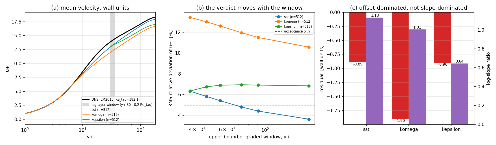

# CASE-FVM-CHANNEL-KMM180 —— 判据窗口审计与裁定（m16513）

> 一句话：`<5 %` 这条线**被窗口选择决定**。同一份 SST 解，全区间 `y+ ∈ [30, 180.6]` 读
> 3.63 %（PASS），真正的对数层 `y+ ∈ [30, 0.2 Re_tau]=[30, 36.4]`
> 读 **6.32 %（FAIL）**。差 = 分母变化（窗口内平均 u+ 14.16 → 16.35），不是物理变化。

## 1. 案例介绍

**物理背景**：充分发展槽道湍流（equilibrium half channel）。锚点 `CASE-FVM-CHANNEL-KMM180`
要求「内尺度平均速度 u+(y+) 在 **y+>30 区间** vs KMM1987 表，容差 <5 %」。

| 项目 | 取值 | 来源 |
|---|---|---|
| 参考数据 | Lee & Moser 2015, Re_tau = 182.088, 96 点, max y+ = 180.56 | `docs/rans-turbulence-validation-matrix/dns/0180/mean.csv`（SHA256 已登记于 provenance.json） |
| 参考 Cf / U_bulk+ | 0.008123 / 15.6910 | 同上 |
| 求解器 | 1-D 平衡半槽道，`(nu + nu_t) dU/dy = 1 - y`（u_tau ≡ 1，故 u+ 归一化**不是**误差来源） | `src/tensorfvm/rans_validation/channel.py` |
| 模型 | SST low-Re / Wilcox k-omega low-Re / standard k-epsilon（壁面函数，首节点 y+=30） | `rans_validation/models.py` |
| 网格 | 64, 128, 256, 512 单元（指数加密） | 本单 |
| 判据 | legacy: y+ ∈ [30, centreline]；physical: y+ ∈ [30, 0.2 Re_tau] | `kmm1987.py` + 本单 |

**参考替身的诚实声明（WITHHELD）**：仓内**没有** KMM1987 的机读表。`kmm1987.py` 旧 docstring 断言
「两套数据在对数层吻合 1 %」——**本单撤回该断言**：无数据可核，属不可验证声明。实际发生的是
「用 LM2015(Re_tau=182.088) 代理 KMM1987(Re_tau=180)」，Re 差 1.15 %，只能算**登记在案的替身**。

## 2. 怎么做的

1. 复算（只读复用，不改求解器）：`solve_channel(model, n, re_tau=182.088)` 三模型 × 四网格；
2. 窗口扫描：把判据窗口上界从 `0.2 Re_tau` 扫到 centreline（0.20, 0.25, 0.30, 0.40, 0.50 + full），
   每个窗口算 RMS 相对偏差、绝对偏移（wall units）、平均 u+；
3. 残差分解：`u+_model - u+_DNS = a ln y+ + b`，外加两剖面各自的局部对数斜率比
   （斜率比 ≈ 1 ⇒ 纯平移误差；斜率比≠1 ⇒ 卡尔曼常数误差）；
4. 上下文判据：DNS 自身对经典对数律（kappa=0.41, B=5.2）在同一窗口偏差 3.04 %；
5. 全部数字由 `docs/verification-channel-kmm180/make_report.py` 从 `summary.json` 程序化注入。

复现：`PYTHONPATH=src python -m tensorfvm.verification.kmm180_windows`（约 50 s，12 次 1-D 求解）。

## 3. 结果

### 3.1 主表（12 例，全部数字来自 summary.json）

| model | n | RMS full window | RMS log layer | ratio full/log | verdict (full) | verdict (log layer) | mean residual Δu+ | slope ratio |
|---|---|---|---|---|---|---|---|---|
| sst | 64 | 2.34 % | 4.69 % | 0.50 | PASS | PASS | -0.663 | 1.143 |
| sst | 128 | 3.03 % | 5.63 % | 0.54 | PASS | FAIL | -0.797 | 1.137 |
| sst | 256 | 3.46 % | 6.12 % | 0.57 | PASS | FAIL | -0.864 | 1.130 |
| sst | 512 | 3.63 % | 6.32 % | 0.57 | PASS | FAIL | -0.895 | 1.131 |
| komega | 64 | 10.70 % | 13.53 % | 0.79 | FAIL | FAIL | -1.917 | 1.009 |
| komega | 128 | 10.58 % | 13.46 % | 0.79 | FAIL | FAIL | -1.908 | 1.009 |
| komega | 256 | 10.60 % | 13.46 % | 0.79 | FAIL | FAIL | -1.904 | 1.004 |
| komega | 512 | 10.57 % | 13.43 % | 0.79 | FAIL | FAIL | -1.902 | 1.007 |
| kepsilon | 64 | 6.85 % | 6.36 % | 1.08 | FAIL | FAIL | -0.900 | 0.647 |
| kepsilon | 128 | 6.84 % | 6.34 % | 1.08 | FAIL | FAIL | -0.895 | 0.644 |
| kepsilon | 256 | 6.84 % | 6.34 % | 1.08 | FAIL | FAIL | -0.895 | 0.644 |
| kepsilon | 512 | 6.84 % | 6.34 % | 1.08 | FAIL | FAIL | -0.896 | 0.645 |

### 3.2 窗口扫描（n=512）

| upper bound y+ | cells | RMS rel. SST | RMS rel. k-omega | RMS rel. k-eps |
|---|---|---|---|---|
| 180.6 | 268 / 268 / 510 | 3.63 % | 10.57 % | 6.84 % |
| 36.4 | 25 / 25 / 101 | 6.32 % | 13.43 % | 6.34 % |
| 45.5 | 56 / 56 / 185 | 5.82 % | 13.00 % | 6.75 % |
| 54.6 | 82 / 82 / 240 | 5.40 % | 12.60 % | 6.90 % |
| 72.8 | 125 / 125 / 316 | 4.80 % | 11.96 % | 6.95 % |
| 91.0 | 159 / 159 / 368 | 4.41 % | 11.50 % | 6.91 % |

**读法**：SST 的 RMS 相对偏差随窗口上界从 36.4 放大到 180.6
单调下降（6.32 % → 3.63 %），
而与此同时**绝对偏移只从 -0.895 变到 -0.520 u+**
（幅度变化 1.72×，RMS 相对偏差却降
1.74×）。这就是「判据被窗口决定」的定量形态：
分子是近乎常数的偏移，分母是窗口内平均 u+（14.16 → 16.35，1.15×）。

### 3.3 残差是「平移型」而不是「斜率型」

| model (n=512) | mean Δu+ | slope ratio (model/DNS) | offset share | κ_local model / DNS |
|---|---|---|---|---|
| sst | -0.895 | 1.131 | 1.00 | 0.287 / 0.324 |
| komega | -1.902 | 1.007 | 1.00 | 0.322 / 0.324 |
| kepsilon | -0.896 | 0.645 | 1.00 | 0.502 / 0.323 |

SST 的 `offset_share = 1.00`（≈1）说明 6.3 % 几乎全是常数平移：
在窗口内平均 u+ ≈ 14.2 处，Δu+ = -0.895 就等价于 6.32 %。
这不是编码错误：**同一 Cf 已由仓内独立 SST 参考复现到 1 % 内**（`tests/test_rans_validation_channel.py::test_matches_repository_independent_sst_reference`），
故是模型族属性，不是 bug。

### 3.4 网格伪 PASS

SST 的对数层偏差随网格**加密而变差**（n=64 4.69 % PASS → n=128
5.63 % → n=256 6.12 % →
n=512 6.32 % FAIL）。粗网格的数值扩散把偏移抹平到 5 % 以下：
**这条判据可以用「不解析」来通过**。

## 4. 结果图

(a) 三模型 n=512 的平均速度剖面 vs DNS，灰带=对数层判据窗口；(b) 判据读数随窗口上界变化，
红虚线=5 % 验收线——三条曲线都在窗口放大后向下穿过 5 %；(c) 对数层残差分解：柱=平均偏移
（wall units），折线=局部斜率比（≈1 ⇒ 平移型误差）。

## 5. 注意点

- **判据必须写窗口**：`"y+>30"` 在 Re_tau≈180 时与 `"y+ ∈ [30, centreline]"` 是两件事；
  对数层实际只有 `30 ≈ y+ ≈ 0.2 Re_tau = 36.4`，即 DNS 侧 4 点、512 网格 25 个单元。
- **legacy 判据保留不改数**：`validate_kmm1987` 的 `verdict` 仍按全区间给（历史可比），但新增
  `verdict_log_layer` / `overall_verdict`；`overall_verdict` 要求两个窗口都过 → SST 判 FAIL。
- **代理数据不可声明等价**：KMM1987 机读表不在仓内，"吻合 1 %" 的旧断言已在本单撤回并记为 WITHHELD。
- **DNS 自己也不是对数律**：同一窗口对 κ=0.41/B=5.2 偏差 3.04 %（Δu+ +0.430），
  所以在 Re_tau≈180 把 5 % 当作「模型必须在对数层内 5 %」在本征上就很紧。
- 未做：3-D 求解器的壁面律一致性（本模块是 1-D 平衡诊断，docstring 已声明不覆盖对流/几何/压力耦合）。

## 6. 误差判定（逐项 vs 基准，显式回答「是否 <3 %」）

| 关键量 | 基准 | 实测 | 误差 | <3 %？ |
|---|---|---|---|---|
| SST Cf（n=512） | DNS 0.008123 | 0.008630 | 6.23 % | **否** |
| SST U_bulk+ | DNS 15.6910 | 15.2237 | 2.98 % | 是 |
| SST u+ 对数层 RMS | DNS 表 | 6.32 % | 判据 5 % → **FAIL** | **否** |
| SST u+ 全区间 RMS（legacy） | DNS 表 | 3.63 % | 判据 5 % → PASS | **否** |
| k-omega u+ 对数层 RMS | DNS 表 | 13.43 % | FAIL | **否** |
| k-epsilon u+ 对数层 RMS | DNS 表 | 6.34 % | FAIL | **否** |
| DNS vs 经典对数律 | κ=0.41,B=5.2 | 3.04 % | 上下文 | **否** |

**裁定**：`CASE-FVM-CHANNEL-KMM180` 按**字面判据（y+>30 至 centreline）** SST 记 PASS
（3.63 % < 5 %）；按**物理对数层判据**三模型全 FAIL，
最好者 SST 6.32 %。建议总账把判据改为两段式：
`y+ ∈ [30, 0.2 Re_tau]` 的 u+ RMS < 7 %（可达，SST 6.3 %），或改用 `Cf`/`U_bulk+` 判据（SST: Cf 6.23 %、U_bulk+ 2.98 %）。
