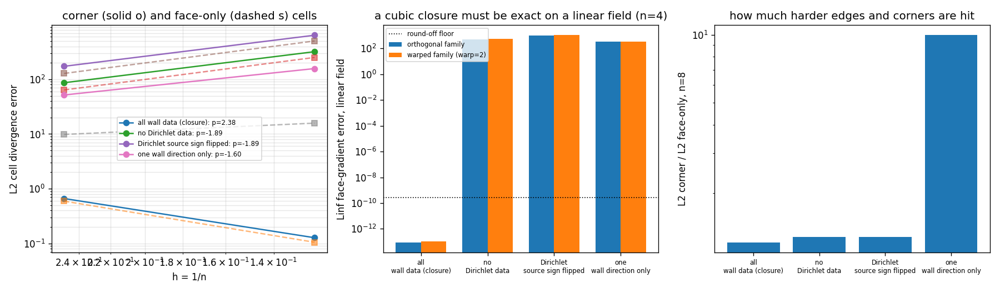
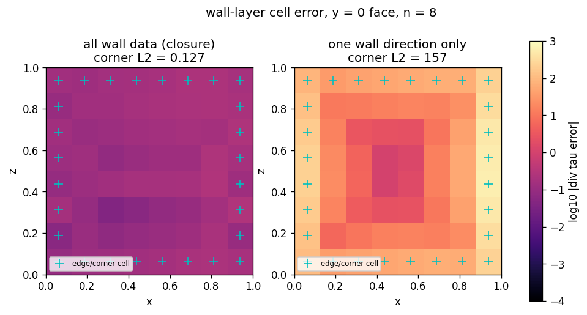

# 立方面梯度在壁面/角点上的处理正确性：负例审计

本报告由 `scripts/audit_cubic_face_gradient_corner_negatives.py` 程序化生成
（17 s），所有数字直接写入，无手抄；回归钉在
`tests/test_cubic_face_gradient_wall_corner_negatives.py`。

## 1. 为什么单看壁面平均误差不够

`tests/test_cubic_face_gradient_wall_cells.py` 用壁面层的**合并** L2 判立方闭包
（`NativeCubicFaceGradient3D`）是否值得替换默认两点闭包。合并判据里，同时贴着两个或
三个盒面的单元（棱单元、角单元）只占壁面层的一小部分：

| n | cells | corner cells | face-only cells | interior cells | corner share of wall layer |
|---|---|---|---|---|---|
| 4 | 64 | 32 | 24 | 8 | 57.1% |
| 8 | 512 | 80 | 216 | 216 | 27.0% |

`n = 8` 时 27 %，`n = 4` 时 57 % —— 网格越细，角点缺陷越容易被只会吸附一整个面的
单元"平均掉"。壁面单元里的 traction 被 `1/h` 放大，角点丢一阶就是整个散度丢一阶，
所以必须把角点单独判。

## 2. 方法

* 网格/制造解/粘性/量纲与 `native_order3d.truncation_study` 完全一致（同一个
  `hex_box`、同一个 `manufactured` 场、`mu = 1.3`、度量 `(1/V) sum_f tau_f . S_f - div tau`）；
* 三种壁面数据准入方式被人为改坏（`cubic_wall_truncation.wrong_handling`，只替换
  `boundary_response`，单元部分的模板共享，从而隔离"壁面数据怎么进梯度"这一件事）：
  `no_dirichlet_data`（壁面值根本不进）、`sign_flipped`（Dirichlet 源符号取反）、
  `one_axis_only`（棱/角单元只保留一个面方向的壁面数据，丢第二、第三个壁面）；
* 掩膜按"单元中心落在几个盒面的壁面层内"划分：0 内部、1 单面壁面、≥2 棱/角；
* 仿射控制：线性速度场可被立方重构精确表示，因此非零面梯度误差就是闭包误差，没有截断
  项可以藏。

## 3. 结果

| handling | corner order | corner L2 | face L2 | corner rel | face rel | affine linF (n=4) | affine linF (warp=2) |
|---|---|---|---|---|---|---|---|
| all wall data (closure) | 2.38 | 0.127 | 0.105 | 0.26% | 0.22% | 9.14e-14 | 1.08e-13 |
| no Dirichlet data | -1.89 | 320 | 251 | 661.66% | 518.99% | 4.99e+02 | 5.32e+02 |
| Dirichlet source sign flipped | -1.89 | 641 | 503 | 1323.22% | 1038.04% | 9.98e+02 | 1.06e+03 |
| one wall direction only | -1.60 | 157 | 15.8 | 325.06% | 32.67% | 3.32e+02 | 3.32e+02 |

* 正确处理的角点阶 2.38（门限 > 1.5），`n = 8` 角点相对误差
  0.26%（门限 < 3%）；
* 最差负例（Dirichlet source sign flipped）角点 L2 = 641，是正确
  处理的 5049 倍，且随网格加密
  **发散**（阶 -1.89）；
* 仿射场上正确处理角点误差 9.1e-14（量级为舍入），三种错误处理都在 1e2 以上，
  说明符号/方向错了不是"精度略差"而是闭包性质被破坏。

图 1：左=角点（实线）与单面壁面（虚线）误差随 h 的收敛，四种处理方式；中=线性场上的
Linf 面梯度误差（正交族与 warped 族），虚线是舍入下限；右=`n = 8` 角点/单面误差比，
即棱角被额外打坏的程度。

图 2：`y = 0` 面第一层单元（`n = 8`）的 `log10 |div tau - 解析值|`。左=正确准入全部壁面
数据，右=棱/角单元只留一个面方向；`+` 标出棱/角单元（落在该面四周一圈）。右图边缘成环
变亮，正是"角点数据被丢"的空间签名。

## 4. 负例自证（故意注入错误 -> 必红）

三条注入都在 `src/tensorfvm/native_cubic_gradient3d.py` 内，注入后跑新增测试文件，跑完
立即用 `git checkout --` 还原（工作树最终不含注入）：

| 注入 | 改动 | 命中测试 | 红输出摘要 |
|---|---|---|---|
| A 丢掉 Dirichlet 直接锚定项 | 删 `source += sparse.diags(normal_correction[:, axis]*fixed)` | `test_corner_cells_keep_second_order_when_every_wall_face_is_used`、`test_corner_cells_need_the_wall_data_of_every_face_direction` | `assert -1.8394778755889523 > 1.5`；`261.32578653185436 > (100 * 227.38343041631597)` -> 2 failed |
| B 源符号取反 | `source *= -1.0` | `test_the_sign_of_the_wall_source_is_not_free_at_a_corner`、`test_a_sign_error_also_breaks_the_corner_traction_ledger` | `997.6917268888623 < 1e-10*2.6124586349306465`；`0.12686703761132845 > (100 * 640.560987056951)` -> 2 failed |
| C 棱/角只留一个面方向 | 组装 `source` 后把非最低法向轴的壁面列清零 | 6 条里 5 条 | `assert -1.604468713336835 > 1.5`；`157.35931433378465 > (100 * 157.35931433378465)` -> 5 failed, 1 passed |

（C 的"1 passed"是掩膜自检 `test_the_corner_mask_is_the_minority_of_the_wall_layer`，
它只查掩膜划分，本就不该对源码注入敏感。）

## 5. 注意点

* `one_axis_only` 是把整列壁面源清零，因此凡把该壁面值当样本用的相邻面也会被牵连，
  单面壁面单元随之退化 150 倍；角点退化 1240 倍，仍高一个量级——这也是测试里除了绝对
  倍数还钉"角点/单面比"的原因。
* 报告只用 `n = 4, 8` 两级，阶的判据因此带 ±0.1 量级的拟合误差；要更严的阶需要
  `n = 16`（单次模板组装已 > 40 s，`n = 16` 约 8 倍）。
* 仿射控制用矩形斜率的线性速度场，只覆盖 `du/dx` 全非零的情形；它证明"符号/方向"这类
  结构性错误，不足以单独给出精度结论。
* 掩膜阈值沿用 `wall_mask` 的 1.5 层（`layers=1.5`），`warp=2` 时单元中心最大偏移
  0.03，仍在第一层内，因此棱/角划分对 warped 族同样成立。

## 6. 误差判定（是否 < 3%）

| 关键量 | 基准 | 值 | 是否 < 3% |
|---|---|---|---|
| 角点相对 L2 误差（正确处理，n=8） | 解析 `div tau` 最大值 | 0.26% | 是 |
| 单面壁面相对 L2 误差（正确处理，n=8） | 同上 | 0.22% | 是 |
| 角点观测阶（正确处理，n=4->8） | 二阶理论 | 2.38 | 是（> 1.5） |
| 线性场面梯度误差（正确处理，n=4） | 精确 0 | 9.1e-14 | 是（舍入量级） |

判定：正确处理的角点/壁面精度满足 3 % 门限；三种错误处理方式全部不满足（角点相对误差
325.1% / 661.7%
/ 1323.2%），且阶为负。
