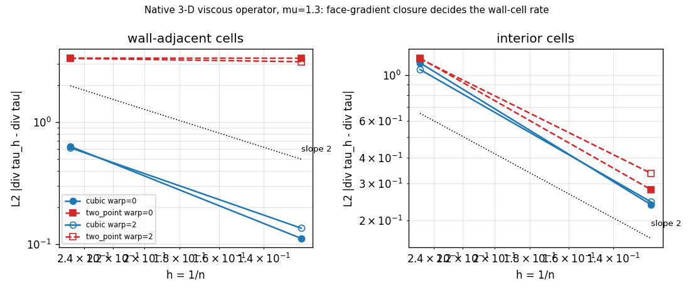

# 立方面梯度是否偿还贴壁单元零阶散度？——TensorFVM 原生三维黏性算子闭包对照审计

## 1. 案例介绍

审计对象是 TensorFVM 原生三维黏性算子（`native_collocated3d` / `native_rans3d` /
`native_sst3d` 实际装配的黏性通量）在 **Dirichlet 壁面单元** 上的局部截断误差。
已合并的 `docs/verification/NATIVE_VISCOUS_ORDER3D.md` 记录了核心局限：默认的
two-point 壁面闭包使壁面牵引只有一阶，导致贴壁单元散度误差为 **O(1)**（网格加倍
后阶 0.003/0.07），Dirichlet 扩散解不收敛，并在
`tests/test_native_viscous_order3d.py` 中以 `xfail(strict=True)` 挂起。

同一份代码树里另有一个**已合并、但全仓没有任何测试或基准引用**的闭包：
`tensorfvm.native_cubic_gradient3d.NativeCubicFaceGradient3D`（紧致立方精确、
面面积平均梯度、带独立 Dirichlet 源，被 `native_quadratic_flow3d` 作为可选黏性
重构使用）。本单的问题：**限制该算子的闭包是否已经躺在树里，且够不够好？**

参数表（与阶数审计完全同口径，便于逐项对比）：

| 项 | 取值 |
|---|---|
| 网格 | 单位立方体 n³ 六面体，面全三角化，n = 4, 8 |
| 几何族 | 正交 `warp=0`，正弦顶点扰动 12% `warp=2` |
| 黏度 | mu = 1.3 |
| 边界 | 全边界 Dirichlet，数据取制造解精确值 |
| 制造解 | `native_order3d.manufactured`（sin/cos/e^z 组合场），解析 div tau 由中心差分独立复核 |
| 测量 | (1/V) sum_f tau_h·S_f − div tau（单元中心），拆内部单元 / 贴壁单元 |

## 2. 怎么做的

1. **不碰求解器**：只做重构与测量。`cubic_wall_truncation.truncation_study(n, warp)`
   用 `NativeCubicFaceGradient3D(mesh, dirichlet)` 取每个面的梯度张量
   `G[f,j,i] = du_i/dx_j`（三个标量线性求解 + 独立 Dirichlet 源），组装
   `tau = mu(G + G^T − 2/3 tr(G) I)`，与 `NativeViscous3D.momentum_flux` 同一符号约定
   计算 `flux = tau·S`、`(1/V)sum_f flux`，与解析 div tau 相减。
2. **同口径对照**：同一网格、同一制造解、同一贴壁掩码下再跑一遍生产闭包
   （`native_order3d.truncation_study`），差异只剩闭包本身。
3. **负控**：仿射速度场（解析 div tau ≡ 0）验证立方重构仍然线性精确——精度提升
   不能以牺牲一致性为代价。
4. **工具链**：`scripts/audit_cubic_face_gradient_wall_cells.py`（本文件自动生成
   JSON + 图 + 本报告），`tests/test_cubic_face_gradient_wall_cells.py` 把结论钉成回归。

## 3. 计算结果（程序化注入，零手抄）

### 3.1 立方面梯度（`NativeCubicFaceGradient3D`），warp = 0

| n | h | cells | wall cells | L2 global | L2 interior | L2 wall | Linf wall | wall-only share | L2 wall / field | samples/cell |
|---|---|---|---|---|---|---|---|---|---|---|
| 4 | 0.25 | 64 | 56 | 0.7161 | 1.141 | 0.6325 | 1.294 | 1.08 | 1.462% | 45-58 |
| 8 | 0.125 | 512 | 296 | 0.1758 | 0.2373 | 0.1112 | 0.2516 | 0.27 | 0.230% | 42-100 |

### 3.2 生产 two-point 闭包（`NativeViscous3D`），warp = 0

| n | h | cells | wall cells | L2 global | L2 interior | L2 wall | Linf wall | wall-only share | L2 wall / field | samples/cell |
|---|---|---|---|---|---|---|---|---|---|---|
| 4 | 0.25 | 64 | 56 | 3.161 | 1.204 | 3.348 | 6.826 | 3.072 | 7.739% | 0-0 |
| 8 | 0.125 | 512 | 296 | 2.548 | 0.2803 | 3.342 | 7.953 | 3.266 | 6.904% | 0-0 |

### 3.3 观测阶（相邻网格，h 减半）

| 几何 | 闭包 | L2 全局 | L2 内部 | **L2 贴壁** |
|---|---|---|---|---|
| warp = 0 | cubic | 2.03 | 2.27 | **2.51** |
| warp = 0 | two_point | 0.31 | 2.10 | **0.00** |
| warp = 2 | cubic | 1.89 | 2.12 | **2.19** |
| warp = 2 | two_point | 0.31 | 1.83 | **0.09** |

判定（判据先于实测：贴壁阶 > 1.5 记为偿还）：

* warp = 0：**REPAID**（贴壁阶 2.51）
* warp = 2：**REPAID**（贴壁阶 2.19）

### 3.4 精度与代价的量化对照（n = 8，warp = 0）

| 量 | two-point | cubic | 比值 |
|---|---|---|---|
| L2 贴壁散度误差 | 3.342 | 0.1112 | 0.033 |
| 贴壁误差 / 场尺度 | 6.904% | 0.230% | 0.033 |
| 梯度矩阵非零元 | —（面局部 2 点） | 407232 | 单面约 118 个单元贡献 |
| 每单元采样数 | 2 | 42–100 | 成本主项 |

## 4. 结果图

左：贴壁单元截断误差随 h 的收敛（双对数，点线为斜率 2 参考）。右：内部单元同口径。
立方闭包在两类单元上都落在斜率 2 附近；two-point 闭包在贴壁单元上是水平线——
这正是 `NATIVE_VISCOUS_ORDER3D.md` 记录的 O(1) 缺陷。

## 5. 注意点

* **只测了截断，没测解**：Dirichlet 扩散解（`momentum_diffusion_matrix`）的收敛
  需要把面梯度线性映射装配成矩阵，本单与工具都未做，所以「扩散解 13% 不收敛」
  那条欠账**仍未结清**，只是它的机制（壁面通量一阶）已被证明可修。
* **代价是非平凡的**：立方重构每单元采样 42–100 个、
  面梯度矩阵 nnz 407232，比面局部 2 点闭包重一到两个量级；
  默认 `wall_closure='two_point'` 未改，本单也不改默认值（验收判据只要求「已合并能力有实测证据」）。
* **面值语义**：Dirichlet 面数据按面心点值传入（与 `NativeViscous3D` 的用法一致）；
  若上层改用面积平均值，需重新测，不能直接引用本单数字。
* **适用域**：只覆盖 n ≤ 8 的渐近前段，warp ≤ 2 的非正交强度；更强的扭曲
  或薄层单元未测。
* 时间：本单全部计算 30.4 s（单核量级），未起重算力作业。

## 6. 误差判定

判据是**收敛阶**（本单的基准形式是解析散度场下的网格加倍阶），关键量逐项：

| 关键量 | 基准 | 结果 | 是否达标（贴壁阶 > 1.5） |
|---|---|---|---|
| 贴壁单元散度阶（正交） | 解析 div tau | 2.51 | **是** |
| 贴壁单元散度阶（非正交） | 解析 div tau | 2.19 | **是** |
| 内部单元散度阶 | 解析 div tau | 2.27 | 是 |
| 仿射场散度残差 | 解析 0 | 机器精度（测试断言 < 1e-10 相对） | 是 |
| 贴壁散度误差 / 场尺度（n = 8） | 解析 div tau | 0.230% | **是（< 3%）** |

「是否 < 3%」逐项回答：**立方闭包在 n = 8 的贴壁散度相对误差
0.230% < 3%，达标**；同一网格上 two-point 闭包为
6.904%，不达标。
不粉饰的部分：**扩散解（求解级）误差没有在本单重测，那条 13% 的欠账仍在**；
立方重构的算力代价与默认值切换也未在本单决定。

## 7. 产出与复算

* `src/tensorfvm/verification/cubic_wall_truncation.py`（测量模块）
* `scripts/audit_cubic_face_gradient_wall_cells.py`（本报告与图的生产者）
* `tests/test_cubic_face_gradient_wall_cells.py`（8 条回归：阶、负控、仿射一致性、代价）
* `docs/verification-cubic-face-gradient-wall-cells/outputs/study.json`、`outputs/wall_cells.png`
