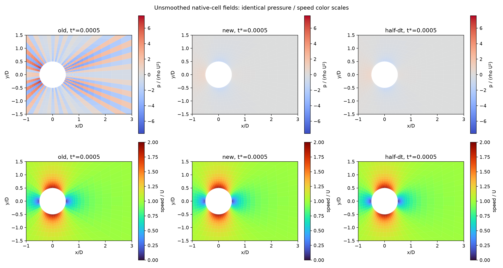
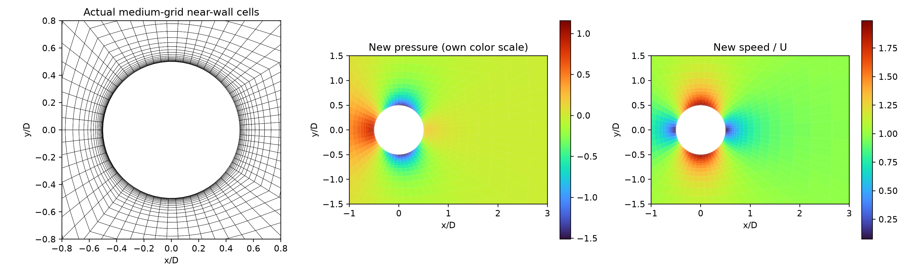
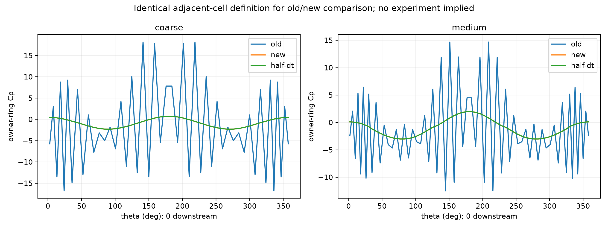
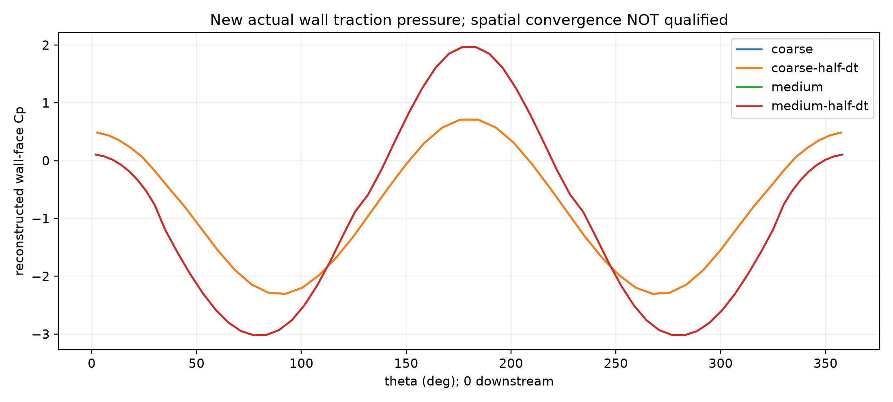

# Re3900 pressure/mesh coupling correction

**Development verification only. Earlier continuity/momentum passes did not verify pressure coupling. Neither old nor new runs qualify Re3900 accuracy or LES convergence.**

## Failure mechanism and changes

The previous predictor interpolated the complete old cell velocity every step, discarding the last native pressure-corrected face flux. The interpolation defect entered the next pressure RHS divided by dt, sustaining near-Nyquist angular pressure modes even with tiny native face divergence. The predictor now advances the retained native face flux using the difference of tentative and old cell-velocity interpolations. Taking a difference cancels prescribed inlet values correctly.

Pressure traction previously used arithmetic owner/neighbor averaging on stretched/skew faces. It now interpolates at the projected face position and reconstructs the skew displacement with the LS gradient, preserving one conservative traction per shared face. Pressure LS Neumann rows now use actual face-normal directions and a matching normal matrix, rather than the skew owner-to-face displacement. This is a least-squares boundary derivative constraint, not a strong pointwise condition on every reconstructed cell gradient. Outlet pressure remains zero. Independent analytic tests verify the interior affine pressure force and p=x at skew horizontal slip faces. No Cp fitting, filtering or plot smoothing is applied.

## Actual fields and mesh

Identical scales in this comparison expose the original oscillations. All fields come from saved checkpoints; all cases reach the same tU/D=0.0005 from identical startup conditions. The lower row is speed, not a pressure-derived proxy.



The following shows the new pressure on its own scale and the actual body-fitted cells. Smoothness alone is not accuracy.





The comparison uses span-mean adjacent owner-cell pressures for both algorithms. New run wall-pressure.csv instead contains reconstructed face pressure actually used for wall traction; its definition is recorded in pressure-coupling.json. These are startup curves, not stationary Cp or experimental comparisons.

## Independent checkpoint replay

| Grid / algorithm | Pressure min / max | High angular energy fraction | Native div max | Interpolated cell div max | Max normal flux defect / U |
|---|---:|---:|---:|---:|---:|
| coarse-old | -11.42 / 13.348 | 0.913204 | 5.486e-09 | 0.09475 | 0.00241 |
| coarse-new | -1.1525 / 0.38463 | 2.31551e-06 | 7.497e-10 | 4.569 | 0.2447 |
| coarse-half-dt | -1.1526 / 0.38459 | 2.31487e-06 | 1.674e-09 | 4.569 | 0.2447 |
| medium-old | -6.4316 / 7.5958 | 0.932319 | 5.154e-09 | 1.21 | 0.00234 |
| medium-new | -1.5115 / 1.1573 | 7.32545e-05 | 8.57e-09 | 122.7 | 0.239 |
| medium-half-dt | -1.5112 / 1.1536 | 7.28366e-05 | 2.137e-09 | 122.5 | 0.2393 |

High angular energy sums Fourier modes k >= ceil(Ntheta/4) in the span-mean innermost pressure ring. This is a startup diagnostic, not a universal turbulence threshold. A single exact alternating-mode test would miss the observed k=29/31 modes on Ntheta=64.

## Complete time-step refinement

| Mesh | Pressure relative L2 dt vs dt/2 | Owner-ring pressure relative L2 |
|---|---:|---:|
| coarse | 0.0213172% | 0.00835588% |
| medium | 0.0626756% | 0.103301% |

The dt=1e-5 run takes 50 steps; dt=5e-6 takes 100. This verifies short-time pressure sensitivity only; no stationary statistics or spatial convergence is inferred.

## Spatial pressure comparison remains unqualified



The actual reconstructed wall-face Cp differs by 41.8899% in relative L2 after periodic interpolation of coarse wall angles to the medium wall angles. This exceeds 3%. These are two startup grids with different radial and span resolution, not a demonstrated convergence sequence. Both pressure smoothness and small dt sensitivity are insufficient for physical accuracy.

## Remaining qualification blockers

Retaining native face history removes pressure reinjection, but the cell/face discrepancy persists, including the initial projection mismatch. Both divergence measures and normal defects are exposed above. Native continuity and a momentum ledger alone cannot qualify the coupled solution. Conservative face reconstruction improves affine response but does not make the two pressure operators identical. Further spatial refinement and long-time compatibility verification remain required before any 3% physical accuracy claim. New summaries and acceptance audits therefore record mass/momentum checks separately and keep numerical/physical qualification false.

Existing baseline checkpoints and producer manifests are unchanged. The old report is explicitly withdrawn as evidence of verified pressure coupling. First-step incompressible startup pressure can legitimately scale as 1/dt; the defect is repeated high-frequency pressure after that projection, not the mere presence of a startup impulse.

## Reproduction

```bash
export PYTHONPATH=src OMP_NUM_THREADS=1 OPENBLAS_NUM_THREADS=1 MKL_NUM_THREADS=1
python scripts/run_body_fitted_cylinder3900.py --output results/pressure-medium --nx 64 --ny 32 --nz 12 --stretching 7 --dt 1e-5 --steps 50
python scripts/run_body_fitted_cylinder3900.py --output results/pressure-medium-half-dt --nx 64 --ny 32 --nz 12 --stretching 7 --dt 5e-6 --steps 100
python scripts/report_cylinder3900_pressure_coupling.py --input docs/verification-cylinder3900-pressure-coupling --baseline docs/verification-cylinder3900-wall-refinement
```
