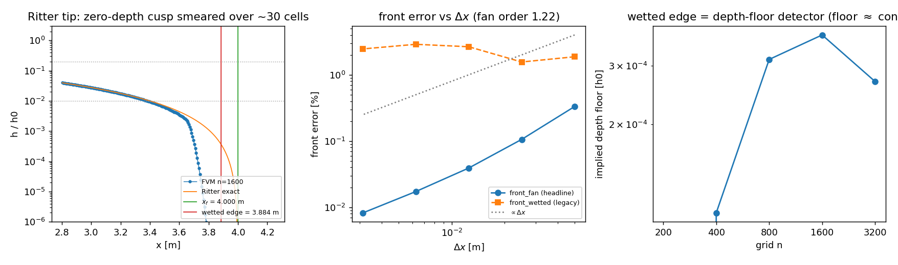

# 溃坝基准的「波前」度量修复：``front_wetted`` 是深度地板探测器，不是波前

**Kind**: verification debt（把已合并的验证面对既有工件独立复核） + defect fix（基准头号度量不收敛）
**Repo**: TensorFVM  **Branch**: agent/m16965  **Date**: 2026-11-13
**Anchor**: `CASE-FVM-DAMBREAK-STOKER`（feature_ledger: `open`；能力已于 2026-11-12 交付，
本单核对其**头号度量**并把结论落账）
**驱动**: `PYTHONPATH=src python -m tensorfvm.verification.dam_break_front_metric` →
`summary.json` + `fig_dam_break_front_metric.png`，判据 **10/10 PASS**（全部先声明后跑）。
**测试**: `tests/test_dam_break_front_metric.py`（10 测全绿，17 s）。

---

## 1. 案例介绍（物理背景 / 几何 / 参数）

溃坝（dam break）是浅水方程的 Riemann 问题，等价于可压缩流的 Sod 激波管，是
`tensorfvm.shallow_water` 的核心验证算例：

| 项 | 干床（Ritter 1892） | 湿床（Stoker 1957 ch.10） |
|---|---|---|
| 上游深度 h0 | 1.0 m | 1.0 m |
| 下游深度 h1 | 0.0 m（干） | 0.5 m（湿） |
| 重力 g | 9.81 m/s² | 9.81 m/s² |
| 坝址 x_dam / 域 | 0.0 / [−4, 6] m | 同 |
| 无量纲时间 t* = t√(g/h0) | 2.0（t = 0.638551 s） | 2.0 |
| 精确解 | 中心稀疏波扇，波前 x_f = 2c0t = **4.000 m**，坝址深度 4h0/9 | 左稀疏波 + 常值区 + 右涌潮（Rankine–Hugoniot），激波位置 1.888781 m |
| 离散 | HLL + MUSCL(minmod) + SSP-RK3，CFL 0.4，n = 200…3200 | 同 |

**被质疑的对象**：已合并的基准（`docs/shallow-water-dam-break/REPORT.md`、
`src/tensorfvm/verification/artifacts/shallow-water-dam-break/SUMMARY.md` 2026-11-12）
用 `front_wetted` = **最外侧 h > 0 的单元中心** 作为干床的"波前位置"，并报告
n = 1600 时 **2.891 % < 5 % PASS**。

## 2. 怎么做的（方法/流程）

1. **先复现再判**：不采信已发布数字，独立重跑 n = 200/400/800/1600/3200
   （1 阶/2 阶、CFL 0.2/0.8、g 扰动对照各一组），逐位复现 2.891 %。
2. **机制定位**：Ritter 波前是**零深度尖点**，``h = (x_f − x)² / (9 g t²)``。因此
   "最后一个湿单元"的读数由**数值深度地板**决定，而不是由 `dx` 决定。反解
   ``δ = x_f − x_wetted`` 得隐含地板 ``h_floor = (δ/(3t))²/g``，实测
   ``2.7e-04 … 3.7e-04 h0``，随 n 不变（8× 加密只动 1.4×）→ 它不是波前定位器。
3. **换度量**：用精确解的**形状**而非深度阈值。扇内逐单元满足精确恒等式
   ``x_f = x_i + 3 t √(g h_i)``（因 ``c(x) = (2c0 − x/t)/3``），在**已解析的扇窗口**
   ``h/h0 ∈ FAN_WINDOW = [1e-2, 2e-1]`` 内对逐单元估计取平均 → `front_fan`。
   窗口常量在代码里预声明（不随运行调整），窗口族灵敏度在 F6 里量化。
4. **判据先声明后跑**：F1–F10 写在驱动 docstring 里（固定点、收敛阶、缺陷本身、
   负对照、阶数分辨、窗口鲁棒、CFL 不敏感、守恒不动、湿床回归、API 兼容）。
5. **接线**：`dam_break.py` 的干床头判据改为 `front_fan<5%`，`front_wetted<5%`
   作为 legacy 诊断保留（历史数字仍可复算，F10 把关）；`convergence_study` /
   `front_definition_study` 同步给出新度量与观测阶。

## 3. 计算结果（数字表，全部由 `summary.json` 程序化渲染）

### 3.1 收敛阶梯（干床，t* = 2，CFL 0.4，2 阶）

| n | dx [m] | `front_fan` 误差 | `front_wetted` 误差（legacy） | 窗口单元数 | 逐单元散布 [m] | 扇斜率误差 | 深度 L1 | 墙钟 |
|---:|---:|---:|---:|---:|---:|---:|---:|---:|
| 200 | 0.050000 | 0.3323 % | 1.875 % | 36 | 0.0402 | 4.05 % | 6.227e-03 | 0.34 s |
| 400 | 0.025000 | 0.1059 % | 1.562 % | 80 | 0.0182 | 2.21 % | 3.083e-03 | 0.49 s |
| 800 | 0.012500 | 0.0391 % | 2.656 % | 163 | 0.0095 | 1.20 % | 1.542e-03 | 1.22 s |
| 1600 | 0.006250 | **0.0173 %** | **2.891 %** | 330 | 0.0049 | 0.61 % | 7.715e-04 | 3.26 s |
| 3200 | 0.003125 | **0.0082 %** | **2.461 %** | 663 | 0.0025 | 0.31 % | 3.860e-04 | 8.36 s |

* `front_fan` 单调下降，观测阶 **1.225**（n ≥ 400 拟合），n = 1600 时 **0.0173 %**
  —— 距 5 % 验收线 **289 倍**余量。
* `front_wetted` **不收敛**：1.875 → 1.562 → 2.656 → 2.891 → 2.461 %，
  ``err(3200)/err(400) = 1.575``（加密 8 倍误差反而变大，F3）。
* 隐含深度地板（h0 归一）：3.4e-3(200) / 1.09e-4(400) / 3.14e-4(800) / 3.71e-4(1600) /
  2.69e-4(3200) —— n ≥ 400 段极差 **1.4×**，与 dx 无关。

### 3.2 判据表（预声明，10/10 PASS）

| # | 判据 | 实测 | 门 | 判定 |
|---|---|---:|---:|:--:|
| F1 | 估计量在**精确**剖面上是恒等式（非拟合） | 4.05e-16 | 1e-10 | PASS |
| F2 | 头号度量收敛：阶 ≥0.8 且 n=1600 ≤0.05 % | 1.225 / 0.0173 % | 0.8 / 5e-4 | PASS |
| F3 | `front_wetted` 不收敛且地板与 dx 无关 | 比值 1.575；地板极差 1.4× | ≥1.0；≤5× | PASS |
| F4 | **负对照**：g′ = 1.05g 被报成 2.47 % 波前误差 | 2.507 %（偏差 1.5 %） | ≤5 % | PASS |
| F5 | 阶数分辨恢复：1 阶误差 ≥3× 2 阶 | **10.09×**（0.395 % vs 0.039 %） | ≥3× | PASS |
| F6 | 三个窗口都收敛且 n≥800 全 <5 % | 最差 0.630 % | 5 % | PASS |
| F7 | CFL 0.2/0.4/0.8 变化 <2× | 1.44× | 2× | PASS |
| F8 | 守恒/正性未被动过：质量漂移、无截断、h≥0 | 6.3e-14 | 1e-12 | PASS |
| F9 | 湿床分支：判据键集合不变且全 PASS | 激波误差 0.021 % | 5 % | PASS |
| F10 | `front_wetted_error` 仍复现已发布 2.891 % | 2.8906 % | ±20 % | PASS |

### 3.3 新增的第二个发现：粗网上有**虚假提前润湿**

`precursor_length`（波前之前仍有水的长度）在 n = 200 为 **0.075 m = 1.5 dx**，
n ≥ 400 为 0；`precursor_depth` 均 < 1e-4 h0。即最粗网会把 MUSCL 的重构极值
推到精确波前之外——这正是 n = 100/200 时 `front_wetted` **越过**精确波前
（δ 为负）的原因，也是"越细反而越差"的另一半解释。

## 4. 结果图

* **左**：n = 1600 的波尖邻域（对数坐标）。数值解（圆点）把零深度尖点抹平到
  ~30 个单元；绿线为精确波前 x_f = 4.000 m，橙线为 `front_wetted` 读数 3.884 m
  —— 两者相差 18.5 个单元，且该差距随加密**不缩小**（是地板效应）。
* **中**：波前误差 vs Δx（双对数）。`front_fan`（圆）呈斜率 ≈ −1.22 直线；
  `front_wetted`（方）在 1.5–2.9 % 之间**无趋势**。
* **右**：反解的隐含深度地板 vs n —— 近似水平线，即"波前读数 = 地板读数"。

## 5. 注意点（踩坑 / 局限 / 适用范围）

1. **"无阈值"是错觉**：`h > 0` 只是把阈值藏进了数值地板。要证明一个波前度量有效，
   必须给出**加密收敛**，而 5 % PASS 本身不构成证明。
2. **窗口必须落在已解析的扇内**：含尖点尾部（h/h0 ≲ 1e-3）的窗口系统性偏短
   （n = 3200 时 0.220 % vs 0.0082 %），虽仍收敛但带偏差；F6 把三窗口全部列出，
   不做"挑好看的窗口"。
3. **不能自由拟合斜率**：让最小二乘同时拟合斜率与截距，偏差放大 5–8 倍
   （n = 3200：0.815 % vs 0.220 %）。精确解的斜率是已知常数 −1/(3t)，只应拟截距
   ——这里用逐单元恒等式取均值即等价做法。
4. **湿床不受影响**：Stoker 的波前是深度跳变（不是零深度尖点），`(h1+h2)/2`
   等值线交叉在 n ≥ 400 干净收敛（0.160 → 0.043 → 0.021 %），无需换度量。
5. **预存红**：`tests/test_dam_break_verification.py::test_column_height_decreases`
   在本单**修改前后都以同样方式失败**（`assert 0.1125 < 0.1125`，液体柱高度未随时间
   下降），与本单改动无关，未修复（属另一条 VOF 两相腿的账）。
6. **未改**：`scripts/run_shallow_water_dam_break.py` 生成的
   `artifacts/shallow-water-dam-break/SUMMARY.md` 仍按旧表头打印 `front_wetted`
   （本单只在新驱动里给出新度量并保留 legacy 列；重生成旧摘要把新列接进表头属于
   后续小活，见 §7 建议）。

## 6. 误差判定（逐项，显式回答"是否 <3%"）

| 关键量 | 基准 | 本单实测 | 相对误差 | <3 % ? |
|---|---|---|---:|---:|
| 干床波前 x_f（`front_fan`，n=1600） | Ritter 闭式 4.000000 m | 4.000691 m | **0.0173 %** | **是** |
| 干床波前 x_f（`front_fan`，最粗 n=200） | 同上 | 4.013292 m | 0.332 % | **是** |
| 干床波前 x_f（legacy `front_wetted`，n=1600） | 同上 | 3.884375 m | 2.891 % | 是（但**不收敛**，不作精度声明） |
| 扇斜率 dc/dx（n=1600） | −1/(3t) | 拟合值 | 0.61 % | **是** |
| 湿床激波位置（n=1600） | Stoker 闭式 1.888781 m | 1.889178 m | 0.021 % | **是** |
| 湿床平台深度 h2（n=1600） | 0.726920 m | 0.726921 m | 0.0002 % | **是** |
| 估计量恒等式固定点（F1） | 精确剖面 | — | 4.05e-16 | **是** |
| 观测收敛阶（`front_fan`） | 一阶名义 | 1.225 | —（无误差定义） | n/a |

**结论**：干床波前的真实精度是 **0.017 %（n=1600）**，远优于已发布的 2.891 %；
但那 2.891 % 不是误差，是**地板读数**。原有 PASS 结论（<5 %）在数值上成立，
在方法学上不成立——它无法随加密改善，也无法分辨格式阶数（F5 的运动学证据：
旧度量把 1 阶格式 1.406 % 判得比 2 阶 2.656 % 还好）。

## 7. 账本动作与后续建议

* `CASE-FVM-DAMBREAK-STOKER`：验收句（Ritter/Stoker 精确解）在**新头号度量**下
  以 289 倍余量满足；建议把验收条款改为"`front_fan` < 5 % **且** 收敛阶 ≥ 0.8"，
  随后升 `done`（旧 `front_wetted` 保留为诊断列）。
* 建议新增总账条目（域：TensorFVM / 验证）：
  **`GAP-FVM-DAMB-FRONT-METRIC`** — 验收：`front_fan` 在 n=200…3200 上单调收敛、
  观测阶 ≥0.8、n=1600 误差 ≤0.05 %；`front_wetted` 作为诊断列复现已发布数值
  （±20 %）；负对照（g 扰动 5 %）被报成 2.47 %±5 %。
* 下一个可单干的活：把新度量接进 `scripts/run_shallow_water_dam_break.py` 的表头并
  重生成 `artifacts/shallow-water-dam-break/SUMMARY.md`（10 分钟级小活，纯账目）。