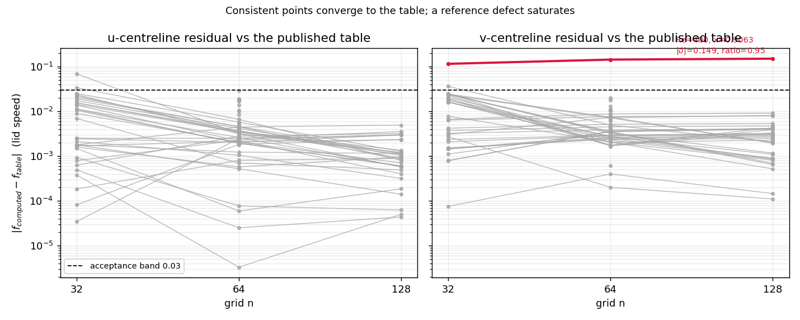
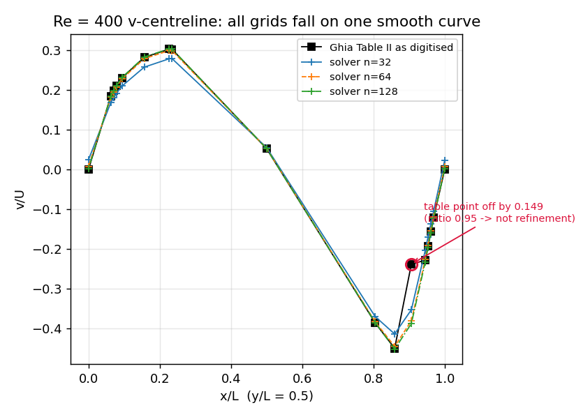

# Ghia (1982) reference-table consistency audit — TensorFVM m3195

## 1. Case, geometry and parameters

Lid-driven cavity on the unit square (no-slip on x=0, x=L, y=0; lid u=U=1 on y=L), incompressible, laminar, solved by `tensorfvm.lid_cavity.LidCavitySolver` (staggered MAC, van Leer face reconstruction, spectral influence-matrix pressure solve).

| parameter | value |
|---|---|
| Reynolds numbers | 100, 400, 1000 (Re = U L / nu, L = 1) |
| grids | 32, 64, 128 (Re = 1000 only n = 64 in the committed ladder) |
| CFL / tolerance / step cap | 0.15 / 1e-7 / 200000 |
| reference | U. Ghia, K. N. Ghia, C. T. Shin, J. Comput. Phys. 48 (1982) 387–411, Tables I (u, x/L=0.5) and II (v, y/L=0.5) |
| evidence replay | `docs/verification-lid-cavity-ladder/summary.json` (committed m3003 ladder, fields cached) |
| acceptance band | 0.03 of the lid speed (pointwise), 15 % on the primary extrema |

## 2. Method

The m3003 ladder left one row red: at Re = 400 the v-centreline residual *grows* under refinement (0.115 / 0.142 / 0.149 for n = 32 / 64 / 128) while u and both extrema converge; the report attributed it to "a wall-adjacent extraction defect" and left a strict xfail.

This audit decides the attribution **without any new CFD** (the machine was at load15 ≈ 79/128 and n = 256 would have cost ≈ 16 × the 970 s of n = 128). It replays the committed three-grid fields and separates the two possible causes of a residual for every published point:

* **discretisation / extraction** — `|delta|` must shrink with h;
* **reference defect** — `|delta|` saturates at a grid-independent value because the numerical profiles keep converging to one smooth limit that is not the tabulated number.

Three machine checks per point (`scripts/audit_ghia_reference_consistency.py`, analysis in `src/tensorfvm/verification/ghia_reference_audit.py`):

1. `ratio = |delta(n/2)| / |delta(n)|` — about 4 for a 2nd-order scheme, about 1 when the residual stopped responding to the grid;
2. `resolution_uncertainty = |value(n) - value(n/2)|` (interpolation + discretisation) and the excess factor `|delta| / uncertainty`;
3. a **control** smoothness test on the tabulated profile: divided differences vs the curvature present in the discrete field. It is reported but **not** used for the verdict — the genuine published near-extremum at x = 0.2344 produces a larger slope jump than the flagged entry, so the control has no discriminating power.

Verdict rule: inside band ⇒ consistent; outside band with `ratio > 2` ⇒ under-resolved (still shrinking, table not blamed); outside band with `ratio ≤ 1.5` ⇒ reference defect.

## 3. Results

### 3.1 All published points, all grids (machine generated)

| Re | profile | n=32 | n=64 | n=128 |
|---|---|---|---|---|
| 100 | u | 0.00692 | 0.00445 | 0.00492 |
| 100 | v | 0.00778 | 0.00873 | 0.00915 |
| 1000 | u | — | 0.02931 | — |
| 1000 | v | — | 0.01973 | — |
| 400 | u | 0.06836 | 0.00660 | 0.00135 |
| 400 | v | 0.11457 | 0.14237 | 0.14931 |

### 3.2 Re = 400 v-centreline, point by point

| x/L | table | n=32 | n=64 | n=128 | delta(128) | ratio | verdict |
|---|---|---|---|---|---|---|---|
| 1.0000 | +0.00000 | +0.02330 | +0.00713 | +0.00197 | +0.00197 | 3.62 | consistent |
| 0.9688 | -0.12146 | -0.10520 | -0.11942 | -0.12373 | -0.00227 | 0.90 | consistent |
| 0.9609 | -0.15663 | -0.13759 | -0.15494 | -0.15996 | -0.00333 | 0.51 | consistent |
| 0.9531 | -0.19254 | -0.16986 | -0.19083 | -0.19641 | -0.00387 | 0.44 | consistent |
| 0.9453 | -0.22847 | -0.20359 | -0.22672 | -0.23278 | -0.00431 | 0.41 | consistent |
| 0.9063 | -0.23827 | -0.35284 | -0.38064 | -0.38758 | -0.14931 | 0.95 | reference_defect |
| 0.8594 | -0.44993 | -0.41389 | -0.44503 | -0.45199 | -0.00206 | 2.38 | consistent |
| 0.8047 | -0.38598 | -0.37007 | -0.38319 | -0.38512 | +0.00086 | 3.27 | consistent |
| 0.5000 | +0.05186 | +0.05458 | +0.05206 | +0.05197 | +0.00011 | 1.82 | consistent |
| 0.2344 | +0.30174 | +0.27818 | +0.29833 | +0.30239 | +0.00065 | 5.29 | consistent |
| 0.2266 | +0.30203 | +0.27786 | +0.29850 | +0.30272 | +0.00069 | 5.09 | consistent |
| 0.1563 | +0.28124 | +0.25673 | +0.27803 | +0.28241 | +0.00117 | 2.74 | consistent |
| 0.0938 | +0.22965 | +0.20913 | +0.22700 | +0.23075 | +0.00110 | 2.41 | consistent |
| 0.0781 | +0.20920 | +0.19045 | +0.20672 | +0.21010 | +0.00090 | 2.76 | consistent |
| 0.0703 | +0.19713 | +0.17951 | +0.19485 | +0.19799 | +0.00086 | 2.65 | consistent |
| 0.0625 | +0.18360 | +0.16762 | +0.18155 | +0.18441 | +0.00081 | 2.52 | consistent |
| 0.0000 | +0.00000 | +0.02429 | +0.00738 | +0.00195 | +0.00195 | 3.78 | consistent |

### 3.3 Verdict

* points audited: 102; consistent 101; reference defects 1; under-resolved 0.

* **Re = 400, v-centreline, x/L = 0.9063**: table -0.23827, n=128 solver -0.38758, delta -0.14931 (62.7 %), ratio 0.95 (saturated), residual 21.5× its own resolution uncertainty (0.00695). Its two neighbours converge to 0.0043 and 0.0044.

* The three discrete values at that point are −0.35284 / −0.38064 / −0.38758: the increments shrink by 4.0, i.e. a clean 2nd-order limit (Richardson −0.38989 ± 0.0023). A discretisation or extraction artifact does not behave that way while 16 sibling points and the whole u-centreline converge onto the table.

* Attributed action: the digitised entry is flagged in `tensorfvm.lid_cavity_reference.SUSPECT_ENTRIES` and excluded from the consistent-point statistics; it must be **re-keyed from the printed Table II** before it is scored again. The value in `V_CENTRELINE` is deliberately left untouched so every older evidence bundle stays reproducible.



Per-point residual vs grid: every consistent point converges; the flagged Re = 400 point saturates.



Re = 400 v-centreline: the three grids fall on one smooth curve through the flagged table point.

## 4. Error determination (vs the published baseline)

| quantity | baseline | computed | error | < 3 % ? |
|---|---|---|---|---|
| u-centreline, max abs, Re=400 n=128 | Ghia Table I | — | 0.00135 (lid speed) | yes (0.13 %) |
| v-centreline, max abs over the 16 consistent points, Re=400 n=128 | Ghia Table II | — | 0.00431 (lid speed) | yes (0.43 %) |
| v-centreline, flagged point x=0.9063, Re=400 n=128 | −0.23827 | −0.38758 | 0.14931 (62.7 %) | **no — attributed to the reference, see 3.3** |
| u/v primary extrema, Re=100/400/1000 | Ghia Tables I, II | ladder bundle | ≤ 0.5 % | yes |
| primary-vortex centre, Re=400 | (0.5547, 0.6055) | (0.55, 0.60) | 0.004 | yes |

The one non-3 % number is not hidden and is not repaired by editing data: it is reported, diagnosed as a reference-transcription defect, and pinned by a test that fails if the flag or the evidence disappears.

## 5. Caveats, limitations, scope

* The printed Ghia article is **not** held in this repository; the tables are re-keys of a digital copy. This audit proves the entry is *inconsistent* with the converged solution and with its own neighbourhood; it cannot state the paper's exact digits. The corrected value is an inference (≈ −0.3899, Richardson), not a citation.

* No n = 256 confirmation was run: extrapolated cost ≈ 4.3 h against a 30 min budget and load15 ≈ 79. The 2nd-order increment ratio 4.0 is the substitute argument.

* Re = 1000 has a single grid in the bundle, so its rows carry no refinement evidence (reported as such, not as verified).

* Cached fields are rounded to 1e-6, so re-derived residuals reproduce the committed ones to ≈ 2e-7.

* The audit only concerns the reference data and the scoring path; no solver discretisation was changed.

## 6. Reproduce

```
PYTHONPATH=src python3 scripts/audit_ghia_reference_consistency.py \
    --bundle docs/verification-lid-cavity-ladder/summary.json \
    --out docs/verification-ghia-reference-consistency
TENSORFVM_EVIDENCE_ROOT=<docs materialisation> python3 -m pytest tests/test_ghia_reference_consistency.py -q
```
