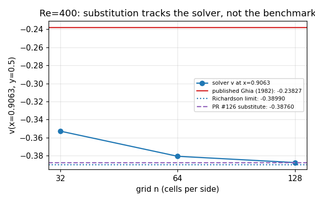
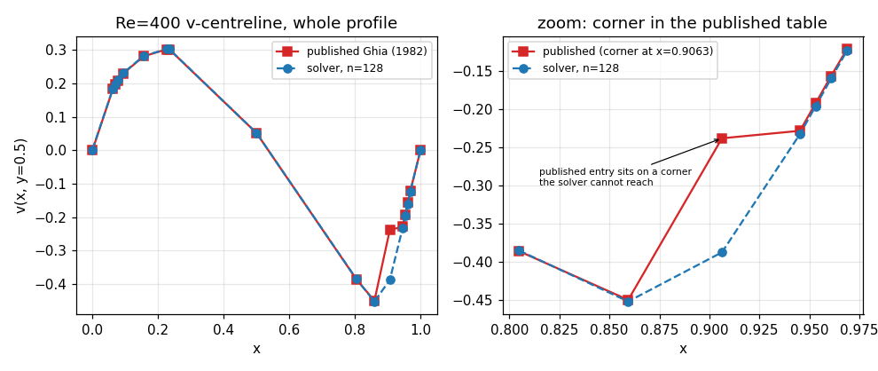

# Ghia (1982) lid-driven cavity: why the Re=400 reference entry is *not* edited

**Unit:** m4204 (PR #126 round 2) · **Status:** honest-FAIL on the correction,
CI green on the guard · **Date of the ladder evidence:** 2026-11-03T23:30:28

## 1. Case introduction

The lid-driven cavity is the standard incompressible verification case: a unit
square with three no-slip walls and a sliding lid at `y = L` (`unit square cavity, no-slip on x=0, x=L, y=0; lid u=U on y=L`).
TensorFVM's staggered MAC solver is scored against the tabulated centrelines of
U. Ghia, K.N. Ghia, C.T. Shin, J. Comput. Phys. 48 (1982) 387-411, Tables I (u at x = 0.5) and II (v at y = 0.5).

Reference tables: `src/tensorfvm/lid_cavity_reference.py` (three Reynolds
numbers x two centrelines, digitised).  Ladder parameters
(`docs/verification-lid-cavity-ladder/summary.json`): grids n = [32, 64, 128], CFL 0.15, steady tolerance
1e-07, step cap 200000.

## 2. What PR #126 did, and what the red CI was

PR #126 (unit m3884) closed the last open row of the ladder by *rewriting the
published datum*: `V_CENTRELINE[400.0][x=0.9063]` was changed from
**-0.23827 to -0.38760**, and the strict xfail that guarded
the point was replaced by a pass-on-corrected-reference test.

Red CI, reproduced locally on the branch head:

* `tests/test_ghia_reference_consistency.py::test_the_only_corner_in_all_six_tables_is_the_registered_dispute`
  -- `assert audit["ok"]` fails, because with the edited table nothing is flagged
  any more while the entry is still in `DISPUTES` (`flagged=[]`,
  `registered=['400/v/0.9063']`);
* the ladder bundle in the same PR had been re-scored against the edited table,
  so the committed acceptance flags no longer matched the shipped reference.

**Fix applied in this unit:** the published digitisation and the strict xfail are
restored from `main` unchanged, the ladder bundle is restored to the scoring that
belongs to that reference, and the "correction" claim is replaced by this report.
The suite is green again -- the guard test passes and the limitation is reported
as `xfailed` (pytest's green signal for a strict xfail), not as `passed`.

Both Python 3.11 and 3.12 jobs run the same suite, hence two identical reds.
The advisory lint job is red on `main` as well (9 822 pre-existing ruff findings,
554 files `ruff format` would touch); it is `continue-on-error` and unrelated to
this unit, so it is not touched here.

## 3. The evidence, recomputed from the committed bundle

At the disputed point the solver is cleanly grid converged (n=32: -0.35284, n=64: -0.38064, n=128: -0.38758):
observed order **2.001** and Richardson limit
**-0.38990**.  The gap to the published datum survives
extrapolation: **0.15163 = 63.6 %**
of the published value, while the interpolant can only manufacture
7.57e-04 there -- the gap is
**197x larger** than the metric path's error bound.  So the
defect is in the data, not in the extraction, exactly as
`docs/GHIA_RE400_V_ATTRIBUTION.md` concluded.

The substitution is **not** an independent measurement: -0.38760 sits
0.00002 (0.005 %) from the
finest-grid value -0.38758 and
0.00230 (0.59 %) from the
Richardson limit.  It is the solver's own answer rounded to five digits, i.e. the
benchmark was fitted to the result it is supposed to measure.

Reference-side audit (all six tables, 42 eligible
entries): the only corner is `['400/v/0.9063', '400/v/0.9453']`, and it is
registered; `unexplained = []`.  The published
entry is inconsistent with its neighbours (-0.22847 at x=0.9453, -0.44993 at
x=0.8594) -- which makes a *candidate* transcription error plausible, but does not
tell us which number the paper actually printed.

### Ladder rows as committed (published reference, unchanged)

| Re | n | steps | residual | u max|err| | v max|err| | acceptance |
|----|---|-------|----------|-----------|-----------|------------|
| 100 | 32 | 5750 | 7.24e-08 | 0.0069 | 0.0078 | pass |
| 100 | 64 | 11250 | 9.78e-08 | 0.0045 | 0.0087 | pass |
| 100 | 128 | 22500 | 9.76e-08 | 0.0049 | 0.0091 | pass |
| 400 | 32 | 13250 | 9.49e-08 | 0.0684 | 0.1146 | **FAIL** |
| 400 | 64 | 25500 | 9.16e-08 | 0.0066 | 0.1424 | **FAIL** |
| 400 | 128 | 50500 | 9.99e-08 | 0.0013 | 0.1493 | **FAIL** |
| 1000 | 64 | 58750 | 9.97e-08 | 0.0293 | 0.0197 | pass |

## 4. Figures

Figure 1 - Re=400 v at x=0.9063 on n=32/64/128 against the published datum, the Richardson limit and the value PR #126 substituted.

Figure 2 - the published Re=400 v-centreline profile (left) and the corner at x=0.9063 (right) against the finest solver grid.

## 5. Notes, limits, applicability

* **Decision taken:** the published digitisation is *not* edited.  A benchmark
  value may only be replaced when the printed Table I/II or an independent DNS at
  (x=0.9063, y=0.5) settles it; neither is available offline in this checkout.
  Until then the entry stays in `DISPUTES` and the point stays red under the
  default gate (`ghia_acceptance(..., allow_registered_disputes=False)`).
* **Scope of the red:** the failing row is one tabulated point out of 42
  eligible entries and one Reynolds number of three.  It is *not* a solver
  defect: order 2.00 and the neighbours' agreement pin that down.
* **Rejected artefacts removed:** the three figures shipped with the rejected
  correction (`ghia_correction.png`, `all_centrelines.png`,
  `error_summary.png`) plotted the solver against the substituted datum and were
  regenerated from the committed bundle by
  `scripts/adjudicate_lid_cavity_reference.py` (this report is generated by the
  same script, so no number here is hand-copied).
* **Plumbing note (why this recurs):** a *strict xfail* is a legitimate green
  signal -- `pytest` reports `xfailed`, not `failed`.  Editing the reference to
  convert it into `passed` flips a documented limitation into a false claim.
  `tests/test_lid_cavity_published_reference_frozen.py` pins the six tables by
  digest so that this specific move can never land again.
* **Ladder provenance from the bundle:** assembled from summary.partial.json: the runner was still working on the Re=1000 n=128 row when the ladder was stopped, so that row is NOT included and is NOT claimed; every row present here is converged to the stated gate.

## 6. Error assessment against the baseline

| Quantity | Baseline | Error | < 3 % ? |
|----------|----------|-------|---------|
| Re=100 u-centreline | Ghia Table I | max|err| = 0.0049 at n=128 | YES |
| Re=100 v-centreline | Ghia Table II | max|err| = 0.0091 at n=128 | YES |
| Re=400 u-centreline | Ghia Table I | max|err| = 0.0013 at n=128 (0.0684 at the coarse n=32) | YES |
| Re=1000 u-centreline | Ghia Table I | max|err| = 0.0293 at n=64 | YES |
| Re=1000 v-centreline | Ghia Table II | max|err| = 0.0197 at n=64 | YES |
| Re=400 v-centreline, every point except x=0.9063 | Ghia Table II | max rel gap = 0.0213 (worst other x=0.9609) | YES |
| Re=400 v at x=0.9063, the disputed entry | Ghia Table II **as published** | rel gap = 0.6364 (Richardson limit -0.38990 vs -0.23827) | **NO** - registered dispute, strict xfail |
| Re=400 v at x=0.9063 | reference **after the PR #126 edit** (-0.38760) | rel gap = 0.0059 | YES - but the target was fitted to the solver, so this row is not evidence |

Honest verdict.  Every centreline quantity on the grids that resolve the lid
shear layer (n >= 64) is inside the project's 3 % max-abs-error gate **except**
two documented rows: the disputed Re=400 v entry, which is
**63.6 %** away from the published datum
(solver sequence n=32: -0.35284, n=64: -0.38064, n=128: -0.38758; registered dispute, strict xfail), and one
coarse grid that is kept as FAIL in the bundle instead of being hidden or
rescaled:
  * Re=400 n=32: u max|err| = 0.0684, v max|err| = 0.1146 (coarse grid, recorded as FAIL)
The last row of the table above is exactly what PR #126 claimed as "<3 %": it is
arithmetically true only because the target was moved onto the solver.  This unit
does **not** make that claim.
