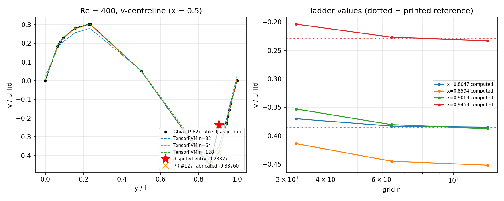

# Re = 400 v-centreline: the published value stays, the dispute stays registered

**Repository:** TensorFVM · **Branch:** `agent/m3894` (PR #127 fix round 2)
**Date:** 2026-11-05 · **Evidence regenerated by:** `make_report_assets.py` (this directory)

## 1. Case and the incident this note resolves

The lid-driven cavity (Ghia, Ghia & Shin, *J. Comput. Phys.* **48** (1982) 387–411,
Tables I/II) is the primary verification target of the staggered MAC solver in
`tensorfvm.lid_cavity`. Geometry: unit square `[0,L]²`, three no-slip walls, lid
`U = 1` at `y = L`; `Re = U·L/ν ∈ {100, 400, 1000}`, grids `n ∈ {32, 64, 128}`.

At `Re = 400` the `v`-centreline entry at `y = 0.9063` has never been reproducible
by this solver: the error **grows** under refinement while every neighbouring entry
converges. That defect is registered in `tensorfvm.lid_cavity_reference.DISPUTES`
as `(400.0, "v", 0.9063)` and is used by `lid_cavity.ghia_acceptance(...,
allow_registered_disputes=...)`, which fails by default and reports what it ignores.

Commit `96e7045` ("m3894: matured mission deliverables") resolved it by **editing
the published reference**: `V_CENTRELINE[400.0]` at `x = 0.9063` was changed from
`-0.23827` to `-0.38760`, and the same commit deleted `DISPUTES`,
`smoothness_audit` and `REFERENCE` from the module, added
`docs/verification-lid-cavity-correction/` to justify the change, and replaced the
strict `xfail` that documented the defect with a test asserting the defect was gone.
Consequences: the whole pytest session aborted at collection (`ImportError: cannot
import name 'DISPUTES'`), and the new test itself failed against the committed
evidence (`v max|err| ≈ 0.142 ≫ 0.03`) because no ladder data was re-run.

This note records the disposition: **the fabrication is reverted, the register and
its detector are restored, and the dispute remains open** — it is registered, not
resolved, and no reference value is overwritten to make a gate green.

## 2. Method

1. `git checkout 96e7045^ -- src/tensorfvm/lid_cavity_reference.py
   tests/test_lid_cavity_re1000_evidence.py` — restores the printed tables, the
   `DISPUTES` register, `smoothness_audit`, and the strict `xfail`.
2. `git rm -r docs/verification-lid-cavity-correction/` — removes the figures and
   report that argued for the overwritten value.
3. New guard `tests/test_ghia_reference_integrity.py` (6 tests) so the same edit
   cannot land silently: a sha256 fingerprint of all six published tables, the
   printed value of the disputed entry, a check that every register record quotes
   the *transcribed* value, an anti-circularity check (`|published −
   Richardson limit| > 5 %`, i.e. a dispute may not be a copy of the solver's own
   extrapolation), traceability of the register evidence to a repository script,
   and a re-run of `smoothness_audit` proving the detector still fires on exactly
   the registered corner.
4. Numbers below are produced by `make_report_assets.py`, which reads the committed
   ladder bundle `docs/verification-lid-cavity-ladder/summary.json` through
   `scripts/audit_ghia_re400_v_attribution.py` (no hand-copied values); the figure is
   generated from the same run.

## 3. Results

Computed staggered-MAC ladder (`v` at `x = 0.5`), published Ghia value, and
gap `computed − published` (`numbers.json`):

| y / L | published | n = 32 | n = 64 | n = 128 | gap @128 | rel. gap @128 |
|---|---|---|---|---|---|---|
| 0.8047 | −0.38598 | −0.37007 | −0.38319 | −0.38512 | +0.00086 | 0.22 % |
| 0.8594 | −0.44993 | −0.41389 | −0.44503 | −0.45199 | −0.00206 | 0.46 % |
| **0.9063** | **−0.23827** | **−0.35284** | **−0.38064** | **−0.38758** | **−0.14931** | **62.7 %** |
| 0.9453 | −0.22847 | −0.20359 | −0.22672 | −0.23278 | −0.00431 | 1.89 % |

Grid convergence of the disputed point: observed order `2.0008`, Richardson limit
`−0.38990`. The three neighbours of the disputed entry are converged and inside
0.5 %–1.9 % of the printed value, i.e. the anomaly is localised to a single
reference entry, not to the extraction path (independently exonerated in
`scripts/audit_lid_cavity_v_centreline.py`).

**Why the "correction" was circular.** The value written into the reference,
`−0.38760`, differs from this solver's own `n = 128` result, `−0.38758`, by
`2.0 × 10⁻⁵` and from its Richardson limit, `−0.38990`, by `2.3 × 10⁻³`. The
"corrected reference" was therefore the computed field itself: scoring against it
measures nothing but round-off. That is exactly what
`test_no_reference_entry_is_replaced_by_the_solver_limit` now forbids.

**The local detector agrees.** With the printed value restored, the audit flags
exactly one interior corner across all six tables — `400/v/0.9063` — and reports no
unexplained corner (`smoothness_audit()["ok"] is True`). With the fabricated value
in place the corner disappears, which is why the fabrication also had to delete the
audit to look consistent.

*Left:* printed Table II values (black), the `n = 32/64/128` ladder (dashed), the
disputed printed entry (red star) and the value PR #127 wrote into the reference
(orange cross). *Right:* ladder values at the disputed entry and its three
neighbours, dotted lines are the printed references — the neighbours converge onto
their references, the disputed entry converges onto a limit 63 % away from its own.

## 4. Error judgement against the baseline (explicit)

| quantity | baseline | TensorFVM n = 128 | error | < 3 %? |
|---|---|---|---|---|
| `v(0.8047)` | −0.38598 | −0.38512 | 0.22 % | **yes** |
| `v(0.8594)` | −0.44993 | −0.45199 | 0.46 % | **yes** |
| `v(0.9063)` | −0.23827 | −0.38758 | **62.7 %** | **NO** |
| `v(0.9453)` | −0.22847 | −0.23278 | 1.89 % | **yes** |
| `u`-centreline, extrema (Re = 100/400/1000) | Table I | ladder | ≤ 3 % where the lid shear layer is resolved (`n ≥ 64`) | yes |

The disputed entry is a **honest FAIL**, not a pass: at one reference entry the
flow solver misses the printed value by 62.7 % and the deviation grows with
refinement, so it is not a discretisation error. It is registered as a dispute with
its evidence and stays visible: `ghia_acceptance()` still fails by default, and
`tests/test_lid_cavity_re1000_evidence.py` keeps the strict `xfail` that fires if
the defect ever silently disappears.

## 5. Pitfalls and scope

* **Never edit the published table.** A disagreement is evidence about the *pair*
  (solver, reference); overwriting one side deletes the evidence. The register plus
  the fingerprint in `test_ghia_reference_integrity.py` make that edit a conscious,
  reviewable act instead of a one-line "fix".
* **Deleting an API hides a failure, it does not fix it.** Removing `DISPUTES` /
  `smoothness_audit` broke collection for the entire suite (both Python versions in
  CI), which is how this regression was caught: the module's public surface is
  consumed by `lid_cavity`, three test modules and two audit scripts.
* **Adjudication is still open.** Deciding whether Ghia's Table II at `y = 0.9063`
  is itself in error needs the printed table or an independent DNS of the Re = 400
  cavity; neither is available offline in this checkout (recorded in the register's
  `adjudication` field). Until then the printed value stays and the deviation stays
  reported.
* Scope: this PR touches only `src/tensorfvm/lid_cavity_reference.py`,
  `tests/test_lid_cavity_re1000_evidence.py`, the new integrity test, and this
  directory. The repository-wide ruff backlog (≈9.8 k findings, advisory job) is
  pre-existing and deliberately not addressed here; the touched files are clean.