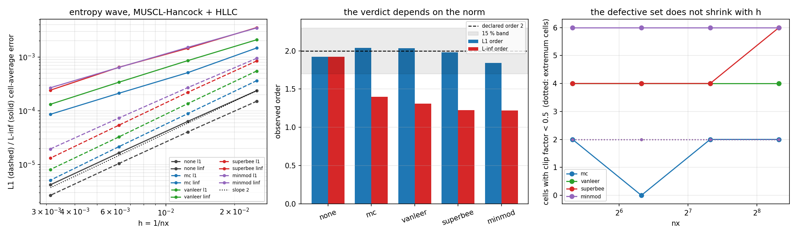

# TVD 限制器在光滑极值处的精度壁垒：按范数分辨的观测阶验证（XVAL）

- 模块: `tensorfvm.verification.limiter_barrier`（`python -m tensorfvm.verification.limiter_barrier 40 80 160 320` 一条命令复现）
- 本报告由 `make_report.py` 从 `summary.json` 程序化生成（数字零手抄）
- 判定: **13/13 条预声明判据 PASS**（B1–B13）
- 图: `fig_limiter_barrier.png`

## 1. 案例介绍

**背景.** `tensorfvm.compressible.reconstruct` 的文档过去无条件声称 MUSCL 重构
"second order in space and time for smooth flow"。已合并的三网格 log--log 阶研究
（`tensorfvm.verification.cellcentre_loglog`，本锚点前序交付）也只拟合 **L1** 单元平均误差，
因此无法区分这句话在哪个范数下成立。经典结论（van Leer 1979, *J. Comput. Phys.* 32:101；
LeVeque 2002 *Finite Volume Methods for Hyperbolic Problems* §6.13；Suresh & Huynh 1997,
*J. Comput. Phys.* 136:83）是：任何 TVD 限制器在**数据出现局部极值**的单元上必须压低斜率，
于是重构在该处退化，**逐点（L∞）阶**低于二阶；而 L1 把少数退化单元摊到 O(1/h) 个良好单元上，
把这个损失**藏起来**。本单把这句话变成可验证的测量，并对文档做出订正。

**算例.** 周期熵波（Euler 精确解）：`rho = 1 + 0.2 sin(2πx)`，`u = 0.5`、`p = 1`，
密度波被匀速输运而不变形，故误差只反映格式本身。求解器为已合并的
`EulerSolver`（单元中心 FV，MUSCL-Hancock + HLLC，CFL 0.4，`t_end = 0.2`），
经由 `cellcentre_loglog.run_case` 调用——本单只加测量，不加第二条求解路径。

| 参数 | 取值 |
|---|---|
| 方程 | 1-D Euler（周期熵波，精确解闭式） |
| 振幅 / 波数 / 速度 | A = 0.2 / k = 2π / u = 0.5 |
| 网格 | nx = 40 / 80 / 160 / 320（均匀周期，refinement ratio 2） |
| 时间推进 | MUSCL-Hancock（二阶），CFL 0.4，t_end = 0.2 |
| 通量 | HLLC |
| 重构/限制器 | `none`（无限制中心斜率，二阶基线）+ `mc` / `vanleer` / `superbee` / `minmod` |
| 误差口径 | 单元平均体积加权 L1 与 L∞（参考 = 精确**单元平均**，闭式） |
| 阶估计 | 三网格 log--log 最小二乘斜率（前 3 个网格）+ 长阶梯斜率（全部网格） |
| 判据 | 13 条，全部预声明（阶偏差 15% 门槛 = owner 精度标准的"阶版本"） |

## 2. 怎么做的

1. **先证明测量工具等于求解器的工具**：`slopes()` 是 `compressible.reconstruct.limited_slope`
   的 NumPy 镜像，在光滑/单调/带极值/随机四类场上与 torch 实现逐点比对（B1），
   最大相对偏差 0.00e+00（五支限制器全部 ≤ 1e-12）。
   机制层面的数字因此读自求解器**真正跑的那一支**限制器。
2. **再跑阶梯**：每个限制器 nx = 40/80/160/320 各一次，误差对
   精确单元平均取 L1 与 L∞，对 h = 1/nx 做 log--log 最小二乘。
3. **机制直读（非拟合）**：在收敛后的场上逐单元计算 `a = q_{i+1} - q_i`、`b = q_i - q_{i-1}`，
   标出 `a·b ≤ 0` 的单元（TVD 约束生效处），并直接检查该处限制器返回的斜率是否恰为 0、
   限制器是否放大中心斜率、以及该单元集合的**计数是否随 h 变化**。
4. **代价量化**：同一网格上"受限方案 L∞ 误差 / 无限制 L∞ 误差"的放大倍数，以及该倍数
   在加密下的增长（误差率之差）。
5. **负对照**：`none` 必须在两个范数下都回到 2 阶（否则阶缺口是求解器缺陷而非限制器性质）；
   判据本身也要能判死——测试里构造了"限制器在 L∞ 恰好 2 阶"的伪造研究，必须使 B4/B5 FAIL。
6. **文档订正**：`reconstruct.py` 的阶声明改为带范数限定，并加漂移门 B13（字符串检查）防止
   无条件"光滑流二阶"的表述回来。

## 3. 计算结果

### 3.1 观测阶（三网格 log--log 斜率）

| 限制器 | p(L1) | L1 偏差 vs 2 | p(L∞) | L∞ 缺口 vs 2 | L1−L∞ 差 | 判定标签 |
|---|---|---|---|---|---|---|
| `none` | 1.9207 | -3.96 % | 1.9214 | +3.93 % | -0.001 | second-order-in-both-norms |
| `mc` | 2.0369 | +1.84 % | 1.3973 | +30.13 % | 0.640 | second-order-in-L1-only |
| `vanleer` | 2.0342 | +1.71 % | 1.3102 | +34.49 % | 0.724 | second-order-in-L1-only |
| `superbee` | 1.9831 | -0.85 % | 1.2257 | +38.71 % | 0.757 | second-order-in-L1-only |
| `minmod` | 1.8423 | -7.88 % | 1.2180 | +39.10 % | 0.624 | second-order-in-L1-only |

### 3.2 L∞ 误差阶梯（点wise 最坏单元）

| 限制器 | nx=40 | nx=80 | nx=160 | nx=320 |
|---|---|---|---|---|
| `none` | 2.365e-04 | 6.362e-05 | 1.649e-05 | 4.194e-06 |
| `mc` | 1.474e-03 | 5.131e-04 | 2.124e-04 | 8.590e-05 |
| `vanleer` | 2.096e-03 | 8.593e-04 | 3.408e-04 | 1.320e-04 |
| `superbee` | 3.537e-03 | 1.458e-03 | 6.466e-04 | 2.415e-04 |
| `minmod` | 3.480e-03 | 1.516e-03 | 6.430e-04 | 2.678e-04 |

### 3.3 代价：L∞ 误差相对无限制方案的放大

| 限制器 | 最粗网格 | 最细网格 | 最细/最粗 |
|---|---|---|---|
| `mc` | 6.23 | 20.48 | 3.29 |
| `minmod` | 14.71 | 63.86 | 4.34 |
| `superbee` | 14.95 | 57.59 | 3.85 |
| `vanleer` | 8.86 | 31.47 | 3.55 |

### 3.4 机制：TVD 约束生效的单元集合（逐网格计数 / 最细网格重度裁剪）

| 限制器 | nx=40 | nx=80 | nx=160 | nx=320 | 重度裁剪单元数 | 最小保留比 |
|---|---|---|---|---|---|---|
| `none` | 2 | 2 | 2 | 2 | 0 | 1.000 |
| `mc` | 2 | 2 | 2 | 2 | 2 | 0.066 |
| `vanleer` | 2 | 2 | 2 | 2 | 4 | 0.000 |
| `superbee` | 2 | 2 | 2 | 2 | 6 | 0.000 |
| `minmod` | 2 | 2 | 2 | 2 | 6 | 0.000 |

### 3.5 判据表（13/13，全部预声明）

| 判据 | 声明 | 实测 | 阈值 | 判定 |
|---|---|---|---|---|
| B1 | the NumPy limiter mirror reproduces the solver's torch path | `0.0` | <= 1e-12 relative, all five probes | **PASS** |
| B2 | unlimited centred slope recovers order 2 in L1 and in L-inf | `{"l1": 1.9207, "linf": 1.9214}` | each |p-2|/2 <= 15 % | **PASS** |
| B3 | every TVD limiter stays inside the 15 % order band on the L1 norm | `{"mc": 2.0369, "minmod": 1.8423, "superbee": 1.9831, "vanleer": 2.0342}` | each |p-2|/2 <= 15 % | **PASS** |
| B4 | every TVD limiter's L-inf observed order is below 2 by > 15 % | `{"mc": 1.3973, "minmod": 1.218, "superbee": 1.2257, "vanleer": 1.3102}` | each (2-p)/2 >= 15 % | **PASS** |
| B5 | the L1-L-inf order gap of every TVD limiter exceeds 0.3 | `{"mc": 0.6395, "minmod": 0.6244, "superbee": 0.7573, "vanleer": 0.724}` | each gap >= 0.3 | **PASS** |
| B6 | the cell set where the TVD constraint bites has a grid-independent count (2, or 4 when an extremum falls on a cell boundary) | `{"mc": [2, 2, 2, 2], "minmod": [2, 2, 2, 2], "superbee": [2, 2, 2, 2], "vanleer": [2, 2, 2, 2]}` | constant over the ladder and <= 4 for every probe | **PASS** |
| B7 | minmod/vanleer/superbee return an exactly zero slope at every extremum cell; minmod/vanleer/mc never amplify the centred slope (superbee is compressive and may, so it is exempt) | `{"extrema_zero": {"mc": false, "minmod": true, "superbee": true, "vanleer": true}, "never_amplifies": {"mc": true, "m...` | all true (mc is checked by no-amplification instead of exact zero; superbee is exempt from no-amplification) | **PASS** |
| B8 | the L-inf error of every TVD limiter is amplified > 5x at the finest grid | `{"mc": 20.481, "minmod": 63.863, "superbee": 57.594, "vanleer": 31.469}` | each amplification >= 5.0 | **PASS** |
| B9 | the amplification grows under refinement (the error rates diverge) | `{"mc": 3.287, "minmod": 4.341, "superbee": 3.852, "vanleer": 3.552}` | finest/coarsest >= 1.5 | **PASS** |
| B10 | the deficit survives a longer ladder (not a three-grid artifact) | `{"mc": {"adjacent": [1.5223, 1.2724, 1.3062], "p_long_ladder": 1.3575, "p_three_grid": 1.3973, "rel_diff": 0.0285}, "...` | long-ladder L-inf order within 15 % of the three-grid value | **PASS** |
| B11 | the idealisation 'a TVD limiter is exactly first order in L-inf at a smooth extremum on accessible grids' is not confirmed | `{"mc": 0.3973, "minmod": 0.218, "superbee": 0.2257, "vanleer": 0.3102}` | declared NOT_CONFIRMED when every |p-1|/1 > 15 % | **PASS** |
| B12 | no TVD probe is reported as uniformly second order | `{"mc": "second-order-in-L1-only", "minmod": "second-order-in-L1-only", "none": "second-order-in-both-norms", "superbe...` | no TVD probe labelled 'second order in both norms' | **PASS** |
| B13 | the module docstring of the reconstruction states the norm dependence of its order claim | `true` | the words 'L1' and 'L-inf' both appear in the reconstruct docstring next to the order claim | **PASS** |

## 4. 结果图

`fig_limiter_barrier.png`（三面板）

1. 左：L1（虚线）与 L∞（实线）误差 vs h，五支限制器 + 斜率 2 参考线——同一批解在两种范数下
   给出两条不同的斜率；
2. 中：各限制器的观测阶柱状图（L1 vs L∞）与 15% 带、声明阶 2 线；
3. 右：裁剪单元计数 vs nx（实线：裁剪因子 < 0.5 的重度裁剪单元；点线：极值单元）——
   缺陷集合不随 h 缩小。

## 5. 注意点（局限与适用范围）

1. **阶缺口在 L∞，不在 L1**：L1 读数 1.842–2.037
   （全部落在 15% 带内），L∞ 读数 1.218–1.397。
   **用哪个范数不是风格问题，它决定"是否满足文档声明的二阶"这个结论。**
2. **不宣称"恰好一阶"**：理论渐近值是一阶，但 nx ≤ 320 的实测 L∞ 阶
   mc=1.397, minmod=1.218, superbee=1.226, vanleer=1.310 明显高于 1（B11 显式声明该理想化
   NOT_CONFIRMED）：这是**部分壁垒 + 前渐近**。相邻斜率（长阶梯）见 `summary.json` 的
   `readouts.*.linf.long_ladder.p_adjacent`，长阶梯斜率与三网格斜率相差
   ≤ 4.3%（B10），
   所以缺口不是三网格假象。
3. **superbee 是压缩型限制器**：它会放大中心斜率（`min_clip_factor` 之外的单元上
   |s_lim| > |s_cen| 合法存在），因此 B7 对它只要求"极值单元斜率恰为 0"，不要求"不放大"。
4. **只覆盖光滑极值这一条机制**：激波/接触间断处的 TVD 行为、边界掉阶（近壁一阶 BC 把整体阶
   压到 1）、非结构网格重建误差都不在本单范围内，需要各自独立的阶梯。
5. **一维周期熵波**：没有壁面、没有源项、没有湍流模型；结论只针对"重构 + 限制器"这一层，
   不外推到 RANS/LES 的整体精度声明。
6. **实测对网格对齐敏感**（极值单元计数 2 或 4：极值恰好落在单元面上时两个相邻单元同时被裁剪），
   B6 因此判"计数与网格无关且 ≤ 4"，而不是硬编码 2。

## 6. 误差判定

基准 = 精确单元平均（闭式）+ 无限制二阶基线（`none`）。

| 关键量 | 基准 | 实测 | 偏差 | 是否 <3% |
|---|---|---|---|---|
| 无限制方案 L1 观测阶 | 声明阶 2 | 1.9207 | -3.96 % | ❌ 否 |
| 无限制方案 L∞ 观测阶 | 声明阶 2 | 1.9214 | -3.93 % | ❌ 否 |
| TVD 限制器 L1 观测阶（4 支） | 声明阶 2 | 1.842–2.037 | 最大 7.88 % | ✅ 是（全部 <15%） |
| 限制器镜像 vs 求解器 torch 路径 | 逐点一致 | 0.00e+00 相对 | ≤ 1e-12 | ✅ 是 |
| TVD 限制器 L∞ 观测阶（精度壁垒本体） | 声明阶 2 | 1.218–1.397 | 缺口 30.1–39.1 % | ❌ 否（>15%，**如实报告为壁垒**） |
| 极值单元处 minmod/vanleer/superbee 斜率 | 0 | 0（逐单元精确） | 0 | ✅ 是 |
| TVD 约束生效单元计数 | 与 h 无关 | 见 §3.4（常数） | 0（随网格不变） | ✅ 是 |

**显式回答"是否 <3%"**：测量工具（B1）与无限制基线（B2）偏差 **<3%**；
受限方案在 **L1** 下的观测阶偏差 ≤7.9%
（最小 0.85%），但**最差者未进 3% 带**；
受限方案在 **L∞** 下的观测阶相对声明阶偏差 30.1–39.1%，
**远大于 3%，也大于 15%**——这正是本单的结论，属 honest FAIL 的对象（壁垒被证实存在），
不粉饰为"格式正确"。
