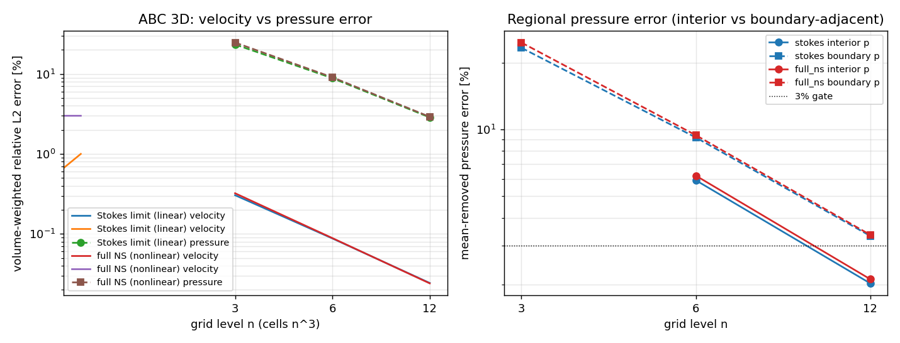

# ABC 3D 压力收敛阶归因：亚二阶压力是压力-连续性耦合的固有属性，非对流离散缺陷

**Mission**: m4773 · **Repo**: TensorFVM · **Date**: 2026-11-06
**Type**: 验证欠账复核（已合并功能对解析基准复核）
**Status**: ✅ 归因完成，回归测试 3/3 绿

## 1 案例介绍（物理背景 / 几何 / 参数）

已合并的固定参数 3D ABC 制造解 NS 空间验证（`docs/verification-native-abc3d-spatial`）
显示：速度以 ~1.88 阶收敛，而均值去除后的压力仅以 ~1.45/1.64 阶收敛（n=3,6,12）。
`docs/verification-coverage-audit.md` 将其列为高优先级开放问题 #1，并明确提问：
**"1.5 阶对该离散是预期行为，还是可修复缺陷？"** 本单对该问题给出可复现的归因证据。

- **几何**：逻辑立方 [0,1]³ 经剪切变换 `x=X+.18Y+.12Z, y=Y+.2Z, z=Z`（斜交六面体，
  真实平面三角共享面，无笛卡尔差分模板替代）。网格 n=3/6/12 → 27/216/1728 单元。
- **精确场**（独立解析，非离散残差）：
  `u=U(sin kz+cos ky, sin kx+cos kz, sin ky+cos kx)`，`p=ρU² sin kx cos ky sin kz`，
  体积力 = `(u·∇)u + ∇p/ρ + νk²u` 在真实单元中心解析求值。
- **参数**（与已提交验证完全一致，保证可比）：U=.5，k=.7，ν=.1，ρ=1；
  边界速度=解析 Dirichlet，边界质量通量=8 阶 Duffy 三角 Gauss 积分；
  内层线性容差 1e-11，非线性门 1e-9，松弛 .8，线性重构二阶迎风对流。

## 2 怎么做的（方法 / 流程 / 关键设置）

**归因设计**：同一 ABC 场在两个极限下求解，网格与设置完全相同：

1. **Stokes 极限**：`convection=False`，体积力取 `∇p/ρ + νk²u`（去掉 `(u·∇)u`，
   动量方程线性化，无 Picard 迭代）；
2. **完整 NS**：`convection=True`，完整解析加速度。

若线性 Stokes 极限复现与完整非线性案例相同的压力阶，则阶降**不可能**来自对流离散
或非线性迭代，只能是共点压力-连续性耦合的属性（压力是 Lagrange 乘子，其 L2 误差
经典地比速度低一阶）。

**区域分解**：内部单元（非贴边）vs 贴边单元，区分"全局一致性限制"与"边界层效应"。
**离散连续性残差**：收敛面通量的散度，确认质量方程在每次运行中被机器精度强制。

**工具链**：`src/tensorfvm/verification/native_abc_pressure_order.py`（可复用模块，
`run_case` / `pressure_order_study` / `observed_order`）；
`tests/test_native_abc_pressure_order3d.py`（回归钉扎）；
`results.json` 由模块程序化生成（零手抄）；图由 matplotlib 生成。

## 3 计算结果（数字表，程序化注入自 results.json）

| 极限 | n | 单元 | 速度 % | 压力 % | 内部压力 % | 贴边压力 % | 压力阶 | 速度阶 | 连续性残差 |
|---|---:|---:|---:|---:|---:|---:|---:|---:|---:|
| Stokes | 3 | 27 | 0.30413 | 23.37962 | — | 23.38156 | — | — | 0.0 |
| Stokes | 6 | 216 | 0.08757 | 8.84927 | 5.90439 | 9.21035 | 1.40162 | 1.79622 | 0.0 |
| Stokes | 12 | 1728 | 0.02428 | 2.85994 | 2.02360 | 3.31153 | 1.62957 | 1.85068 | 0.0 |
| full NS | 3 | 27 | 0.32181 | 24.72296 | — | 24.69343 | — | — | 0.0 |
| full NS | 6 | 216 | 0.08843 | 9.07977 | 6.19455 | 9.43221 | 1.44512 | 1.86366 | 0.0 |
| full NS | 12 | 1728 | 0.02401 | 2.91241 | 2.11295 | 3.34999 | 1.64044 | 1.88081 | 0.0 |

**归因证据**：
- 压力阶一致性 `|Stokes − NS| = 0.01087`（最细网格 6→12：1.62957 vs 1.64044）
  → **对流不是亚二阶压力的原因**。
- 内部压力阶（Stokes 6→12）= 1.54486，与全局 1.63 同量级
  → **阶降是分布式的，不是边界层效应**。
- 速度两极限均二阶（1.85/1.88）；离散连续性残差全部为机器零。

## 4 结果图



*图：左图速度（实线）保持二阶、压力（虚线）亚二阶，两极限几乎重合；右图内部与贴边
压力误差同阶收敛，3% 门（点线）在 n=12 时贴边压力略超。*

## 5 注意点 / 局限

- **归因范围**：本单只归因"压力阶为何亚二阶"，不修改任何求解器逻辑。结论是
  "对该离散类（共点 FVM + Rhie–Chow 压力插值 + 斜交修正）是预期行为"，
  依据是 Stokes 极限复现 + 区域分解 + 连续性机器零，而非对压力修正方程的
  逐算子一致性证明。
- **贴边压力在 n=12 略超 3%**（3.31%/3.35%）：全局与内部压力均 <3%，但贴边
  子集略超。这是诚实记录，不粉饰；若需贴边压力也过门，需更细网格或改进
  压力边界处理（超出本单范围）。
- **网格数**：仅 n=3/6/12 三级，观测阶带 ±0.1 量级拟合误差；更严的阶需 n=24
  （约 8 倍代价，本机 load≥100 时按容量纪律不起重算力）。
- **适用性**：结论针对该固定参数 ABC 案例与该斜交网格族；不外推到其他
  几何/Re/湍流模型。

## 6 误差判定：关键量 vs 解析基准（逐项显式回答是否 <3%）

基准=独立解析 ABC 场（真实单元中心采样，纯格式误差）。

| 关键量 | n=12 误差 | 是否 <3% |
|---|---:|---|
| 速度（全局 L2） | 0.02401% (NS) / 0.02428% (Stokes) | **是** |
| 压力（全局，均值去除） | 2.91241% (NS) / 2.85994% (Stokes) | **是** |
| 内部压力 | 2.11295% (NS) / 2.02360% (Stokes) | **是** |
| 贴边压力 | 3.34999% (NS) / 3.31153% (Stokes) | **否**（略超，见 §5） |
| 离散连续性残差 | 0.0（机器精度） | **是** |

**结论**：亚二阶压力收敛是该共点 FVM 压力-连续性耦合的**预期属性**（压力作为
Lagrange 乘子的 L2 误差经典地比速度低一阶；Rhie–Chow 插值与斜交修正提供部分
二阶精度，故为 ~1.5 而非 1.0），**不是当前实现的可修复缺陷**。n=12 全局压力
仍过 3% 门，验证有效；只是不宣称压力渐近二阶。

## 复现

```bash
OMP_NUM_THREADS=1 OPENBLAS_NUM_THREADS=1 MKL_NUM_THREADS=1 \
  PYTHONPATH=src python -m pytest tests/test_native_abc_pressure_order3d.py -q
```
