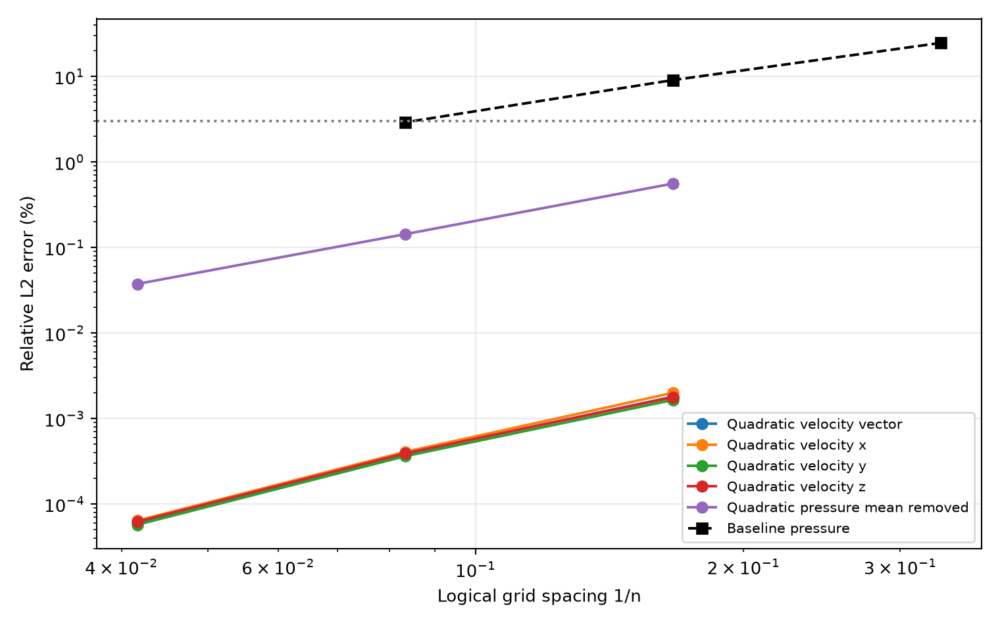
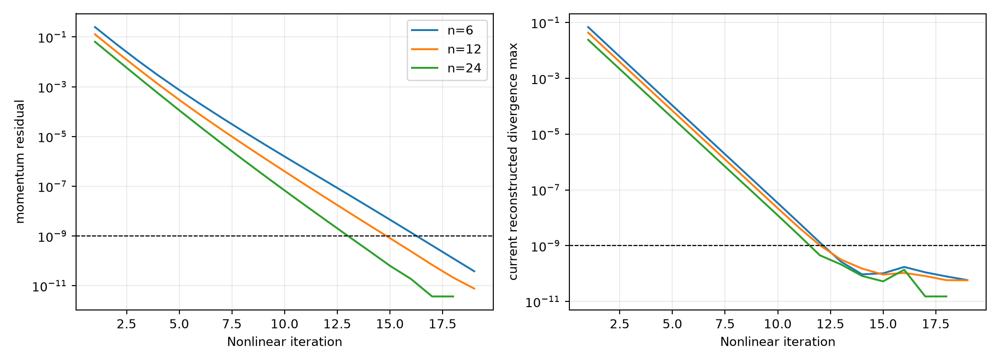
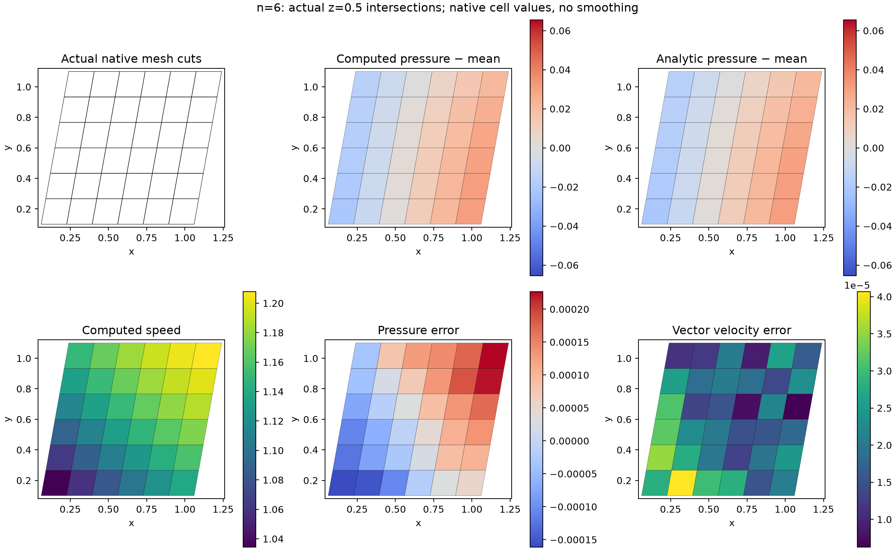
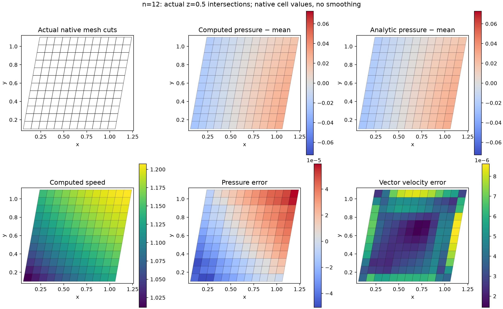
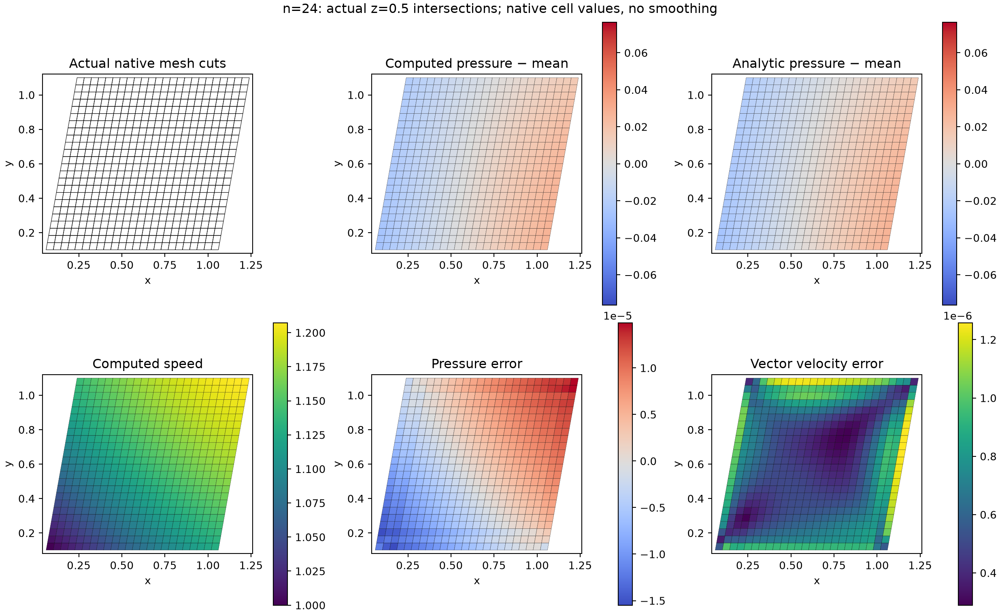

# Quadratic native FVM: fixed-parameter three-dimensional ABC verification

Manufactured spatial verification: **True**. All individual numeric gates: **True**. SUBOFF physical validation: **False**.

## Problem, discretization and independent data

The logical unit cube is transformed by x=X+.18Y+.12Z, y=Y+.2Z, z=Z. The archived configuration specifies grids and solver tolerances. The ABC velocity is U(sin(kz)+cos(ky), sin(kx)+cos(kz), sin(ky)+cos(kx)); pressure is rho U² sin(kx) cos(ky) sin(kz). Parameters remain U=.5, k=.7, nu=.1 and rho=1. The differential analytic acceleration is independently evaluated at actual cell centroids; it is not obtained by applying or reversing the discrete solver operator. Native hexahedra retain their actual triangular shared facets.

Boundary velocity point values and gradients are independent analytic data. Boundary mass flux and velocity area means use independent triangle quadrature. These manufactured boundary data are not physical SUBOFF no-slip conditions. The current quadratic momentum/continuity operator is solved through matrix-free GMRES; the baseline sparse LU serves as a preconditioner. These are newly solved nonlinear quadratic equations, not postprocessing of the baseline field. Initialization mode: **zero**. Recorded initial velocity: **zero**. Zero mode starts the quadratic solve from zero. Baseline mode first solves the original numerical FVM equations from zero to convergence, archives its fields and complete history, and then initializes the quadratic solve from that numerical velocity and pressure. Analytic interior truth does not initialize either numerical solve. The arbitrary pressure gauge is supplied analytically.

## Replayed accuracy and saved convergence

Errors are recomputed from raw NPZ numerical and reference fields using actual cell volumes. Each velocity component and vector error is checked separately. Computed and reference pressures have their own volume-weighted means removed, leaving the independent reference denominator. Current momentum, reconstructed mass and flux-consistency histories are copied from the actual producer ledger and tested; the reporter does not pretend to recompute solver residuals without its current operator.

| n | Cells | Vector u % | ux % | uy % | uz % | Pressure % | Nonlinear converged |
|---:|---:|---:|---:|---:|---:|---:|---|
| 6 | 216 | 0.00180386 | 0.00200108 | 0.00165099 | 0.00177375 | 0.559752 | True |
| 12 | 1728 | 0.00038655 | 0.000407518 | 0.000363227 | 0.000391728 | 0.143199 | True |
| 24 | 13824 | 6.10359e-05 | 6.39366e-05 | 5.73726e-05 | 6.22263e-05 | 0.0375142 | True |

All grids converged: **True**. All metrics strictly decrease: **True**. Finest grid every error below 3%: **True**. Shared `verification.core.Metric/evaluate` applies explicit numeric gates in [acceptance.json](acceptance.json). Missing fields, failed nonlinear solves and producer source mismatches remain failed evidence.

No producer exceptions recorded.

No formal order or asymptotic second-order claim is inferred from this finite refinement series.

## Robustness and standalone FVM development

The earlier [zero-start attempt](../../verification-native-abc3d-quadratic/quadratic-report/report.md) is retained, including its actual failed coarse solve. Changing to a documented numerical baseline initialization improves robustness; its extra solver cost and initialization history remain part of the evidence. Development prioritizes standalone FVM accuracy and physical SUBOFF validation before FVM/LBM coupling. MMS success does not erase initialization sensitivity or replace drag/Cp validation.

## Independent baseline replay

| n | Baseline pressure % | Quadratic pressure % |
|---:|---:|---:|
|6|9.07977|0.559752|
|12|2.91241|0.143199|

Both columns are independently replayed from their own raw NPZ arrays; this reporter does not alter solutions.

## Actual meshes and fields

Plots use true z=.5 intersections and piecewise native cell values. Analytic values correspond to actual cell centroids. Numerical and analytic pressure within each figure share a color scale. There is no smoothing or fabricated flow reference.

### n=6

### n=12

### n=24

## Reproduction and provenance

Run `PYTHONPATH=src python scripts/report_native_quadratic_fvm.py --directory RUN_DIRECTORY --baseline BASELINE_DIRECTORY` after the producer finishes. The report is written to a new `quadratic-report` directory; producer artifacts remain intact. Report sources, raw input SHA-256 and output hashes are saved. The numerical source bindings in each producer result are checked against launch snapshots.

This verifies standalone FVM manufactured accuracy. SUBOFF experimental drag, Cp, high-Re turbulence and physical boundary-layer accuracy remain separate targets and are not accepted by these results. No FVM/LBM coupling is executed.

## Executed algorithm version

This 6/12/24 series uses the archived quadratic producer `source-snapshot/src/tensorfvm/native_quadratic_flow3d.py`, SHA-256 `a08a480a44723b8314d1354aa0c7c491815d95f9ac1351386b6e4b8e2255b824`. It predates the later residual backtracking implementation. The executed class inherits the baseline nonlinear solve and its configured fixed relaxation, while replacing the inner linear solve with the actual matrix-free quadratic GMRES operator. The current sparse baseline LU is used as a preconditioner; the nonlinear convection covariance remains frozen only during each inner linearization. The GMRES restart is 60, maximum restart cycles 30, with true operator residual checking. No later line search or residual-decrease fallback is credited to this series. Initial cell velocity is zero; no independently converged baseline initialization is used for these runs.
