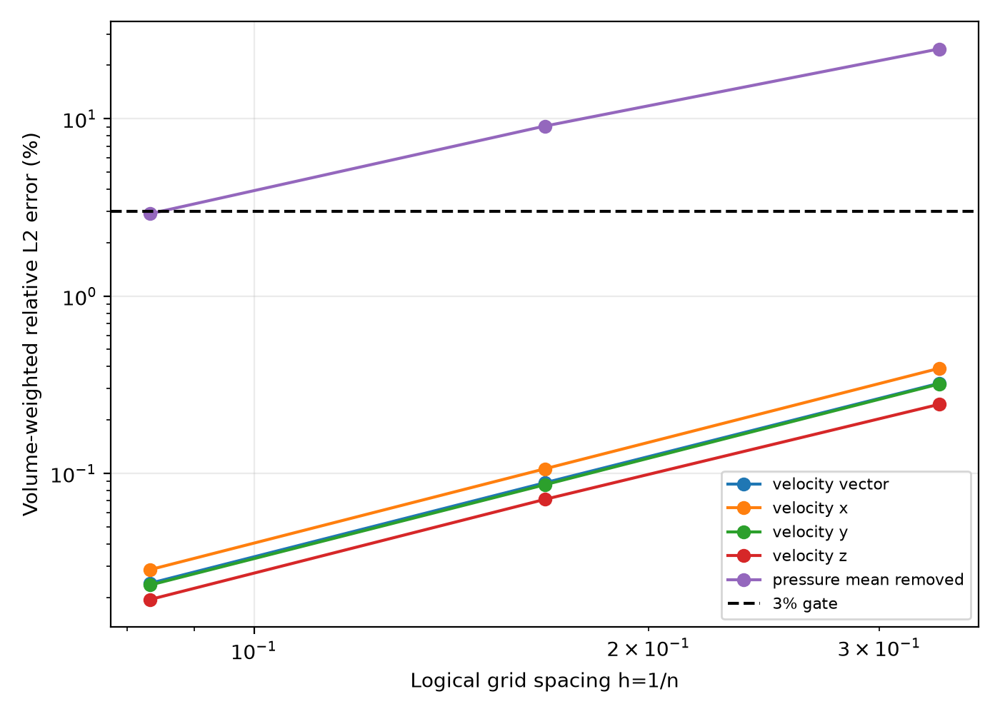
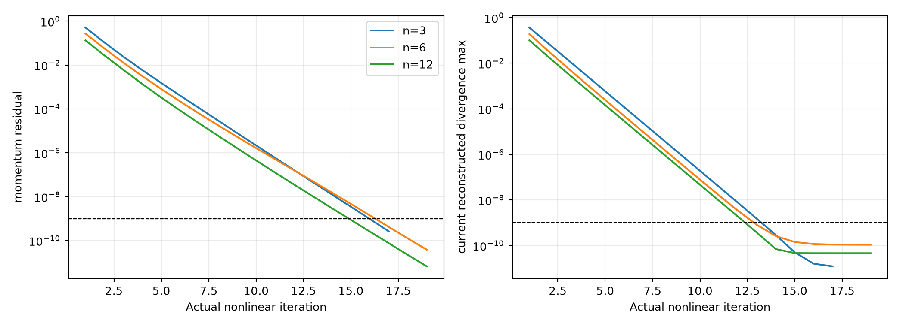
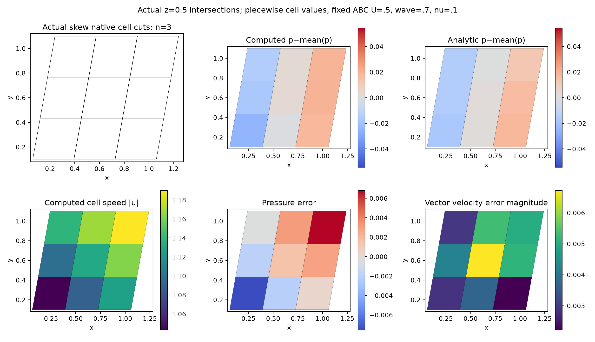
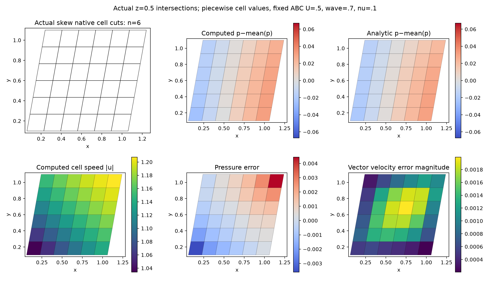
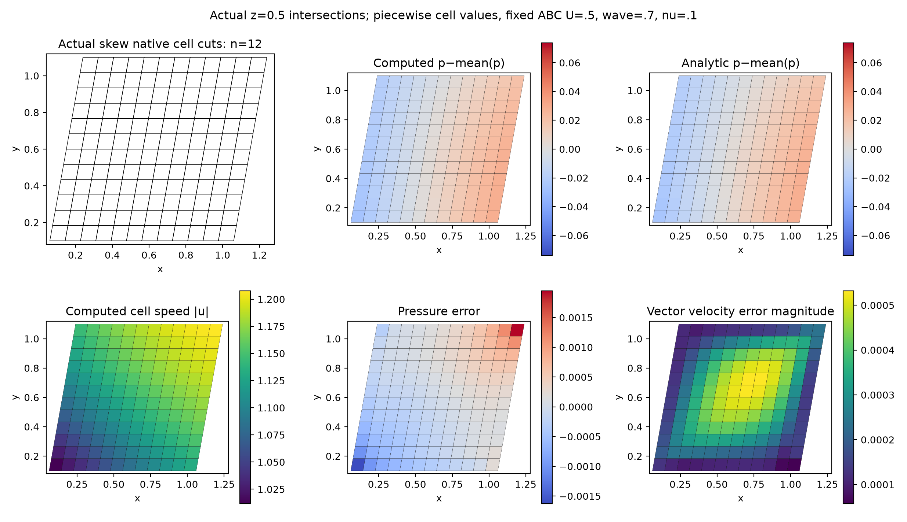

# Fixed-parameter nonlinear 3D ABC manufactured spatial verification

**Finest-grid MMS spatial verification: True. SUBOFF physical benchmark validation: False.** Coarser pressure errors remain failed evidence; the finest grid is accepted only when every required error is below 3% and every metric decreases under refinement.

## Problem and independent exact data

The logical cube [0,1]^3 is transformed by x=X+.18Y+.12Z, y=Y+.2Z, z=Z. Native hexahedra expose actual planar triangular shared facets, so no Cartesian differential stencil is substituted. Grids n=3,6,12 contain 27,216,1728 cells. The default analytic ABC parameters are fixed at amplitude U=.5, wavenumber .7, kinematic viscosity .1 and density 1 across all three runs.

u=U(sin(kz)+cos(ky), sin(kx)+cos(kz), sin(ky)+cos(kx)) and p=rho U² sin(kx)cos(ky)sin(kz). The vector field depends on all three coordinates and has all three nonzero components; each component has the explicit two-coordinate dependence shown above. The independent body acceleration is (u·grad)u+grad(p)/rho+nu k²u. It is evaluated analytically at actual cell centroids; no discrete numerical residual produces the forcing. All boundary velocities are analytic Dirichlet data, and actual triangle boundary mass flux uses order-8 Duffy quadrature. Initial cell velocity is zero; pressure uses only a constant gauge anchored to the analytic first-cell value.

This solves full nonlinear momentum and continuity with second-order reconstructed upwind convection and full symmetric viscous stress. Inner linear tolerance is 1e-11, nonlinear gates 1e-9. Nonlinear convergence checks current reconstructed continuity and face-flux consistency, as well as momentum and field changes.

## Error definition and actual results

Errors are volume-weighted relative L2 norms against the independent analytic field at **actual cell centroids**. Vector velocity and each x/y/z component are checked separately. Pressure has its volume-weighted mean removed independently from computed and analytic fields, removing only the arbitrary gauge. Its denominator remains the analytic mean-removed pressure norm. No amplitude, wavenumber, pressure normalization or reference source is tuned to meet the 3% gate.

| n | Cells | Vector velocity % | ux % | uy % | uz % | Pressure % | Nonlinear converged | Per-grid 3% passed |
| ---: | ---: | ---: | ---: | ---: | ---: | ---: | --- | --- |
| 3 | 27 | 0.321812 | 0.390895 | 0.318935 | 0.244917 | 24.723 | True | False |
| 6 | 216 | 0.088427 | 0.106013 | 0.0862008 | 0.0712905 | 9.07977 | True | False |
| 12 | 1728 | 0.0240107 | 0.0286566 | 0.0234688 | 0.0194505 | 2.91241 | True | True |

The n=3 and n=6 pressure results fail the 3% criterion and are retained. At n=12, every requested metric passes; this is an MMS spatial result, not a claim that the coarser grids pass.



| Refinement | Vector order | ux order | uy order | uz order | Pressure order |
| --- | ---: | ---: | ---: | ---: | ---: |
| 3→6 | 1.8637 | 1.8825 | 1.8875 | 1.7805 | 1.4451 |
| 6→12 | 1.8808 | 1.8873 | 1.8770 | 1.8739 | 1.6404 |

All required errors strictly decrease: **True**. Observed pressure convergence is slower than second order on these grids; the report does not claim asymptotic second-order pressure convergence.



## Actual native mesh and fields

Figures use true z=.5 intersections of the transformed hexahedra. Displayed fields are native piecewise cell values; analytic plots use corresponding actual cell centroids. Computed and analytic pressure within each figure share a color scale. No smoothing, geometry substitution or fabricated reference curves are applied. Plots use the same nondimensional field units as the analytic functions; the prescribed amplitude remains .5.

### n=3: 27 cells



[Raw fields](n-3/fields.npz), [full result](n-3/result.json).

### n=6: 216 cells



[Raw fields](n-6/fields.npz), [full result](n-6/result.json).

### n=12: 1728 cells



[Raw fields](n-12/fields.npz), [full result](n-12/result.json).

## Reproduction and qualification scope

```bash
OMP_NUM_THREADS=1 OPENBLAS_NUM_THREADS=1 MKL_NUM_THREADS=1 PYTHONPATH=src python scripts/verify_native_abc_convergence3d.py --grids 3 6 12 --output NEW_EMPTY_DIRECTORY
PYTHONPATH=src python scripts/report_native_abc_convergence3d.py
```

The producer preserves each failed per-grid gate. Its return code reports whether all individual grids meet 3%, so it returns failure when coarse pressure fails; [acceptance.json](acceptance.json) separately evaluates finest-grid accuracy plus monotonic refinement. Raw fields, forcing, exact boundary flux, true geometry and complete histories are archived. Imported producer sources were snapshotted at launch. Report source/input/artifact hashes are in report-manifest.json.

This auxiliary manufactured benchmark verifies spatial response on a skew 3D grid. It does not establish SUBOFF experimental drag/Cp agreement, turbulence accuracy, body boundary-layer resolution, high-Re wall y+, force accuracy or GPU performance. All SUBOFF physical flags remain false.
