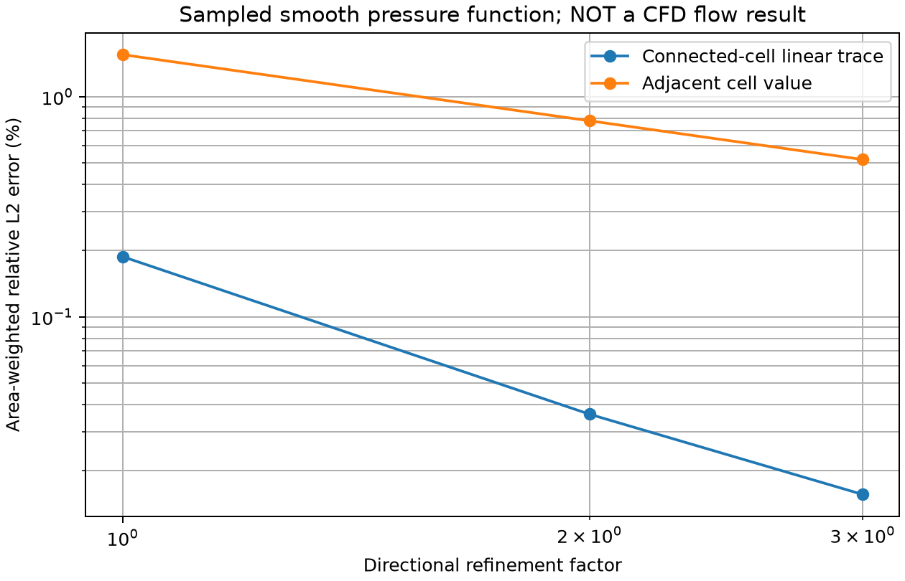

# 不依赖壁面已知压力的单元压力重构

## 目的与范围

原生 SUBOFF 启动计算的“壁邻单元压力”不是壁面压力值，直接使用它会引入法向和切向位置偏差。
新增 `NativeBoundaryPressureTrace3D`，只用通过流体内部面连通的单元压力作距离加权线性最小二乘。
它不需要未知的壁面压力作为输入，不跨过实体选取最近邻，也不改变原动量方程或数值牵引。

每个壁邻单元由一圈内部邻居开始，去除重复邻居；若坐标方向秩不足则扩展，最多三圈。
用 SVD 判断三维方向可解性，最小/最大奇异值比必须 >1e-10；无法确定三维梯度则明确拒绝，不能默认为壁面零压力梯度。
计算 `p_f=p_owner+grad(p)·(x_f−x_owner)`，保留原单元值和法向总牵引代理量，不选择更接近参考数据的曲线。

**本报告是后处理算子核查，不是流动解，更不是 SUBOFF Cp 物理精度通过。**
实际 CFD 压力本身的离散误差、曲面几何误差、壁面模型和实验对照仍须另行验证。

## 独立核查

1. 真实 SUBOFF 薄层上，独立给定仿射压力 `p=.23+.7x−1.3y+2.1z` 的单元中心样本。
   全部壁面压力和梯度应按几何位置恢复，未提供壁面输入值。
2. 固定薄层总厚度 0.0044L，在轴向、周向、层数同时加密，对独立平滑函数
   `p=1+.2 sin(2πx)+.3y²−.1z` 的单元中心样本重构壁面面中心值。
   这里明确使用采样值，不将它们冒充由 NS 求解得到的单元压力。
3. 正交通道网格上的二次函数核查接近二阶下降，压力常量平移被严格保留；不可解的一维内部邻居被拒绝。

| 单元数 | 壁面三角面数 | 仿射最大误差 | 重构面积加权相对 L2 | 直接壁邻值相对 L2 |
|---:|---:|---:|---:|---:|
| 192 | 176 | 2.22e-16 | 0.187935% | 1.553218% |
| 1536 | 736 | 3.33e-16 | 0.036171% | 0.777659% |
| 5184 | 1680 | 2.22e-16 | 0.015628% | 0.518593% |

三档均只需一圈，最小奇异值比为 0.7048、0.5449、0.5799。
同时保存压力数据噪声的最大范数放大界：每个面重构线性权重绝对值之和。
它通过逐单元单位扰动独立验证；三档最大值约 2.54、2.69、2.71，不能仅凭方向条件数宣称实际压力无误差放大。
[4 项测试](tests.txt)通过；[原场独立审计](artifact-audit.json)复算输入函数、参考值、保存梯度的面重构和误差，并校验源码/原场哈希。



## 在实际 CFD 上的用途

[实际 SUBOFF 启动报告](../verification-native-hybrid-suboff-startup/README.md)增加第三条压力重构曲线，
与原壁邻压力和负法向总牵引一起展示；原力积分仍使用求解器数值牵引。
1,331 单元 Re=10 原场中，重构值与壁邻值的 Cp 面积加权绝对 RMS 差约 0.09917，
这只量化后处理影响，不能据此断言哪条实际压力曲线已达到实验精度。

SST 物理压力与修正压力的转换、曲面真实流动的压力误差和同工况实验对照尚未由本算子测试证明。

## 复现

```bash
export OMP_NUM_THREADS=1 OPENBLAS_NUM_THREADS=1 PYTHONPATH=src
python -m pytest -q tests/test_native_boundary_pressure3d.py
python scripts/verify_native_boundary_pressure.py --output results/pressure-trace-new
python scripts/report_native_boundary_pressure.py results/pressure-trace-new
python scripts/report_native_hybrid_suboff.py EXISTING_COMPLETED_SUBOFF_RUN
```

原始几何、单元采样值、面参考值、重构值/梯度、条件数诊断、配置及源码快照均随报告保存。
实际流场报告额外保存后处理源码快照、输入原场绑定及 `wall-pressure-traces.npz`，不覆写原 CFD 场。
