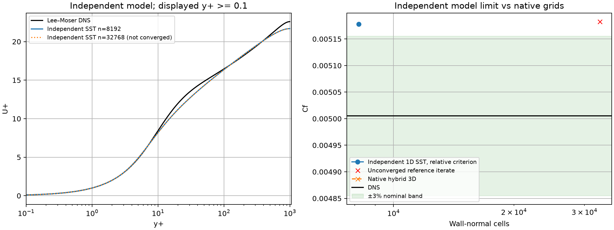

# 原生 SST 通道 Reτ=1000.512 验证

## 当前状态

已取得并核对原作者均值及统计标准差数据；原生计算尚未完成，不宣称精度或网格收敛通过。
此项用于检查 SST 在更高 Re 壁面湍流中的表现，保留 [Reτ=182.088 的精度失败](../verification-native-channel-sst/README.md)。
通道验证不能代替 SUBOFF 的曲面压力和总阻力验收。

## 独立参考与固定验收标准

Lee & Moser (2015), *Direct numerical simulation of turbulent channel flow up to Reτ=5200*,
[JFM 原始论文](https://doi.org/10.1017/jfm.2015.268)。
采用作者发布的 [Reτ≈1000 均值](https://turbulence.oden.utexas.edu/channel2015/data/LM_Channel_1000_mean_prof.dat)
及 [采样标准差](https://turbulence.oden.utexas.edu/channel2015/data/LM_Channel_1000_mean_stdev.dat)。
原始文件头给出 Reτ=1000.512、ν=5e-5、h=1、Ub=1、uτ=0.0500256；
由此 Cf=2(uτ/Ub)²=0.00500512131072。
[参考记录](reference/provenance.json)绑定原文件及转录 CSV 的 SHA256、256 个测点、归一化和来源。
均值及标准差网格、参数、y+ 关系已核对；[导入器 5 项测试](reference-import-tests.txt)覆盖错配拒绝和数值保真。
没有凭空给出 Cf 或总体 DNS 不确定度；独立采样标准差只属于已有剖面统计。

计算仍为半通道 h=ρ=uτ=1，无体力、压降驱动、低 Re 壁面条件，不使用壁面函数，不以 DNS 初始化。
生产模块与此前通道相同，先检查 n=64/128，并根据实际加密变化补充下一档。
事先固定沿用原门槛：完整当前 RANS 方程、状态/流入变化 <1e-8，标量绝对收支 <1e-8；
速度体积加权相对 L2 和由出口通量计算的 Cf 对独立 DNS 均 <3%。
每档单独报告数值与精度，不以单档偶然接近 DNS 作为网格认证。

## 复现

```bash
export OMP_NUM_THREADS=1 OPENBLAS_NUM_THREADS=1 PYTHONPATH=src
python scripts/verify_native_developed_channel.py --levels 64 128 --reference docs/verification-native-channel-sst-re1000/reference --output results/channel-re1000-new
python scripts/report_native_developed_channel.py results/channel-re1000-new
```

运行器复制参考文件到各次运行目录；后处理优先使用该冻结副本，并核对哈希。
旧归档保留原参考位置的兼容读取。网格、速度、两种压力、原场与收敛曲线沿用共性报告模块。


## 独立模型参考的实际结果

采用[已独立实现并验证的同条件一维 SST 方程](../verification-native-sst-model-limit/README.md)，
更换为本 DNS 的 Reτ，不修改模型常数或壁面公式。四档初查后继续检查两档更细网格。

| 法向单元 | Cf | 对 DNS 的名义偏差 | 一维相对方程与两次完整更新门槛 | 原始最大绝对 ω 行缺陷 |
|---:|---:|---:|---|---:|
| 64 | 0.0046300306 | 7.4941% | 通过 | 5.821e-11 |
| 128 | 0.0048461096 | 3.1770% | 通过 | 4.657e-10 |
| 512 | 0.0050869864 | 1.6356% | 通过 | 2.98e-08 |
| 2048 | 0.0051592289 | 3.0790% | 通过 | 2.98e-07 |
| 8192 | 0.0051779407 | 3.4529% | 通过 | 0.0002441 |
| 32768 | 0.0051826466 | 3.5469% | **失败** | 0.01562 |

n=512 的小于 3% 不能单独作为达标结论。n=2048→8192 的 Cf 继续增加约 0.3614%，
n=8192 的名义偏差为 3.4529%，模型/壁面组合尚未证明满足此通道的 3% 目标。
n=32768 在 8000 次迭代后局部相对缺陷 2.176e-9，超过预设 1e-10；虽然其 Cf 再变化约 0.0908%，
**该档未收敛，不将其用作认证模型极限或网格通过证据**。

这些一维结果只按所声明的相对方程与连续两次未松弛更新门槛评价，
其极细网格绝对 ω 缺陷显著大于原生三维的 1e-8 门槛，未放宽或替代三维验收。
独立交叉重算存在巨大项相消导致的绝对舍入差异；逐单元归一化重算差异处于浮点量级，原始绝对值也全部保留。
[四档完整证据](independent-reference/summary.json)、[更细诊断含失败状态](independent-fine-diagnostic/summary.json)
及各目录下 `artifact-audit.json`、原场、历史和冻结源码可复查。



```bash
python scripts/verify_sst_channel_reference.py --reference docs/verification-native-channel-sst-re1000/reference --native-runs --levels 64 128 512 2048 --model-source docs/verification-native-sst-model-limit/run/model-source.html --output results/sst-reference-re1000-new
python scripts/verify_sst_channel_reference.py --reference docs/verification-native-channel-sst-re1000/reference --native-runs --levels 8192 32768 --model-source docs/verification-native-sst-model-limit/run/model-source.html --output results/sst-reference-re1000-fine-new
```

第二条预期返回未通过状态；每组可用 `audit_sst_channel_reference.py` 重算，
`plot_sst_channel_reference.py` 对未收敛点单独标记。
