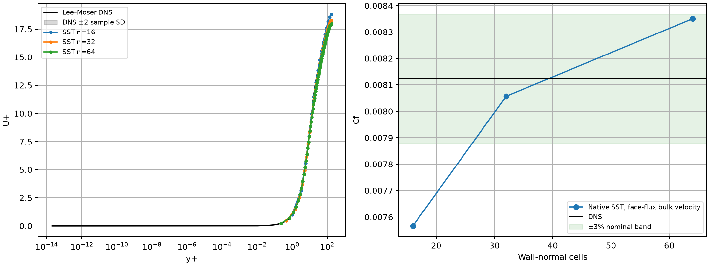
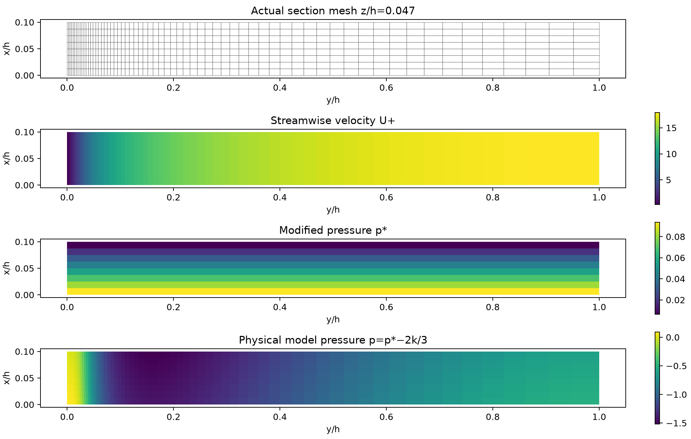
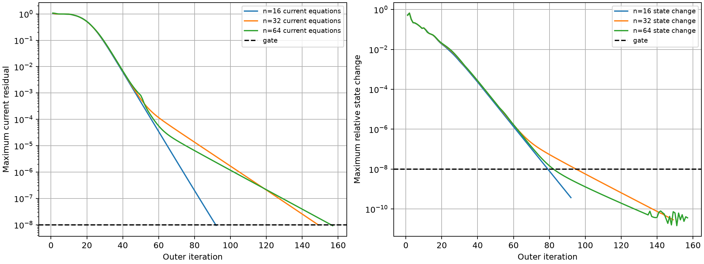

# 原生压力驱动通道：SST 物理对照与 SIMPLEC 验证

## 当前结论

原生 TensorFVM 的无体力充分发展通道已得到数值收敛解，并与 Lee–Moser 原始 DNS 比较。
三档初步网格中，最细档速度剖面误差 1.890%、摩阻误差 2.793%，但中细网格摩阻变化仍约 3.6%。
**尚未认证网格收敛；不能选择误差最小的一档宣称完成验证。SUBOFF 的 Cp/Cd 验收仍未完成。**

SIMPLEC 从零压力初值出发的完整 SST 对照，与联立黏性预测的摩阻相对差为 1.016e-12；
这验证本通道算法的一致性，粗网格物理误差仍为 6.852%。
当前采用解析到壁面的 SST，无壁面函数；CPU 计算，GPU 未验证。

## 1. 物理问题与参考数据

半通道高 h=1、密度 1、压力梯度 −1、运动黏度 ν=1/182.088。
壁面无滑移，中心面法向速度为零、切向应力为零；两个展向边界为对称边界。
入口/出口给总牵引，对应 p*=0.1−x、τxy=1−y；体力严格为零。
均匀充分发展问题中，连续壁面剪切为 1，摩擦速度 uτ=1。
本模型是三维离散网格承载的一维充分发展平均流，未解析三维湍流脉动。

SST 采用 NASA TMR SST-2003 精确生产项版本；各向同性湍流应力吸收入 p*=p+2k/3。
壁面 k=0，ω=60ν/(β1 d1²)，其余边界标量扩散为零法向通量。
入口速度、k、ω从当前相邻单元外推，每轮更新并独立检查边界变化。
没有导入 DNS 内部场或速度入口剖面；初始速度来自原生 Stokes 解，初始 ω 来自正的反应扩散解。

参考为作者原站的 [Lee–Moser 平均剖面](https://turbulence.oden.utexas.edu/channel2015/data/LM_Channel_0180_mean_prof.dat)
与[统计标准差](https://turbulence.oden.utexas.edu/channel2015/data/LM_Channel_0180_mean_stdev.dat)。
出处：Lee & Moser (2015), *JFM* 774, 395–415，[DOI](https://doi.org/10.1017/jfm.2015.268)。
它是 DNS 数据，不是实验数据。原数据 Reτ=182.088，Ubulk=1，uτ=0.0637309，故 Cf,ref=0.00812325522962。
[来源、参数与哈希](reference/provenance.json)、[数值 CSV](reference/mean.csv)随报告保存；不对参考值作拟合。
图中带状区域为 ±2 个作者提供的有限采样标准差，没有将其宣称为 95% 置信区间。
原表未给总摩阻的不确定度，摩阻误差按名义值计算。

## 2. 网格与离散方法

固定区域 0≤x≤0.1、0≤y≤1、0≤z≤0.1。
壁法向节点为 y(t)=(exp(3t)−1)/(exp(3)−1)，n=16/32/64；轴向 n/8，展向 2。
使用四边形共享面、六面体单元，既加密法向也加密轴向。n=128（4096 单元）在动量预测步遇到初始化容差问题，修正后的独立重算正在进行。
充分发展平均流对轴向/展向长度不敏感，但离散面通量对轴向分辨率敏感，因此必须保持明确的固定几何与加密规则。

动量/连续性由原生单元与共享面速度后端求解，湍流输运使用原生混合标量算子；未调用 OpenFOAM。
本控制的预测步利用充分发展条件省去解析上为零的对流，先解当前黏度下的 Stokes，再解 k/ω。
**最终验收重新用实际非零面通量、当前黏度、当前 SST 系数及完整原生 RANS 方程计算残差。**
这不是通用绕流的非线性求解器，不能直接把该降维预测策略推广至 SUBOFF。

验收门槛：当前动量、连续性、压力约束、k/ω 与边界残差均 <1e-8；
全部单元/面状态的相对更新与外推入口更新均 <1e-8；
标量单元、自由面、界面与全局积分收支缺陷均 <1e-8。不裁剪负 k 或非正 ω。

## 3. 误差定义与结果

速度误差为单元体积加权相对 L2：`sqrt(sum(V*(U−U_DNS)^2)/sum(V*U_DNS^2))`。
DNS 用保形 PCHIP 插值至实际单元中心，禁止超出参考表范围外推。
摩阻 `Cf=2*tau_wall/Ubulk²`，壁面剪切从数值总牵引积分取得，
`Ubulk=sum(outlet_face_flux)/sum(outlet_area)`。单元速度体积均值另行保存，不代替实际输送流量。

| 法向 n | 总单元 | 首层 y+ | U 剖面误差 | Cf | Cf 误差 |
|---:|---:|---:|---:|---:|---:|
| 16 | 64 | 0.9838 | 3.8468% | 0.00756665 | 6.8521% |
| 32 | 256 | 0.4689 | 1.4501% | 0.00805684 | 0.8176% |
| 64 | 1024 | 0.2289 | 1.8899% | 0.00835014 | 2.7930% |

误差随加密并不单调；还需区分空间离散与 SST 模型偏差，不能靠选择网格抵消两者。
同样网格上的无体力层流 Poiseuille 校验，速度误差为 0.6019%、0.1523%、0.03818%，呈接近二阶下降；
摩阻误差分别为 1.7067%、0.4330%、0.1087%。

上述三档来自 [初步加密数据](pilot-refinement/cases.json)。该批保存了源文件快照，但当时运行器延迟导入的 SST/边界模块未全部纳入初始快照。
[审计](pilot-refinement/artifact-audit.json)明确列出缺失模块，`source_snapshot_complete=false`；因此这些数值属于初步结果。
运行器已将数值依赖提前导入。[完整快照重跑](refinement-v2-interrupted/cases.json)已再次完成 n=16/32/64，数值与初步结果一致，但在 n=128 的 SST 动量预测步因 Stokes 初始化检查抛出异常。
该次没有保存失败 n=128 的候选场，不能补造其收敛结果；[原异常日志](refinement-v2-interrupted/run.log)保留。
结束后、改源码前，逐个比对当前源文件与原始快照 SHA，均一致；[汇总](refinement-v2-interrupted/summary.json)明确标记外部事后验源与异常终止。
因此三档已完成场的源码覆盖与审计已补齐，四档整体仍失败。
后续将通道动量预测的 Stokes 门槛统一到既定外层 1e-8，并增加预测失败时的原场/当前残差归档；最终全 RANS、更新和收支门槛均未改变。
现有 [联立控制](coupled-control/summary.json)和 [SIMPLEC 控制](simplec-control/summary.json)已完整重跑、验源与原场复算。





图中横轴为壁面法向 y，纵轴为流向 x；按真实网格单元着色，未平滑成解析流场。
p* 随 x 变化；物理模型压力还包含 −2k/3，不能混淆两种变量。



## 4. SIMPLEC 修复与边界缺陷

强拉伸通道的线性黏性预测中，原默认绝对行和松弛设置 3000 次仍未收敛。
保留原默认通用 NS 设置，只对此充分发展线性预测使用对角基准、动量松弛 1、压力松弛 1。
独立冻结黏度测试从零压力开始可收敛；更严格的 1e-11 求解门槛下与独立联立场一致。
完整 SST 迭代从零压力开始在 92 次外迭代收敛，最大相对场差为 2.303e-11（修正压力）。
详见[算法比较](algorithm-comparison.json)；各次原始失败尝试保存在 [diagnostic-probes](diagnostic-probes/)，它们是探索日志，不是完整冻结运行。

另发现 1×n×1 挤出网格，只有壁面面均值约束时，仍存在两个未约束全局刚体转动。
稀疏 LU 可以返回小残差但非唯一的流场。新增六个刚体模态的边界约束秩检查，当前通道在求解前拒绝此类输入。
2×n×2 网格消除了该缺陷。此检查是唯一性必要条件，不能作为任意网格离散稳定性的充分证明。
通用 Stokes 构造器接入已在隔离分支 `ce6e298` 通过 [71 项回归](isolated-stokes-integration-tests.txt)，
待已启动的冻结源码计算结束后合入主线。通道功能原有 [5 项测试](tests.txt)已通过，增加失败归档检查后 [6 项测试](tests-v3.txt)通过。

此前仅在长通道上加密法向、保持两个轴向单元，实际面流量给出的 SST 摩阻误差约 22.1%、17.2%、14.3%。
若改用单元速度均值计算，会掩盖该误差。该失败探索日志保留，不计为当前精度通过。

## 5. 使用、证据与后续

从仓库根目录运行：

```bash
export OMP_NUM_THREADS=1 OPENBLAS_NUM_THREADS=1 PYTHONPATH=src
python scripts/verify_native_developed_channel.py --levels 16 32 64 128 --output results/channel-refinement-new
python scripts/report_native_developed_channel.py results/channel-refinement-new
python scripts/verify_native_developed_channel.py --levels 16 --momentum simplec --zero-initial-pressure --output results/channel-simplec-new
python scripts/report_native_developed_channel.py results/channel-simplec-new
python -m pytest -q tests/test_native_boundary_constraints3d.py tests/test_native_developed_channel.py
```

输出目录必须为空，防止覆盖证据。运行器退出成功仅表示数值收敛，精度通过另见 `all_accuracy_gates_passed`。
每批保存配置、依赖源码/哈希、环境、原始几何、单元与面场、总动量通量、总牵引、标量总通量/源项/自由残差及完整迭代历史。
报告器独立复算质量、积分动量收支、标量局部收支、压力变量关系、DNS 误差与实际通量摩阻。
PDF 图件也随结果保存。

下一步完成四档加密终态审计，确认 SST 模型与离散偏差，再推进曲面无体力绕流和原生 SUBOFF。
尚未通过的项目包括：曲面壁面函数、高 Re 原生 SUBOFF Cp/Cd、完整网格无关性，以及 GPU 加速。
