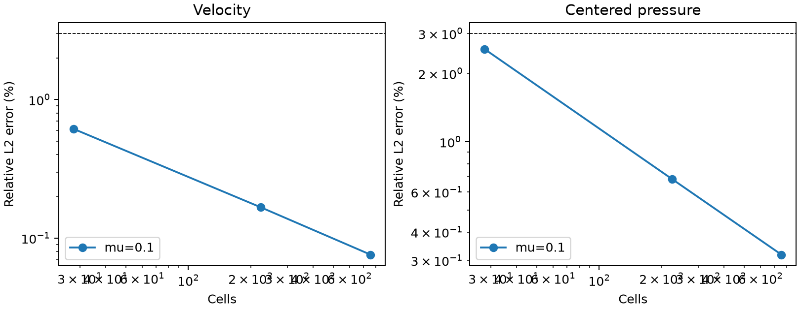
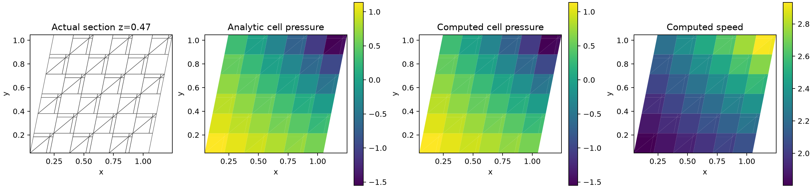
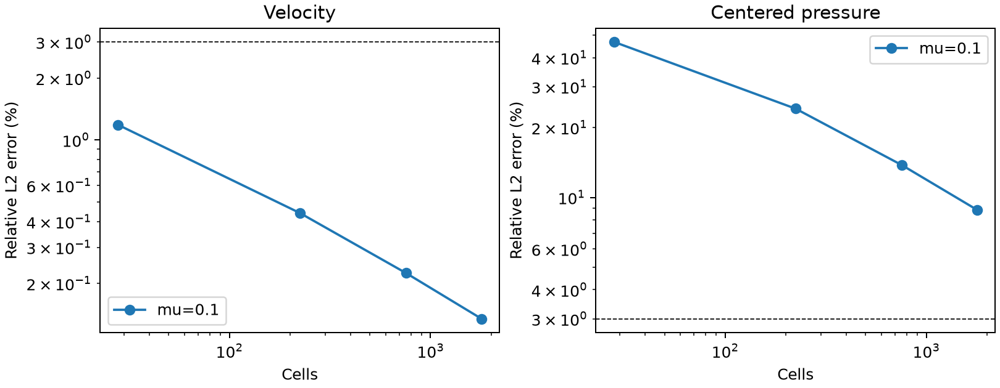
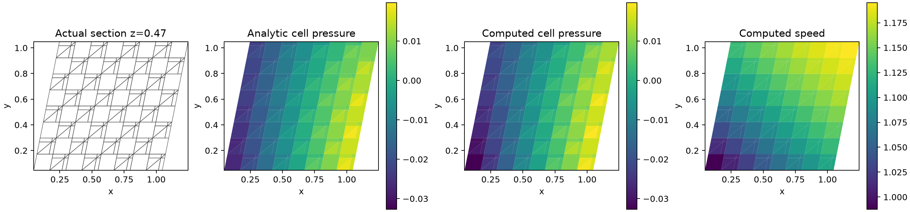
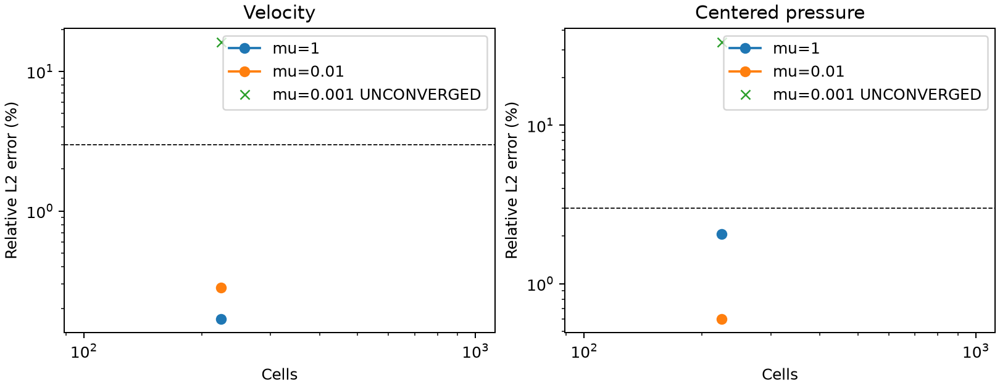

# 原生共享面惯性与压力相容性验证

## 1. 问题与修复范围

此前混合后端的压力约束、体力测试函数作用于共享面速度，对流惯性却只作用于单元速度。
[梯度跳变修正](../verification-native-gradient-jump/README.md)改善黏性应变控制后，
756 单元 ABC 的压力误差仍达 55.82%；224 单元无体力势流在黏度 0.1 时为 35.50%。
本阶段统一惯性和体力的对偶加载，并验证完整离散能量、局部/整体动量与界面牵引。
所有计算均由原生 TensorFVM 完成，CPU 双精度，尚未测试 GPU。

**本报告是算子与层流验证。SST、壁面函数、原生 SUBOFF 的 Cp/Cd 验收尚未完成。**

## 2. 离散方程与守恒

共性模块 `native_face_mean3d.py` 实现

\[
R_K U=\frac1{V_K}\sum_{f\subset\partial K}(x_f-x_K)(U_f\cdot S_{Kf}).
\]

几何矩恒等式保证常速度重构以及积分力守恒；R 在一般多面体上不是单元中心线性插值。
共享面质量流量仍由实际面速度计算。记守恒单元迎风算子为 C，入流/背流项为 b：

- 一阶：惯性 `Rᵀ C R U + Rᵀ b`，基准速度为 `U_R=R U`。
- 二阶：惯性 `Rᵀ C U_cell + Rᵀ(b + D F_gradient)`，采用隐式单元值、显式 Gauss 梯度修正。
- 二阶恢复 `U_K+G_K(x_f−x_K)` 的线性面重构。其相对一阶的投影修正及梯度修正具有有符号功，不能宣称无条件耗散或有界。
- 压力约束和粘性应力保持原定义；没有拟合参考数据、裁剪解或修改体力。

能量账本使用 `U_R` 测试惯性，分别记录迎风耗散、边界动能流、离散散度功、
`U_R·C(U_cell−U_R)` 与梯度修正功。随机非零散度通量也检查完整恒等式。

惯性双重加载还会改变数值牵引。每个单元的积分对流动量为 `C_K`，增加

\[
L^C_{Kf}=((C_K/V_K)\cdot(x_f-x_K)) S_{Kf},\qquad
 t_{Kf}=t^{visc}_{Kf}-p_K S_{Kf}-L^f_{Kf}+L^C_{Kf}.
\]

体力矩已有负号，惯性矩为正号。相邻两侧牵引分别计算，再核查其和；
共享面动量通量为 `advective_flux − t_owner`，局部和整体通量分别对积分体力闭合。
不能沿用未加惯性矩的旧 Stokes 牵引账本。

## 3. 独立连续解、网格和误差

### 无体力三维势流

\[
U=(1+yz,1+xz,1+xy),\quad p=-\tfrac12 |U|^2,\quad f=0.
\]

该解为 `grad(x+y+z+xyz)`；散度、旋度、速度 Laplacian 都为零，
所以任意常黏度下连续 NS 方程严格成立。三个速度分量和三个坐标均参与计算。
有限差分独立检查了对流与压力梯度抵消，源项恒为零。

### ABC 三维控制

沿用既有 `abc_fields` 连续解、黏度 0.1 和独立解析体力，与前一阶段逐项比较。
该解包含非零黏性/体力平衡，防止仅凭势流的特殊平衡判定一般压力误差已修复。

两者均使用同一共性网格生成器：单位立方体交错六面体/六四面体分块，三角面，
再作 `(x,y,z)→(x+0.2y+0.1z,y+0.1z,z)` 偏斜变换。
边界采用真实面面积平均速度，保证总边界通量平衡；内部初值为零。
速度误差为体积加权相对 L2；压力先分别去除体积加权均值再计算同一指标。
压力参考不参与速度或压力修正。解析精度门槛为 3%，当前非线性残差、散度和
速度/压力变化门槛为 `1e-8`，物理守恒账本另外要求小于 `1e-7`。

## 4. 结果与图

### 三档网格无体力势流，黏度 0.1

| 单元数 | 黏度 | 速度误差 | 压力误差 | 当前方程收敛 |
|---:|---:|---:|---:|:---:|
| 28 | 0.1 | 0.6140% | 2.5604% | 是 |
| 224 | 0.1 | 0.1666% | 0.6855% | 是 |
| 756 | 0.1 | 0.0759% | 0.3179% | 是 |

[全部指标和残差](potential/cases.json) · [冻结设置](potential/settings.json)

### ABC 三维控制，黏度 0.1

| 单元数 | 黏度 | 速度误差 | 压力误差 | 当前方程收敛 |
|---:|---:|---:|---:|:---:|
| 28 | 0.1 | 1.1829% | 46.7965% | 是 |
| 224 | 0.1 | 0.4407% | 24.1230% | 是 |
| 756 | 0.1 | 0.2246% | 13.7806% | 是 |
| 1792 | 0.1 | 0.1347% | 8.8300% | 是 |

[全部指标和残差](abc/cases.json) · [冻结设置](abc/settings.json)

### 224 单元黏度扫描

| 单元数 | 黏度 | 速度误差 | 压力误差 | 当前方程收敛 |
|---:|---:|---:|---:|:---:|
| 224 | 1 | 0.1690% | 2.0650% | 是 |
| 224 | 0.01 | 0.2811% | 0.6012% | 是 |
| 224 | 0.001 | 16.3249% | 33.6203% | **否；仅为迭代末态** |

[全部指标和残差](viscosity/cases.json) · [冻结设置](viscosity/settings.json)

势流三档网格均通过预定解析精度与守恒门槛；224→756 单元观察阶为速度 1.94、压力 1.89。
756 单元的动量、界面受力、能量闭合均小于 `1e-8`。这证明该无体力三维解的网格收敛，
不替代有黏性作用的 ABC 控制或物理外流。




相同 756 单元 ABC，压力从上一阶段 55.82% 降至 13.78%；继续加密到 1,792 单元为 8.83%，
仍未达标。没有用势流通过结果掩盖该失败，也没有修改 3% 口径。




黏度 0.01 的势流需 174 次外层迭代；黏度 0.001 的 200 次迭代没有收敛，动量残差约 0.200，
整体动量/能量闭合也失败。其误差为未收敛末态误差，不能评价最终离散精度。



### 迭代稳定性与未采用的方案

曾试验全隐式梯度；黏度 0.1 可减少迭代，但黏度 0.01 在 200 次迭代后不收敛，未采用。
[探针源码和输出](probes/gradient_implicit.txt)保留该反例；其黏度 0.001 试算中止，没有最终结果。
另保留[单元隐式、梯度显式探针](probes/cell_implicit.txt)，其方程已由正式场数据运行重新验证。
探针不具备完整场快照，正式结论使用上述 `abc/`、`potential/`、`viscosity/` 目录。

普通对角松弛在粗网格 Kovasznay 的 SIMPLEC 中发散。对投影惯性采用矩阵绝对行和作为
松弛基准 `d_relaxed = sum_j |A_ij| / alpha`，动量两侧同加 `(d_relaxed−diag(A)) U`。
这只改变迭代过程，固定点仍是原方程；保留真实线性及非线性残差门槛。
Stokes 默认对角松弛不变，NS 默认使用绝对行和。代价是部分工况内迭代数显著增加，
尚不具备工业规模求解效率。

前三组联合求解运行的源码在该松弛修复前冻结；联合分支不使用松弛对角。
后续 SIMPLEC 运行和回归测试采用修复后源码，分别保留版本，不混称同一次计算。


### SIMPLEC 独立对照

采用修复后的绝对行和松弛，28、224 单元均收敛并通过解析精度和守恒门槛。
224 单元速度误差 0.166608%、压力误差 0.685527%，与联合求解一致。
27 次外迭代、20,065 次累计内迭代，最大真实线性残差 `4.08e-15`；
耗时约 60 秒，而联合求解约 4.2 秒。这说明当前实现的算法一致性已验证，效率仍需改进。
[完整 SIMPLEC 指标](simplec/cases.json)、[与联合原场对照](algorithm-comparison.json)、
[完整内迭代记录](simplec/potential-n4-mu0.1-inner-history.json.gz)均保留。

## 5. 复现

在项目根目录使用项目 Python 环境：

```bash
export OMP_NUM_THREADS=1 OPENBLAS_NUM_THREADS=1 PYTHONPATH=src
python scripts/verify_native_compatible_inertia.py --case potential --levels 2 4 6 --output results/reproduce-potential
python scripts/verify_native_compatible_inertia.py --case abc --levels 2 4 6 8 --output results/reproduce-abc
python scripts/verify_native_compatible_inertia.py --case potential --levels 4 --viscosities 1 .01 .001 --max-outer 200 --output results/reproduce-viscosity
python scripts/verify_native_compatible_inertia.py --case potential --levels 2 4 --algorithm simplec --max-outer 80 --output results/reproduce-simplec
python scripts/plot_native_pressure_diagnostic.py --fields results/reproduce-potential/potential-n6-mu0.1-fields.npz --output results/reproduce-potential/section
```

输出目录必须为空。脚本退出码表示数值收敛状况，解析精度单独检查 `summary.json` 和 `cases.json` 的通过字段。每个运行保存所有原网格、速度/压力、实际面流量、两侧牵引、
动量通量、外层迭代历史、联合线性求解记录、环境、生产时源码快照和 SHA256。运行结束核对源码未变化。
SIMPLEC 最终运行还保存 gzip 压缩的完整内迭代记录，摘要给出最大真实线性残差。
切面图使用实际单元面交线，不进行单元中心插值；压力图共用色标。

## 6. 回归检查

[测试日志](tests.txt)：61 项通过，覆盖随机非守恒通量的完整能量恒等式、
共享面力矩守恒、偏斜混合单元线性面重构、局部和全局动量、两侧独立牵引、
真实背流、SIMPLE/SIMPLEC 与联合解对照、Kovasznay、变黏度剪切和梯度跳变。
没有降低原测试的误差或残差门槛。测试源码哈希见 [test-sources.json](test-sources.json)。
旧配点黏性增能反例仍未修复，本次未重复其完整历史测试集。

```bash
python -m pytest tests/test_native_compatible_inertia3d.py tests/test_native_hybrid_ns3d.py tests/test_native_hybrid_stokes3d.py tests/test_native_kovasznay.py tests/test_native_hybrid_shear.py tests/test_native_gradient_jump3d.py -q
```

原场独立复核：`python scripts/audit_native_inertia_evidence.py docs/verification-native-compatible-inertia`。
[审计结果](artifact-audit.json)重新从保存场计算速度/压力误差和整体动量，同时核对源码快照哈希。
该审计确认报告一致性，保留不通过标记，不把原场一致等同物理达标。

## 7. 保留的限制与下一步

本次改进不证明一般网格上的稳定性定理，也不证明高 Re 外流可用。
ABC 压力精度与低黏度非线性收敛仍须分别攻关，然后才能推进新后端 SST、壁面律和 SUBOFF。
历史 Kovasznay 96×96×1 的通过数据属于旧冻结源码，不自动视为当前算法已通过同一细网格。
原生 SUBOFF 物理精度和参考资格仍按[原验收计划](../native-suboff-development-plan.md)执行。
